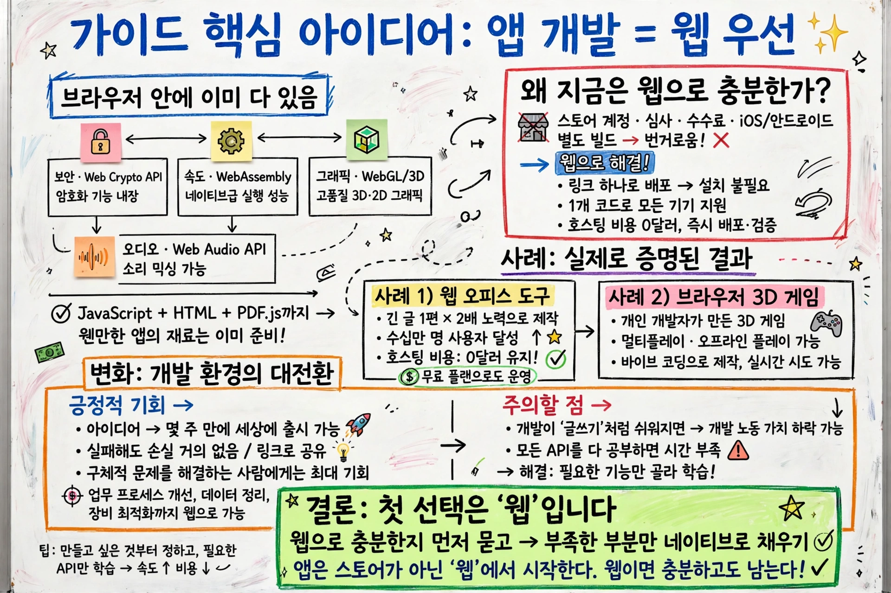
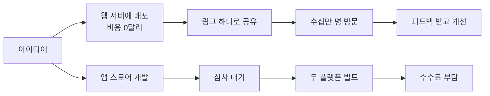
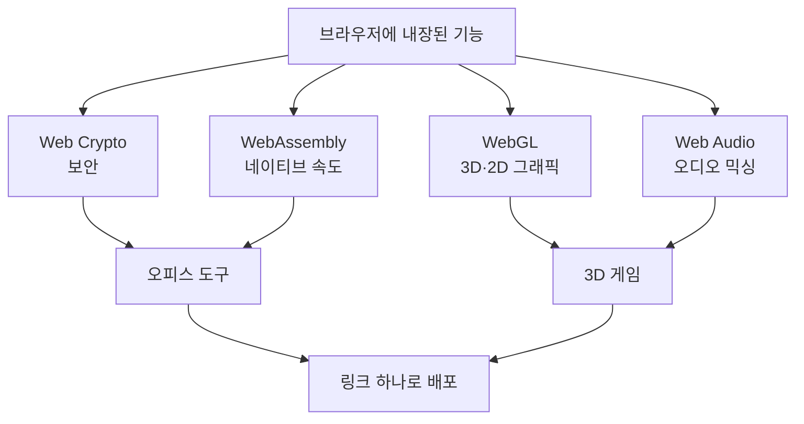

# 앱을 꼭 스토어에 올려야 할까요? 웹이면 충분하고도 남습니다

> **Summary**
> 브라우저 안에 암호화·3D 그래픽·오디오까지 이미 들어 있습니다. 앱 스토어 문턱을 넘지 않고도 웬만한 앱은 웹으로 충분합니다. 긴 글 한 편 쓰는 노력의 두 배로 만든 웹 오피스 도구가 수십만 명을 맞았고, 호스팅 비용은 0달러였습니다. 개발이 글쓰기처럼 쉬워지면 개발 노동의 가치는 떨어질 수 있지만, 구체적인 문제를 풀려는 사람에게는 지금이 가장 큰 기회입니다.

---

- 브라우저 안에 암호화·3D 그래픽·오디오까지 이미 들어 있습니다. 앱 스토어 문턱을 넘지 않고도 웬만한 앱은 웹으로 충분합니다.
- 긴 글 한 편 쓰는 노력의 두 배로 만든 웹 오피스 도구가 수십만 명을 맞았고, 호스팅 비용은 0달러였습니다.
- 개발이 글쓰기처럼 쉬워지면 개발 노동의 가치는 떨어질 수 있지만, 구체적인 문제를 풀려는 사람에게는 지금이 가장 큰 기회입니다.

앱 하나 만들려면 어디부터 시작해야 할까요? 스토어 계정 만들고, 심사 기다리고, 아이폰용·안드로이드용 따로 빌드하고, 수수료까지 떼이는 풍경을 먼저 떠올리셨다면, 이 글은 그 풍경을 뒤집어 봅니다. 브라우저만으로 충분하다는 이야기입니다.

🎥 [동영상 보기](https://www.youtube.com/watch?v=FF3X3b5cclM)

## 브라우저 안에 이미 다 들어 있지 않나요?

브라우저를 문서 보는 도구로만 생각하면, 이미 지나간 이야기입니다. 지금 브라우저 안에는 본격적인 보안 플랫폼인 `Web Crypto API`가 들어 있고, 네이티브에 가까운 속도로 코드를 돌리는 `WebAssembly`가 있습니다. 고품질 3D·2D 그래픽을 그리는 `WebGL`, 브라우저 안에서 소리를 섞는 `Web Audio API`까지 갖췄습니다. 거기에 `JavaScript`는 완전한 프로그래밍 언어이고, `HTML`은 문서에 필요한 표현 대부분을 담습니다. 브라우저에서 PDF를 다루는 `PDF.js`까지 있으니, 웬만한 앱의 재료는 이미 손안에 있는 셈입니다.

그런데 왜 이걸 다들 잘 안 쓸까요? 이유가 있습니다. 이 기술들은 오래전부터 있었지만, 각각이 너무 방대합니다. 오디오를 잘 익히면 암호화와 그래픽까지 파고들 시간이 부족해집니다. 복잡함의 뿌리도 있습니다. 지난 10여 년 동안 브라우저는 수십억 명에게 안전하게 소프트웨어를 전달해야 하는 대기업 팀 중심으로 발전했습니다. 개인은 뒷전이었습니다. 큰 팀이 큰 제품을 만들도록 설계된 기능들이 브라우저 안에 쌓인 것입니다.

## 글 한 편 쓰는 노력의 두 배로, 오피스 도구를 만들었습니다?

사례 하나를 보겠습니다. 데이터를 URL에 저장하는 오피스 도구 모음이 있습니다. 만든 사람의 말로는, 긴 뉴스레터 한 편을 쓰는 데 드는 노력의 약 두 배가 들었다고 합니다. 특별한 능력의 소유자만 가능한 일이 아니라, 배우면 누구나 만들 수 있는 작업이라는 설명도 덧붙였습니다. 그런데 결과가 어땠을까요? 수십만 명이 방문했고, 신용카드를 등록한 뒤에도 호스팅 비용은 0달러였습니다. 무료 플랜 한도에 걸려 한 번 서비스가 멈추긴 했지만, 비용은 그대로 0달러였습니다!

또 다른 사례도 있습니다. 게임 개발자가 아닌 한 개인이 만든 브라우저 3D 게임입니다. 브라우저에서 바로 실행되고, 멀티플레이에 오프라인 실행까지 됩니다. 만든 사람은 바이브 코딩으로 만든 게임도 진지하게 평가받을 수 있는 길이 보인다고 말했습니다. 재미와 완성도, 새로운 기능을 갖췄고, 오디오를 통한 멀티플레이는 실시간 전략 게임에서 처음 보는 방식이라고 합니다. 1990년대풍 작은 오피스 도구와는 또 다른 방식으로, 브라우저의 가능성을 보여주는 사례입니다.

## 앱 스토어의 높은 문턱, 굳이 넘을 필요가 있을까요?

여기서 질문이 생깁니다. 몇 주 작업한 아이디어를 웹 서버에서 0달러로 세상에 시험할 수 있다면, 앱 스토어용 개발의 높은 부담을 감수할 이유가 얼마나 남을까요? 답은 점점 줄어들고 있습니다. 이 변화는 앱 스토어 경제 자체를 흔들 수 있습니다. 예전에는 대규모 산업 과정이었던 앱 개발이, 이제는 원한다면 개인적인 작업이 될 수 있기 때문입니다.

물론 이 변화가 모두에게 좋은 소식만은 아닙니다. 개발이 글쓰기처럼 변한다는 말에는 불편한 이면이 있습니다. 사람들은 일반적으로 글에 돈을 잘 지불하지 않습니다. 글 쓰는 사람에게는 익숙한 가치 절하가, 소프트웨어 개발자에게는 비교적 새로운 경험일 수 있습니다. 개발 노동의 가치가 떨어질 수 있다는 뜻입니다. 그런데 반대쪽도 봐야 합니다. 구체적인 문제를 해결하려는 사람에게는 지금이 놀라운 시기입니다. 업무 프로세스를 고치고, 데이터베이스를 정리하고, 대형 산업 장비에서 더 많은 가치를 뽑아내는 일까지, 웬만한 일은 웹으로 할 수 있게 됐습니다!

## 그래서, 웹으로 시작하면 무엇이 달라질까요?

가장 큰 차이는 속도입니다. 아이디어를 떠올린 뒤 몇 주 만에 세상에 내놓고 반응을 볼 수 있습니다. 실패해도 잃는 게 적습니다. 스토어 심사를 기다리느라 시간을 쓰지 않고, 두 개 플랫폼을 따로 만들느라 힘을 나누지 않습니다. 대신 링크 하나로 배포하고, 21개 언어로 출시해 다국어·접근성 기반을 그대로 가져갈 수도 있습니다. 위 오피스 도구가 실제로 그렇게 출시했습니다. 뉴욕에서 흔히 쓰이는 언어를 기준으로 삼았더니, 크리올어와 이디시어까지 포함됐습니다.

여기서 한 가지는 짚고 넘어가야 합니다. 브라우저 기능이 방대하다는 약점은 여전합니다. 하나를 깊게 익히면 다른 하나를 익힐 시간이 부족합니다. 그래서 무작정 모든 API를 공부하는 건 비효율적입니다. 만들고 싶은 것부터 정하고, 필요한 기능만 골라 익히는 순서가 맞습니다. 오피스 도구라면 문서와 저장부터, 게임이라면 그래픽과 오디오부터 시작하면 됩니다!

마지막으로, 이 글의 결론을 한 줄로 정리하겠습니다. 앱을 만들 때 첫 선택지는 스토어가 아니라 웹입니다. 웹으로 충분한지 먼저 묻고, 부족한 부분만 네이티브로 채우면 됩니다. 웹이면 충분하고도 남습니다!

