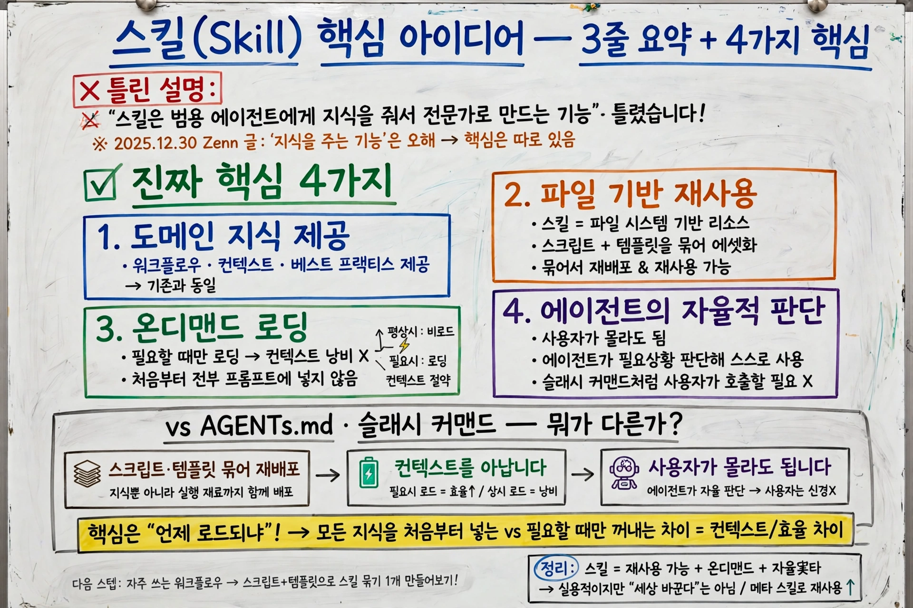
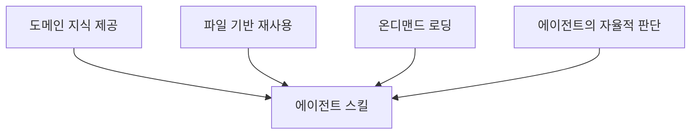

# 에이전트 스킬의 핵심은 지식이 아니라 온디맨드 로딩이다

> **Summary**
> 에이전트 스킬의 핵심은 지식 제공 자체보다 파일 기반 리소스를 필요할 때만 로드하고, 에이전트가 상황에 맞춰 자율적으로 사용하는 데 있다. 스크립트와 템플릿까지 묶어 재사용·배포할 수 있어 컨텍스트를 아끼고, 사용자가 직접 호출하지 않아도 된다.

---

**3줄 요약**

- "스킬은 범용 에이전트에게 지식을 줘서 전문가로 만드는 기능"이라는 설명은 틀렸습니다.
- 진짜 핵심은 네 가지입니다. 도메인 지식 제공, 파일 기반 재사용, 온디맨드 로딩, 에이전트의 자율적 판단.
- `AGENTS.md`나 슬래시 커맨드와 달리 스크립트·템플릿까지 묶어 재배포할 수 있고, 사용자가 몰라도 에이전트가 알아서 씁니다.

"에이전트 스킬은 범용 에이전트에게 도메인 지식을 줘서 전문가로 만드는 기능이다." 이 설명, 틀렸습니다! 2025년 12월 30일에 올라온 글이 이 오해를 정면으로 지적했습니다. 핵심은 지식을 주는 게 아니라, 필요할 때만 꺼내 쓰는 데 있었습니다.

🔗 [https://www.youtube.com/post/Ugkx7i03lglp7rCzN_HmWWE6aPYxezlfLfOe](https://www.youtube.com/post/Ugkx7i03lglp7rCzN_HmWWE6aPYxezlfLfOe)

🎥 [동영상 보기](https://www.youtube.com/watch?v=fOxC44g8vig)

## 스킬, 정말 지식을 주는 기능일까요?

흔히 보는 설명은 이렇습니다. 범용 에이전트에게 도메인 지식이나 워크플로우, 베스트 프랙티스를 주면 특정 용도에 특화된 스페셜리스트로 변한다는 것입니다. 문제는 이 설명만으로는 스킬의 본질이 안 보인다는 점입니다.

도메인 지식을 주는 일은 이미 다른 것들이 하고 있었습니다. `AGENTS.md`와 `CLAUDE.md`, `copilot-instructions.md` 같은 설정 파일, 슬래시 커맨드, 서브에이전트까지. 이것들도 에이전트에게 도메인 지식을 주고 특정 용도에 특화되게 만듭니다. 그럼 스킬은 뭐가 다른 걸까요? 스킬을 "지식을 주는 기능"으로만 설명하면, 기존 방식과 뭐가 다른지 설명이 안 됩니다.

## 진짜 핵심 4가지

Claude Code의 Agent Skills overview에서 정말 중요한 부분을 빼내면 네 가지입니다.

**도메인 지식을 제공합니다.** 워크플로우, 컨텍스트, 베스트 프랙티스 같은 도메인별 지식을 에이전트에게 줍니다. 여기까진 기존 방식과 같습니다.

**재사용 가능한 파일 시스템 기반 리소스입니다.** 스킬은 파일로 존재합니다. 스크립트 파일이나 템플릿을 묶어 하나의 에셋으로 만들고, 그걸 그대로 배포하고 재사용할 수 있습니다.

**온디맨드에 로드되며 컨텍스트를 낭비하지 않습니다.** 모든 지식을 처음부터 프롬프트에 넣지 않습니다. 필요할 때만 로드합니다. 그래서 컨텍스트 창을 낭비하지 않습니다.

**에이전트가 스스로 판단해 자립적으로 이용합니다.** 사용자가 스킬의 존재를 알 필요가 없습니다. 에이전트가 상황에 맞춰 필요한 스킬을 판단하고 씁니다. Codex CLI는 명시적으로 부를 수도 있습니다.

## `AGENTS.md`·슬래시 커맨드와 뭐가 다른가?

핵심 네 가지에서 갈리는 차이가 세 가지입니다.

**스크립트와 템플릿을 묶어 재배포할 수 있습니다.** 슬래시 커맨드와 달리, 프롬프트에 필요한 스크립트 파일이나 템플릿을 에셋으로 묶어 하나의 리소스로 배포할 수 있습니다. 지식뿐 아니라 실행에 필요한 재료까지 함께 다닙니다.

**컨텍스트를 아낍니다.** 스킬과 동등한 내용을 `AGENTS.md`에 다 때려넣는 것보다, 필요할 때만 로드하는 쪽이 문맥을 덜 낭비합니다. 모든 걸 상시로 들고 다니는 것과, 필요할 때 꺼내 쓰는 것의 차이입니다.

**사용자가 몰라도 됩니다.** 슬래시 커맨드처럼 사용자가 존재를 알고 불러낼 필요가 없습니다. 에이전트가 알아서 판단해 이용해 줍니다. "사용자가 몰라도 된다"는 부분이 저는 가장 와닿았습니다. 슬래시 커맨드는 이름을 알아야 부를 수 있는데, 스킬은 에이전트가 알아서 판단해 쓰니까요. 쓰는 사람 입장에선 신경 쓸 게 하나 줄어드는 셈입니다!

여기에 하나 더 있습니다. **개방형 표준**이라는 점입니다. 스킬은 특정 서비스에 종속되지 않는 오픈 스탠다드(`agentskills.io`)를 지향하고, Claude Code뿐 아니라 Codex CLI, GitHub Copilot도 지원하고 있습니다.

## 그래서, 세상을 바꾸는 기능인가?

평가는 솔직합니다. 아주 훌륭하고 실용적인 기능이지만, "AI 에이전트 업계에 격진! 세상이 바뀐다!" 정도는 아니라는 것입니다. 스킬을 만드는 스킬, 이른바 메타 스킬까지 있어 재사용이 더 쉬워진다는 점도 장점으로 꼽습니다.

정리하면 이렇습니다. 스킬의 핵심은 "스킬이 있냐 없냐"가 아니라 "언제 로드되냐"입니다! 모든 지식을 처음부터 프롬프트에 넣는 방식과 필요할 때만 꺼내 쓰는 방식의 차이. 이 차이가 컨텍스트 낭비를 가르고, 결국 에이전트의 효율을 가릅니다.

자주 쓰는 워크플로우 하나를 스킬로 묶어보세요. 스크립트와 템플릿까지 포함해서, 파일 하나로 만들어두는 것입니다. 그게 스킬이 기존 방식과 다른 지점을 직접 확인하는 가장 빠른 방법입니다!

