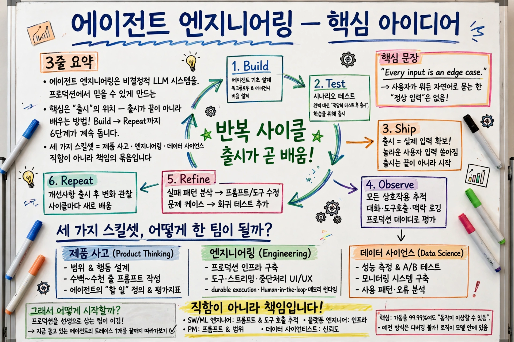
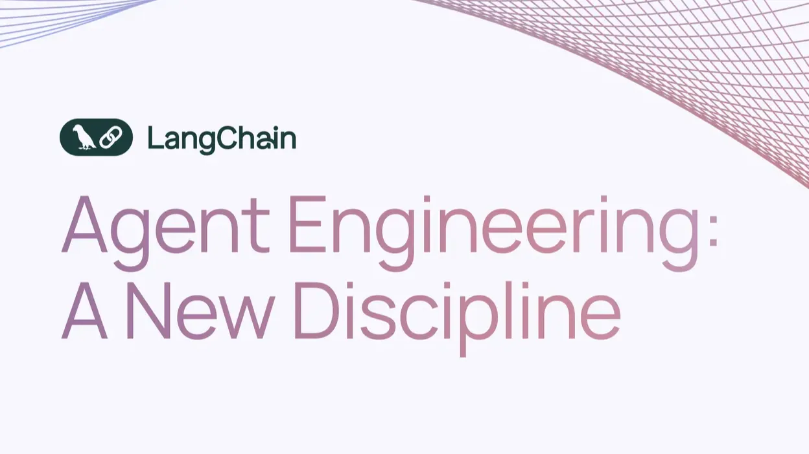
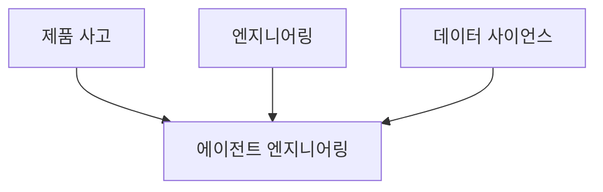
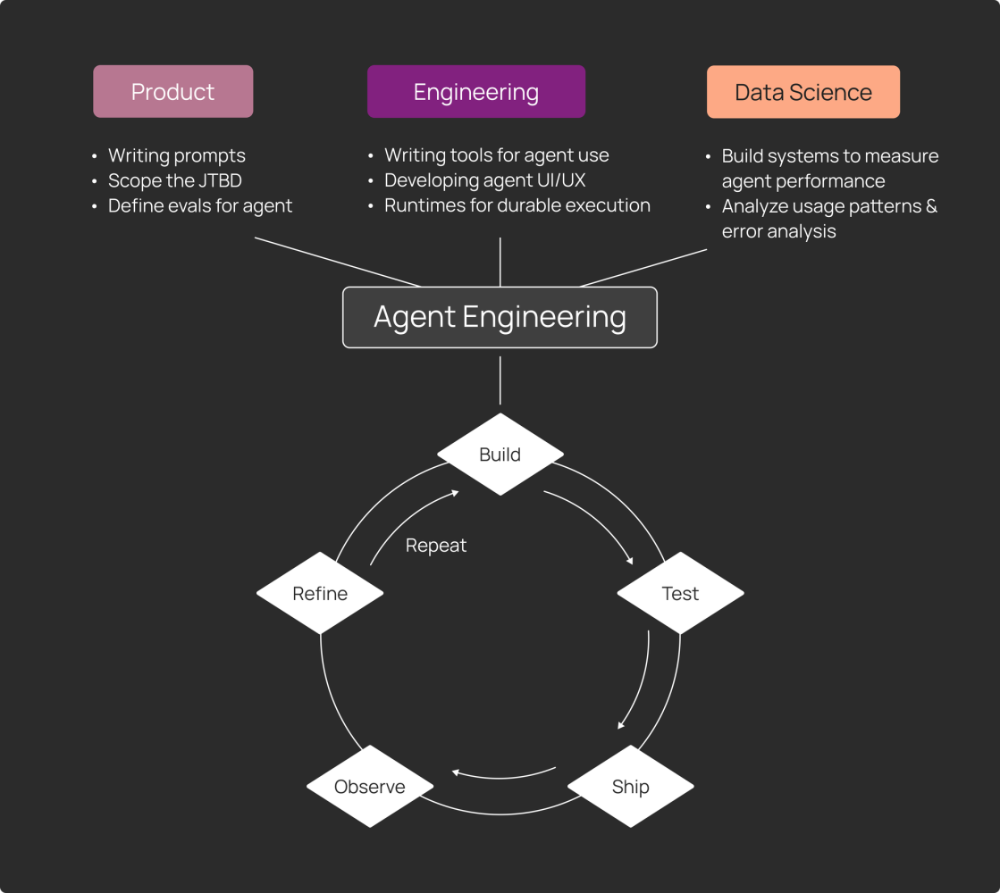
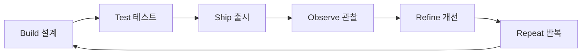

# 에이전트 엔지니어링: 출시가 끝이 아니라 배우는 방법이다

> **Summary**
> 에이전트 엔지니어링은 비결정적인 LLM 시스템을 프로덕션에서 신뢰할 수 있도록 Build, Test, Ship, Observe, Refine, Repeat의 사이클로 지속 개선하는 과정이다. 제품 사고·엔지니어링·데이터 사이언스가 협력해 모든 입력과 실제 사용 데이터를 추적하고, 실패를 평가와 회귀 테스트에 반영하며, 출시를 학습의 시작점으로 삼는다.

---

**3줄 요약**

- 에이전트 엔지니어링은 비결정적 LLM 시스템을 프로덕션에서 믿을 수 있게 만드는 반복 과정입니다.
- 핵심은 출시의 위치입니다. 출시가 끝이 아니라 배우는 방법이고, Build부터 Repeat까지 여섯 단계가 계속 돕니다.
- 세 가지 스킬셋(제품 사고·엔지니어링·데이터 사이언스)이 한 팀으로 움직이고, 직함이 아니라 책임의 묶음입니다.

에이전트를 만들어본 분이라면 아는 간극이 있습니다. 내 컴퓨터에선 되던 것이 프로덕션에선 다르게 굴러갑니다. 왜 그럴까요? 로컬에선 멀쩡하던 에이전트가 실제 사용자 앞에선 엉뚱한 짓을 하던 장면 말입니다. 수천 개 팀을 지켜본 결론은 단순합니다.

## 에이전트 엔지니어링, 도대체 뭘까요?

정의는 한 문장입니다. 비결정적 LLM 시스템을 프로덕션에서 믿을 수 있는 경험으로 다듬는 반복 과정, Build부터 Repeat까지 여섯 단계의 사이클입니다.

핵심은 출시의 위치입니다. 기존 개발에서 출시는 학습이 끝난 뒤의 일입니다. 에이전트 엔지니어링에선 반대입니다. 출시해야 실제 입력이 보이고, 고치는 속도가 곧 신뢰도가 됩니다. 출시가 끝이 아니라 배우는 방법입니다!

> Every input is an edge case.

이 한 줄이 이 분야의 출발점입니다!

## 왜 지금, 왜 필요한가

두 가지 변화가 겹쳤습니다.

첫째, LLM이 강해졌습니다. 에이전트는 일 통째로 맡습니다. Clay는 잠재고객 조사부터 아웃리치, CRM 업데이트까지, LinkedIn은 인재 풀 스캔과 후보 랭킹을 맡깁니다.

둘째, 그 힘만큼 예측이 안 됩니다. 에이전트는 여러 단계를 추론하고 도구를 부르고 맥락에 따라 적응합니다.

**모든 입력이 엣지 케이스입니다.** 사용자가 자연어로 뭐든 물을 수 있는 한 "정상 입력"이란 없습니다.

**예전 방식으론 디버깅이 안 됩니다.** 로직의 상당 부분이 모델 안에 있어, 결정 하나하나, 도구 호출 하나하나를 들여다봐야 합니다.

**"동작한다"가 이진이 아닙니다.** 가동률 99.99%를 찍으면서도 엉뚱한 짓을 하고 있을 수 있습니다. 이 문장을 읽고 고개를 끄덕이신 분, 많으시죠? 숫자만 보면 멀쩡한데, 내용은 틀어져 있는 경우 말입니다.

## 세 가지 스킬셋, 어떻게 한 팀이 될까요?

에이전트 엔지니어링은 세 가지 스킬셋의 결합입니다.

**Product thinking**은 범위와 행동을 설계합니다. 수백~수천 줄의 프롬프트를 쓰고, 에이전트가 대신하는 "할 일"을 이해하고, 그 일을 제대로 하는지 재는 평가를 정의합니다.

**Engineering**은 프로덕션 인프라를 만듭니다. 에이전트용 도구, 스트리밍·중단 처리가 되는 UI/UX, durable execution·human-in-the-loop·메모리 런타임을 만듭니다.

**Data science**는 성능을 재고 개선합니다. 평가와 A/B 테스트, 모니터링 시스템을 만들고, 사용 패턴과 오류를 분석합니다.

## 직함이 아니라 책임입니다!

에이전트 엔지니어링은 새로운 직함이 아닙니다. 기존 팀이 떠안는 책임의 묶음입니다. SW·ML 엔지니어는 프롬프트와 도구 호출 추적을, 플랫폼 엔지니어는 인프라를, PM은 프롬프트와 범위를, 데이터 사이언티스트는 신뢰도를 맡습니다.

현장에선 이런 협업이 일상입니다. 엔지니어가 오류를 추적해 PM에게 넘기면 PM이 프롬프트를 고칩니다.

## 실전 사이클 6단계

성공한 팀들이 밟는 순서입니다.

**Build.** 에이전트의 기초를 설계합니다. 워크플로우와 에이전시(LLM 판단)의 비율에 따라 아키텍처가 갈립니다.

**Test.** 상상 가능한 시나리오로 테스트합니다. 모든 경우를 미리 그릴 순 없으니, "완벽히 테스트하고 출시"에서 "적당히 테스트하고 출시해서 배우는 것"으로 바뀝니다.

**Ship.** 출시하면 상상하지 못한 입력이 바로 쏟아집니다. 프로덕션 트레이스 하나하나가 에이전트가 다뤄야 할 것을 보여줍니다.

**Observe.** 모든 상호작용을 추적합니다. 대화 전체, 부른 도구, 결정을 이끈 맥락까지. 프로덕션 데이터로 평가를 돌립니다.

**Refine.** 실패 패턴이 보이면 프롬프트와 도구 정의를 고칩니다. 문제 케이스는 예시 집합에 넣어 회귀 테스트로 삼습니다.

**Repeat.** 개선을 출시하고 변화를 지켜봅니다. 사이클마다 새로 배웁니다.

## 그래서 어떻게 시작할까

프로덕션을 선생으로 삼는 팀이 이깁니다! 출시 전에 완벽을 노리는 대신 모든 결정을 추적하고, 대규모로 평가하고, 며칠 단위로 개선하는 팀입니다.

지금 돌고 있는 에이전트의 트레이스 하나를 끝까지 따라가 보는 것부터 시작입니다.

