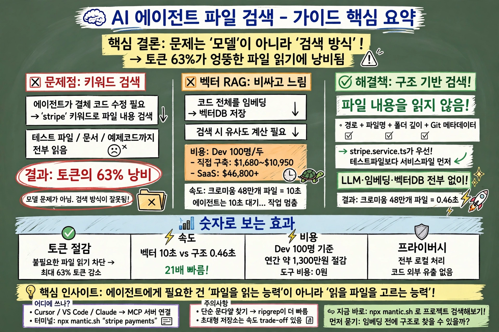
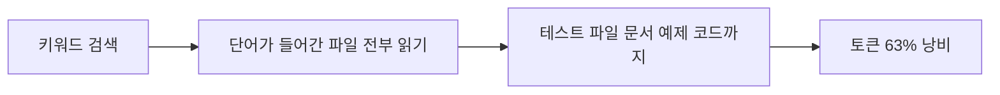
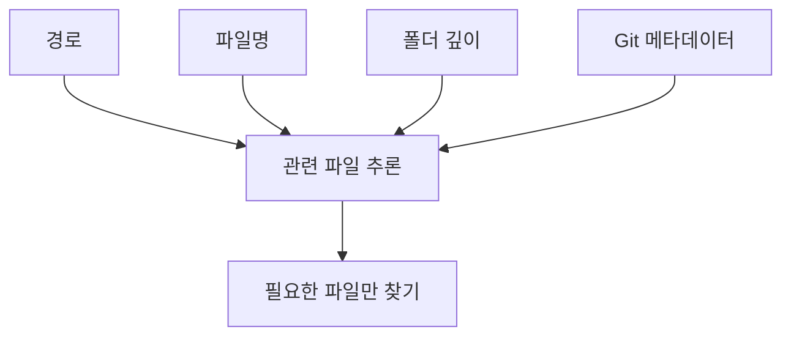

# Mantic: 에이전트 토큰 63% 낭비, 임베딩 말고 구조로 찾는 게 답이다

> **Summary**
> 구조 기반 검색은 파일 내용을 읽지 않고 경로, 파일명, 폴더 깊이, Git 메타데이터로 필요한 파일을 찾아 임베딩·벡터 DB·LLM 호출 없이 토큰과 비용을 줄입니다. 크로미움 48만 개 파일을 0.46초에 검색하며, 코드가 로컬에 머물러 프라이버시도 지킵니다. 다만 단순 문자열 검색이나 초대형 저장소에서는 다른 도구와 용도에 맞게 선택해야 합니다.

---

- AI 에이전트가 파일을 읽는 토큰의 63%를 엉뚱한 파일에 쓰고 있습니다. 문제는 모델이 아니라, 파일 내용을 읽어서 찾는 검색 방식입니다.
- 구조 기반 검색은 임베딩도, 벡터 DB도, LLM 호출도 없이 경로와 Git 메타데이터만으로 필요한 파일을 찾습니다. 크로미움 48만 개 파일 검색이 0.46초입니다.
- 개발자 100명 기준으로 연간 약 1,300만 원을 아끼고, 코드는 전부 로컬에서만 처리합니다. 비싼 벡터 RAG를 지을 이유가 없습니다!


에이전트한테 파일 하나 찾아달라고 했는데, 엉뚱한 파일을 잔뜩 읽고 토큰이 줄줄 새는 걸 본 적 있으시죠? 결제 코드 하나 고치려고 했을 뿐인데, 테스트 파일부터 문서, 예제 코드까지 다 읽어버리는 겁니다. 그런데 이게 우연이 아닙니다. 토큰의 63%가 엉뚱한 파일을 읽는 데 쓰이고 있었습니다. 모델이 멍청해서가 아닙니다. 검색 방식이 잘못됐기 때문입니다!

🎥 [동영상 보기](https://www.youtube.com/watch?v=uhJJgc-0iTQ)

## 에이전트, 왜 엉뚱한 파일을 읽을까요?



에이전트는 일을 시작하면 먼저 코드를 찾습니다. 결제 코드를 고치려면 결제 관련 파일을 찾아야 합니다. 그런데 기존 검색은 키워드로 파일 내용을 뒤집니다. "stripe"이라는 단어가 들어간 파일을 전부 읽습니다. 테스트 파일, 문서, 예제 코드까지 말입니다. 그래서 토큰이 샙니다. 읽을 필요가 없는 파일을 읽는 데 토큰의 63%가 쓰입니다. 이게 바로 문제입니다.

## 벡터 RAG, 왜 비싸고 느릴까요?

벡터 RAG는 이 문제를 임베딩으로 풀려고 합니다. 코드 전체를 벡터로 바꾸고, 데이터베이스에 넣고, 검색할 때마다 유사도를 계산합니다. 돈이 듭니다. 개발자 100명이 하루 100번씩 검색하면, 직접 구축해도 연간 1,680달러에서 10,950달러, SaaS는 46,800달러가 넘습니다. 느리기도 합니다. 크로미움 48만 개 파일에서 벡터 검색은 10초가 걸립니다. 에이전트가 10초를 기다리는 동안, 일은 멈춥니다.

## 구조로 찾는다는 건 뭘까요?



여기서 발상을 바꿔봅니다. 파일 내용을 읽지 않고, 파일의 구조만 보는 겁니다. 경로, 파일명, 폴더 깊이, Git 메타데이터. 이 네 가지만으로 "결제 코드가 어디 있는지"를 추론합니다. `stripe.service.ts`가 `stripe.txt`보다 위에 오는 이유가 여기 있습니다. 서비스 파일이 테스트 파일보다 먼저 오는 것도 같은 원리입니다. LLM 호출은 없습니다. 임베딩도 없습니다. 순수한 경로 지능과 Git 메타데이터만으로 동작합니다. 그래서 크로미움 48만 개 파일 검색이 0.46초에 끝납니다!

## 숫자로 보면 어떨까요?

- 토큰 절감: 관련 없는 파일을 읽기 전에 걸러내, 토큰 사용을 최대 63%까지 줄입니다.
- 속도: 크로미움 48만 개 파일 기준, 벡터 검색 10초 vs 구조 검색 0.46초입니다.
- 비용: 개발자 100명 기준 연간 약 1,300만 원을 아낍니다. 도구 자체는 0원입니다.
- 프라이버시: 전부 로컬에서 처리합니다. 코드가 외부로 나가지 않습니다.
## 어디에 쓰면 좋을까요?

Cursor, VS Code, Claude에서는 MCP 서버로 연결해 씁니다. 터미널에서는 설치 없이 바로 쓸 수 있습니다.

```bash
npx mantic.sh "stripe payments"
```

자연어로 검색어를 치면, 관련 파일을 순위와 함께 돌려줍니다. "결제 코드가 어디 있어?"라고 묻는 것처럼 말입니다. 그런데 만능은 아닙니다. 단순 문자열 찾기("TODO를 다 찾아줘")는 ripgrep이 더 빠르고, 초대형 저장소에서는 속도 trade-off가 있습니다. 용도에 맞게 골라 쓰는 게 맞습니다.

기준은 하나입니다. 에이전트에게 필요한 건 "파일을 읽는 능력"이 아니라 "읽을 파일을 고르는 능력"입니다! 임베딩을 쌓기 전에, 구조만으로 찾을 수 있는지 먼저 물어보세요.

