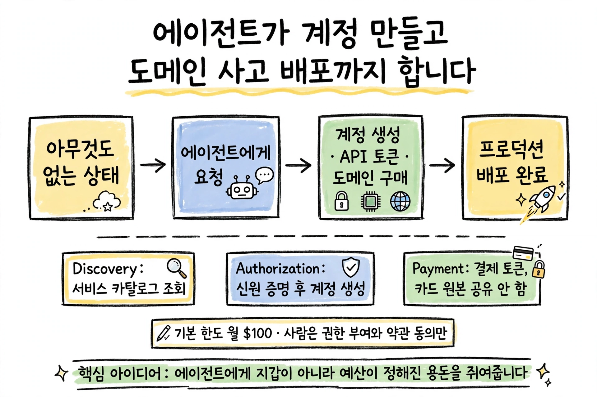
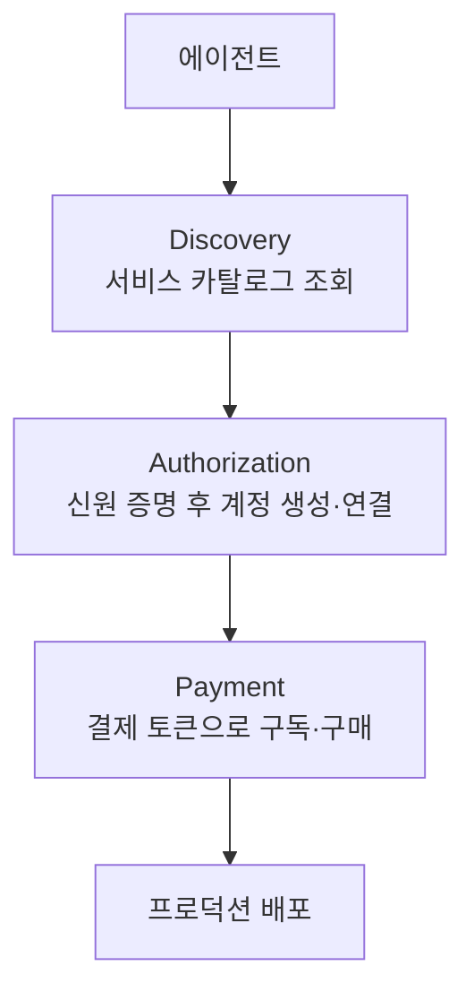
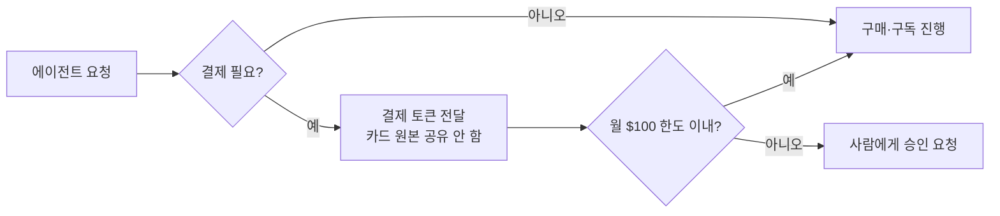

# 에이전트가 계정을 만들고 도메인을 사고 배포까지 합니다. 사람은 허락만 하면 됩니다

> **Summary**
> 코딩 에이전트가 이제 계정 생성, 유료 구독, 도메인 등록, 프로덕션 배포까지 사람 대신 직접 수행합니다. 사람은 권한 부여와 약관 동의만 하면 되고, 대시보드 방문도 카드 정보 입력도 필요 없습니다. 카드 번호는 에이전트에게 절대 공유되지 않고, 공급자당 월 $100 한도가 지출을 막습니다.

---

- 코딩 에이전트가 이제 계정 생성, 유료 구독, 도메인 등록, 프로덕션 배포까지 사람 대신 직접 수행합니다.
- 사람은 권한 부여와 약관 동의만 하면 되고, 대시보드 방문도 카드 정보 입력도 필요 없습니다.
- 카드 번호는 에이전트에게 절대 공유되지 않고, 공급자당 월 $100 한도가 지출을 막습니다.


새 앱을 만들었는데, 배포하려고 보니 할 일이 산더미였던 적 있으시죠? 계정을 만들고, 카드를 등록하고, 토큰을 복사해서 붙여넣고, 도메인을 사고, 그제야 배포를 시작합니다. 코드는 한 시간 만에 짰는데, 배포 준비에 반나절이 걸립니다. 이제 그 준비를 에이전트에게 통째로 맡길 수 있게 됐습니다!

🎥 [동영상 보기](https://www.youtube.com/watch?v=lIsHZfRl2zw)

### 에이전트가 어디까지 해줄까요?

코딩 에이전트가 코드를 짜는 건 이제 일상이 됐습니다. 그런데 배포는 달랐습니다. 프로덕션에 올리려면 호스팅 업체의 계정, 결제 수단, API 토큰이 필요했고, 이 세 가지는 사람이 직접 챙겨야 했습니다. 에이전트는 코드를 짤 수는 있어도, 고객이 될 수는 없었던 겁니다. 이제 그 벽이 무너졌습니다. 에이전트가 계정을 만들고, 유료 구독을 시작하고, 도메인을 등록하고, API 토큰을 받아서 바로 배포합니다. 사람이 하는 일은 딱 두 가지입니다. 권한을 부여하고, 서비스 약관에 동의하는 것뿐입니다. 대시보드를 열 필요도, 토큰을 복사해서 붙여넣을 필요도, 카드 정보를 입력할 필요도 없습니다!


### 시작은 어떻게 할까요?

방법은 놀랍도록 간단합니다. Stripe CLI와 Stripe Projects 플러그인을 설치하고, Stripe에 로그인한 뒤 새 프로젝트를 시작합니다.

```plain text
stripe projects init
```

한 줄이면 됩니다. 그 다음 에이전트에게 새 앱을 만들어 새 도메인에 배포하라고 말하면 됩니다. 로그인한 이메일로 된 계정이 이미 있으면, 일반적인 OAuth 흐름으로 에이전트 접근 권한을 부여합니다. 계정이 없으면 새로 만듭니다. 에이전트가 사이트를 빌드해 새 계정에 배포하고, Stripe Projects CLI로 도메인을 등록합니다. 결제 수단이 연결돼 있지 않으면 에이전트가 직접 물어봅니다. 마지막에는 앱이 새로 등록된 도메인에서 프로덕션으로 실행됩니다. 계정도, 스킬도, MCP 서버도 미리 준비하지 않은 상태에서 시작했는데, 끝에는 계정, 토큰, 도메인, 배포된 앱이 모두 갖춰집니다!

### 프로토콜은 어떻게 돌아갈까요?

이 흐름 뒤에는 세 가지 장치가 있습니다. 첫째는 Discovery입니다. 에이전트는 `stripe projects catalog` 명령으로 프로비저닝할 수 있는 서비스 목록을 조회합니다. 도메인 등록을 하려면 먼저 등록 서비스를 찾아야 하는데, 카탈로그가 그 역할을 합니다. 사람에게는 벅찰 만큼 긴 목록이지만, 에이전트에게는 필요한 문맥 그 자체입니다. 둘째는 Authorization입니다. 사용자가 Stripe에 로그인했기 때문에 Stripe가 신원 공급자 역할을 하며 사용자 신원을 증명합니다. 계정이 없으면 새로 만들고, 자격 증명을 CLI에 안전하게 돌려줍니다. 셋째는 Payment입니다. 에이전트가 유료 서비스를 프로비저닝할 때 Stripe가 결제 토큰을 함께 보냅니다. 카드 번호 같은 원본 결제 정보는 에이전트에게 절대 공유되지 않습니다.



### 에이전트에게 카드를 맡겨도 될까요?

당연한 걱정입니다. 에이전트가 도메인을 수십 개 사버리면 어떡할까요? 청구서가 터지면 누가 책임질까요? 프로토콜은 이 걱정을 처음부터 설계에 넣었습니다. 에이전트가 한 공급자에 쓸 수 있는 기본 한도는 월 $100입니다. 한도를 올리고 싶으면 계정에서 Budget Alerts를 설정하면 됩니다. 카드 정보는 토큰으로 바뀌어서 전달되고, 원본은 에이전트의 눈에 닿지 않습니다. 이 장면이 저는 가장 인상 깊었습니다. 에이전트에게 지갑을 통째로 맡기는 게 아니라, 예산이 정해진 용돈을 쥐여주는 방식이라는 점이요!



### 왜 클라우드만의 이야기가 아닐까요?

이 프로토콜의 진짜 의미는 한 회사에만 있지 않습니다. 로그인한 사용자가 있는 플랫폼이라면 어디든 같은 Orchestrator 역할을 할 수 있습니다. 코딩 에이전트 제품을 만든다면, 사용자가 만든 결과물을 여러 서비스에 바로 배포하게 할 수 있습니다. 반대로 한 서비스의 고객이 다른 서비스를 쉽게 프로비저닝하게 만들 수도 있습니다. 이미 비슷한 흐름은 있었습니다. 한 클라우드에서 다른 회사의 데이터베이스를 바로 만드는 방식이 그 예입니다. 표준이 없으면 통합마다 새로 공사를 해야 했고, 그 공사를 다음 통합에 재사용하기도 어려웠습니다. OAuth가 계정 접근 위임을 표준화했던 것처럼, 이 프로토콜은 OAuth를 결제와 계정 생성까지 확장하고, 에이전트를 일급 대상으로 다룹니다. 시작 방법은 간단합니다. 오픈 베타로 제공되고, 계정이 없어도 시작할 수 있습니다. 에이전트에게 새 앱을 만들라고 말하면 됩니다. 배포의 마지막 문턱이 사라진 지금, 남은 질문은 하나입니다. 무엇을 만들 것인가요?

