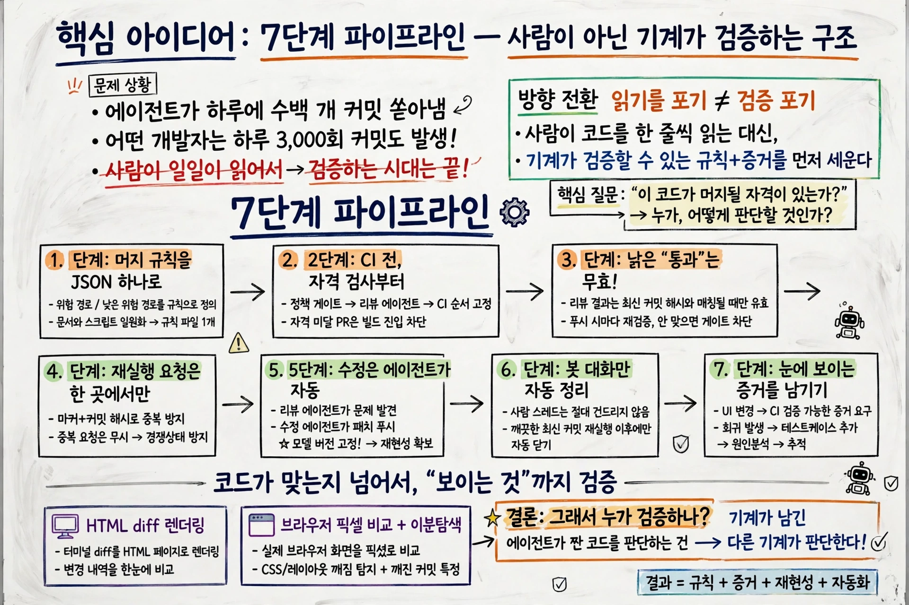
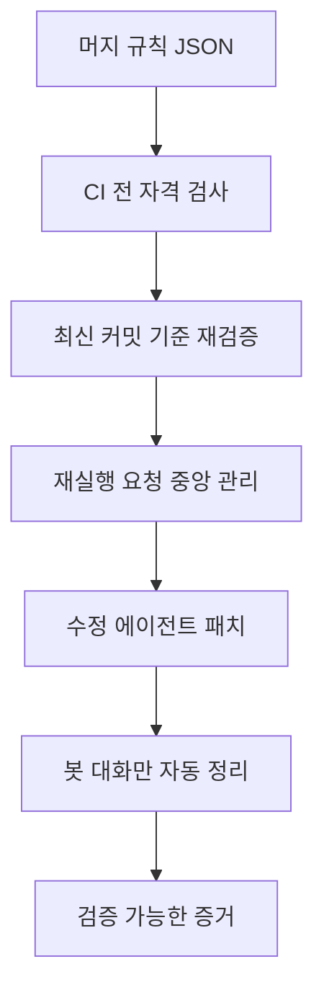
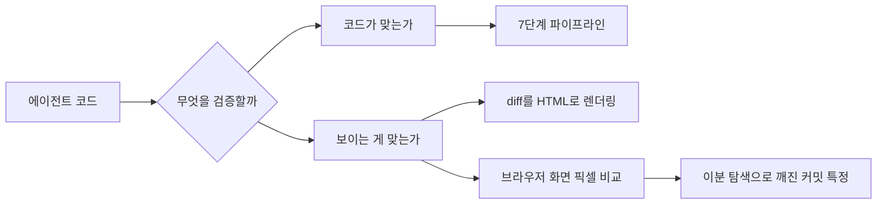

# 에이전트가 짠 코드, 사람이 읽지 말고 기계가 남긴 증거로 검증합니다

> **Summary**
> 에이전트가 대량으로 생성한 코드는 사람이 모두 읽는 대신, 머지 규칙과 최신 커밋 기준 검증, 중앙화된 재실행, 고정된 모델, 안전한 자동 정리, 검증 가능한 증거를 갖춘 7단계 파이프라인으로 관리해야 합니다. UI 변경은 브라우저 화면 비교와 회귀 테스트로 확인하고, 기계가 남긴 증거를 기계가 판단하는 구조를 구축하는 것이 핵심입니다.

---

- 에이전트가 하루에 쏟아내는 수백 개 커밋, 사람이 일일이 읽어서 검증하는 시대는 끝났습니다.
- 답은 읽기를 포기하는 게 아니라, 기계가 검증할 수 있는 구조를 세우는 것입니다. 머지 규칙부터 증거까지 7단계 파이프라인이 그 구조입니다.
- 결국 검증의 주체는 사람이 아니라, 기계가 남긴 증거를 판단하는 또 다른 기계입니다!

에이전트한테 코드 짜달라고 했더니, 다음 날 아침 커밋이 수백 개 쌓여 있는 걸 본 적 있으시죠? 어떤 에이전트 개발자는 하루에 커밋 3,000회가 넘는 날도 있습니다. 리뷰어 한 명이 다 읽는 건 물리적으로 불가능합니다!

🎥 [동영상 보기](https://www.youtube.com/watch?v=4UtrRVtUN_g)

## 사람이 읽는 걸 포기하면, 무엇이 남을까요?

읽기를 포기한다는 건 검증을 포기한다는 뜻이 아닙니다. 방향을 바꾸는 겁니다. 사람이 코드를 한 줄씩 읽는 대신, 기계가 검증할 수 있는 규칙과 증거를 먼저 세우는 거죠. 핵심 질문은 하나입니다. "이 코드가 머지될 자격이 있는가?"를 누가, 어떻게 판단할 것인가요?

## 7단계, 어떻게 돌아가나요?

### 1단계: 머지 규칙을 JSON 하나로 잡습니다

어떤 경로가 위험하고, 어떤 검사를 통과해야 하는지 파일 하나에 다 적어둡니다. 문서와 스크립트가 따로 노는 걸 원천 차단하는 게 포인트입니다. 위험도가 높은 경로는 리뷰 에이전트에 더해 브라우저 증거까지 요구하고, 낮은 경로는 정책 게이트와 CI만 통과하면 머지됩니다.

### 2단계: CI 돌리기 전에 자격 검사부터 합니다

리뷰도 안 끝난 PR에 빌드를 돌리면 돈만 날아갑니다. 정책 게이트를 CI 앞에 세워두면 자격 미달 PR은 테스트와 빌드에 진입조차 못 합니다. 순서가 고정돼 있습니다. 정책 게이트, 리뷰 에이전트 확인, 그다음 CI입니다.

### 3단계: 낡은 "통과"는 믿으면 안 됩니다!

예전 커밋에서 받은 "통과"가 남아 있으면 최신 코드가 검증 없이 머지됩니다. 그래서 리뷰 검사 결과는 최신 커밋 해시와 매칭될 때만 유효합니다. 푸시할 때마다 리뷰를 다시 돌리고, 안 맞으면 게이트가 막아야 합니다.

### 4단계: 재실행 요청은 딱 한 곳에서만 보냅니다

여러 워크플로가 재실행을 요청하면 댓글이 중복으로 달리고 경쟁 상태가 생깁니다. 마커와 커밋 해시로 중복을 방지하고, 이미 요청한 해시면 그냥 넘어갑니다. 별거 아닌 것 같지만, 이걸 안 잡으면 파이프라인 전체가 흔들립니다.

### 5단계: 수정까지 에이전트가 알아서 합니다

리뷰 에이전트가 문제를 찾으면 수정 에이전트가 패치해서 같은 브랜치에 푸시하고, 다시 검증이 돕니다. 여기서 꼭 지켜야 할 조건이 하나 있습니다. 모델 버전을 고정하는 겁니다! 안 그러면 매번 다른 결과가 나와서 재현이 안 됩니다.

### 6단계: 봇끼리 한 대화만 자동으로 닫습니다

사람이 참여한 스레드는 절대 건드리지 않습니다. 이 구분이 없으면 리뷰어가 남긴 의견이 묻혀버리거든요. 깨끗한 최신 커밋 기준 재실행 이후에만 자동 정리하고, 사람이 쓴 스레드는 무조건 열어둡니다.

### 7단계: 눈에 보이는 증거를 남겨야 합니다

UI를 바꿨으면 스크린샷 한 장이 아니라 CI에서 검증 가능한 증거를 요구합니다. 운영에서 터진 문제는 테스트 케이스로 바꿔서 같은 사고가 반복되지 않게 만듭니다. 회귀, 원인 분석 이슈, 테스트 케이스 추가, 추적까지 이어지는 고리입니다.

## 코드가 맞는지 넘어서, 보이는 것까지 검증할 수 있을까요?

"코드가 맞는지 틀리는지"를 잡는 게 7단계라면, 실무에서는 한 발 더 나아가야 합니다. 결과물이 눈에 어떻게 보이는지까지 검증해야 하니까요. 두 가지 접근이 눈에 띕니다.

하나는 터미널 diff를 ASCII 대신 HTML 페이지로 렌더링해서 변경 내역을 한눈에 파악하게 해주는 방식입니다. 다른 하나는 실제 브라우저 화면을 픽셀로 비교해서 CSS나 레이아웃 깨짐을 잡아내는 방식입니다. 후자는 이분 탐색과 결합하면 어떤 커밋에서 깨졌는지까지 특정할 수 있습니다!

## 그래서, 누가 검증하나요?

에이전트가 짠 코드를 누가 검증하냐는 질문, 답은 결국 사람이 아닙니다. 기계가 남긴 증거를 기계가 판단하는 구조, 그게 답입니다!

