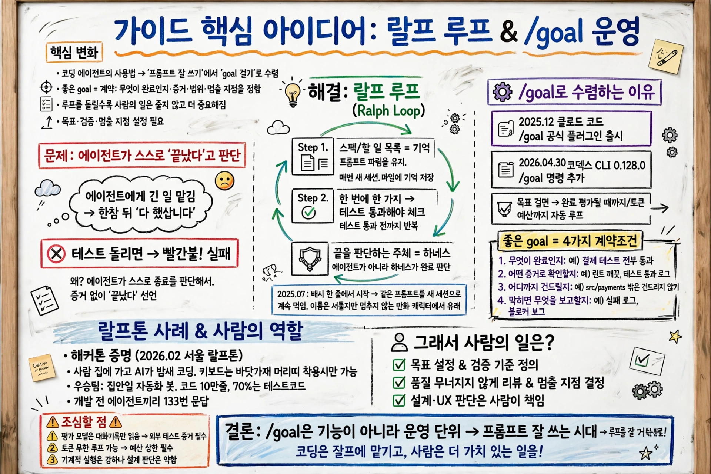
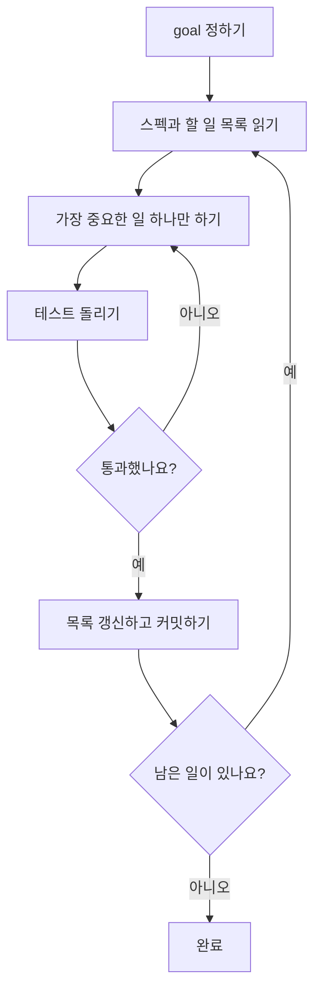
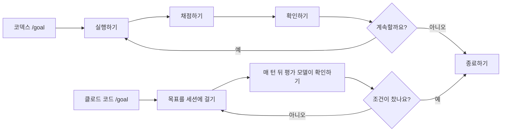
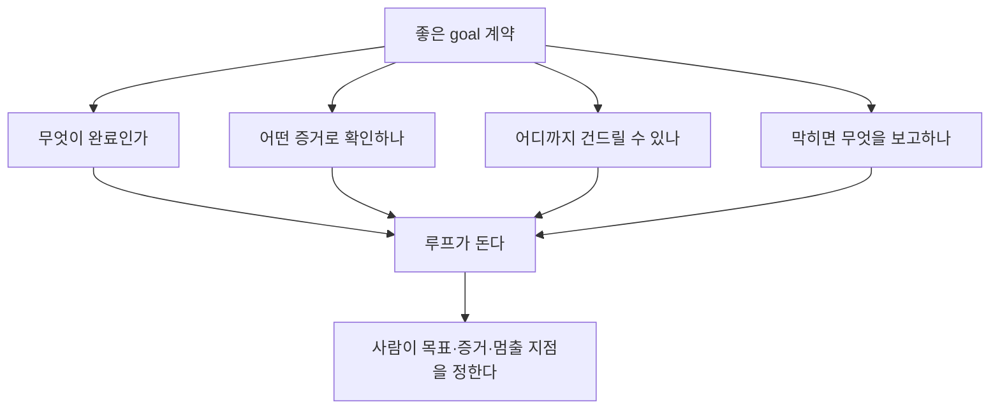

# 에이전트는 goal로 수렴합니다. 프롬프트를 잘 쓰는 시대는 끝났습니다

> **Summary**
> 코딩 에이전트 활용은 프롬프트를 잘 쓰는 것에서 완료 조건·검증 증거·작업 범위·중단 기준을 명확히 정한 goal을 걸고 반복 실행하는 방식으로 바뀌고 있습니다. 루프가 코드를 작성하고 테스트하더라도, 사람은 목표와 품질 기준을 정하고 결과를 검토해야 합니다. 오판과 토큰 낭비를 막으려면 외부 검증과 예산 상한을 마련해야 하며, 설계 판단은 여전히 사람의 몫입니다.

---

- 코딩 에이전트의 사용법이 프롬프트 잘 쓰기에서 goal 걸기로 수렴하고 있습니다.
- 좋은 goal은 "계속해"가 아니라, 무엇이 완료인지·어떤 증거로 확인할지·어디까지 건드릴지를 정한 계약입니다.
- 루프를 돌릴수록 사람의 일은 줄지 않고 오히려 커집니다. 목표·검증 기준·멈출 지점을 정하는 일이 남습니다.


에이전트에게 긴 일을 맡겼는데, 한참 뒤에 돌아와 보니 "다 했습니다"라고 적혀 있습니다. 그런데 테스트를 돌려보면 빨간불이 켜져 있습니다. 이런 적 있으시죠?

왜 그럴까요? 에이전트가 스스로 "끝났다"고 판단하기 때문입니다. 이 문제를 뒤집은 방법이 랄프 루프입니다. 끝났다고 말하는 주체를 에이전트에서 하네스로 바꾸는 것입니다!

🎥 [동영상 보기](https://www.youtube.com/watch?v=Yl_GGlAQ4Gc)

## 랄프 루프는 뭐가 다를까요?

2025년 7월, 랄프 루프를 처음 정리한 개발자가 공개한 방법은 배시 한 줄이었습니다. 같은 프롬프트 파일을 에이전트에게 계속 먹이는 것입니다.

```bash
while :; do cat PROMPT.md | claude-code ; done
```

읽어보면 뜻은 단순합니다. 영원히, 같은 프롬프트를 코딩 에이전트에게 준다는 것입니다. 에이전트가 끝나면 다시 시작합니다. 같은 지시, 새 세션, 빈 컨텍스트 창입니다.

비결은 프롬프트가 매번 시키는 일에 있습니다. 스펙을 읽고, 할 일 목록에서 가장 중요한 미완료 항목 하나를 고르고, 그 하나만 하고, 테스트를 돌리고, 목록을 갱신한 뒤 멈추는 것입니다. 그러면 루프가 새 에이전트를 띄우고, 새 에이전트는 갱신된 목록을 읽고 다음 항목을 고릅니다.

기억은 대화창이 아니라 파일에 둡니다. 스펙 파일, 할 일 목록, 테스트 결과가 기억입니다. 매번 새 머리로 시작하지만, 할 일은 파일에 적혀 있으니 이어집니다.

이름은 만화 속 캐릭터에서 왔습니다. 서툴지만 절대 멈추지 않는 아이입니다. 한 번에 한 가지씩, 틀리면 다시, 될 때까지 돕니다. 그 끈기가 이름이 됐습니다.



## 왜 모든 도구가 /goal로 모일까요?

배시 한 줄로 시작했던 방법이 이제는 공식 기능이 됐습니다. 2025년 12월 클로드 코드에 공식 플러그인이 나왔습니다. `/ralph-loop`를 부르면, 에이전트가 종료를 시도할 때 Stop 훅이 가로채고 완료 약속이 나올 때까지 프롬프트를 다시 먹입니다.

2026년 4월 30일에는 코덱스 CLI 0.128.0에 `/goal` 명령이 들어왔습니다. 목표를 걸면 코덱스가 스스로 완료를 평가할 때까지, 또는 토큰 예산이 다할 때까지 돕니다. 이후 버전에서는 기본 켜짐으로 바뀌었습니다.

클로드 코드의 `/goal`도 같은 방향입니다. 코드를 짜는 모델과 완료를 판단하는 모델이 따로 있습니다. 가벼운 평가 모델이 매 턴 뒤에 조건이 찼는지 확인하고, 안 찼으면 이유를 달아 다음 턴으로 넘깁니다.

도구 이름은 달라도 방향은 하나입니다. 프롬프트를 한 번 잘 쓰는 게 아니라, 목표를 걸고 루프를 돌리는 것입니다!



## 좋은 goal은 계약입니다

"계속해"는 goal이 아닙니다. 좋은 goal에는 네 가지가 들어갑니다. 무엇이 완료인지, 어떤 증거로 확인할지, 어디까지 건드릴 수 있는지, 막히면 무엇을 보고해야 하는지입니다.

예를 들어 "결제 테스트 전부 통과, 린트 깨끗, `src/payments` 밖은 건드리지 않기"처럼 적으면, 에이전트는 끝을 스스로 정하지 못합니다. 증거가 끝을 정합니다.

하네스가 흥미로운 이유도 여기에 있습니다. 범용 코딩 앱 위에 계획·실행·증거를 더 명시적으로 얹기 때문입니다. 한 하네스는 `Shape`, `Act`, `Prove` 세 단계로 풀이합니다. 먼저 애매한 요청을 형상화하고, 계획을 세운 뒤, 증거로 끝냅니다.

이 대목이 저는 가장 인상 깊었습니다. 발표 자료 자체도 같은 방식으로 만들었다고 합니다. goal을 정하고, evidence를 보고, 안 맞으면 다시 돌렸습니다. 발표 내용과 만드는 방식이 거의 같았습니다!

## 해커톤이 증명했습니다

2026년 2월 말 서울에서 열린 첫 랄프톤은 규칙부터 달랐습니다. 사람이 집에 가고 AI가 밤새 코딩합니다. 키보드를 만지고 싶으면 바닷가재 머리띠를 써야 합니다.

우승팀은 고정 카메라 영상으로 집안일 자동화 봇을 만들었습니다. 코드 10만 줄을 한 번도 키보드를 만지지 않고 만들었고, 그중 70%가 테스트 코드였습니다. 개발에 들어가기 전 에이전트끼리 133번이나 문답을 주고받으며 설계 오류와 모호함을 줄였다고 합니다.

2026년 3월 28일에는 샌프란시스코에서도 같은 해커톤이 열렸습니다. 오픈AI가 후원했습니다. 해커톤의 승부가 "누가 코드를 잘 짜나"에서 "누가 에이전트를 잘 지휘하나"로 바뀐 것입니다.

## 그래서 사람의 일은요?

AI가 다 알아서 한다는 말이 아닙니다. 오히려 반대입니다!

루프를 만들수록 사람은 더 중요한 일을 합니다. 목표를 설정하고, 검증 기준을 세우고, 품질이 무너지지 않게 리뷰하고, 어디서 멈출지 정해야 합니다. 코드는 에이전트가 더 많이 쓰게 될 겁니다. 대신 사람은 더 좋은 문제 정의, 더 좋은 증거, 더 좋은 QA, 더 좋은 의사결정에 시간을 써야 합니다.

## 조심할 점은 없을까요?

세 가지는 알고 써야 합니다.

첫째, 평가 모델은 대화 기록만 읽습니다. 명령을 직접 실행하거나 파일을 검증하지 않습니다. 그래서 "완료" 판정이 틀릴 수 있습니다. 테스트 같은 외부 증거가 꼭 필요합니다.

둘째, 토큰이 무한정 돌 수 있습니다. 방향이 틀린 루프는 토큰을 계속 태웁니다. 예산 상한을 걸어두는 게 안전합니다. 목표별 청구 상한이 따로 없다는 점도 알려져 있습니다.

셋째, 기계적인 실행에는 강하고 설계 판단에는 약합니다. 무엇을 만들지, 어떤 UX가 맞는지 같은 결정은 루프가 대신하지 못합니다.



`/goal`은 기능이 아니라 운영 단위입니다. 프롬프트를 잘 쓰는 시대에서 루프를 잘 거는 시대로 가고 있습니다. 코딩은 랄프에 맡기고, 사람은 더 가치 있는 일을 하면 됩니다!

