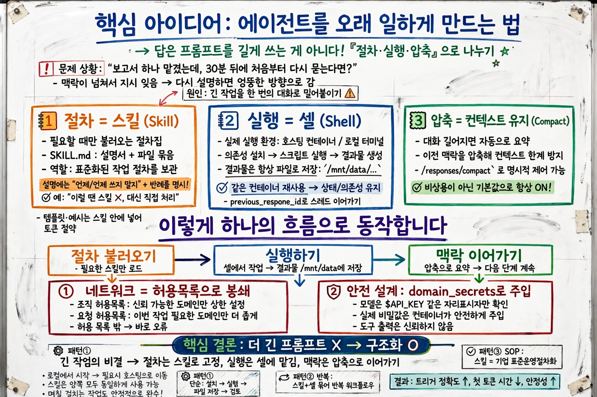
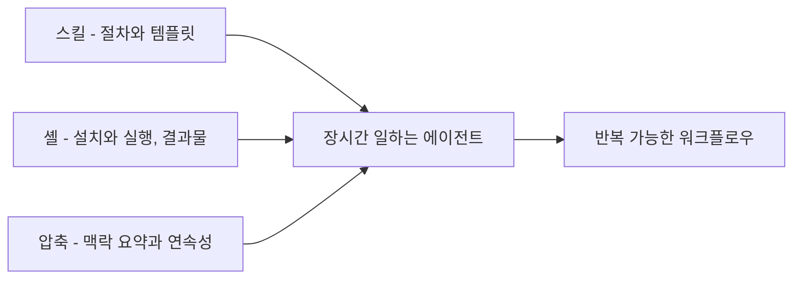
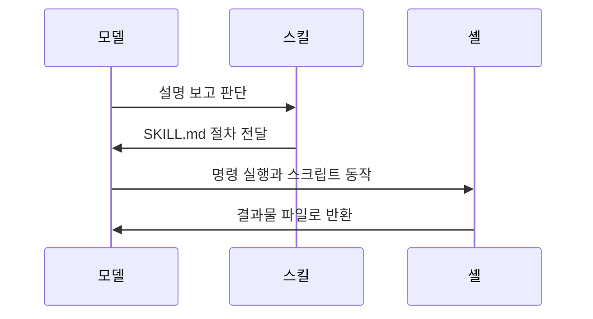
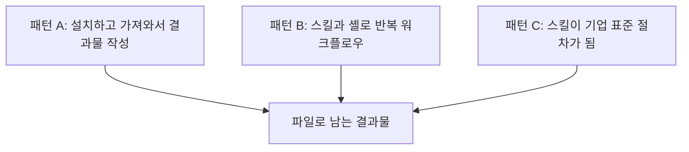

# 에이전트를 장시간 일하게 하려면, 프롬프트가 아니라 절차·실행·압축입니다

> **Summary**
> 장시간 작업을 안정적으로 수행하려면 긴 프롬프트보다 절차는 스킬로, 실행은 셸로, 맥락은 압축으로 분리해야 합니다. 스킬에는 사용 조건과 반례를 명확히 적고, 연속성을 위해 같은 실행 환경과 대화 흐름을 유지하며, 네트워크 허용 목록과 비밀 정보 분리로 안전을 설계합니다.

---

- 에이전트를 오래 일하게 하는 답은 프롬프트를 길게 쓰는 게 아닙니다. 절차는 스킬로, 실행은 셸로, 맥락 유지는 압축으로 나누는 것입니다.
- 스킬은 필요할 때만 불러오는 절차집이고, 셸은 의존성을 설치하고 결과를 파일로 뽑는 실행 환경이며, 압축은 컨텍스트 한계에 부딪히지 않게 긴 작업을 이어주는 장치입니다.
- 설명에 "언제 쓰고 언제 쓰지 말지"와 반례까지 적어두면 라우팅이 안정되고, 네트워크는 허용 목록으로 묶고 인증 정보는 모델이 못 보게 따로 주입해야 합니다.

## 보고서 하나 맡겼는데, 30분 뒤에 처음부터 다시 묻는다면?

에이전트에게 "이 데이터 정리해서 보고서로 만들어줘"라고 맡겼습니다. 30분 뒤에 돌아보니, 중간에 멈춰 있었습니다. 맥락이 넘쳐서 처음에 준 지시를 잊어버린 겁니다. 다시 설명했더니, 이번엔 엉뚱한 방향으로 가기 시작했습니다. 이런 적 있으시죠?

문제는 모델이 게을러서가 아닙니다. 긴 작업을 한 번의 대화로 밀어붙이는 구조가 문제입니다!

🎥 [동영상 보기](https://www.youtube.com/watch?v=b7l_Dhe1h8M)

## 세 가지, 절차·실행·압축으로 나눕니다

긴 작업을 굴리는 답은 세 가지 원시 요소를 나누는 것입니다. 절차는 스킬이, 실행은 셸이, 맥락 유지는 압축이 맡습니다.

스킬은 버전이 있는 절차집입니다. `SKILL.md`라는 설명서와 파일 묶음으로, 모델이 필요할 때만 불러와서 읽습니다. 시스템 프롬프트에 모든 절차를 욱여넣는 대신, 쓸 때만 꺼내는 방식입니다.

셸은 에이전트가 실제로 일하는 터미널 환경입니다. 호스팅 컨테이너에서 돌리거나, 로컬에서 직접 실행할 수도 있습니다. 의존성을 설치하고, 스크립트를 돌리고, 결과물을 파일로 뽑습니다.

압축은 긴 작업이 멈추지 않게 해주는 장치입니다. 대화가 길어져 컨텍스트 한계에 닿으면, 서버가 알아서 이전 대화를 요약해서 줄여줍니다. 따로 호출할 필요 없이 스트림 안에서 자동으로 돌고, 원하면 `/responses/compact`로 명시적으로 제어할 수도 있습니다.

이 장면이 저는 가장 인상 깊었습니다. 세 가지가 따로 노는 게 아니라, "절차는 불러오고, 실행은 하고, 맥락은 이어간다"는 하나의 흐름이 된다는 점입니다!

## 스킬 설명, 마케팅 문구가 아니라 라우팅 로직으로 써야 합니다

스킬을 만드는 일, 설명부터가 관건입니다. 설명은 모델의 판단 경계입니다. "언제 이걸 써야 하는지, 언제 쓰지 말아야 하는지, 결과물과 성공 기준이 무엇인지"가 들어가야 합니다. 추상적인 홍보 문장은 오히려 오작동을 부릅니다.

반례를 넣는 것도 중요합니다. 스킬을 제공했는데 오히려 제대로 안 불려지는 경우가 있습니다. "이럴 땐 이 스킬을 부르지 말고, 대신 이렇게 하세요"라는 반례와 엣지 케이스를 적어두면 라우팅이 훨씬 깔끔해집니다. 실제 사례도 있습니다. 한 기업은 스킬을 도입한 뒤 트리거 정확도가 20%쯤 떨어졌다가, 반례와 예외 조건을 설명에 추가한 뒤에야 회복했습니다.

템플릿과 예시는 스킬 안에 넣는 게 좋습니다. 안 쓸 때는 토큰을 거의 안 먹으니까요. 보고서 양식, 트리아지 요약, 계정 계획서 같은 결과물 템플릿을 스킬 안에 두면, 필요할 때만 불러와서 씁니다. 시스템 프롬프트에 욱여넣던 시절과는 다른 방식입니다!

그리고 확정이 필요하면 직접 말하면 됩니다. "이 스킬을 써라." 한 마디면, 애매한 라우팅이 명확한 계약으로 바뀝니다. 생산 워크플로우에서는 이 단순한 지시가 가장 확실한 신뢰성 장치입니다.

## 긴 작업, 처음부터 연속성을 설계해야 합니다

긴 작업은 한 번에 되는 일이 아닙니다. 처음부터 연속성을 설계해야 합니다. 같은 컨테이너를 단계마다 재사용하면 의존성과 중간 결과물이 그대로 남습니다. `previous_response_id`로 같은 스레드를 이어가면, 모델이 작업을 처음부터 다시 파악하지 않습니다. 압축은 비상용이 아니라 긴 작업의 기본값으로 켜두는 게 좋습니다.

이렇게 굴리는 패턴은 세 가지입니다. 첫째, 설치하고 가져와서 결과물을 쓰는 가장 단순한 패턴입니다. 라이브러리를 설치하고, 외부 데이터를 불러오고, 보고서를 `/mnt/data/report.md`에 씁니다. 결과물이 파일로 남으니 사람이 검토하고, 다음 단계로 넘기기도 쉽습니다.

둘째, 스킬과 셸을 묶은 반복 워크플로우입니다. 스프레드시트 분석, 데이터셋 정리, 정기 보고서처럼 매번 같은 순서로 돌아가는 일에 씁니다. 절차를 스킬로 고정해두면, 프롬프트가 조금씩 달라져도 결과가 흔들리지 않습니다.

셋째, 스킬을 기업의 업무 절차 그 자체로 쓰는 패턴입니다. 한 기업은 영업용 스킬을 도입한 뒤 평가 정확도 73%에서 85%로, 첫 토큰까지 걸리는 시간은 18.1% 줄이는 결과를 얻었습니다. 스킬이 살아 있는 표준 운영 절차가 되는 셈입니다!

## 안전은 따로 설계합니다. 네트워크는 묶고, 비밀은 가립니다

스킬에 네트워크까지 붙이면 위험한 조합이 됩니다. 스킬이 강력한 절차를 담고 있는데, 거기에 열린 인터넷까지 더하면 데이터 유출 경로가 생깁니다. 네트워크는 허용 목록을 엄격하게 묶고, 도구 출력은 신뢰하지 않는다고 가정해야 합니다.

허용 목록은 두 단계로 관리합니다. 조직 단위 허용 목록이 "믿을 수 있는 목적지"의 상한을 정하고, 요청 단위 허용 목록은 "이번 작업에 필요한 목적지"만 더 좁게 잡습니다. 요청에 조직 허용 목록 밖의 도메인이 들어가면 오류가 납니다.

인증이 필요한 호출에는 `domain_secrets`를 씁니다. 모델은 `$API_KEY` 같은 자리표시자만 보고, 실제 값은 옆에서 승인된 목적지에만 주입합니다. 컨테이너 안에서 보호된 API를 부를 때 기본값으로 삼을 만한 방식입니다.

결과물은 `/mnt/data`에 모읍니다. 도구와 모델이 디스크를 사이에 두고 주고받는 경계입니다. 보고서, 정리된 데이터셋, 완성된 스프레드시트처럼 꺼내서 검토할 결과물은 전부 여기에 씁니다.

## 로컬에서 시작하고, 호스팅으로 옮겨도 스킬은 그대로입니다

이 세 가지는 클라우드 전용이 아닙니다. 로컬에서 빠르게 반복하다가, 반복성과 격리가 필요해지면 호스팅 컨테이너로 옮기면 됩니다. 스킬은 양쪽에서 똑같이 돌아갑니다. 실행 환경이 바뀌어도 워크플로우는 그대로입니다.

긴 작업의 비결은 더 긴 프롬프트가 아닙니다. 절차는 스킬로 고정하고, 실행은 셸에 맡기고, 맥락은 압축으로 이어가는 것. 그 구조가 갖춰지면, 에이전트는 한 번의 대화가 아니라 며칠에 걸친 일도 끝까지 해냅니다!

