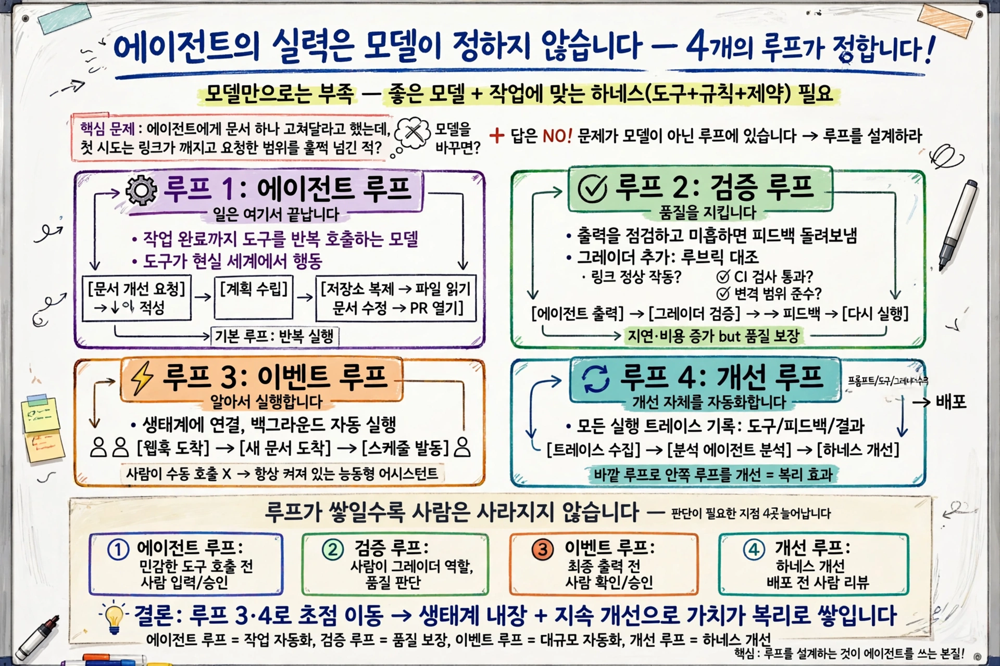
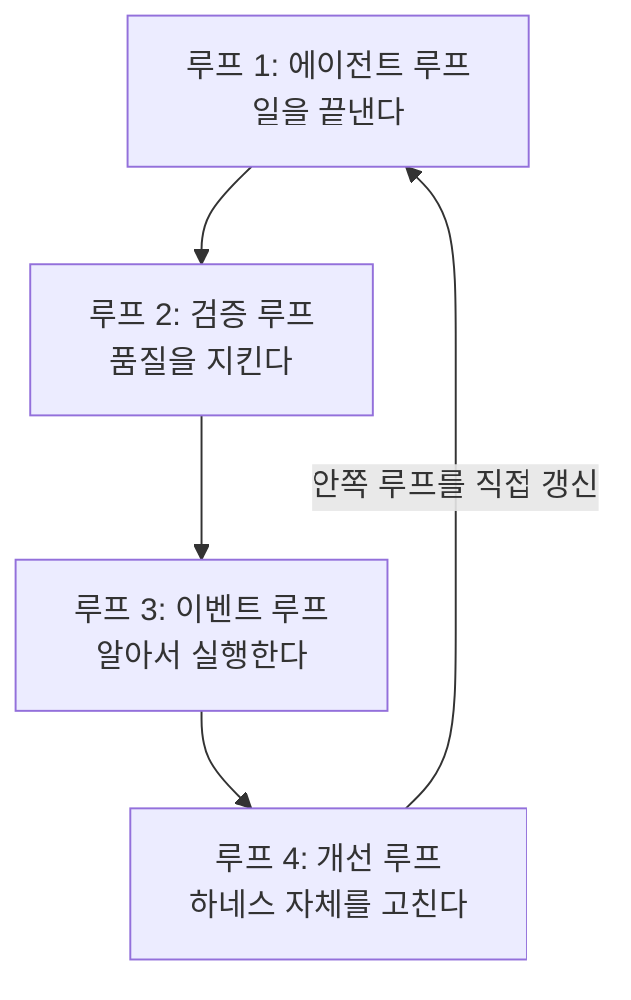
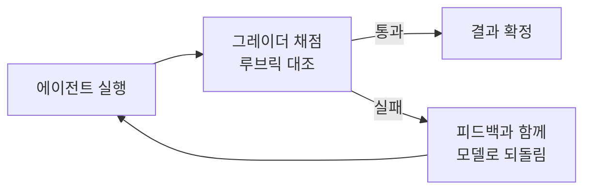
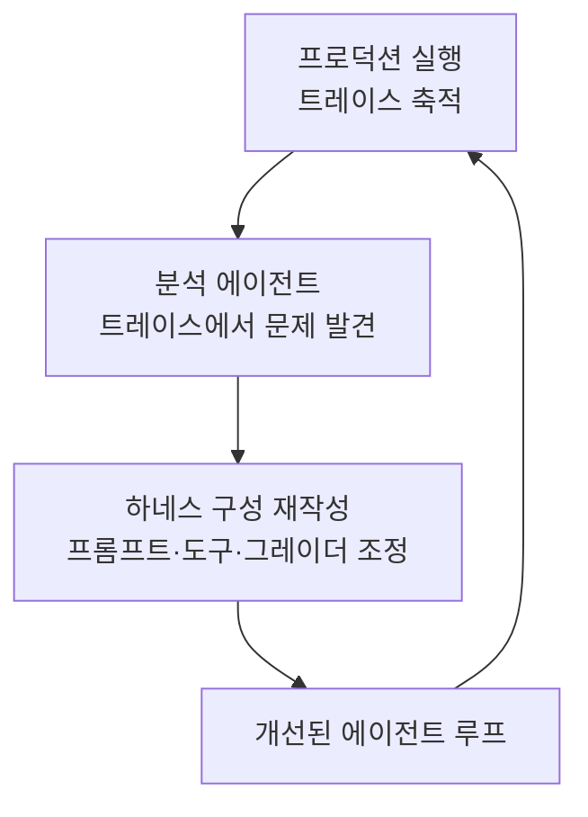

# 에이전트의 실력은 모델이 아니라 루프 네 개가 만듭니다

> **Summary**
> 에이전트를 믿고 쓰려면 좋은 모델만으로는 부족하고, 작업에 맞는 하네스와 그 위의 루프가 필요합니다. 기본 루프가 일을 끝내고, 검증 루프가 그레이더로 품질을 지키고, 이벤트 루프가 알아서 실행하고, 개선 루프가 트레이스를 보고 하네스 자체를 고칩니다. 루프가 쌓일수록 사람의 일은 사라지지 않고, 판단이 필요한 지점이 네 군데로 늘어납니다.

---

- 에이전트의 실력은 모델이 정하지 않습니다. 루프 네 개가 정합니다.
- 기본 루프는 일을 끝내고, 검증 루프는 품질을 지키고, 이벤트 루프는 알아서 실행하고, 개선 루프는 하네스 자체를 고칩니다.
- 루프가 쌓일수록 사람의 일은 사라지지 않습니다. 판단이 필요한 지점이 네 군데로 늘어납니다.

에이전트에게 문서 하나 고쳐달라고 했는데, 첫 시도는 링크가 깨지고 요청한 범위를 훌쩍 넘긴 적 있으시죠? 그럼 모델을 바꾸면 해결될까요? 이 글의 답은 다릅니다. 모델이 아니라 루프가 문제였습니다!

🎥 [동영상 보기](https://www.youtube.com/watch?v=4biXYSNkn9Y)

## 왜 모델만으로는 부족할까요?

에이전트가 실제 일을 자동화하려면 좋은 모델만으로는 부족합니다. 작업에 맞게 설계된 **하네스**가 필요합니다. 하네스는 에이전트가 일하는 환경, 즉 도구와 규칙과 제약을 묶은 틀입니다. 핵심 알고리즘 자체는 놀라울 만큼 단순합니다. 모델에게 맥락을 주고, 일이 끝날 때까지 도구를 반복 호출하게 하면 됩니다. 그런데 이 가장 기본적인 루프가 전부가 아닙니다. 루프를 쌓아 올리면 에이전트가 훨씬 더 효과적으로 일합니다.

## 루프 1: 에이전트 루프, 일은 여기서 끝납니다

에이전트의 본질은 간단합니다. 작업이 끝날 때까지 도구를 반복 호출하는 모델입니다. 모델을 고르고 도구를 연결하면 동작하는 에이전트 루프가 완성됩니다. 도구는 에이전트가 현실 세계에서 행동할 수 있게 만드는 요소입니다.

글에서 든 예시는 내부 문서 작성 에이전트입니다. 문서 개선 요청을 받으면 모델이 변경 사항을 계획하고 초안을 씁니다. 저장소를 복제하고, 파일을 읽고, 문서를 쓰고, 풀 리퀘스트를 여는 일까지 도구가 맡습니다. 이 장면이 저는 가장 인상 깊었습니다. 에이전트가 채팅창에서 답만 하는 존재가 아니라, 실제 시스템 안에서 일을 끝내는 존재라는 게 한눈에 보이니까요!

## 루프 2: 검증 루프, 한 번에 안 되면 다시 돌립니다

에이전트 루프는 일을 처리하지만, 첫 시도에서 항상 정확하거나 일관된 결과를 내지는 않습니다. 일관성이 중요할 때는 출력을 점검하고, 미흡하면 피드백을 모델로 되돌리는 **검증 루프**로 감쌉니다.

검증 루프는 **그레이더**를 추가합니다. 그레이더는 에이전트 출력을 루브릭에 대조하고, 실패하면 피드백과 함께 결과를 되돌립니다. 그레이더는 결정론적일 수도 있고, 에이전트형일 수도 있습니다. 대표적인 예가 **LLM as a judge**입니다. 문서 작성 예시에서는 그레이더가 각 시도 뒤에 테스트를 실행합니다. 모든 링크가 정상 작동하는지, 모든 CI 검사가 통과하는지, 변경 범위가 요청 안에 머무는지를 확인합니다. 수동 리뷰 없이 오류 유형을 포착합니다!

다만 공짜는 아닙니다. 검증을 추가하면 실행마다 지연 시간과 비용이 늘어납니다. 속도보다 품질이 중요한 대부분의 프로덕션 용도에서는 그만한 가치가 있습니다. 품질이 목적인데 검증 없이 돌리는 건, 검수 없이 출고하는 것과 무엇이 다를까요?

## 루프 3: 이벤트 루프, 부르면 오는 게 아닙니다

에이전트 개발에서 가장 중요한 부분 중 하나는 **통합 계층**입니다. 에이전트를 생태계에 연결해 백그라운드에서 실행되게 만드는 일입니다. **이벤트 기반 루프**는 새 문서가 도착하거나, 스케줄이 발동하거나, 웹훅이 도착하면 에이전트를 실행합니다.

에이전트는 사람이 수동으로 호출하는 대상이 아닙니다. 더 큰 시스템 안에서 계속 동작하는 구성 요소입니다. 문서 에이전트는 채팅 채널에 메시지가 오면 실행됩니다. 예를 들어 문서 요청 전용 채널에 메시지가 도착하면, 채널이 문서 에이전트를 깨웁니다. 스케줄 기반의 **하트비트**도 같은 맥락입니다. 에이전트를 항상 켜져 있는 능동형 어시스턴트로 바꾸는 방식입니다.

## 루프 4: 개선 루프, 개선 자체를 자동화합니다

앞의 세 루프가 작업을 자동화한다면, 네 번째 루프는 **개선 자체를 자동화**합니다. 모든 에이전트 실행은 **트레이스**를 남깁니다. 모델이 무엇을 했고, 어떤 도구를 호출했고, 그레이더가 무슨 피드백을 줬는지 기록한 것입니다. 이 트레이스에는 무엇이 잘되고 무엇이 안 되는지에 대한 가치 높은 신호가 담겨 있습니다.

개선 루프는 트레이스에 분석 에이전트를 실행하고, 그 결과로 **하네스 구성**을 개선된 설정으로 다시 씁니다. 프롬프트나 도구를 조정하거나, 그레이더를 조정하는 식입니다. 문서 에이전트 예시에서는 분석 엔진이 트레이스를 훑어 문제를 감지합니다. 여러 트레이스가 같은 잠재적 문제를 가리키면, 문제되는 프롬프트나 도구의 변경을 요청하는 이슈가 등록됩니다.

핵심은 반환 화살표의 방향입니다. 화살표가 단순히 맨 위로 되돌아가는 게 아닙니다. **안쪽으로 들어가 에이전트 루프를 직접 갱신**합니다. 바깥 루프의 한 주기가 안쪽 루프를 더 효과적으로 만듭니다!

나아가 오픈 웨이트 모델을 운영하는 팀은 이 루프를 **RL 파인튜닝**에 연결할 수 있습니다. 트레이스나 평가 결과를 학습 신호로 삼아 모델 자체를 개선하는 방식입니다. 메모리나 검색된 스킬 같은 보조 맥락도 같은 방식으로 개선할 수 있습니다. 루프는 패턴이고, 무엇을 최적화할지는 사용하는 사람에게 달려 있습니다.

## 사람은 어디에 남을까요?

자동화가 사람을 루프에서 제거한다는 뜻은 아닙니다. 모든 계층에 사람의 감독이 가치를 더하는 지점이 있습니다. 자동 그레이더는 링크가 정상 작동하는지 확인할 수 있습니다. 하지만 대상 독자에게 프레이밍이 잘못됐음을 알아채는 건 사람의 몫입니다. 맥락과 경험과 안목에서 나오는 판단이 사람 리뷰가 필요한 지점입니다.

일부 전문성은 프롬프트나 도구 자체에 코드화해야 합니다. 하지만 금융 거래나 데이터베이스 작업 같은 **민감한 행동**에는 실시간 사람 리뷰가 필수입니다. 네 루프마다 사람의 자리가 따로 있습니다. 에이전트 루프에서는 민감한 도구 호출 전에 사람 입력을 요구하고, 검증 루프에서는 사람이 그레이더 역할을 하고, 애플리케이션 루프에서는 최종 사용자에게 반환하기 전에 사람이 출력을 승인하고, 개선 루프에서는 하네스 개선이 배포 전에 사람 리뷰를 통과합니다.

## 루프 3·4로 초점이 옮겨갑니다

네 루프를 한 번에 정리하면 이렇습니다. 에이전트 루프는 작업을 자동화하고, 검증 루프는 작업 품질과 정확성을 보장하고, 이벤트 루프는 대규모 작업을 자동화하고, 개선 루프는 하네스를 개선합니다. 루프 1·2는 오래전부터 다뤄왔습니다. 이제 초점은 에이전트를 생태계에 내장해 기준에 따라 계속 개선되며 가치가 복리로 쌓이는 **루프 3·4로 전환**되어야 합니다. 사람의 판단과 토큰 자본이 함께 복리로 쌓이는 학습 루프를 일찍 구축하는 곳이 복제하기 어려운 우위를 확보한다는 지적도 나옵니다.

한 가지 단서는 짚고 넘어가야 합니다. 이 네 루프 구조는 한 벤더의 프레임워크로 설명된 것입니다. 각 계층에 붙은 도구 이름은 그 벤더의 제품입니다. 하지만 루프 자체는 패턴입니다. 어떤 도구로 구현하든, 일을 끝내고, 품질을 지키고, 알아서 실행하고, 스스로 개선하는 네 겹의 루프가 에이전트의 실력을 만듭니다!

루프를 설계하는 일이 이제 에이전트를 쓰는 일의 본질이 됐습니다. 모델이 좋아지기를 기다리는 대신, 루프 네 개를 어떻게 쌓을지부터 그려보시는 건 어떨까요?

