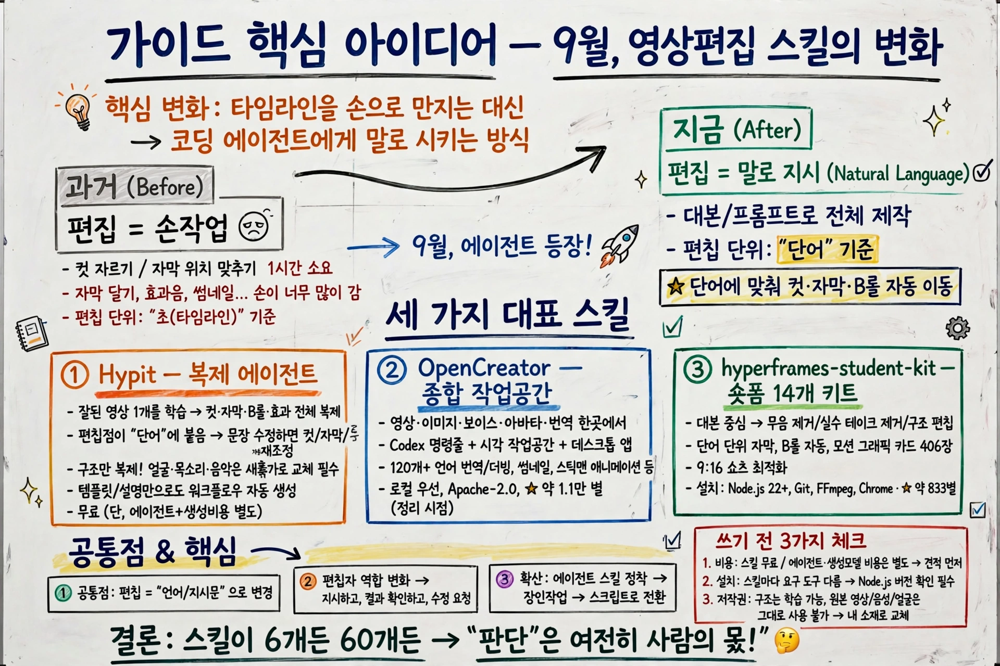
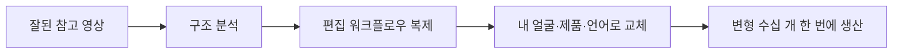
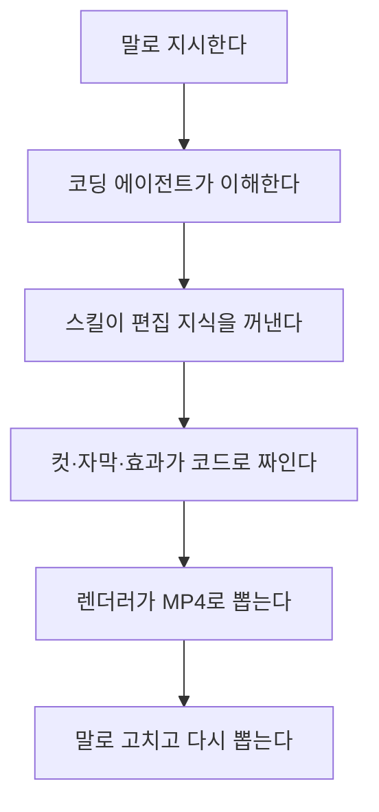

# 영상 편집, 이제 타임라인이 아니라 말로 합니다. 9월에만 스킬 6개가 쏟아졌습니다

> **Summary**
> 9월에는 영상 편집을 말로 지시하는 다양한 AI 스킬이 등장했습니다. 잘된 영상의 편집 구조를 복제하는 도구, 번역·더빙·생성을 한곳에서 다루는 작업공간, 숏폼 제작 키트 등은 컷과 자막을 단어 단위로 조정해 편집 과정을 간소화합니다. 다만 에이전트·생성 비용과 설치 요건을 확인하고, 원본 영상의 화면과 소리를 무단으로 사용하지 않도록 주의해야 합니다.

---

- 9월에 영상 편집 스킬이 한꺼번에 쏟아졌습니다. 잘된 영상의 컷·자막·효과를 통째로 복제하는 도구부터, 번역·더빙·아바타까지 한곳에 모은 작업공간까지, 종류도 각양각색입니다.
- 공통점은 하나입니다. 타임라인을 손으로 만지는 대신, 코딩 에이전트에게 말로 시키는 방식입니다.
- 세 가지 대표 스킬을 뜯어보니, 편집의 단위가 초에서 단어로 바뀌고 있었습니다.

쇼츠 하나 만들려고 편집 앱을 켰는데, 자막 위치 맞추는 데만 한 시간이 간 적 있으시죠? 컷 나누고, 자막 달고, 효과음 고르고, 썸네일 만들고. 영상 하나에 들어가는 손길이 너무 많습니다. 9월에 쏟아진 영상 편집 스킬들은 이 손길을 줄이는 대신, 아예 없애는 쪽을 택했습니다.

🎥 [동영상 보기](https://www.youtube.com/watch?v=XPZ-m6F_YNU)

참고로 원문 게시글은 직접 읽지 못했습니다. X 로그인 벽에 막혔기 때문입니다. 그래서 저장된 제목과 요약에서 확인된 세 가지 스킬을 중심으로, 각 저장소와 문서를 교차 확인해 재구성했습니다. 게시글은 6개를 소개했지만, 나머지 세 가지는 이름을 확정할 수 없어 이 글에서는 다루지 않았습니다.

## 잘된 영상, 통째로 복제할 수 있을까요?

첫 번째는 `Hypit`입니다. 잘된 영상 하나를 주면, 에이전트가 그 영상을 통째로 복제합니다. 컷, 자막, B롤, 효과까지 워크플로우 전체를 가져옵니다. 대본 요약이나 장면 목록이 아닙니다. 다시 실행할 수 있는 편집 설계도 자체를 뽑아내는 겁니다!

핵심은 편집점이 단어에 붙어 있다는 점입니다. 보통 편집점은 초 단위에 고정됩니다. 그런데 여기서는 대사가 바뀌면 컷이 따라 움직입니다. 문장 하나를 고치면 자막이 다시 맞춰지고, B롤도 다시 들어갑니다. 그래서 복제한 뒤에는 얼굴, 제품, 언어만 갈아끼우면 됩니다. 같은 구조로 변형 수십 개를 한 번에 뽑아낼 수도 있습니다.

참고 영상 없이 시작할 수도 있습니다. 템플릿에서 출발하거나, 설명만으로 에이전트가 워크플로우를 처음부터 짜줍니다. 생성 모델을 쓰지 않고 코드로 그린 화면만으로 영상을 완성하는 길도 있습니다. 스킬 자체는 무료입니다. 다만 코딩 에이전트 요금제와 이미지·음성 생성 비용은 따로 듭니다. 설치는 스킬 마켓플레이스에서 검색해 추가하는 방식입니다.

그런데 복제에도 선이 있습니다! 원래 영상의 화면, 목소리, 음악, 등장인물의 얼굴은 그대로 쓸 수 없습니다. 구조만 배우고, 화면과 인물은 생성 모델로 다시 만들거나 내 소재로 채워야 합니다. 이 구분을 지키는 것이 복제를 제대로 쓰는 방법입니다.

## 번역부터 아바타까지, 한곳에서 끝낼 수 있을까요?

두 번째는 `OpenCreator`입니다. 영상·이미지·보이스·아바타·번역을 한 작업공간에서 다루는 크리에이터용 종합 도구입니다. 전에는 영상 번역·더빙 도구로 알려졌던 프로젝트가 작업공간 전체로 커진 모습입니다.

방식은 첫 번째와 다릅니다. 스킬 하나가 아니라, `Codex` 명령줄 도구를 실행 엔진으로 삼고 그 위에 시각 작업공간과 데스크톱 앱을 얹은 형태입니다. 도구는 열 가지가 들어 있습니다. 영상 번역과 더빙, 영상 다운로드, 이미지·영상 생성, 음성 더빙, 글쓰기와 쇼츠 대본, 스틱맨 애니메이션, 썸네일 생성까지 말입니다. 영상 번역은 120개가 넘는 언어를 지원합니다.

로컬 우선이라는 점도 눈에 띕니다. 창작과 개발 작업을 내 컴퓨터에서 돌리고, 에이전트 대화로 지시합니다. 라이선스는 `Apache-2.0`입니다. 게시글이 정리한 시점의 별은 약 1만 1천 개였습니다.

## 릴스·쇼츠만 노리는 스킬 묶음도 있을까요?

세 번째는 `hyperframes-student-kit`입니다. 릴스·쇼츠 전용 스킬 14개 묶음입니다. `HyperFrames`라는 HTML 기반 영상 렌더러 위에 얹힌 편집 키트입니다. 게시글 시점의 별은 약 833개였습니다.

이 키트의 편집은 대본에서 출발합니다. 무음 구간을 자르고, 실수한 테이크를 골라내고, 이야기 구조를 짠 뒤, 9:16 세로 영상으로 바꿉니다. 자막은 단어 단위로 정확하게 붙고, B롤은 움직이며, 모션 그래픽 카드 406장이 준비돼 있습니다. 긴 영상을 찍어두고 숏폼으로 바꾸는 흐름에 맞춰져 있습니다.

설치에는 `Node.js` 22 이상, `Git`, `FFmpeg`, 크롬이 필요합니다. 손이 좀 가는 편입니다. 대신 대본 기반 컷이라는 방식 자체가, 말로 편집한다는 이 물결의 본질을 가장 잘 보여줍니다.

## 세 스킬, 뭐가 같고 뭐가 다를까요?

세 스킬은 겉모습이 다릅니다. 복제 도구, 종합 작업공간, 숏폼 전용 키트. 그런데 속을 보면 같은 방향을 가리킵니다. 편집을 타임라인이 아니라 언어로 다루는 겁니다!

이 흐름에서 편집자는 타임라인을 만지지 않습니다. 지시하고, 결과를 보고, 고칠 곳을 말합니다. 9월에 이런 스킬이 한꺼번에 나온 이유도 여기에 있습니다. 에이전트 스킬이라는 형식이 정착하면서, 영상 편집이라는 장인이 하던 일이 지시문과 스크립트로 옮겨지고 있습니다.

P264에서 다룬 `Diffusion Studio`와는 결이 다릅니다. 그쪽은 타임라인과 코드가 양방향으로 동기화되는 데스크톱 편집기입니다. 손으로 만지는 편집기를 에이전트도 쓸 수 있게 만든 겁니다. 이번 스킬들은 반대로, 편집기 자체를 거치지 않고 에이전트 안에서 끝냅니다. 같은 달에 나온 도구들인데, 접근이 정반대라는 점이 재미있습니다!

## 쓰기 전에 확인할 것은요?

세 가지만 짚어보겠습니다. 첫째, 비용입니다. 스킬은 무료인 경우가 많지만, 에이전트 요금제와 생성 모델 비용은 별도입니다. 만들기 전에 견적을 먼저 받는 습관이 필요합니다. 둘째, 설치입니다. 스킬마다 요구하는 도구가 다릅니다. `Node.js` 버전부터 확인하는 것이 빠릅니다. 셋째, 저작권입니다. 잘된 영상의 구조는 배울 수 있지만, 그 영상의 화면과 소리를 그대로 가져올 수는 없습니다.

영상 편집이 말로 하는 일이 되면서, 편집의 진입 장벽은 낮아졌습니다. 그런데 판단의 자리는 그대로 남았습니다. 어떤 영상을 참고할지, 어디까지 바꿀지, 무엇을 내 것으로 만들지는 여전히 사람의 몫입니다. 스킬이 6개든 60개든, 그 판단이 먼저입니다!

