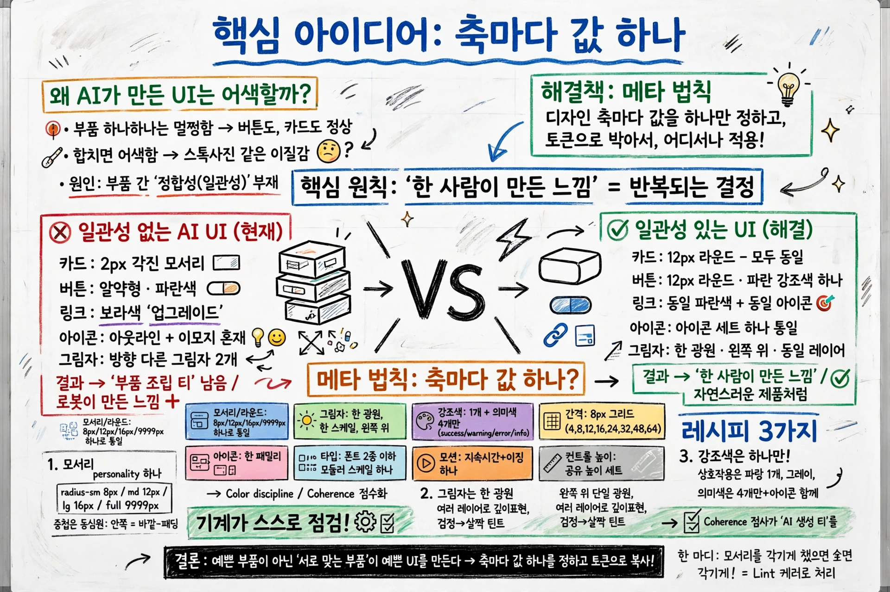
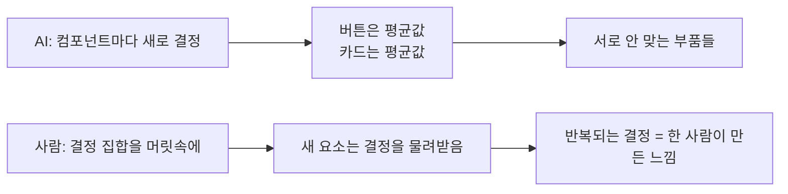
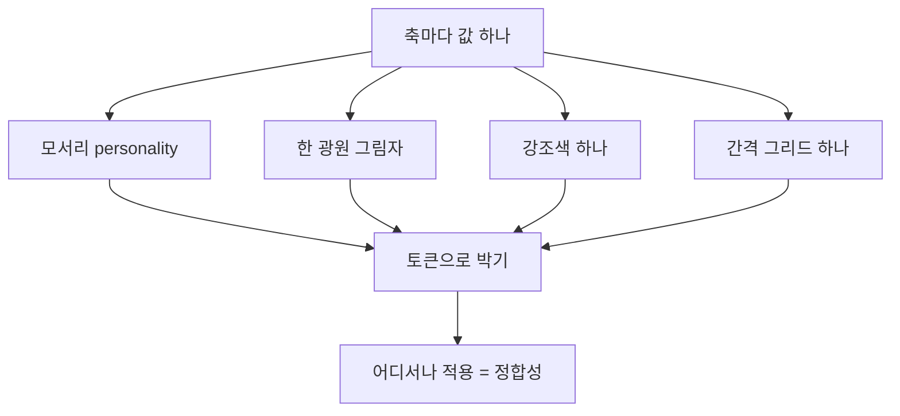
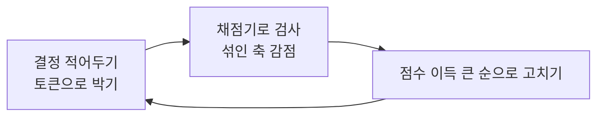

# 예쁜 부품이 예쁜 UI를 만들지 않습니다. 서로 맞는 부품이 만듭니다

> **Summary**
> AI가 만든 UI는 부품 하나하나는 멀쩡한데, 합치면 어색한 티가 납니다. 원인은 못생긴 부품이 아니라 부품들이 서로 안 맞는 것, 정합성의 부재입니다. 모서리·그림자·강조색·간격 같은 디자인 축마다 값을 하나만 정해 토큰으로 박고 어디서나 적용하면, 그 한 가지 규율만으로 '로봇이 만들었네'와 '디자이너가 만들었네'가 갈립니다.

---

- AI가 만든 UI는 부품 하나하나는 멀쩡한데, 합치면 어색한 티가 납니다.
- 원인은 못생긴 부품이 아니라, 부품들이 서로 안 맞는 정합성의 부재입니다.
- 축마다 값을 하나만 정해 토큰으로 박고 어디서나 적용하면, 그 한 가지 규율만으로 티가 사라집니다.


AI한테 대시보드 하나 만들어달라고 해보셨죠? 버튼도 버튼답고, 카드도 카드답습니다. 그런데 전체를 보면 묘하게 어색합니다. 마치 UI를 찍은 스톡 사진 같달까요?

🎥 [동영상 보기](https://www.youtube.com/watch?v=7Z9rrryIOC4)

## 뭐가 어색한 걸까요?

틀린 게 하나도 없는 화면을 떠올려보겠습니다. 각진(2px) 카드 안의 알약 모양 버튼, 파란 버튼 옆 보라색 "업그레이드" 링크, 아웃라인 아이콘에 섞인 이모지 1개, 방향이 다른 그림자 2개.

하나씩 떼어 보면 전부 정당화됩니다. 그런데 합치면 "부품 조립" 신호가 뜹니다! 사람 디자이너라면 같은 화면에서 이 결정들을 동시에 내리지 않습니다. 모서리 스타일 하나, 강조색 하나, 아이콘 세트 하나, 광원 하나를 고르고 어디서나 반복합니다.

그 반복이 "한 사람이 만든 느낌"의 정체입니다. `Refactoring UI` 전체가 "불필요한 변주를 만들지 마라"는 책이기도 합니다. 원칙은 오래됐고, 새로운 건 AI가 기본값으로 이걸 깨뜨린다는 점입니다.

## AI는 왜 유독 이걸 못 할까요?

언어 모델은 UI를 국소적으로 생성합니다. 카드, 버튼, 모달을 각각 그럴듯한 새 조각으로 따로 만듭니다. "40줄 위의 버튼이 알약 모양이었으니 이것도 알약이어야 한다"는 기억이 없습니다. 각 컴포넌트는 학습 데이터의 평균값으로 회귀하는데, "버튼의 평균"과 "카드의 평균"은 서로 맞춰진 적이 없습니다.

사람은 머릿속에 아주 작은 결정 집합, 이를테면 둥근 모서리, 파란 강조색, 8px 그리드를 들고 다니고, 새 요소는 전부 그걸 물려받습니다.

그래서 해법은 "모델을 더 감각 있게"가 아닙니다. 끈끈한 결정들을 적어두고, 모델에게 새로 만들지 말고 복사하라고 시키는 것입니다!



## 메타 법칙: 축마다 값 하나

핵심은 한 문장입니다.

> 디자인 축마다 값(또는 패밀리)을 하나만 정하고, 토큰으로 박아서, 어디서나 적용한다.

정합성은 "모든 화면이 똑같다"가 아닙니다. 같은 결정이 반복되는 것입니다. 설정 페이지와 대시보드는 다르게 생겨도, 모서리·그림자·강조색·간격만 공유하면 한 제품처럼 느껴집니다.

| 축 | 하나만 정한다 | 섞이면 |
| --- | --- | --- |
| 모서리/라운드 | 각짐 0–4px · 부드러움 8–12px · 알약 | "두 제품 붙인 느낌" |
| 그림자 | 한 스케일, 한 광원(좌상단), 한 색조 | "태양이 둘인 장면" |
| 강조색 | 강조는 1개 (+ 의미색 red/green/amber) | 강조가 안 읽힘 |
| 간격 단위 | 8px 그리드 하나 (4px 하프스텝) | 오프그리드 = 엉성함 |
| 아이콘 | 한 패밀리, 한 채움, 한 굵기 | "겉도는" 느낌 |
| 타입 스케일 | 모듈러 스케일 하나, 폰트 2종 이하 | 임의 크기가 리듬을 깸 |
| 모션 | 지속시간 세트 하나 + 이징 패밀리 하나 | 빠릿함·굼뜸이 섞임 |
| 컨트롤 높이 | 공유 높이 세트 (예: 40px) | 베이스라인 깨짐 |

한 마디로 정리하면 이렇습니다.

> "모서리를 각지게 했으면 다 각지게 가야지."

정확합니다. 그리고 이건 위 표의 모든 행에 그대로 적용됩니다. 축이 섞이는 건 스타일 선택이 아니라 lint 에러로 취급하세요!

## 레시피 1: 모서리 personality 하나, 중첩은 동심원으로

라운드는 토큰이지 매직 넘버가 아닙니다. 작은 스케일을 정의해 어디서나 참조하세요.

```css
:root {
  --radius-sm: 8px;
  --radius-md: 12px;
  --radius-lg: 16px;
  --radius-full: 9999px;
}
```

그다음 personality 하나를 골라 카드·버튼·인풋·모달·이미지에 적용합니다. 모델이 `rounded-none` 패널에 `rounded-full` 버튼을 섞게 두지 마세요.

두 번째 규칙은 중첩된 라운드는 중심을 공유해야 한다는 점입니다. 둥근 컨테이너 안의 둥근 요소는 안쪽 반지름이 더 작아야 합니다.

```javascript
안쪽 반지름 = 바깥 반지름 − 패딩
```

안쪽 요소에 바깥과 같은 라운드를 주면 코너가 호를 비집고 튀어나옵니다.

## 레시피 2: 그림자는 한 광원, 레이어로 쌓기

깊이를 가짜로 보이게 하는 가장 빠른 방법이 단일 하드 `box-shadow`입니다. 진짜 그림자는 반음영이라 낮은 불투명도 레이어를 여러 겹 쌓고, 검정 대신 표면 색조 쪽으로 살짝 틴트하세요. 순수 검정은 탁해집니다.

```css
--shadow-md:
  0 1px 2px  hsl(220 40% 20% / 0.08),
  0 2px 4px  hsl(220 40% 20% / 0.08),
  0 4px 8px  hsl(220 40% 20% / 0.08);
```

정합성 규칙은 페이지 전체가 한 광원, 관례상 위쪽에 약간 왼쪽입니다. 수직 오프셋은 수평의 약 2배, 고도가 올라가면 오프셋·블러는 커지고 불투명도는 낮아집니다.

다크 모드에선 그림자가 거의 안 보이므로 톤 기반 고도로 전환하세요. 높을수록 밝은 표면입니다.

## 레시피 3: 강조색 하나, 나머지는 그레이스케일

"AI 무지개" UI는 대개 강조가 필요할 때마다 새 색을 꺼내 써서 생깁니다. 규율은 단순합니다. 상호작용 강조는 하나의 강조색, 텍스트·표면·테두리는 틴트된 그레이 램프, 의미색은 딱 넷(success·warning·error·info)이고 오직 의미로만 씁니다. 장식으로는 절대 안 씁니다!

```css
:root {
  --accent: #5b5bd6;
  --grey-50:  hsl(240 20% 98%);
  --grey-500: hsl(240 8%  55%);
  --grey-900: hsl(240 12% 14%);
}
```

접근성 하한선, `WCAG 2.2 AA`도 있습니다. 본문 텍스트 4.5:1, 큰 텍스트·UI 요소 3:1입니다. 정보를 색으로만 전달하면 안 됩니다. 유효성 실패 필드에 빨간 테두리만으로는 부족하고, 아이콘과 메시지를 같이 넣으세요.

## 레시피 4: 간격 그리드 하나, 그룹핑은 근접성으로

margin·padding·gap을 한 스케일, `4, 8, 12, 16, 24, 32, 48, 64`에 스냅하세요. 그룹 바깥 공간이 그룹 안 공간보다 확실히 커야 합니다.

폼 사다리는 이렇습니다.

```javascript
라벨 → 인풋        : 4–8px
인풋 → 인풋         : 12–16px
그룹 → 그룹 (섹션)  : 24–32px
```

전부 균일하게 띄우면 눈이 무엇이 한 덩어리인지 알 수 없습니다. 단계마다 두 배로 벌어지는 게 핵심입니다.



## 기계가 스스로 점검하게 하면 어떨까요?

결정을 적어두는 게 절반이고, 나머지 절반은 위반을 잡는 것입니다. 채점 기준만 쥐여주면 AI가 실제로 쓸모 있습니다.

가장 쓸모 있던 조각은 정합성 채점기입니다. 파일을 점수화하고 섞인 축을 감점으로 잡습니다.

```javascript
## Design Score: 70 / 100   (Dashboard.tsx)
Color discipline  13/18  강조색 3개
Coherence          6/12  각진 카드 + 알약 버튼

### 먼저 고칠 것
1. 라운드 통일 + 강조색 1개로  → +9
2. empty + loading 상태 추가  → +7
```

"Coherence" 항목이 "AI 생성 티"를 가장 잘 예측합니다. 컴포넌트별 예쁨이 아니라 전역 일관성을 재기 때문입니다!



## 결론

하나만 기억한다면 이겁니다.

> 예쁜 부품이 예쁜 UI를 만들지 않습니다. **서로 맞는** 부품이 만듭니다.

축마다 값 하나를 골라 토큰으로 적어두고, 새 요소가 그걸 물려받게 하세요. 그 한 가지 규율이 "로봇이 만들었네"와 "디자이너가 만들었네"를 가릅니다. AI가 만든 인터페이스에 할 수 있는 가장 싸고 효과 큰 일입니다.

모서리가 각지다고요? 그럼 전부 각지게. 끝까지요.

