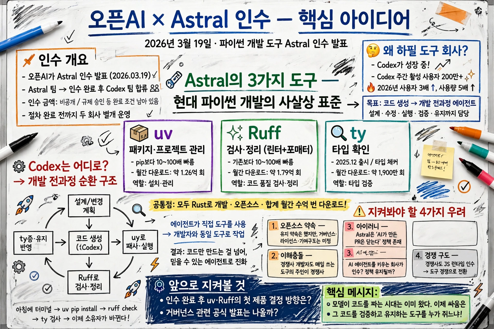
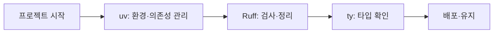
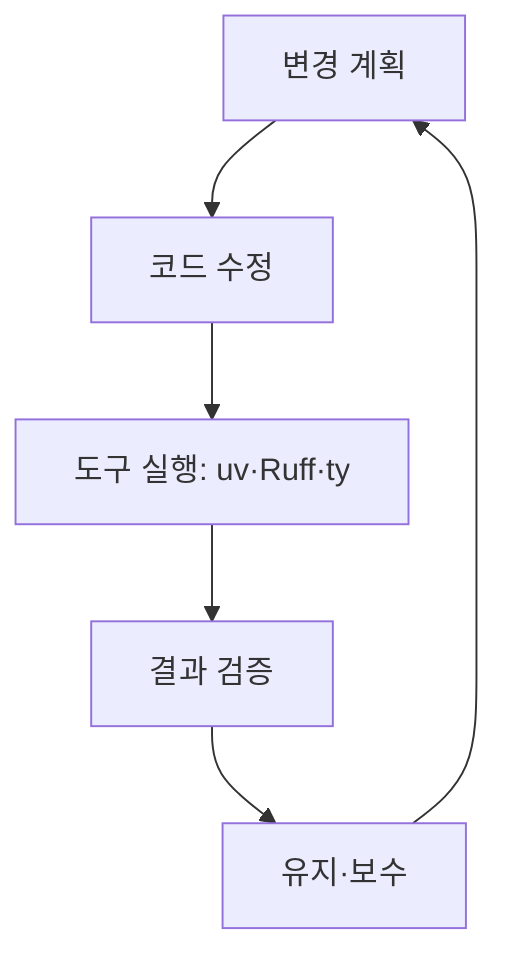
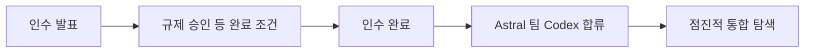

# 오픈AI가 Astral을 인수했습니다. 코딩 에이전트 전쟁은 모델이 아니라 도구 싸움입니다

> **Summary**
> 오픈AI는 파이썬 도구 uv, Ruff, ty를 만든 Astral을 인수해 Codex를 코드 생성에서 설계·검증·유지까지 담당하는 에이전트로 확장하려 합니다. 세 도구는 오픈소스로 유지될 예정이지만, 경쟁사도 널리 쓰는 만큼 인수 후 거버넌스와 기여 정책, 제품 방향을 지켜볼 필요가 있습니다.

---

- 오픈AI가 2026년 3월 19일 파이썬 개발 도구 `uv`, `Ruff`, `ty`를 만든 Astral 인수를 발표했습니다. 인수 절차가 끝나면 Astral 팀은 코딩 에이전트 Codex 팀에 합류합니다.
- 세 도구는 모두 러스트로 만든 오픈소스로, 매달 수억 번 다운로드되며 현대 파이썬 개발의 사실상 표준이 됐습니다. 오픈AI는 코드만 짜주던 Codex를 설계부터 검증까지 개발 전 과정을 맡는 에이전트로 키우겠다는 계획입니다.
- 두 회사는 오픈소스 유지를 약속했지만, 경쟁사 개발자까지 매일 쓰는 도구의 주인이 바뀐 만큼 앞으로의 운영 방식을 지켜봐야 합니다.

아침에 터미널을 켜고 `uv pip install`을 치는 건, 이제 파이썬 개발자의 몸에 밴 습관입니다. 설치가 끝나면 `ruff check`으로 코드를 다듬고, 타입이 맞는지 `ty`로 확인합니다. 그런데 어느 날 아침, 매일 쓰던 이 도구들의 주인이 바뀌었다는 소식이 떴습니다. 오픈AI가 Astral을 인수한다는 발표였습니다!

🎥 [동영상 보기](https://www.youtube.com/watch?v=_Al7pl5pE2A)

## 왜 하필 지금, 왜 하필 도구 회사일까요?

2026년 3월 19일, 오픈AI는 Astral을 인수하겠다고 발표했습니다. 인수 금액은 공개되지 않았습니다. 규제 승인을 비롯한 완료 조건이 남아 있고, 절차가 끝나기 전까지 두 회사는 별개로 운영됩니다.

Astral은 AI 회사가 아닙니다. AI 모델도, 챗봇도 만들지 않았습니다. 만든 건 파이썬 개발자가 매일 쓰는 빠른 도구 세 가지뿐입니다. 그런데 오픈AI는 이 회사를 샀습니다. 왜일까요?

답은 Codex의 숫자에서 찾을 수 있습니다. Codex는 주간 활성 사용자 200만 명을 넘겼고, 2026년 들어 사용자 3배, 사용량 5배로 뛰었습니다. 코드만 생성해주는 단계는 이미 지나갔습니다. 다음 단계로 가려면 코드 생성 바깥의 과정까지 손에 넣어야 했습니다.

오픈AI의 목표는 분명합니다. 코드만 생성하는 도우미가 아니라, 변경을 설계하고, 코드를 고치고, 도구를 실행하고, 결과를 검증하고, 소프트웨어를 오래 유지하는 전 과정에 참여하는 에이전트입니다. Astral의 도구는 그 과정 한가운데에 있습니다.

이 대목이 저는 가장 인상 깊었습니다. 모델 성능 경쟁이 아니라, 개발자가 코드를 짜기 전에 거치는 준비 과정 자체를 사들였다는 점입니다!

## Astral이 만든 세 가지 도구, 뭐가 다른가요?

세 도구의 역할은 딱 나뉩니다. `uv`는 패키지와 프로젝트 관리, `Ruff`는 검사와 정리, `ty`는 타입 확인입니다. 개발자가 프로젝트를 시작할 때부터 배포할 때까지, 이 세 가지가 한 줄로 이어집니다.

공통점은 속도입니다. 세 도구 모두 러스트로 만들었습니다. `uv`는 `pip`보다 10배에서 100배 빠르고, `Ruff`도 기존 린터와 포매터보다 10배에서 100배 빠릅니다. `ty`는 2025년 12월에 나온 타입 체커로, 같은 철학을 타입 검사에 적용했습니다.

숫자가 말해줍니다. 월간 다운로드가 `uv` 약 1억 2,600만 회, `Ruff` 약 1억 7,900만 회, `ty` 약 1,900만 회입니다. 합치면 매달 수억 번입니다! 공식 파이썬 문서도 새 프로젝트의 패키지 관리자로 `uv`를 권장합니다. 어느새 표준이 된 겁니다.

## Codex는 어디로 가려는 걸까요?

Codex의 방향은 한 문장으로 정리됩니다. 코드 생성을 넘어, 개발 전 과정에 참여하는 동료가 되겠다는 겁니다. 변경을 계획하고, 코드베이스를 수정하고, 도구를 실행하고, 결과를 검증하고, 소프트웨어를 오래 유지하는 일까지 말입니다.

Astral의 도구가 그 흐름 안에 직접 들어가면, 에이전트가 개발자와 같은 도구를 같은 방식으로 쥐게 됩니다. 코드를 뱉고 끝내는 게 아니라, 검사하고 고치고 다시 확인하는 순환이 에이전트 안에서 돕니다. 그 순환이 빨라질수록 에이전트는 더 믿을 만해집니다.

## 그래서, 뭘 걱정해야 할까요?

첫째, 오픈소스 약속입니다. 양쪽 모두 인수 뒤에도 오픈소스로 지원하겠다고 밝혔습니다. 말은 분명합니다. 다만 거버넌스, 라이선스, 기여 구조에 대한 구체적인 내용은 발표에 없습니다. 약속은 믿음직하지만, 지켜지는지는 인수 뒤의 결정으로 판가름 납니다.

둘째, 이해충돌입니다. `uv`와 `Ruff`는 경쟁사 개발자들도 매일 씁니다. 이제 그 도구의 주인은 경쟁사입니다. 도구의 방향을 정하는 회의실에 앉은 사람이, 그 도구를 쓰는 경쟁사와 경쟁하는 회사라면? 이 질문이 인수 소식 뒤에 따라붙었습니다.

셋째, 아이러니입니다. Astral의 기여 정책에는 자율 에이전트가 만든 풀 리퀘스트는 닫는다는 문구가 있습니다. AI 코딩 에이전트를 키우는 회사가 인수한 도구의 저장소는, AI가 만든 기여를 받지 않겠다는 뜻입니다. 이 정책이 인수 뒤에도 그대로일까요?

넷째, 경쟁도 같은 길을 걷고 있습니다. 2025년 12월에는 경쟁사가 자바스크립트 런타임 기업을 인수했습니다. AI 코딩 도구 전쟁이 모델 성능 싸움에서 개발 도구 싸움으로 번지고 있습니다.

## 인수가 끝나면 뭐가 달라질까요?

절차는 순서대로 흘러갑니다. 발표가 나왔고, 규제 승인 등 완료 조건을 거쳐 인수가 끝나면, Astral 팀이 Codex 팀에 합류하고, 그 뒤에 점진적인 통합을 탐색합니다.

당장 달라지는 건 없습니다. 두 회사는 절차가 끝나기 전까지 별개로 운영되고, 도구는 지금처럼 쓸 수 있습니다. 인수 금액도 공개되지 않았습니다. 그래서 지켜볼 것은 두 가지입니다. 인수 뒤 `uv`와 `Ruff`의 첫 제품 결정이 어떻게 정해지는지, 그리고 거버넌스에 대한 발표가 나오는지입니다.

모델이 코드를 짜는 시대는 이미 왔습니다. 이제 싸움은 그 코드를 검증하고 유지하는 도구를 누가 쥐느냐로 옮겨가고 있습니다!

