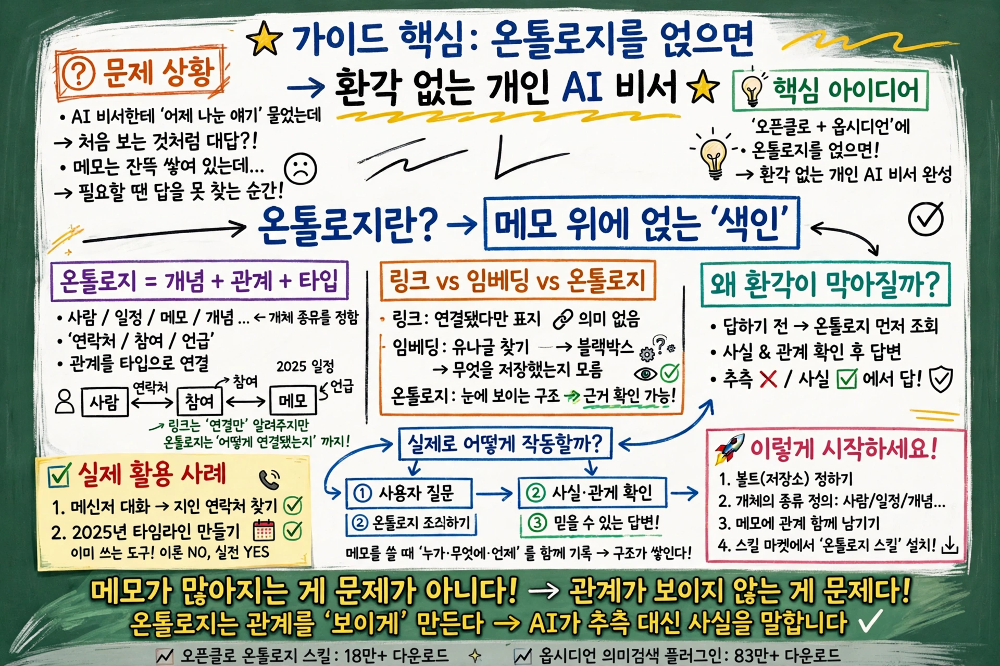
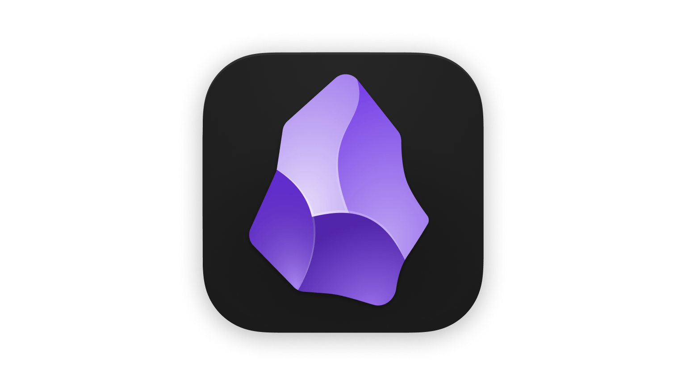
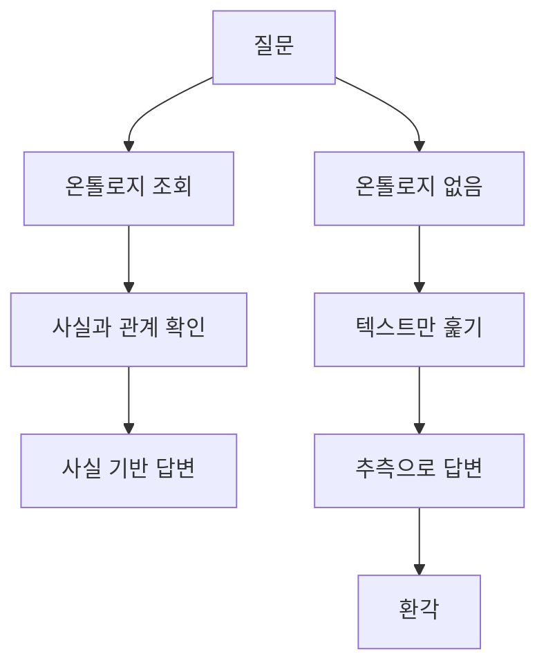
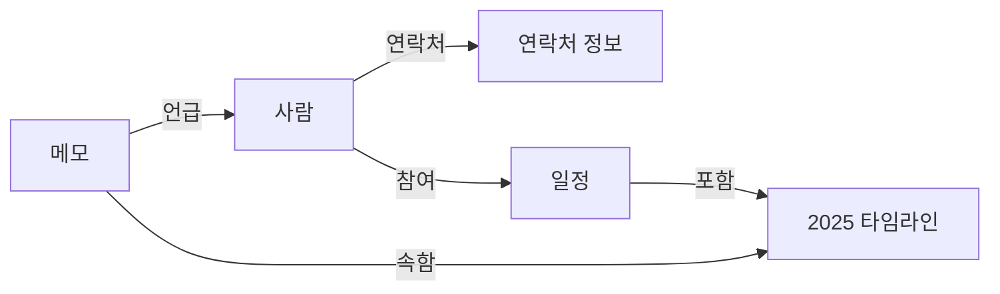

# 옵시디언 온톨로지, 오픈클로의 환각을 멈추게 합니다

> **Summary**
> 온톨로지는 메모 속 개념과 관계를 명확히 구조화해 AI가 추측 대신 사실에 근거해 답하도록 돕습니다. 옵시디언과 오픈클로에 적용하면 연락처 검색이나 타임라인 작성에 활용할 수 있으며, 사람·일정·개념의 종류와 관계를 정해 메모에 함께 기록하는 것부터 시작할 수 있습니다.

---

- 오픈클로와 옵시디언에 온톨로지를 얹으면, 환각 없는 개인 AI 비서가 됩니다.
- 온톨로지는 메모 위에 얹는 색인입니다. 개념과 관계를 타입으로 정해두면, 에이전트는 추측 대신 사실에서 답을 찾습니다.
- 연락처 찾기, 2025년 타임라인 만들기처럼 실제로 써먹은 사례가 이미 있습니다.

AI 비서한테 어제 나눈 얘기를 물었는데, 처음 보는 것처럼 대답한 적 있으시죠? 메모는 잔뜩 쌓여 있는데, 정작 필요할 때 답을 못 찾는 순간 말입니다.

🎥 [동영상 보기](https://www.youtube.com/watch?v=XfvzEqI4dkU)

## 온톨로지가 뭐길래 환각을 막을까요?

온톨로지는 개념과 관계를 타입으로 정리한 구조입니다. 사람, 일정, 메모, 개념 같은 개체마다 종류를 정하고, 개체 사이를 "연락처", "참여", "언급" 같은 관계로 연결합니다. 옵시디언의 `[[링크]]`가 "연결됐다"만 알려준다면, 온톨로지는 "어떻게 연결됐는지"까지 알려줍니다. 이 차이가 큽니다!

링크만 있으면 에이전트는 관련 메모를 잔뜩 읽고도 무엇이 사실인지 가려내지 못합니다. 온톨로지가 있으면 답하기 전에 사실과 관계를 먼저 확인합니다. 그래서 추측이 아니라 사실에서 답합니다!

## 링크와 임베딩, 뭐가 다를까요?

링크는 연결만 알려줍니다. "연결됐다"는 사실만 남고, 관계의 의미는 없습니다. 임베딩은 의미가 비슷한 글을 찾아주지만, 그 과정이 블랙박스입니다. 무엇을 저장했고 무엇을 잃었는지 눈으로 확인할 수 없습니다. 온톨로지는 다릅니다. 개념과 관계가 눈에 보이고, 답의 근거를 직접 열어볼 수 있습니다.

이 장면이 저는 가장 인상 깊었습니다. 메신저 대화에서 온톨로지로 지인의 연락처를 찾고 2025년 타임라인을 만들었다는 대목이, 이게 이론이 아니라 이미 쓰는 도구라는 걸 보여주니까요!

## 실제로 어떻게 쓰일까요?

질문이 들어오면 에이전트는 답부터 만들지 않습니다. 온톨로지를 먼저 조회하고, 사실과 관계를 확인한 뒤에 답합니다. 메모를 쓸 때 개념과 관계를 함께 남기면, 나중에 에이전트가 그 구조를 따라 답을 찾습니다. 메모가 쌓일수록 구조도 함께 자랍니다!

생태계도 커지고 있습니다. 오픈클로 스킬 생태계에서 온톨로지 스킬은 18만 다운로드를 넘겼고, 옵시디언에서 의미 기반으로 관련 메모를 찾아주는 플러그인은 83만 다운로드를 넘겼습니다. 혼자 쓰는 도구가 아니라, 이미 많은 사람이 같은 방향으로 쓰고 있습니다.

## 시작은 어떻게 할까요?

볼트를 정하고, 사람·일정·개념 같은 개체의 종류를 먼저 정합니다. 메모를 쓸 때 관계를 함께 남깁니다. "누가, 무엇에, 언제"가 구조로 남아야 합니다. 스킬 마켓플레이스에서 온톨로지 스킬을 검색해 설치하면, 에이전트가 그 구조를 읽고 답하기 시작합니다.

메모가 많아지는 게 문제가 아닙니다. 메모 사이의 관계가 보이지 않는 게 문제입니다. 온톨로지는 그 관계를 보이게 만듭니다. 그래서 AI 비서가 추측 대신 사실을 말합니다!

