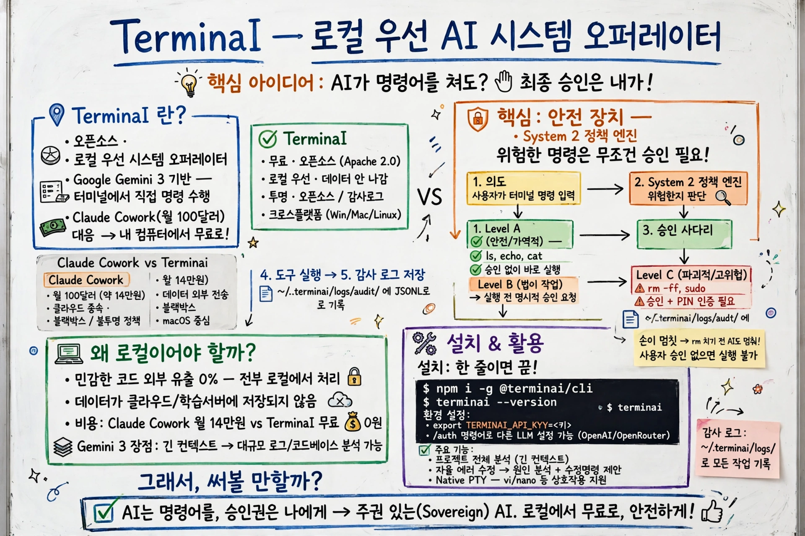
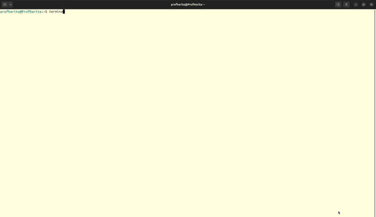
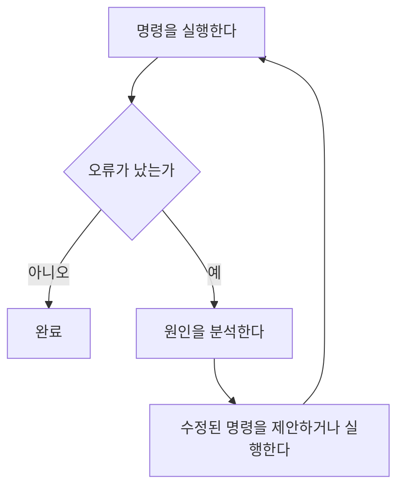

# 월 100달러짜리 AI 시스템 오퍼레이터, 로컬에서 무료로 돌리는 방법이 있다

> **Summary**
> TerminaI는 Gemini 3를 기반으로 로컬에서 무료로 실행되는 오픈소스 AI 시스템 오퍼레이터입니다. 명령 실행 전 위험도를 검토하고, 작업 수준에 따라 사용자 승인이나 추가 인증을 요청하며, 모든 주요 작업을 감사 로그에 기록합니다. 긴 로그 분석과 오류 수정도 지원해 컴퓨터 제어의 편의성과 데이터 주권, 사용자 통제를 함께 제공합니다.

---

- TerminaI는 월 100달러짜리 Claude Cowork에 대응하는 오픈소스, 로컬 우선 시스템 오퍼레이터입니다. Gemini 3 기반으로 터미널에서 직접 명령을 수행합니다.
- 핵심은 안전 장치입니다. 위험한 명령은 System 2 정책 엔진이 걸러내고, 승인 사다리에 따라 사용자가 직접 승인합니다.
- 모든 작업은 로컬에서만 이뤄지고, 감사 로그가 남습니다. 설치는 npm 한 줄이면 됩니다.


터미널에서 `rm`을 치기 전에, 손이 한 번 멈칫한 적 있으시죠? 지워지는 건 되돌릴 수 없다는 걸 아니까요. 그런데 AI가 대신 명령어를 쳐준다면 어떨까요? 편하긴 한데, 뭘 지울지 모른다는 게 더 불안합니다. 그래서 나온 게 TerminaI입니다. 월 100달러짜리 Claude Cowork를 내 컴퓨터에서 무료로 돌리는, 오픈소스 시스템 오퍼레이터입니다!

🎥 [동영상 보기](https://www.youtube.com/watch?v=UAmKyyZ-b9E)

## TerminaI, 도대체 뭘까요?

TerminaI(터미나이)는 사용자의 시스템을 관리하고 제어하는 AI 기반 시스템 오퍼레이터입니다. 터미널 환경에서 직접 명령을 수행하는 자율 에이전트인데, 기반 모델은 Google의 Gemini 3입니다.

배경이 있습니다. Anthropic이 AI가 컴퓨터를 제어하며 업무를 돕는 Claude Cowork를 출시했는데, 연구용 미리보기는 월 100달러 이상 요금제 사용자만 쓸 수 있고, 모든 데이터가 Anthropic으로 전달되어 처리됩니다. 그래서 나온 대안이 TerminaI입니다. "주권이 있는(Sovereign)" AI를 표방합니다. 외부 클라우드가 아니라 사용자의 로컬 머신에서 직접 구동되고, 실행 권한과 데이터 흐름을 사용자가 투명하게 제어합니다. 무료 오픈소스입니다!

- **기반 모델**: TerminaI는 Google Gemini 3, Claude Cowork는 Claude (추정)입니다.
- **비용**: TerminaI는 무료, Claude Cowork는 월 100달러 (약 14만 원)입니다.
- **실행 환경**: TerminaI는 로컬 우선, Claude Cowork는 클라우드 종속입니다.
- **안전 장치**: TerminaI는 System 2 정책 엔진 (승인 기반), Claude Cowork는 불투명한 내부 정책입니다.
- **투명성**: TerminaI는 오픈소스, Claude Cowork는 블랙박스입니다.
- **OS 지원**: TerminaI는 크로스 플랫폼, Claude Cowork는 초기 macOS 중심입니다.


## 왜 로컬이어야 할까요?

민감한 코드가 클라우드 서버에 영구 저장되거나 학습 데이터로 쓰일까 봐 걱정되신 적 있으시죠? TerminaI의 모든 작업은 사용자의 로컬 환경에서 이뤄집니다. 코드가 외부로 나가지 않습니다. 사용자가 통제하는 환경 안에서만 활동합니다.

비용도 다릅니다. Claude Cowork는 월 100달러, 우리 돈으로 약 14만 원입니다. TerminaI는 무료입니다. API 비용만 들고, Gemini 무료 티어를 쓰면 아예 0원입니다. 긴 문맥 처리에 강한 Gemini 3라, 대규모 로그 분석이나 복잡한 코드베이스 이해에도 유리합니다.

## 안전 장치는 어떻게 동작할까요?


여기가 이 도구의 핵심입니다! TerminaI는 AI의 행동을 제어하는 System 2 정책 엔진을 갖추고 있습니다. System 2는 심리학에서 '느리고 신중한 사고'를 뜻합니다. AI가 `rm -rf` 같은 삭제나 네트워크 전송 같은 위험한 명령어를 실행하려 할 때, 즉시 실행하지 않고 사용자에게 명시적인 승인을 요청합니다. 이유를 설명하고, 최종 권한을 사용자에게 넘깁니다.

결정론적 승인 사다리라는 보안 체계가 있습니다. 의도 → 정책 엔진 → 승인 → 도구 실행 → 감사, 이 순서로 흐릅니다. 승인 등급은 세 가지입니다.

- **Level A (안전/가역적)**: `ls`, `echo`, `cat` 같은, 쉽게 되돌릴 수 있는 작업입니다. 승인 없이 즉시 실행됩니다.
- **Level B (변이 작업)**: `mkdir`, `touch`, 파일 편집 같은, 상태를 바꾸는 작업입니다. 실행 전에 명시적인 승인을 요청합니다.
- **Level C (파괴적/고위험)**: `rm`, 시스템 설정 변경, `sudo` 같은 위험한 작업입니다. 승인에 더해 PIN 입력 같은 추가 인증을 거쳐야 합니다.
모든 작업 내역은 감사 로그로 남습니다. `~/.terminai/logs/audit/` 경로에 JSONL 형식으로 저장되어, TerminaI가 수행한 중요 작업을 사후에 검토할 수 있습니다. 일반적인 세션 로그는 `~/.terminai/logs/`에 저장됩니다.

## 뭘 할 수 있을까요?



Gemini 3의 긴 컨텍스트 윈도우를 활용해서, 프로젝트 전체의 파일 구조나 긴 에러 로그를 한 번에 분석할 수 있습니다. 실제 터미널과 동일한 환경(Native PTY)을 제공해서, `vi`나 `nano` 같은 대화형 프로그램이나 복잡한 셸 상호작용도 더 자연스럽게 처리합니다.

자율적 에러 수정도 됩니다. 명령어 실행 후 오류가 나면, 스스로 원인을 분석해서 수정된 명령어를 다시 제안하거나 실행합니다. 개발자가 반복적으로 겪는 디버깅 과정을 획기적으로 단축시켜 줍니다!

## 설치는 어떻게 하나요?

가장 일반적이고 권장되는 방법은 CLI 설치입니다. Node.js 20 이상이 필요하고, 명령어 한 줄이면 됩니다.

```bash
npm i -g @terminai/cli
terminai --version
terminai
```

CLI가 익숙하지 않으면 데스크탑 인스톨러를 쓸 수도 있습니다. OS별 인스톨러를 받아 설치하면 됩니다. 소스 코드를 직접 받아 빌드하는 방법도 있습니다.

LLM 설정은 Gemini가 기본값입니다. 무료 티어 크레딧을 제공해서 비용 장벽 없이 바로 쓸 수 있습니다. API 키를 환경 변수로 내보내기만 하면 됩니다.

```bash
export TERMINAI_API_KEY=<발급받은 키>
terminai
```

OpenAI나 OpenRouter 같은 OpenAI 호환 공급자도 쓸 수 있습니다. `/auth` 명령어로 대화형 설정하거나, 설정 파일(`~/.terminai/settings.json`)을 직접 수정하면 됩니다. 라이선스는 Apache License 2.0이라, 자유롭게 사용·수정·배포할 수 있고 상업적 이용도 가능합니다.

## 그래서, 써볼 만할까요?

기준은 하나입니다. AI한테 컴퓨터를 맡기고 싶은데, 월 100달러와 데이터 주권이 걸린다면, 로컬에서 무료로 돌리는 쪽이 맞습니다. 명령어는 AI가 치고, 승인권은 내 손에 두는 것. 그게 TerminaI가 제시하는 답입니다!

