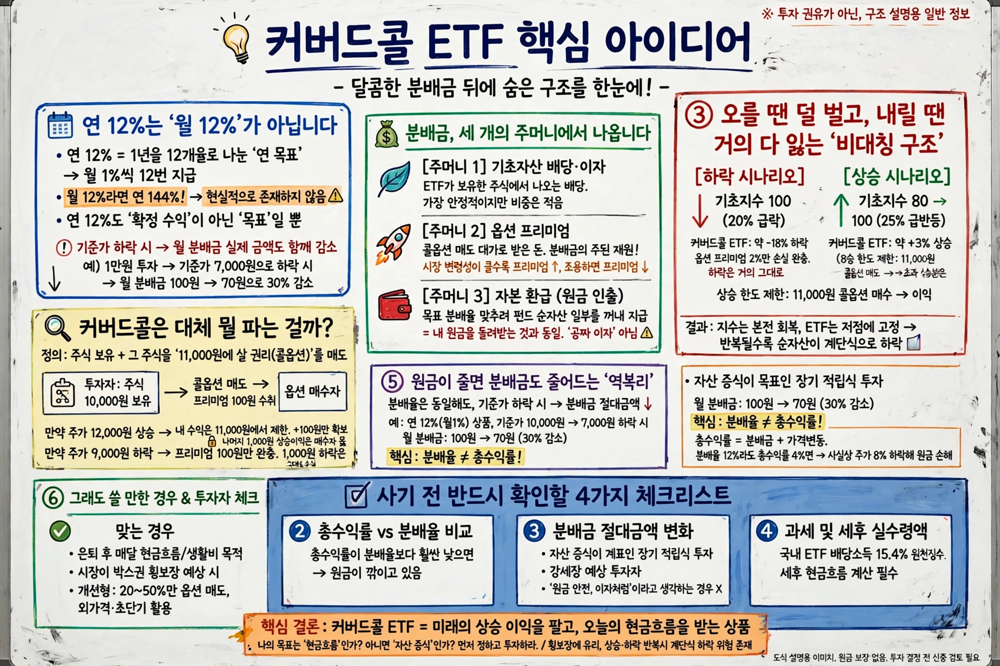
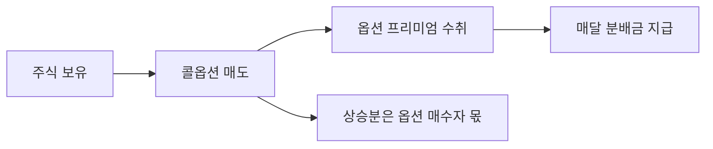
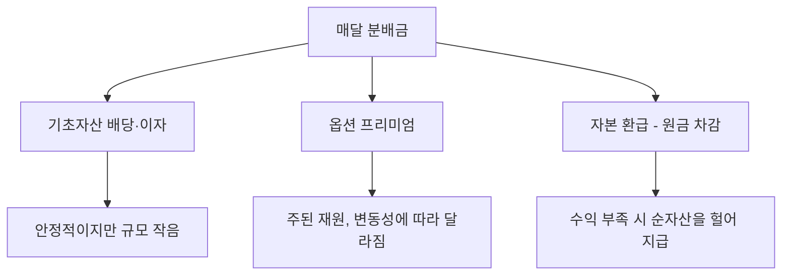
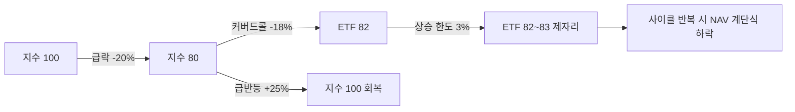

# 월 배당 12%는 월 12%가 아닙니다. 연 12% 목표, 원금을 깎아 줄 수도 있습니다

> **Summary**
> 커버드콜 ETF의 연 12% 목표 분배율은 확정 수익이 아니며, 옵션 프리미엄과 때로는 원금 환급으로 지급됩니다. 상승 이익은 제한되고 하락 위험은 대부분 감수하므로, 분배율보다 기준가 추세와 총수익률을 살펴야 합니다. 현금흐름이 필요한 투자자는 일부 활용할 수 있지만, 자산 증식을 목표로 한다면 신중해야 합니다.

---

- 매달 통장에 꽂히는 분배금, "연 12%"는 월 12%가 아닙니다. 연 12% 목표를 12개월로 나눈 월 1%입니다.
- 높은 분배금은 기업 배당이 아니라, 미래의 상승 이익을 팔아 받은 옵션 프리미엄이 주된 재원입니다.
- 오를 때는 덜 벌고 내릴 때는 거의 다 잃는 비대칭 구조라, 분배금만 보고 들어가면 원금이 계단식으로 녹습니다.

매달 초, 통장 알림이 울립니다. 분배금이 들어왔다는 메시지입니다. 건물주가 된 기분, 이런 적 있으시죠? 그런데 1년 뒤 계좌를 열어보면 이상합니다. 분배금은 꼬박꼬박 받았는데, 계좌 총액은 오히려 줄었습니다. 도대체 무슨 일이 일어난 걸까요?

🎥 [동영상 보기](https://www.youtube.com/watch?v=NyuwaY64q4A)

원문 커뮤니티 글은 앱 안에서만 열리는 페이지라 직접 읽지 못했습니다. 그래서 같은 주제를 다룬 검증된 자료들로 내용을 교차 확인해 다시 썼습니다. 결론부터 말하면, "매달 배당 12%"라는 말은 월 12%가 아닙니다!

## 커버드콜, 대체 뭘 파는 걸까요?

커버드콜은 주식을 들고, 그 주식을 정해진 가격에 살 수 있는 권리인 콜옵션을 남에게 파는 전략입니다. 옵션을 판 대가로 받는 돈이 바로 옵션 프리미엄이고, 이 프리미엄이 분배금의 주된 재원입니다.

쉽게 말하면 이렇습니다. 내가 가진 주식을 "나중에 11,000원에 살 수 있는 권리"로 팔았습니다. 주가가 12,000원이 돼도, 내 이익은 11,100원에서 멈춥니다. 나머지 상승분은 옵션을 산 사람의 몫입니다. 대신 권리를 판 대가로 100원을 미리 받았습니다. 이 100원이 모여 매달 분배금이 됩니다.

## 12%는 연 12%입니다. 월 12%가 아닙니다?

가장 먼저 짚을 숫자가 있습니다. "매달 배당 12%"라고 적힌 상품의 12%는 연 목표 분배율입니다. 월 1%씩 12번 나눠 주는 구조입니다. 월 12%면 1년에 144%인데, 그런 상품은 세상에 없습니다.

그런데 연 12%도 확정 수익이 아닙니다. 목표일 뿐입니다. 금융감독원은 2024년 7월 소비자경보에서 이 점을 짚었습니다. 연 12% 목표 상품에 1만 원을 넣으면 연 1,200원이 확정되는 것처럼 오인하기 쉬운데, 기준가가 계속 내리면 연 분배금이 919원까지 줄 수 있다는 예시를 들었습니다. 비율은 같아 보여도, 받는 돈은 줄어듭니다. 왜 그럴까요?

## 분배금, 세 개의 주머니에서 나옵니다

커버드콜 ETF의 분배금은 한 곳에서만 나오지 않습니다. 세 가지 주머니가 있습니다.

첫째, 기초자산 배당과 이자입니다. ETF가 담은 주식에서 나오는 배당금입니다. 가장 안정적이지만 규모가 크지 않습니다.

둘째, 옵션 프리미엄입니다. 콜옵션을 팔아 받은 돈입니다. 분배금의 주된 재원입니다. 시장 변동성이 클수록 옵션 가격이 비싸져 프리미엄도 커집니다. 반대로 시장이 조용해지면 프리미엄이 줄고 분배금도 줄어듭니다.

셋째, 자본 환급입니다. 정해진 목표 분배율을 맞추기 위해 운용 수익이 부족하면, 펀드 순자산 일부를 떼어내 지급합니다. 내 원금을 인출해 내 통장에 다시 입금하는 것과 경제적 실질이 같습니다. 세 주머니를 모두 "공짜 이자"로 여기면 안 되는 이유입니다!

## 오를 때는 덜 벌고, 내릴 때는 다 잃습니다?

커버드콜의 손익 구조는 비대칭입니다. 주가가 크게 오르면 행사가격 위의 이익은 옵션 매수자에게 넘어갑니다. 주가가 크게 내리면 프리미엄만큼만 완충될 뿐 하락은 거의 그대로 떠안습니다.

숫자로 보면 더 선명합니다. 기초지수가 100에서 80으로 20% 급락하면, 커버드콜 ETF는 프리미엄 2%만큼만 손실을 줄여 약 18% 하락합니다. 다음 달 지수가 80에서 다시 100으로 25% 급반등하면 어떻게 될까요? 커버드콜은 상승 한도가 3% 수준으로 막혀 있어 82~83 수준에 그칩니다. 지수는 본전을 회복했는데, ETF 기준가는 저점에 굳어버립니다. 사이클이 반복될수록 순자산가치는 계단식으로 주저앉습니다.

유일하게 유리한 구간은 완만한 횡보장입니다. 가격이 크게 오르지도 내리지도 않으면, 옵션 매도 대금을 온전히 챙기면서 시장을 이길 수 있습니다. 문제는 시장이 늘 횡보만 하지 않는다는 점입니다.

## 원금이 줄면 받는 돈도 줄어듭니다

많은 분들이 "원금이 좀 줄어도 배당률 12%는 그대로 아니냐"고 묻습니다. 비율은 그대로일 수 있습니다. 하지만 분배금은 "처음 투자한 원금" 기준이 아니라 "현재 남아 있는 순자산"에 비례해 지급됩니다.

연 12%(월 1%)를 주는 ETF의 주가가 1만 원에서 7천 원으로 떨어졌다고 해보겠습니다. 월 분배금은 100원에서 70원으로 줄어듭니다. 분배율 1%는 그대로인데, 실제 현금흐름은 30% 감소한 것입니다. 이게 역복리의 마법입니다!

그래서 분배율만 보지 말고 총수익률을 봐야 합니다. 총수익률은 분배금과 가격 변화를 합친 숫자입니다. 연 분배율이 12%인데 1년 총수익률이 4%라면, 실제로는 주가가 8% 하락해 원금을 갉아먹은 셈입니다. 분배율과 수익률은 다른 숫자입니다.

## 그래도 쓸 만한 경우는 있습니다

모든 커버드콜 상품을 똑같은 기준으로 묶어 볼 수는 없습니다. 최근 나오는 개선형 상품들은 옵션을 파는 방식과 비중을 세밀하게 조정합니다.

보유 주식 전체에 옵션을 파는 전통형과 달리, 개선형은 20~50%만 부분 매도합니다. 나머지 자산은 지수 상승을 그대로 따라갑니다. 행사가격도 현재 가격보다 높은 외가격으로 잡아 상승 여력을 남깁니다. 만기가 하루나 일주일인 초단기 옵션을 쓰면, 주가가 하루 만에 급등하지 않는 한 상승분을 어느 정도 따라가면서 프리미엄도 자주 수취할 수 있습니다. 다만 폭등장이 오면 상승분이 제한되는 한계는 여전히 남습니다.

누구에게 맞을까요? 은퇴 후 매달 써야 할 생활비가 필요해 분배금을 재투자하지 않고 인출해 쓰는 현금흐름 목적의 투자자, 시장이 큰 폭의 상승 없이 박스권에 머물 것으로 보는 경우에 한해 포트폴리오의 일부로 활용하는 것이 합리적입니다. 반대로 자산을 크게 불려야 하는 적립식 장기 투자자나 강세장을 예상하는 투자자에게는 맞지 않습니다. "원금은 안전하고 이자처럼 받는다"고 생각한다면, 그건 예금이 아니라 착각입니다!

## 사기 전, 이 네 가지만 보면 됩니다

분배율 숫자 대신 네 가지 지표를 대조해 보면 됩니다.

첫째, 주당 순자산가치의 장기 추세입니다. 기초지수가 우상향했는데도 ETF 기준가가 지속적으로 우하향한다면, 운용 수익보다 더 많은 돈을 분배금으로 빼내고 있다는 신호입니다.

둘째, 총수익률과 분배율의 괴리입니다. 분배금을 재투자했다고 가정한 총수익률이 연간 분배율보다 현저히 낮다면, 그 차액만큼 원금이 깎인 것입니다.

셋째, 분배금 절대 금액의 변화입니다. "주당 몇 원"이 아니라 "순자산의 몇 %"를 주겠다고 약속한 상품은, 기준가가 내리면 받는 돈도 함께 줄어듭니다.

넷째, 과세 비중입니다. 국내 상장 ETF 분배금은 일반적으로 배당소득으로 과세되며, 2025년 기준 15.4% 원천징수가 일반적입니다. 세후 실수령액을 계산해 봐야 진짜 현금흐름이 보입니다.

커버드콜 ETF는 미래의 상승 이익을 팔아 오늘의 현금흐름을 사는 상품입니다. 달콤한 유혹 뒤에 무엇이 있는지 알고 나면, 내 목표가 "현금흐름"인지 "자산 증식"인지부터 정하고 판단할 수 있습니다. 이 글은 특정 상품의 투자 권유가 아니라, 구조를 설명하는 일반 정보입니다.

