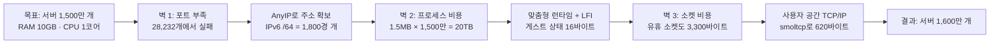
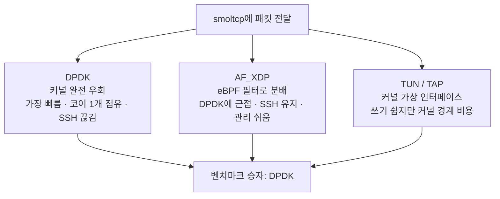

# 웹 서버 1,500만 개, VM 한 대에 올렸습니다. 커널을 비우면 됩니다

> **Summary**
> RAM 10GB, CPU 1코어짜리 VM 한 대에서 웹 서버 1,500만 개를 실행한 실험을 소개했습니다. 포트 부족은 AnyIP로, 프로세스 비용은 맞춤형 런타임과 LFI로, 소켓 비용은 사용자 공간 TCP/IP 스택인 smoltcp로 해결해 유휴 서버당 620바이트까지 줄였습니다. 다만 1,600만 개는 수신 대기 중인 서버 수이며 개념 증명이라는 한계가 있습니다.

---

- VM 한 대, RAM 10GB, CPU 1코어에서 웹 서버 1,500만 개가 돌아갔습니다.
- 비결은 서버를 늘리는 게 아니라 커널이 한 개당 매기는 세금을 걷어내는 것이었습니다. 소켓 하나에 3,300바이트씩 내던 것을 사용자 공간 스택으로 620바이트까지 줄였습니다.
- 다만 1,600만 개는 동시에 요청을 처리한 숫자가 아니라 각자 주소에서 수신 대기하는 서버 수입니다. 개념 증명이라는 한계도 함께 봐야 합니다.

웹 서버 한 대에 몇 개나 올릴 수 있을까요? 이 실험의 답은 1,500만 개였습니다. RAM 10GB, CPU 1코어짜리 VM 한 대에서 말이죠!

🎥 [동영상 보기](https://www.youtube.com/watch?v=MpjlWt7fvrw)

## 왜 1,500만 개일까요?

출발점은 농담 같은 질문이었습니다. 웹 서버를 온라인에 올리면 모두가 해킹을 시도합니다. 공급이 부족해서 수요가 크기 때문입니다. 전 인류에게 웹 서버를 하나씩 나눠주면 어떨까요? 수요가 0이 되면 사이버보안 문제도 사라진다는 농담이었습니다.

## 벽 하나: 포트가 모자랍니다

최소 서버는 C로 짰습니다. `listen`, `accept`, `recv`, `send`, `close` 다섯 개 시스템 호출만으로 모든 요청에 `HTTP 200 OK`와 본문 `OK`를 돌려줍니다. 처리량은 초당 약 6만 5,000건이었습니다.

그런데 1,500만 개를 띄우려 하자 28,232개에서 `listen`이 실패했습니다. 포트 `0`을 쓰면 커널이 가용 포트 범위에서 골라주는데, 기본 범위는 `32768–60999`였습니다. 범위를 `1–65535`로 늘려도 TCP 포트는 `u16`이라 1,500만 개에는 한참 모자랍니다.

해법은 주소에 있었습니다. 수신 서버는 `(프로토콜, IP, 포트)`로 구분됩니다. TCP와 UDP는 같은 포트를 쓸 수 있고, IP가 다르면 포트도 재사용할 수 있습니다. 그래서 서브넷 전체를 수신 주소로 삼는 `AnyIP`를 썼습니다. IPv6 `/64`는 약 1,800경 개의 주소를 제공합니다.

## 벽 둘: 프로세스 하나가 1.5MB입니다

주소를 확보했으니 이제 띄우면 될까요? 이번엔 메모리가 바닥났습니다. 서버 프로세스 하나가 약 1.5MB를 쓰니 전체에는 약 20TB가 필요합니다. 10GB 예산의 2,000배입니다.

그래서 프로세스를 버렸습니다. 맞춤형 런타임 하나에 게스트 1,500만 개를 적재하고 사용자 공간 스케줄러가 전환하는 방식입니다. 샌드박싱에는 `LFI`를 썼습니다. 게스트 메모리를 격리하고 모든 시스템 호출을 호스트 처리기 호출로 대체합니다.

게스트 상태는 얼마나 작아질까요? 주 실행 루프 안에서만 전환한다고 가정하면, 게스트마다 복귀 명령 주소와 파일 디스크립터 2개만 저장하면 됩니다. `pc: u64`, `fd_server: i32`, `fd_client: i32`로 총 16바이트, 1,500만 개면 약 220MB입니다!

## LLM 답변을 그대로 믿었다가?

이 대목이 저는 가장 인상 깊었습니다. 처음 계산은 LLM 답변에서 출발했습니다. "유휴 연결은 0바이트, 활성 연결은 약 5KB"라는 답변이었습니다. 합치면 약 5.22GB로 예산 안에 들어갔습니다.

그런데 유휴 수신 소켓만 만들어도 메모리가 부족했습니다. LLM 답변을 비판 없이 받아들인 것이 잘못된 계산의 출발점이었습니다.

## 벽 셋: 소켓 하나에 3,300바이트

빠뜨린 비용은 `socket` 시스템 호출 자체의 할당량이었습니다. 소켓이 활성 상태이든 수신 대기 중이든 아무 일도 하지 않든 약 3,300바이트가 필요합니다. 내역은 `tcp_sock` 2,240바이트, `socket_alloc` 768바이트, `file` 184바이트, `dentry` 192바이트로 합계 3,384바이트입니다. 커널 네트워크 스택은 서버 약 250만 개에서 RAM을 소진했고, 서버 수가 늘어날수록 처리량도 감소했습니다.

## 해법: 계층을 내려가면 됩니다

문제를 못 풀겠다면, 잘못된 추상화 수준에서 일하고 있는 것일 수 있습니다. HTTP에서 TCP/IP로 내려왔으니 한 계층 더 내려가면 어떨까요? IP 패킷이나 Ethernet 프레임 수준에서 직접 주고받으면 TCP/IP 스택을 직접 만들 수 있습니다.

임베디드 분야의 극단적인 사례인 `Miniweb`은 맞춤형 TCP/IP와 HTTP 서버를 합쳐 28바이트로 동작합니다. 이번 실험은 Rust 기반 `smoltcp`를 선택했습니다. 베어메탈 실시간 시스템을 위한 독립형 이벤트 기반 TCP/IP 스택으로, 힙 할당 없이도 쓸 수 있습니다. 다만 I/O 기능이 없어 `Device` 트레이트의 메서드 3개를 구현해 네트워크 장치와 연결해야 합니다.

## 입출력은 네 갈래, 승자는?

`smoltcp`에 패킷을 넣어주는 방법은 네 가지입니다.

**TUN과 TAP**은 커널이 제공하는 가상 네트워크 인터페이스입니다. TUN은 IP 계층에서, TAP은 한 단계 아래인 Ethernet 계층에서 동작합니다. `smoltcp`가 기본 지원해서 쓰기 쉽지만, 패킷이 커널 경계를 매번 넘어 시스템 호출과 복사 비용이 남습니다.

**DPDK**는 커널 네트워크 스택을 완전히 우회해 네트워크 카드와 Ethernet 프레임을 직접 주고받습니다. 메모리 매핑 버퍼를 읽고 쓰므로 입출력 시스템 호출이 필요 없습니다. 시스템 호출에는 약 500ns, 커널에서 사용자 공간으로의 복사에는 추가 1,000ns가 들 수 있습니다. 400Gbps 인터페이스는 최대 초당 6억 패킷, 패킷당 약 1.7ns에 해당합니다.

인터럽트도 피합니다. 패킷이 몰리면 앱이 계속 중단되는 `라이브락`이 생기는데, DPDK는 바쁜 대기 루프로 이를 피합니다. 대가는 있습니다. 바쁜 대기 루프가 CPU 코어 하나를 점유하고, 하드웨어 수준 드라이버가 장치를 독점하므로 해당 인터페이스가 운영체제에서 사라집니다. SSH 인터페이스를 전환하면 SSH 접속도 끊깁니다.

**AF_XDP**도 메모리 매핑 버퍼를 통한 제로카피 입출력과 네트워크 스택 우회를 지원하지만, 장치는 커널이 계속 소유합니다. 인터럽트는 유지되고, eBPF 필터가 패킷을 사용자 공간 버퍼로 보낼지 일반 네트워크 스택에서 처리할지 결정합니다. 일반 트래픽은 기존 경로로 처리할 수 있어 SSH 연결을 유지할 수 있습니다. DPDK보다 성능은 뒤처지지만, 차이가 작고 관리가 더 쉽습니다!

## 결과: 620바이트, 1,600만 개!

런타임이 게스트 1,500만 개를 메모리에 적재하고 차례로 실행합니다. 게스트 시스템 호출을 가로채 `smoltcp`와 입출력 어댑터로 대체하고, 각 게스트는 고유한 주소에서 수신 대기합니다. 스케줄러는 수신 데이터를 폴링하고 해당 게스트를 깨워 처리한 뒤 다음 게스트로 전환합니다.

`smoltcp`에서는 유휴 서버당 620바이트, 활성 서버당 약 1KB를 사용해 서버 1,600만 개까지 실행했습니다. 입출력 방식 비교에서는 DPDK가 가장 좋은 성능을 보였으며 AF_XDP가 그 뒤를 가까이 따랐습니다.

> 그런데 1,600만 개, 정말 동시에 요청을 처리한 걸까요?

아닙니다. 1,600만 개는 각자 고유한 주소에서 수신 대기하는 서버 수입니다. 1,600만 개의 연결이 동시에 요청을 처리했다는 의미가 아닙니다.

이번 결과는 개념 증명입니다. 호환 가능한 Linux 런타임과 모든 시스템 호출의 100% POSIX 호환 구현은 별도 과제입니다.

## 배운 점

추상화에는 단위당 가격이 있습니다. 소켓 하나에 3,300바이트씩 내는 건 한두 개일 때는 보이지 않지만, 1,500만 개가 되면 커널 자체가 병목입니다. 빠른 길은 안 쓰는 층을 걷어내는 데서 나올 때가 있습니다.

LLM 답변도 마찬가지입니다. 출발점으로는 훌륭하지만, 검증 없이 받아들이면 계산부터 틀어집니다.

서버를 늘리는 게 아니라 커널의 세금을 걷어내는 것, 그게 1,500만 개의 비결이었습니다.

