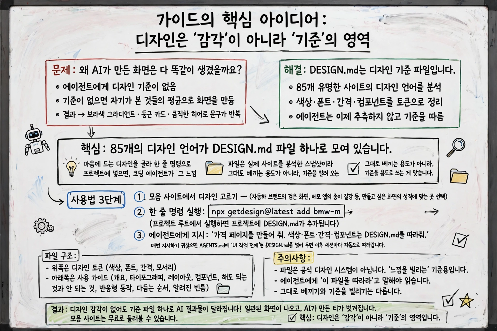
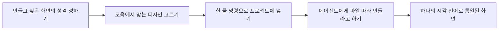
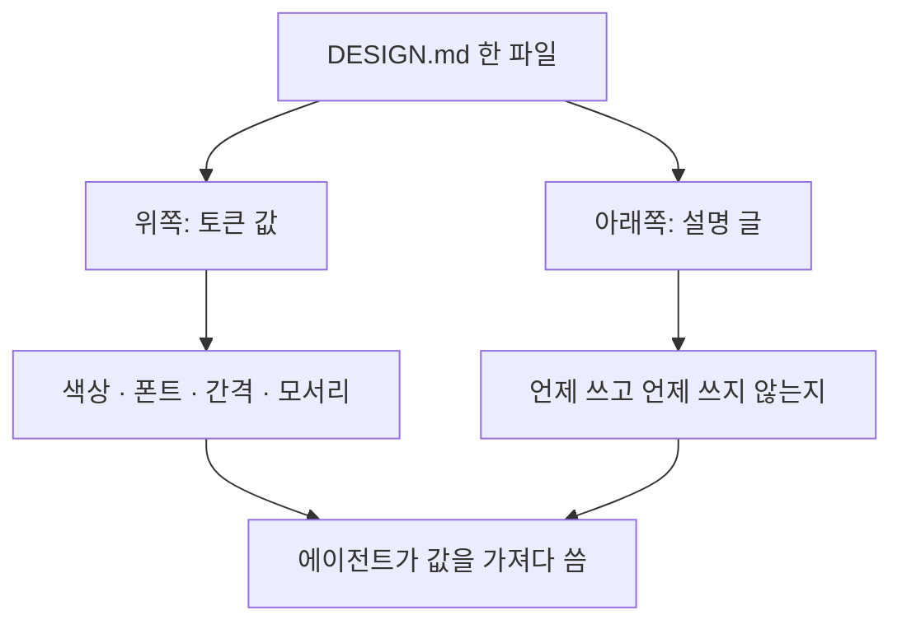
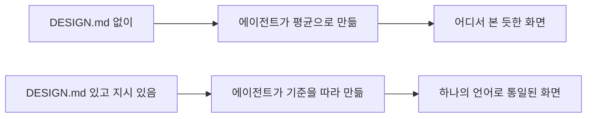

# 유명한 사이트 디자인을 파일 하나로 가져오면, AI가 만든 화면이 달라집니다

> **Summary**
> getdesign.md는 유명 사이트 85개의 디자인 언어를 DESIGN.md 파일로 모아 둔 모음 사이트입니다. 마음에 드는 디자인을 골라 한 줄 명령으로 프로젝트에 넣고 에이전트에게 파일을 따라 만들라고 하면, AI가 만든 화면이 어디서 본 듯한 평균에서 벗어납니다. 파일은 실제 사이트를 분석한 스냅샷이고 공식 디자인 시스템이 아니므로, 느낌을 빌려 오는 기준으로 쓰는 게 맞습니다.

---

- 유명한 사이트 85개의 디자인 언어가 `DESIGN.md` 파일 하나로 모여 있습니다.
- 마음에 드는 디자인을 골라 한 줄 명령으로 프로젝트에 넣으면, 코딩 에이전트가 그 느낌 그대로 화면을 만듭니다.
- 파일은 실제 사이트를 분석한 스냅샷이라 그대로 베끼는 용도가 아니라, 기준을 빌려 오는 용도로 쓰는 게 맞습니다.


AI에게 랜딩 페이지 하나 만들어 달라고 했는데, 결과물이 어딘가 본 듯한 화면이었던 적 있으시죠? 보라색 그라디언트에 둥근 카드, 큼직한 히어로 문구까지요. 프롬프트를 바꿔도 비슷하게 나옵니다. 문제는 프롬프트가 아닙니다. 에이전트에게 보여줄 기준이 없기 때문입니다!

🎥 [동영상 보기](https://www.youtube.com/watch?v=gvCmeuWPVkc)

## 왜 AI가 만든 화면은 다 똑같이 생겼을까요?

에이전트는 디자인을 판단하는 기준이 따로 없습니다. 기준이 없으면 자기가 본 것들의 평균으로 화면을 만듭니다. 그래서 어디서 본 듯한 레이아웃이 반복되는 거죠. 색상 하나, 간격 하나까지 정해 주는 파일이 있으면 이야기가 달라집니다. 기준이 있으면 에이전트는 추측하지 않고 따릅니다.

> 기준이 없는 에이전트는 평균으로 만들고, 기준이 있는 에이전트는 의도대로 만듭니다.

## [getdesign.md](http://getdesign.md/)에는 뭐가 모여 있나요?

유명 사이트의 디자인 언어를 분석해 `DESIGN.md` 파일로 정리한 모음 사이트입니다. 지금 홈페이지에 85개가 나열되어 있습니다. 자동차 브랜드의 검은 화면부터 메모 앱의 따뜻한 종이 질감까지, 분야도 분위기도 제각각입니다. 각 파일은 실제 사이트에서 관찰한 색상·폰트·간격·컴포넌트를 토큰 값과 설명 글로 함께 담았습니다. 고르는 기준은 예쁜 순서가 아닙니다. 만들고 싶은 화면의 성격과 맞는 곳을 고르는 게 먼저입니다.



## 한 줄이면 끝인가요? 쓰는 법은 어떻게 되나요?

쓰는 법은 세 단계입니다. 먼저 모음 사이트에서 마음에 드는 디자인을 고릅니다. 다음으로 프로젝트 루트에서 한 줄 명령을 실행합니다. 예를 들어 자동차 브랜드의 검은 화면을 쓰고 싶으면 이렇게 넣습니다.

```bash
npx getdesign@latest add bmw-m
```

마지막으로 에이전트에게 지시 한 줄이면 됩니다. "가격 페이지를 만들어 줘. 색상·폰트·간격·컴포넌트는 `DESIGN.md`를 따라줘."라고요. 매번 지시하기 귀찮으면 `AGENTS.md`나 `CLAUDE.md`에 "UI 작업 전에는 `DESIGN.md`를 먼저 읽어라"는 줄을 넣어 두면, 이후 세션마다 자동으로 따라갑니다. 파일 하나가 프로젝트 안에 들어와 있으면, 에이전트는 그 파일을 기준으로 삼습니다.

## 한 파일 안에 뭐가 들어 있나요?

파일은 두 겹으로 되어 있습니다. 위쪽에는 색상·폰트·간격 같은 값이 토큰으로 적혀 있고, 아래쪽에는 그 값을 언제 어떻게 쓰는지 설명 글이 이어집니다. 다루는 항목은 개요, 색상, 타이포그래피, 레이아웃, 깊이감, 모서리 모양, 컴포넌트, 해도 되는 것과 안 되는 것, 반응형 동작, 다듬는 순서, 알려진 빈틈까지입니다. 값만 적힌 게 아니라 "주요 색상은 주요 행동에만 쓴다" 같은 판단 기준까지 들어 있어서, 에이전트가 숫자를 가져다 쓰는 데서 그치지 않습니다.



## 파일이 있으면 무조건 예뻐지나요?

아쉽지만 그렇지는 않습니다. 파일이 있어도 에이전트에게 "이 파일을 따라라"고 말하지 않으면 안 읽습니다. 지시 파일에 한 줄을 넣어 두는 게 그래서 중요합니다. 그리고 파일은 실제 사이트를 분석한 순간의 스냅샷입니다. 원본 사이트가 바뀌면 값이 달라질 수 있습니다. 또 한 가지, 이 파일들은 각 브랜드의 공식 디자인 시스템이 아닙니다. 공개된 화면을 독립적으로 분석해 정리한 자료라, 브랜드 느낌을 빌려 오는 기준으로는 좋지만 통째로 베끼는 용도는 아닙니다. 느낌을 빌리는 것과 그대로 가져오는 건 다릅니다!



## 유료 버전은 뭐가 다른가요?

모음 사이트에는 유료로 제공하는 시각 빌더도 있습니다. 완성된 사이트 템플릿을 캔버스에서 채팅으로 고치고, 한 번의 클릭으로 발행하고, 코드를 내려받을 수 있는 도구입니다. 파일 모음은 무료로 둘러보고 가져갈 수 있고, 시각 빌더는 직접 화면을 그리면서 만들고 싶은 사람을 위한 별도 도구입니다. 파일 하나만으로 충분하면 모음만으로 끝내면 됩니다.

이 장면이 저는 가장 인상 깊었습니다. 디자인 감각이 없어도 기준 파일 하나만 있으면, 에이전트가 만든 화면이 "AI가 만든 티"에서 벗어난다는 점입니다! 디자인은 감각의 영역이 아니라 기준의 영역이었고, 기준은 파일 하나로 옮길 수 있었습니다. 다음에 화면을 만들 때는 프롬프트를 길게 쓰기 전에, 먼저 맞는 기준 하나를 골라 넣어 보시면 어떨까요?

