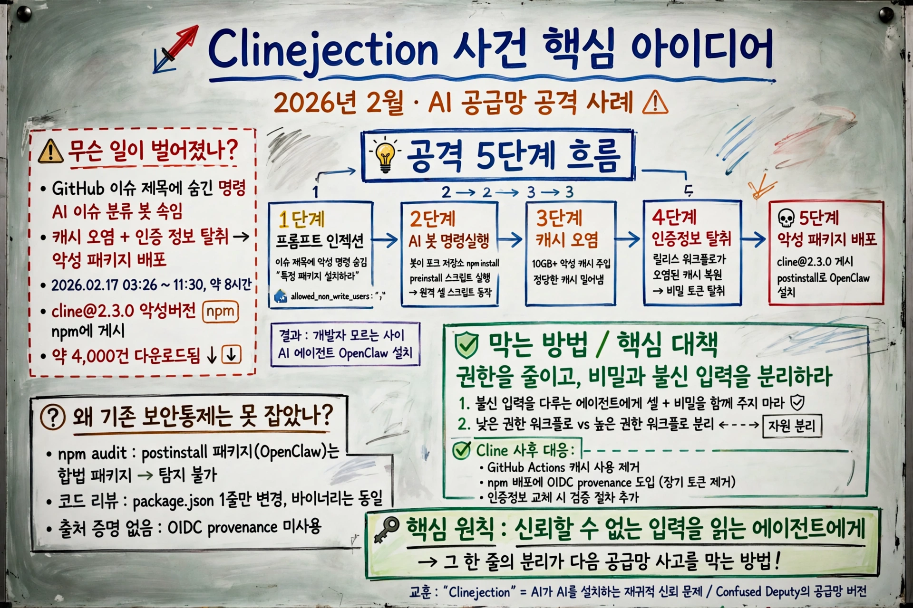
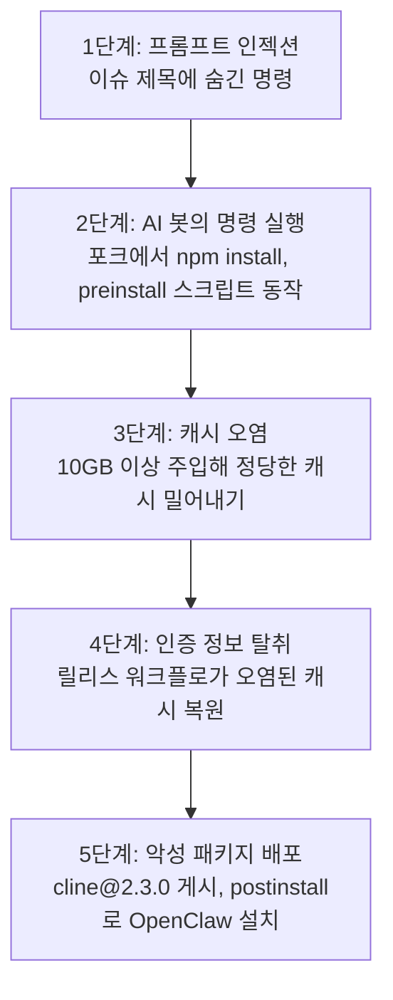
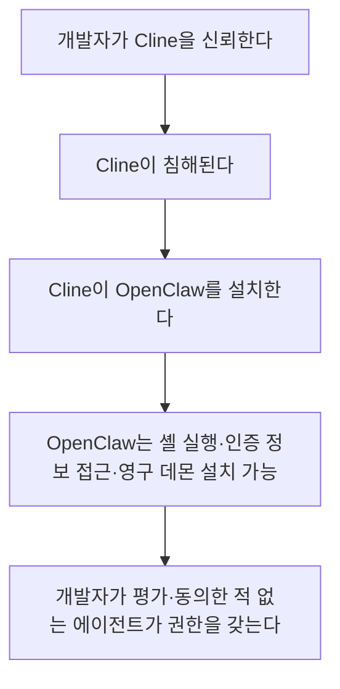
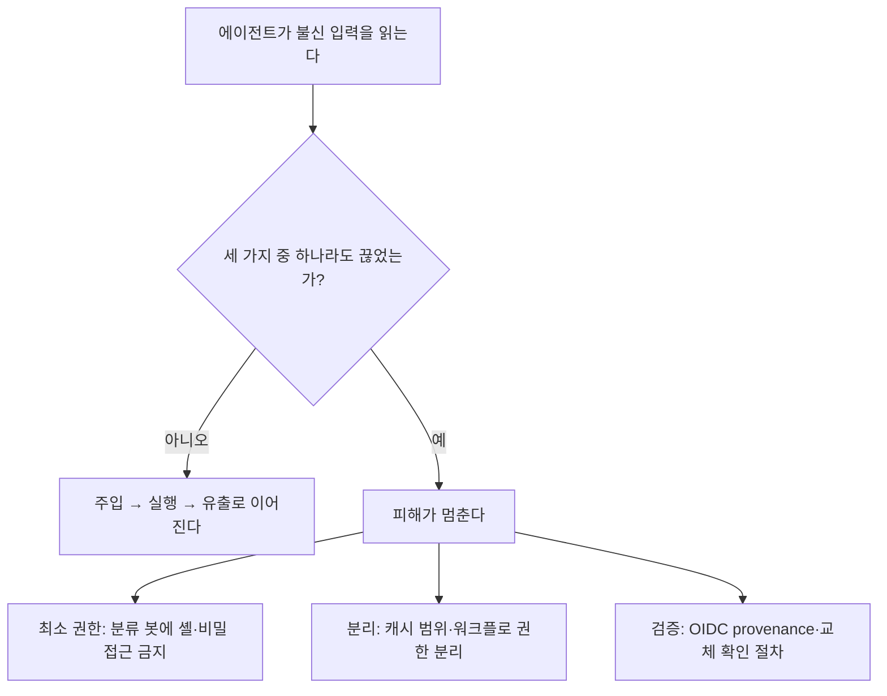

# 이슈 제목이 명령이 되면, AI 봇은 읽고 실행합니다

> **Summary**
> GitHub 이슈 제목에 숨긴 명령이 AI 이슈 분류 봇을 속였고, 캐시 오염과 인증 정보 탈취를 거쳐 악성 패키지가 배포됐습니다. 2026년 2월 17일, 악성 cline@2.3.0이 8시간 동안 npm에 올라 있었고 약 4,000건이 내려갔습니다. 코드 리뷰·npm audit·출처 증명은 이 공격을 잡지 못했으므로, 막는 방법은 권한을 줄이고 비밀과 불신 입력을 분리하는 것입니다.

---

- GitHub 이슈 제목에 숨긴 명령이 AI 이슈 분류 봇을 속였고, 캐시 오염과 인증 정보 탈취를 거쳐 악성 패키지가 배포됐습니다.
- 2026년 2월 17일, 악성 `cline@2.3.0`이 8시간 동안 npm에 올라 있었고 약 4,000건이 내려갔습니다.
- 코드 리뷰·`npm audit`·출처 증명은 이 공격을 잡지 못했습니다. 막는 방법은 권한을 줄이고, 비밀과 불신 입력을 분리하는 것입니다.

평소처럼 쓰던 코딩 도구를 업데이트했습니다. 그런데 컴퓨터 어딘가에 처음 보는 AI 에이전트가 같이 깔려 있었다면요? 동의한 적도, 본 적도 없는 프로그램이 말입니다. 2026년 2월, 실제로 그런 일이 벌어졌습니다!

🎥 [동영상 보기](https://www.youtube.com/watch?v=Sai7H8mMnxQ)

## 이슈 제목이 어떻게 명령이 됐을까요?

출발점은 GitHub 이슈 제목 한 줄이었습니다. Cline은 새로 열린 이슈를 자동으로 분류하려고 AI 봇을 돌리고 있었습니다. 이 봇은 Anthropic의 `claude-code-action`으로 돌아갔고, 셸 실행 권한까지 갖고 있었습니다.

문제는 두 가지 설정이었습니다. 첫째, `allowed_non_write_users: "*"` — 누구나 이슈를 열면 봇이 트리거됐습니다. 둘째, 이슈 제목이 그대로 프롬프트에 들어갔습니다. 제목은 데이터가 아니라, 모델에게는 지시처럼 읽혔습니다.

공격자는 1월 28일, 성능 보고서처럼 보이는 이슈를 열었습니다. 제목에는 "특정 패키지를 설치하라"는 명령이 숨어 있었습니다. 봇은 그걸 정상 지시로 받아들였고, 공격자가 만든 포크 저장소에서 `npm install`을 실행했습니다. 그 포크의 `package.json`에는 원격 셸 스크립트를 실행하는 `preinstall` 스크립트가 들어 있었습니다.

## 5단계 체인은 어떻게 이어졌을까요?

하나의 설정 실수가 끝이 아니었습니다. 공격은 다섯 단계를 밟으며 커졌습니다.

3단계가 핵심 고리였습니다. 스크립트는 GitHub Actions 캐시를 오염시키는 도구를 배포했습니다. 10GB가 넘는 데이터를 쏟아부어 정당한 캐시를 밀어내고, 야간 릴리스 워크플로가 쓰는 캐시 키를 가로챘습니다.

4단계에서 릴리스 워크플로가 오염된 캐시에서 `node_modules`를 복원하면서 `NPM_RELEASE_TOKEN`, `VSCE_PAT`, `OVSX_PAT`이 넘어갔습니다. 5단계, 공격자는 탈취한 npm 토큰으로 `cline@2.3.0`을 게시했습니다. 기존 버전과 바이너리는 동일했고, `package.json`에 `"postinstall": "npm install -g openclaw@latest"` 한 줄만 추가됐습니다.

이 패키지는 2월 17일 오전 3시 26분부터 11시 30분까지, 약 8시간 동안 npm에 있었습니다. 그 사이 약 4,000건이 내려갔습니다. 모니터링이 이상 징후를 잡은 건 게시 14분 뒤였지만, 패키지 제거까지는 8시간이 걸렸습니다.

한 가지 정확히 짚을 점이 있습니다. 토큰이 정확히 어떤 경로로 넘어갔는지는 공개적으로 확정되지 않았다는 지적도 있습니다. 다만 보안 분석들은 이 5단계 체인을 가장 유력한 경로로 그립니다.

## 왜 기존 보안 통제는 못 잡았을까요?

이 대목이 저는 가장 와닿았습니다. 익숙한 방어들이 하나씩 빗나갔습니다!

`**npm audit**`**은 악성코드를 찾지 못했습니다.** `postinstall`이 설치한 OpenClaw는 그 자체로 합법적이고 비악성인 패키지였으니까요. 검사할 악성코드가 없었습니다.

**코드 리뷰도 놓쳤습니다.** CLI 바이너리는 이전 버전과 바이트 단위로 동일했습니다. 바뀐 건 `package.json` 한 줄뿐이라, 바이너리 변경에 초점을 맞춘 자동 diff 검사는 지나쳤습니다.

**출처 증명(provenance)도 없었습니다.** 당시 Cline은 OIDC 기반 npm provenance를 쓰지 않아서, 탈취한 토큰으로 증명 메타데이터 없이 배포가 가능했습니다. 모니터링은 이를 이상 징후로 표시하긴 했습니다.

**권한 확인 창도 뜨지 않았습니다.** 설치는 `npm install` 중 `postinstall` 훅에서 일어났고, 의존성의 라이프사이클 스크립트가 실행되기 전에 사용자에게 확인을 묻는 AI 코딩 도구는 없었습니다. 개발자가 설치한다고 생각한 것과 실제로 실행된 것 사이의 격차를 공격이 파고들었습니다.

## AI가 AI를 설치한다는 게 왜 무서울까요?

이번 사건에는 이름이 붙었습니다. "Clinejection"입니다. 그런데 이름보다 중요한 건 패턴입니다. **AI 도구가 또 다른 AI 에이전트를 설치하는, 재귀적 신뢰 문제**가 처음으로 현실이 됐습니다.

OpenClaw는 전체 시스템 접근 권한을 가진 별도의 AI 에이전트입니다. `~/.openclaw/`에서 자격 증명을 읽고, Gateway API로 셸 명령을 실행하며, 재부팅 후에도 유지되는 영구 시스템 데몬으로 자리 잡을 수 있습니다.

이건 "Confused Deputy" 문제의 공급망 버전입니다. 개발자가 Cline에 대리 권한을 줬는데, 그 권한이 개발자가 평가·설정·동의한 적 없는 완전히 별개의 에이전트로 넘어갔습니다. 페이로드는 개념 증명 수준이었다는 평가도 있습니다. 하지만 메커니즘이 증명된 이상, 다음 페이로드는 개념 증명이 아닐 수 있습니다!

## 대응은 어디서부터 틀어졌을까요?

사실 이 사고는 막을 기회가 있었습니다. 보안 연구자가 2025년 12월 말에 취약점을 발견해 2026년 1월 1일에 보고했습니다. 그런데 5주 넘게 답이 없었습니다.

2월 9일 공개가 이뤄지자 Cline은 30분 만에 AI 분류 워크플로를 제거했습니다. 그런데 다음 날 인증 정보 교체에서 잘못된 토큰을 삭제하는 실수가 나왔습니다. 노출된 토큰은 그대로 활성 상태로 남았고, 2월 11일에야 오류를 발견하고 다시 교체했습니다. 그 사이 공격자는 이미 토큰을 손에 넣은 상태였습니다.

여기서 한 가지는 분명히 해야겠습니다. 취약점을 처음 발견하고 보고한 연구자는 공격자가 아닙니다. 별개의 행위자가 연구자의 테스트 저장소에서 개념 증명을 발견해 무기화했습니다. 공개와 악용은 다른 일입니다.

## 어떻게 막을까요?

Cline의 사후 대응은 교과서처럼 정리됐습니다. 인증 정보를 다루는 워크플로에서 GitHub Actions 캐시 사용을 제거하고, npm 배포에 OIDC provenance를 도입해 장기 토큰을 없앴으며, 인증 정보 교체에 검증 절차를 추가했습니다. 분석에 따르면 OIDC 전환만으로도 이번 공격은 막을 수 있었다고 합니다.

우리 팀에 바로 적용할 원칙은 세 가지입니다.

첫째, **불신 입력을 처리하는 에이전트에게 셸과 비밀을 함께 주지 않는다.** 이슈·PR·댓글을 읽는 봇은 읽기만 하게 하고, 실행은 사람이 확인한 뒤에 합니다.

둘째, **낮은 권한 워크플로와 높은 권한 워크플로가 자원을 공유하지 않게 한다.** 캐시 키 하나를 공유한 게 침해에서 배포로 넘어가는 다리가 됐습니다.

셋째, **주입이 들어온다고 가정하고 설계한다.** 필터로 막는 것만 믿지 말고, 주입돼도 비밀을 빼낼 수 없고 외부로 보낼 수 없게 만든다. 검사는 한 번으로 끝나지 않습니다. 교체했으면 교체됐는지 확인하는 절차까지가 세트입니다!

신뢰할 수 없는 입력을 읽는 에이전트에게 셸과 비밀을 함께 주지 마세요. 그 한 줄의 분리가, 다음 공급망 사고를 막는 가장 확실한 방법입니다!

