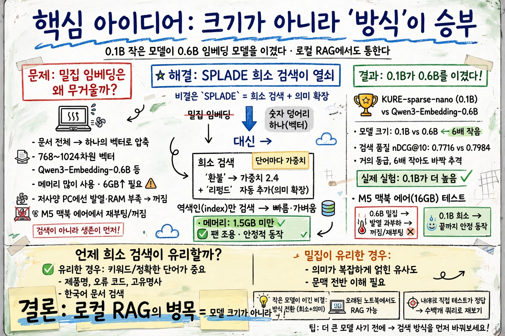
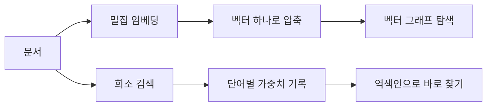

# 임베딩 모델, 클수록 좋은가요? 0.1B가 0.6B를 이겼습니다

> **Summary**
> 0.1B짜리 작은 희소 검색 모델이 0.6B 밀집 임베딩 모델을 이겼습니다. 크기가 아니라 검색 방식이 승부를 갈랐습니다. 비결은 단어마다 가중치를 매기고 의미상 관련 단어를 스스로 덧붙이는 희소 검색입니다. 추론 시 램 1.5GB 미만으로 오래된 노트북에서도 끝까지 안정적으로 돕니다. 다만 이 승부는 한 개발자의 자체 실험이고, 키워드가 또렷한 검색에서 강한 방식이라 모든 상황에서 작은 모델이 이긴다는 뜻은 아닙니다. 내 문서로 직접 재보는 것이 가장 빠릅니다.

---

- 0.1B짜리 작은 모델이 0.6B 임베딩 모델을 이겼습니다. 크기가 아니라 방식이 승부를 갈랐습니다.
- 비결은 `SPLADE`라는 희소 검색입니다. 키워드 검색의 뼈대에 의미까지 얹어, 적은 메모리로 더 잘 찾습니다.
- 로컬 `RAG`의 병목은 모델 크기가 아니라 검색 방식일 수 있습니다. 오래된 노트북에서도 답이 달라집니다.

문서를 잔뜩 모아둔 노트북에서 답을 찾으려고 검색을 돌렸는데, 팬이 윙윙 돌더니 결국 컴퓨터가 꺼져버린 적 있으시죠? `RAG`를 로컬에서 돌리다 보면 이런 장면을 만나게 됩니다. 모델이 무거워서 그렇습니다. 그런데 작은 모델이 큰 모델을 이겼다는 실험 결과가 나왔습니다. 어떻게 된 일일까요?

🎥 [동영상 보기](https://www.youtube.com/watch?v=iGW7FFtJwvg)

## 임베딩, 왜 무거울까요?

`RAG`의 품질은 결국 검색 품질에 달려 있습니다. 질문과 가장 비슷한 문서를 찾아야 답이 좋아지니까요. 그래서 문서마다 임베딩 모델로 벡터를 만듭니다. 문제는 이 벡터가 크다는 점입니다.

밀집 임베딩은 문서 전체를 하나의 벡터로 압축합니다. `Qwen3-Embedding-0.6B` 같은 모델이 대표적입니다. 성능은 좋지만, 저사양 PC에서는 0.6B조차 꽤 무겁습니다. 최신 고사양 장비 이야기가 아닙니다. 평범한 사무실의 8GB 램 윈도우 PC나 5년 된 `M1` 맥북 에어 같은 환경입니다. 이런 곳에서는 검색이 아니라 생존이 먼저입니다!

## 희소 검색이란 무엇일까요?

대안은 `SPLADE`입니다. 본질은 `BM25` 같은 희소 검색이지만, 단어의 의미적 맥락까지 반영합니다. 쉽게 말하면 이렇습니다.

밀집 임베딩은 문서를 숫자 덩어리 하나로 뭉개서 저장합니다. 반대로 희소 검색은 단어마다 가중치를 매깁니다. "이 문서에서 중요한 단어는 무엇인가"를 단어 단위로 기록하는 방식입니다. `SPLADE`는 여기에 한 가지를 더합니다. 문서에 없는 말이라도, 의미상 관련 있는 단어를 모델이 스스로 덧붙입니다. "환불"이라는 문서에 "리펀드"라는 가중치를 얹는 식입니다!

그래서 검색이 빨라집니다. 벡터 전체를 비교하는 대신, 단어 색인만 뒤지면 되니까요. 거대한 벡터 그래프도 필요 없습니다. 오래된 역색인 기술이 그대로 먹힙니다.

## 0.1B가 0.6B를 이긴 실험, 어떻게 했을까요?

한 개발자가 직접 실험을 했습니다. 수백 개의 쿼리로 평가 데이터셋을 만들고, 자기 컴퓨터에 저장된 전체 문서를 검색 대상으로 삼았습니다. 대부분 한국어 문서에 영어 문서가 조금 섞인 코퍼스였습니다. 비교 대상은 `Qwen3-Embedding-0.6B`와 `KURE-sparse-nano`였습니다. `KURE-sparse-nano`는 한국어와 영어 모두에서 강한 성능을 보이는 0.1B짜리 희소 모델입니다. 2026년 10월 12일에 공개됐습니다.

결과는 어땠을까요? 희소 모델이 비슷한 쿼리 속도와 훨씬 적은 메모리 사용량으로도 더 높은 검색 성능을 보였습니다. 추론 시 램 사용량은 1.5GB 미만이었습니다!

가장 극적인 장면은 `M5` 맥북 에어(16GB) 테스트였습니다. 밀집 임베딩 모델은 발열 때문에 맥북이 금방 재부팅될 정도로 실사용이 거의 불가능했습니다. 반면 희소 모델은 메모리 부족 오류나 경고 없이 끝까지 안정적으로 동작했습니다. 같은 노트북, 같은 문서인데 한쪽은 꺼지고 한쪽은 끝까지 간 것입니다!

## 숫자로 보면 어떨까요?

공개된 벤치마크 수치도 참고할 만합니다. `MTEB` 한국어 검색 부문 9개 과제 평균(`nDCG@10`)에서 `KURE-sparse-nano`(0.1B)는 0.7716을 기록했습니다. 같은 계열의 0.6B 희소 모델은 0.7984였습니다. 6배 작은 모델이 형님 모델의 뒤를 바짝 쫓고 있는 셈입니다. 물론 이 수치는 공식 벤치마크 기준이고, 위의 승부 결과는 한 개발자의 자체 실험이라는 점을 함께 봐야 합니다. 독립 검증이 아직 없다는 뜻입니다.

## 언제 희소 검색이 유리할까요?

키워드가 또렷한 검색에서는 희소 검색이 강합니다. 제품명, 고유명사, 오류 코드처럼 정확한 단어가 중요한 경우입니다. 밀집 임베딩은 이런 정확한 단어를 벡터 속에 뭉개버리는 경향이 있습니다. 반대로 의미가 복잡하게 얽힌 유사도 판단에서는 큰 밀집 모델이 여전히 유리할 수 있습니다. 모든 상황에서 작은 모델이 이긴다는 뜻은 아닙니다!

그래서 판단 기준은 하나입니다. 내 문서와 내 쿼리에 무엇이 맞는지, 직접 재보는 것입니다. 모델을 고르기 전에 내 코퍼스로 수백 개 쿼리를 돌려보는 것이 가장 빠릅니다. 벤치마크 순위는 참고일 뿐입니다!

이 글의 관점은 검색을 계획하는 에이전트나 스크린샷으로 문서를 읽는 방식과는 다릅니다. 모델 선택 자체가 주제입니다. 검색의 첫 단추인 임베딩을 무엇으로 할지, 그 선택이 로컬 `RAG`의 성패를 가른다는 이야기입니다.

작은 모델이 이긴 비결은 크기를 줄인 것이 아니라 방식을 바꾼 것입니다. 벡터 하나에 모든 것을 담으려 하지 않고, 단어의 의미를 살려 가볍게 찾는 방식으로요. 오래된 노트북에서도 `RAG`를 돌리고 싶으시다면, 더 큰 모델을 사기 전에 검색 방식부터 바꿔보시는 것이 어떨까요?

