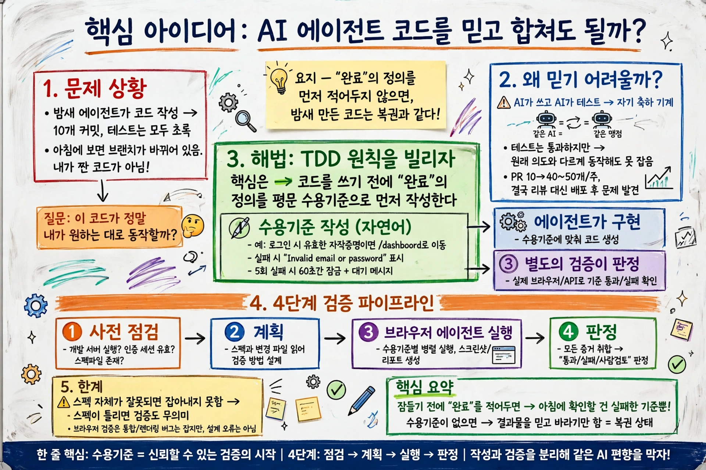
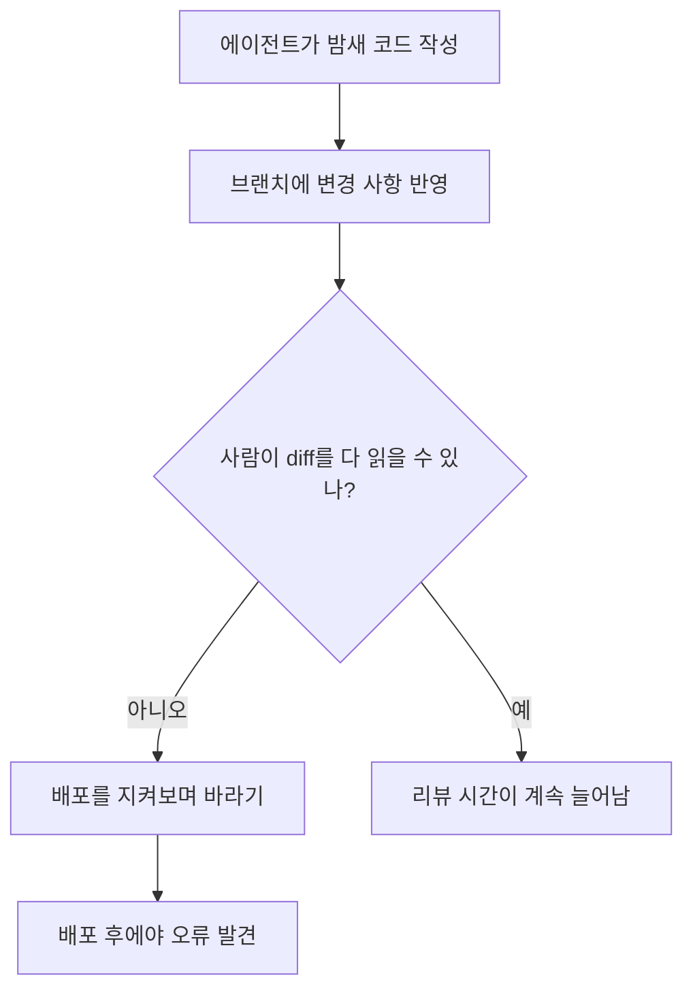
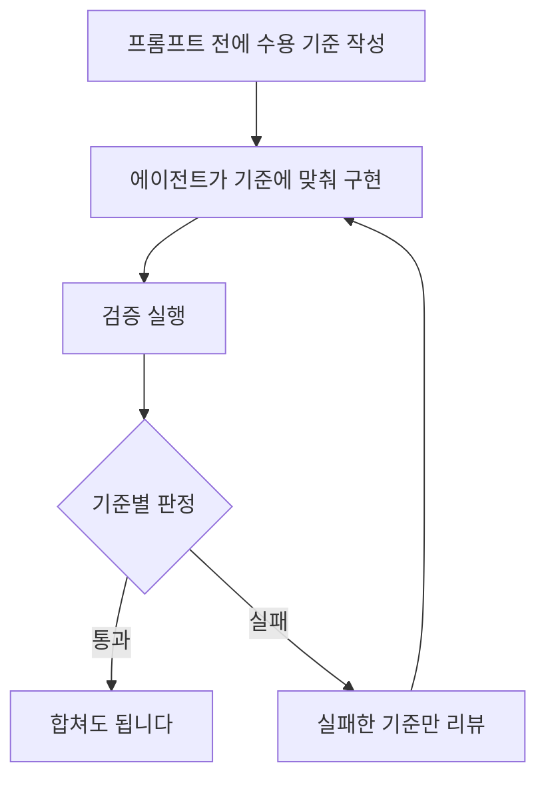
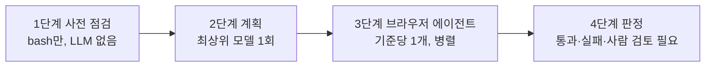

# 자는 동안 에이전트가 짠 코드, 믿으려면 '완료'의 정의를 먼저 적으면 됩니다

> **Summary**
> 자는 동안 에이전트가 짠 코드는 테스트가 초록불이어도 믿기 어렵습니다. 같은 AI가 쓰고 검사하면 자기 축하 기계가 되어 원래 의도와 다른 오해는 잡히지 않기 때문입니다. 해법은 코드보다 먼저 '완료'의 정의를 평문 수용 기준으로 적고, 헤드리스 모드와 브라우저 자동화로 기준별 통과·실패를 판정하는 4단계 파이프라인입니다.

---

- 자는 동안 에이전트가 코드를 짜고, 아침에 보면 브랜치가 바뀌어 있습니다. 직접 짠 코드가 아니라면, 믿고 합쳐도 될까요? 검증 없이 합치는 건 복권에 가깝습니다.
- AI가 쓴 코드를 같은 AI가 테스트하면 자기 축하 기계가 됩니다. 원래 의도와 다른 오해는 잡히지 않습니다.
- 해법은 TDD의 원칙을 빌리는 겁니다. 코드보다 먼저 "완료"의 정의를 평문 수용 기준으로 적고, 에이전트는 기준에 맞춰 구현하고, 별도 검증이 판정합니다.

아침에 출근했는데, 밤새 에이전트가 브랜치에 커밋을 열 개쯤 쌓아둔 적 있으시죠? 코드는 늘었고, 테스트도 초록불입니다. 그런데 한 가지 질문이 남습니다. 이 코드, 정말 제가 원한 대로 동작할까요?

🎥 [동영상 보기](https://www.youtube.com/watch?v=flLyHcLkW3U)

## 왜 믿기 어려울까요?

장시간 실행되는 에이전트 도구는 몇 시간씩 코드를 쓰고 브랜치에 변경 사항을 반영합니다. 사람이 지켜보지 않아도 일은 진행됩니다. 문제는 정확성입니다. 결과물이 실제로 올바른지 확인할 믿을 만한 방법이 없다는 점입니다!

지난 6개월간 100명이 넘는 엔지니어 대상 워크숍에서, 모든 팀이 같은 문제를 겪고 있었습니다. 일상적인 PR에 AI를 쓰는 팀은 주당 PR 병합량이 10개에서 40~50개로 늘었습니다. 코드 리뷰에 드는 시간도 덩달아 늘었습니다. 시스템이 자율적으로 동작할수록 문제는 심해집니다. 어느 순간부터는 diff를 리뷰하지 않고 배포를 지켜보며 문제가 없기를 바라는 구조가 됩니다. 배포 후에야 오류를 발견하는 구조가 됩니다.

## 기존 방법은 왜 안 통할까요?

리뷰어를 더 뽑는 방법은 속도가 따라가지 못합니다. 시니어 엔지니어가 하루 종일 AI가 만든 코드를 읽는 것도 비효율적입니다.

AI가 쓴 코드의 테스트를 같은 AI가 작성하면 더 교묘해집니다. 테스트는 통과합니다. 회귀 버그는 잡힙니다. 그런데 원래 의도와 다른 오해는 절대 잡히지 않습니다. 테스트가 증명하는 건 코드가 AI가 생각한 대로 동작한다는 것뿐입니다. 사용자가 실제로 원한 것이 아닙니다.

같은 AI로 작성과 검증을 동시에 하면 자기 축하 기계가 됩니다. 코드 리뷰의 본래 목적은 원래 작성자가 아닌 두 번째 시선입니다. 그런데 한 AI가 쓰고 다른 AI가 검사해도, 둘은 같은 곳에서 왔습니다. 같은 것을 놓칩니다!

## TDD가 짚은 핵심은 뭘까요?

TDD의 원칙은 단순합니다. 테스트를 먼저 쓰고, 코드를 쓰고, 테스트가 통과하면 멈춥니다. 더 구현하지 않습니다. 대부분의 팀이 TDD를 하지 않는 이유는, 코드가 무엇을 해야 하는지 미리 생각하는 데 시간이 걸리기 때문입니다.

그런데 AI가 속도 문제를 해결했습니다. 이제 느린 부분은 코드가 올바른지 판단하는 것입니다. TDD가 애초에 겨냥한 지점이 바로 여기입니다. 무엇이 올바른지 먼저 적고, 그다음에 확인합니다.

단위 테스트 대신 평문으로 적는 방식이 더 쉽습니다. 기능이 해야 할 일을 자연어로 기술하는 겁니다. 예를 들면 이렇습니다. 사용자가 이메일과 비밀번호로 인증합니다. 잘못된 자격 증명이면 "Invalid email or password"를 표시합니다. 성공하면 `/dashboard`로 이동합니다. 세션 토큰은 24시간 후 만료됩니다. 코드 에디터를 열기 전에 이 기준을 쓸 수 있습니다. 에이전트는 구현하고, 다른 무언가가 검증합니다.

## 실제로 어떻게 검증할까요?

프론트엔드 변경은 스펙 파일 기반으로 수용 기준을 만듭니다. 로그인 기능이라면 기준은 네 가지입니다. AC-1은 유효한 자격 증명으로 접속하면 `/dashboard`로 리다이렉트되고 세션 쿠키가 설정됩니다. AC-2는 잘못된 비밀번호를 입력하면 정확히 "Invalid email or password"가 표시되고 `/login` 페이지에 머무릅니다. AC-3은 필드가 비어 있으면 제출 버튼이 비활성화되거나 인라인 에러가 표시됩니다. AC-4는 5회 실패 후 60초간 로그인이 차단되고 대기 시간 메시지가 표시됩니다. 각 기준은 통과 또는 실패로 명확히 판별됩니다!

에이전트가 기능을 구축하면, 브라우저 에이전트가 각 기준을 실제 브라우저에서 실행합니다. 스크린샷을 찍고 기준별 판정 리포트를 만듭니다. 실패하면 어떤 기준이 실패했고 브라우저에서 무엇이 보였는지 정확히 알 수 있습니다.

백엔드 변경도 같은 패턴입니다. 브라우저 없이 관찰 가능한 API 동작을 명시합니다. 상태 코드, 응답 헤더, 에러 메시지를 기준으로 삼고 `curl` 명령어로 검증합니다. 외부에서 관찰할 수 있는 행동만 기준으로 삼는 것이 핵심입니다.

## 4단계 파이프라인은 어떻게 돌릴까요?

검증 파이프라인은 네 단계로 돌아갑니다. 별도 백엔드 없이, 헤드리스 모드(`claude -p`)와 브라우저 자동화 MCP를 결합한 구조입니다. 기존 로그인 토큰만 쓰고 추가 API 키는 필요 없습니다.

1단계는 사전 점검입니다. 순수 `bash`로 돌리고 LLM 호출은 없습니다. 개발 서버가 실행 중인지, 인증 세션이 유효한지, 스펙 파일이 있는지 확인합니다. 토큰을 쓰기 전에 빠르게 실패합니다.

2단계는 계획입니다. 한 번의 최상위 모델 호출이 스펙과 변경된 파일을 읽고, 각 검증에 필요한 사항과 실행 방법을 정합니다. 코드에서 올바른 셀렉터를 직접 찾으므로 클래스 이름을 추측하지 않습니다.

3단계는 브라우저 에이전트입니다. 수용 기준 하나당 하나의 에이전트, 모두 병렬로 실행합니다. 기준이 5개면 에이전트도 5개, 각자 독립적으로 이동하고 스크린샷을 찍습니다. 클릭 위주 작업에서는 경량 모델이 최상위 모델보다 3~4배 저렴하면서도 성능이 비슷합니다.

4단계는 판정입니다. 마지막 한 번의 최상위 모델 호출이 모든 증거를 읽고 기준별 판정을 반환합니다. 통과, 실패, 또는 사람 검토 필요, 세 가지 중 하나입니다.

설치는 마켓플레이스에서 검증 스킬을 검색해 플러그인으로 추가하면 됩니다. 저장소를 직접 받아서 고쳐 쓰는 것도 가능합니다. 각 단계가 입력과 구조화된 출력을 가진 단일 헤드리스 호출이라 모델을 바꾸거나 단계를 추가하기도 쉽습니다. CI에 연결할 수도 있습니다.

## 한계는 없을까요?

이 방식에도 한계는 분명합니다. 스펙 자체의 오해는 잡아내지 못합니다. 스펙이 처음부터 잘못되면 검증을 통과해도 기능은 틀린 상태입니다!

브라우저 검증이 잡아내는 것은 통합 실패, 렌더링 버그, 이론상으로는 되는데 실제 브라우저에서 깨지는 동작입니다. "검증된 정확성"보다는 좁은 주장입니다. 그래도 코드 리뷰가 안정적으로 잡아내던 것보다는 더 많은 것을 포착합니다.

이 문장이 저는 가장 와닿았습니다. 완료의 정의를 사전에 명시하지 않으면, 결과를 신뢰할 수 없다는 점입니다. 수용 기준을 쓰는 건 프롬프트보다 어렵습니다. 엣지 케이스를 미리 생각해야 하니까요. 그래서 엔지니어들이 저항합니다. TDD를 거부했던 이유와 똑같습니다. 처음에는 더 느리게 느껴지니까요.

하지만 수용 기준이 없으면 할 수 있는 건 결과물을 읽고 올바르기를 바라는 것뿐입니다. 자는 동안 에이전트가 일하게 하려면, 잠들기 전에 "완료"가 무엇인지 적어두면 됩니다. 그 한 장이 없으면, 아침에 쌓인 커밋은 행운을 바라는 짐이 됩니다. 그 한 장이 있으면, 아침에 확인할 건 실패한 기준뿐입니다!

