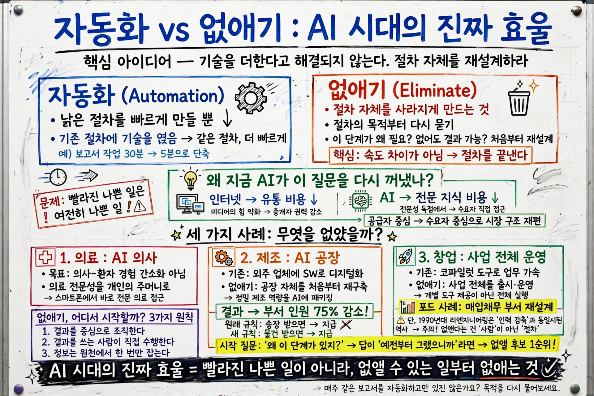
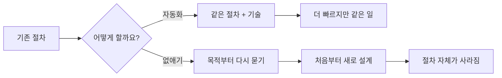
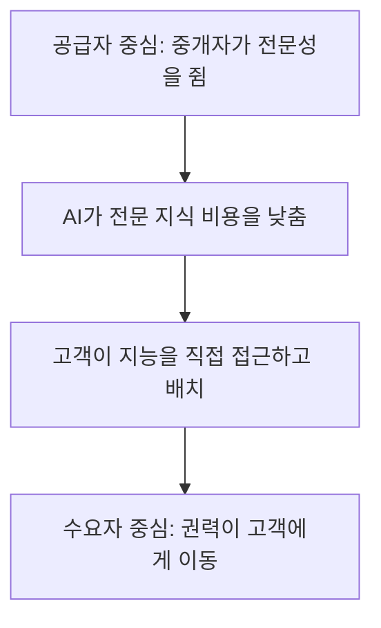

# 자동화하지 말고 없애버려라: 빨라진 나쁜 일은 여전히 나쁜 일입니다

> **Summary**
> 자동화는 낡은 절차를 빠르게 만들 뿐이지만, 없애버리는 일은 절차 자체를 사라지게 만드는 것입니다. 인터넷이 유통 비용을 낮춰 미디어의 힘을 약화시켰듯, AI는 전문 지식의 비용을 낮춰 중개자의 권력을 고객에게 넘기고 있습니다. AI 의사와 AI 공장, 사업 전체를 대신 실행하는 서비스처럼, 진짜 기회는 일을 빠르게 하는 데가 아니라 일을 없애는 데 있습니다.

---

- 자동화는 낡은 절차를 빠르게 만들 뿐이고, 없애버리는 일은 절차 자체를 사라지게 만드는 것입니다.
- 인터넷이 유통 비용을 낮춰 미디어의 힘을 약화시켰듯, AI는 전문 지식의 비용을 낮춰 중개자의 권력을 고객에게 넘기고 있습니다.
- AI 의사, AI 공장, 사업 전체를 대신 실행하는 서비스까지, 진짜 기회는 일을 빠르게 하는 데가 아니라 일을 없애는 데 있습니다.

매주 월요일 아침, 같은 보고서를 만들기 위해 같은 버튼을 누르고 계시진 않으신가요? 자동화 도구를 붙여봤더니 30분 걸리던 일이 5분으로 줄었습니다. 그런데 문득 이런 생각이 들었습니다. 이 보고서, 애초에 왜 만들어야 했을까요?

🎥 [동영상 보기](https://www.youtube.com/watch?v=-9IkUljNZhE)

## 자동화와 없애기, 뭐가 다를까요?

1990년 하버드 비즈니스 리뷰에 실린 한 경영 혁신 글은 이렇게 말했습니다. 소가 다니던 길을 포장하지 말라고요. 오래된 길을 그대로 두고 아스팔트만 깔면, 길은 빨라지지만 여전히 굽은 길입니다. 자동화는 바로 이 포장 작업과 같습니다.

자동화는 기존 절차에 기술을 얹습니다. 같은 절차, 더 빠르게 끝납니다. 없애기는 다릅니다. 절차의 목적부터 다시 묻습니다. 이 단계가 왜 존재하는지, 없어도 결과가 나오는지, 처음부터 새로 설계하면 어떻게 되는지 따져봅니다. 2015년 한 투자사의 블로그 글은 이 구분을 투자 판단의 기준으로 삼았습니다. 기존 시장의 절차를 자동화하는 기업보다, 시장의 구조와 운영 방식을 완전히 대체하는 기업에서 더 큰 성과가 나왔다는 관찰이었습니다.

핵심은 속도 차이가 아닙니다. 자동화는 절차를 살려두고, 없애기는 절차를 끝냅니다. 그래서 자동화는 질문을 미루고, 없애기는 질문부터 시작합니다.

## 왜 지금 AI가 이 오래된 질문을 다시 꺼냈을까요?

인터넷은 유통 비용을 급격히 낮췄습니다. 유통을 통제하던 미디어 기업의 시장 지배력은 약해졌습니다. AI는 전문 지식에 같은 변화를 일으키고 있습니다. 에이전트를 통해 전문가 수준의 지능이 널리 이용 가능해졌고, 전문성을 독점하거나 접근을 통제해 권한을 유지하던 사람과 기업, 기관의 영향력은 줄어들고 있습니다.

사용자는 중개자에게 전문성을 빌리는 대신, 필요한 지능을 직접 접근하고 실제 업무에 배치할 수 있게 됐습니다. 이러한 공급자 중심에서 수요자 중심으로의 이동이 시장 구조를 실질적으로 재편하고 있습니다.

## 세 가지 사례, 무엇을 없앴을까요?

첫 번째 사례는 의료입니다. AI 의사를 스마트폰 사용자 누구나 이용할 수 있게 제공하는 서비스가 있습니다. 목표는 의사와 환자 사이의 경험을 단순히 간소화하는 게 아닙니다. 의료 전문성을 개인의 주머니 안으로 직접 옮기는 것입니다. 기존 방식의 문제는 진료받기 위해 대기 명단과 의뢰 절차를 거쳐야 하고, 제한된 진료 시간을 배분받아야 한다는 점이었습니다. 자동화라면 환자 포털과 예약 앱을 만들어 기존 의사에게 접근하는 과정을 더 원활하게 만드는 수준에 머물렀을 겁니다. 없애기는 스마트폰을 가진 누구에게나 AI 의사를 직접 배치해 기존 의료 접근 구조를 우회합니다. 한 주에서는 이 AI 의사가 합법적으로 처방전을 작성할 수 있는 형태로 시작했습니다.

두 번째 사례는 제조입니다. 정밀 제조 역량이 해외 생산 시설이나 노후한 기계 가공 업체에 묶여 있는 게 문제였습니다. 자동화라면 기존 업체에 소프트웨어를 팔아 견적 산출과 CNC 작업 흐름을 디지털화하는 데 그쳤을 겁니다. 없애기는 고정밀 제조 라인 운영 전문성을 AI에 패키징해, 기존 공장에 도구를 추가하는 대신 그 전문성을 바탕으로 공장 자체를 처음부터 다시 구축합니다.

세 번째 사례는 창업입니다. 회사를 만드는 데 필요한 전문 인력은 부족하고 고용 비용도 높습니다. 자동화라면 창업자에게 코파일럿 도구를 팔아 영업과 운영, 마케팅 업무를 더 빠르게 처리하도록 돕는 수준입니다. 없애기는 개별 업무 도구를 제공하는 데 그치지 않고, 창업자와 협력해 제품 개발부터 영업, 마케팅, 유통까지 사업 전체를 출시하고 운영하는 것을 목표로 합니다. 소프트웨어를 파는 게 아니라 사업 운영 주체의 역할까지 맡는 셈입니다.

## 숫자로 보면 차이가 더 선명해집니다!

포드 자동차의 매입채무 부서 사례가 유명합니다. 원래 규칙은 "송장을 받으면 지급한다"였습니다. 절차를 다시 설계한 뒤 규칙은 "물건을 받으면 지급한다"로 바뀌었습니다. 송장을 확인하고 대조하던 단계가 사라졌습니다. 그 결과 해당 부서 인원은 75% 줄었습니다. 당초 예상은 25% 감소였습니다. 자동화였다면 송장 처리 속도를 높이는 데 그쳤을 겁니다. 절차를 없애니 예상의 세 배가 줄었습니다!

다만 한 가지는 짚고 넘어가야 합니다. 1990년대 리엔지니어링 열풍은 인력 감축의 동의어가 되기도 했습니다. 진단은 맞았지만 실행이 거칠었던 역사가 있습니다. 그래서 "없앤다"는 사람을 없앤다는 뜻이 아닙니다. 절차를 없앤다는 뜻입니다. 이 구분을 놓치면, 좋은 질문이 나쁜 결론으로 바뀝니다.

## 없애려면 어디서부터 시작할까요?

기존 기업은 새 절차를 반기지 않습니다. 익숙한 방식을 자동화해달라고 할 뿐입니다. 그래서 정면 돌파보다 우회로가 낫다는 조언이 나옵니다. 뒷문으로 들어가서, 새 방식이 통한다는 걸 먼저 보여주는 편이 낫다는 뜻입니다.

원칙은 세 가지로 정리됩니다. 결과를 중심으로 조직하고, 결과를 쓰는 사람이 직접 수행하며, 정보는 원천에서 한 번만 잡습니다. 결재를 기다리는 단계를 없애고, 결재가 필요한 사람이 직접 처리하게 하고, 같은 정보를 두 번 입력하지 않는 식입니다.

내 업무에서 "왜 이 단계가 있지?"라고 물어본 적 있으시죠? 그 질문이 시작점입니다. 답이 "예전부터 그랬으니까"라면, 그 단계는 없앨 후보 1순위입니다.

빨라진 나쁜 일은 여전히 나쁜 일입니다. 없앨 수 있는 일부터 없애는 것, 그게 AI 시대의 진짜 효율입니다!

