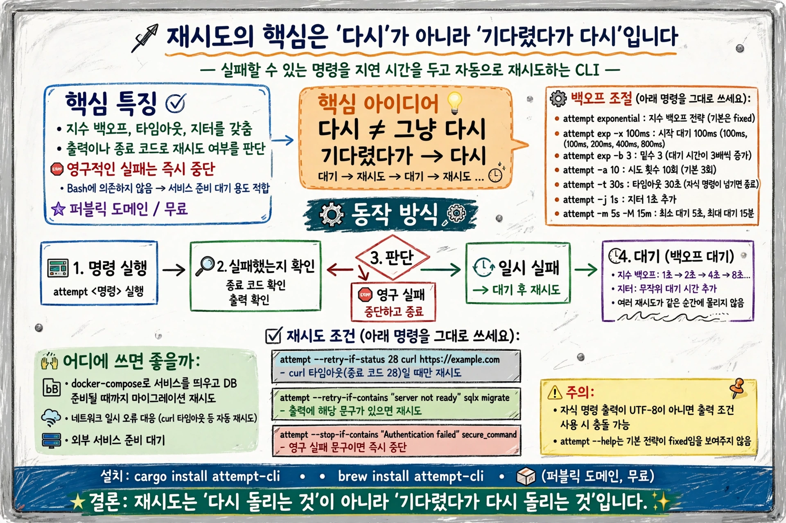
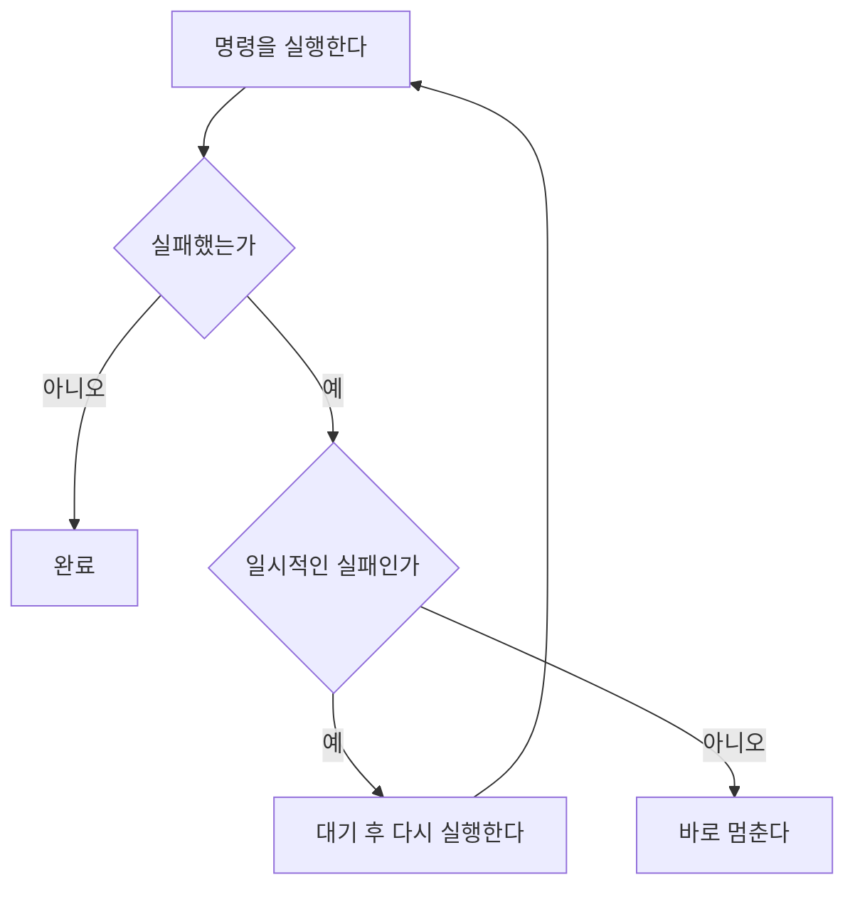

# attempt: 재시도의 핵심은 '다시'가 아니라 '기다렸다가 다시'입니다

> **Summary**
> attempt는 지수 백오프와 지터로 실패한 명령을 기다렸다가 재시도하는 CLI입니다. 종료 코드나 출력에 따라 일시적 실패는 다시 시도하고 영구적 실패는 멈춰, 서비스 준비 대기와 네트워크 오류 처리에 유용합니다. Bash에 의존하지 않으며 무료로 사용할 수 있습니다.

---

- 실패할 수 있는 명령을 지연 시간을 두고 자동으로 재시도하는 CLI입니다. 지수 백오프, 타임아웃, 지터를 갖췄습니다.
- 핵심은 '다시'가 아니라 '기다렸다가 다시'입니다. 출력이나 종료 코드로 재시도 여부를 가려서, 영구적인 실패는 바로 멈춥니다.
- Bash에 의존하지 않아서 서비스 준비를 기다리는 용도로 쓸 수 있고, 퍼블릭 도메인이라 무료입니다.


서비스를 띄우고 바로 마이그레이션을 돌렸는데, DB가 아직 준비가 안 돼서 실패한 적 있으시죠? `docker-compose`로 서비스를 띄우고 바로 마이그레이션을 돌리면, DB가 뜨기 전이라 실패하는 겁니다. 그럴 때 보통 `sleep 5`를 넣거나, 될 때까지 `until` 루프를 돌리죠. 그런데 이 방법은 실패 원인을 가리지 않습니다. DB가 준비 안 된 거면 기다리면 되는데, 마이그레이션 자체가 틀렸으면 아무리 기다려도 안 되거든요!

🎥 [동영상 보기](https://www.youtube.com/watch?v=WjEmM1Jy79M)

## attempt, 도대체 뭘까요?

`attempt`는 실패할 수 있는 명령을 지연 시간을 두고 자동으로 재시도하는 CLI입니다. 사용법은 이렇습니다.

```bash
attempt [BACKOFF] [OPTIONS] [COMMAND]...
```

가장 흔한 쓰임새는 DB 마이그레이션입니다. 서버가 준비되지 않아서 실패하면, 다시 돌립니다.

```bash
attempt --retry-if-contains "server not ready" sqlx migrate
```

이 명령은 출력에 "server not ready"가 들어 있으면 다시 돌리고, 아니면 멈춥니다. 실패 원인을 출력으로 가리는 겁니다!

## 왜 바로 다시 돌리면 안 될까요?

실패했다고 바로 다시 돌리면, 문제가 커집니다. 서비스가 아직 준비 안 됐는데 여러 클라이언트가 동시에 다시 돌리면, 서비스는 더 버거워집니다. 이게 재시도 폭풍입니다. 그래서 기다림이 필요합니다. 지수 백오프는 기다리는 시간을 점점 늘립니다. 1초, 2초, 4초, 8초처럼요. 지터는 기다리는 시간에 무작위성을 더해서, 여러 재시도가 같은 순간에 몰리지 않게 합니다. `attempt`는 이 두 가지를 기본으로 갖췄습니다!

## 재시도 조건, 어떻게 가릴까요?



`attempt`의 진짜 강점은 재시도 여부를 가리는 조건입니다. 종료 코드로 가릴 수 있습니다. 실패한 종료 코드에만 다시 돌리고, 영구 실패 코드에는 멈춥니다.

```bash
attempt --retry-if-status 28 curl https://example.com
```

이건 `curl`이 타임아웃(종료 코드 28)일 때만 다시 돌립니다. 출력으로도 가릴 수 있습니다. 출력에 특정 문구가 있으면 다시 돌리고, 영구 실패 문구가 있으면 멈춥니다.

```bash
attempt --retry-if-contains "Connection timed out" curl https://example.com
attempt --stop-if-contains "Authentication failed" secure_command
```

인증 실패는 기다린다고 해결되지 않으니까, 바로 멈추는 겁니다. 정규식으로 가릴 수도 있습니다. 출력이 패턴에 맞으면 다시 돌립니다. 이 조건들이 `attempt`를 단순한 반복 루프와 다르게 만듭니다!

## 백오프는 어떻게 조절할까요?


백오프는 전략을 골라서 조절합니다. 기본은 `fixed`입니다. 지수 백오프를 쓰려면 `exponential`을 붙입니다.

```bash
attempt exponential --retry-if-contains "server not ready" sqlx migrate
```

대기 시간도 조절할 수 있습니다. 시작 대기 시간은 배율로 정합니다. 기본은 1초(1초, 2초, 4초, 8초)인데, 100밀리초로 바꾸면 100ms, 200ms, 400ms, 800ms가 됩니다. 밑수를 바꾸면 늘어나는 속도가 달라집니다. 밑수가 3이면 대기 시간이 3배씩 늘어납니다. 최소·최대 대기 시간도 정할 수 있고, 지터도 더할 수 있습니다. 시도 횟수는 기본 3회인데, 바꿀 수 있습니다. 타임아웃도 있습니다. 자식 명령이 정한 시간을 넘기면 죽입니다. 이 옵션들이 모여서, 재시도를 정교하게 조율합니다.

## 어디에 쓰면 좋을까요?

가장 잘 맞는 곳은 서비스 준비를 기다리는 일입니다. `docker-compose`로 서비스를 띄우고, DB가 준비될 때까지 마이그레이션을 재시도하는 겁니다. Bash에만 의존하는 대기 스크립트와 달리, `attempt`는 Bash에 의존하지 않습니다. 네트워크나 외부 서비스처럼 일시적으로 불안정한 환경에서도 스크립트 신뢰성을 유지합니다. `curl` 타임아웃처럼 일시적인 실패를 다시 돌리는 데도 잘 맞습니다. 단, 주의할 점이 있습니다. 자식 명령의 출력이 UTF-8이 아니면, 출력 조건을 쓸 때 충돌이 날 수 있습니다. 그리고 `attempt --help`는 전략을 지정하지 않으면 `fixed`가 기본이라는 걸 보여주지 않습니다. 이 두 가지는 알려진 문제입니다.

설치는 간단합니다. `cargo install attempt-cli`나 `brew install attempt-cli`로 받으면 됩니다. 퍼블릭 도메인이라 무료입니다.

재시도는 '다시 돌리는 것'이 아니라 '기다렸다가 다시 돌리는 것'입니다. 실패 원인을 가리고, 대기 시간을 늘리고, 지터로 흩뜨리는 것. 그게 `attempt`가 하는 일입니다!

