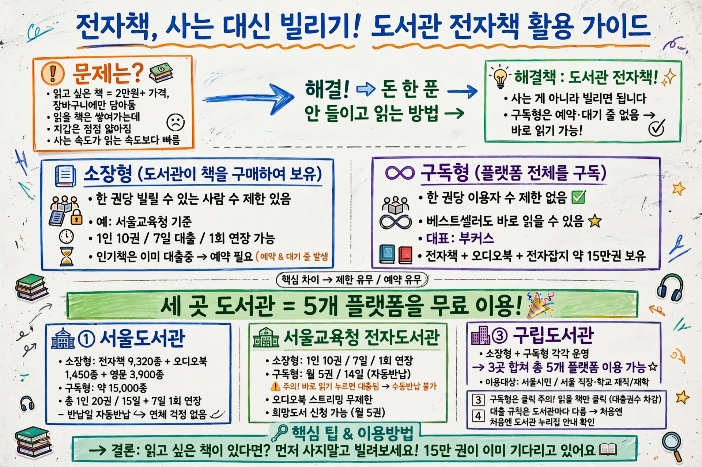
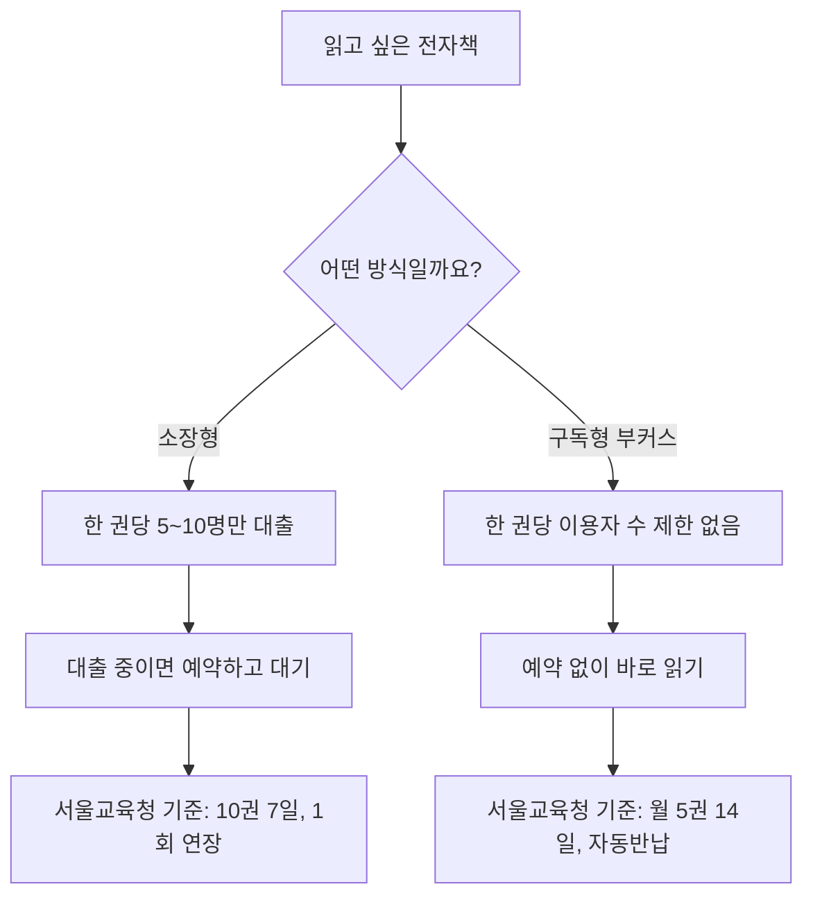
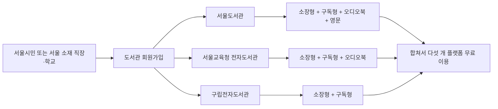
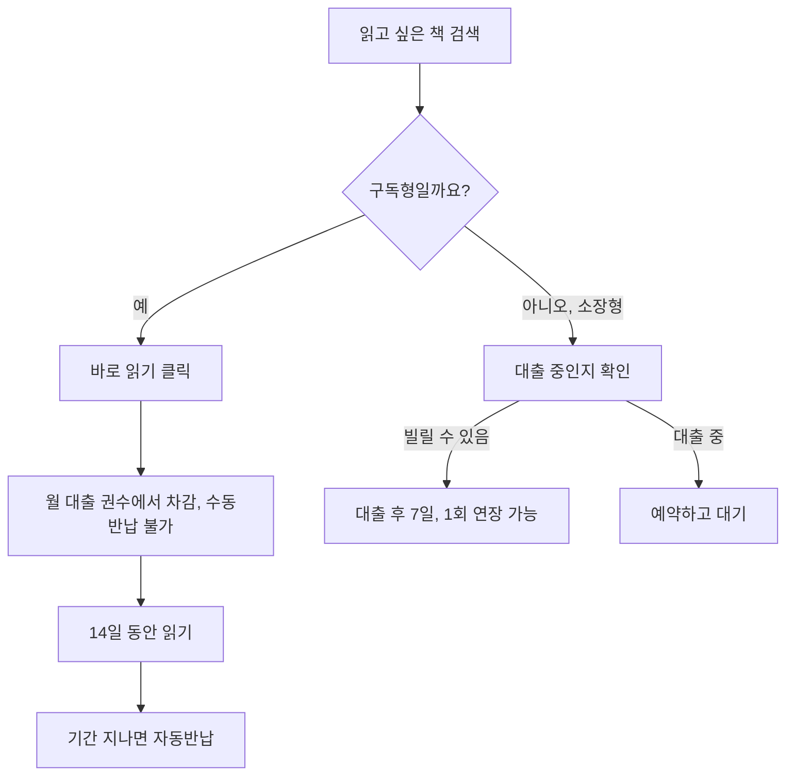

# 전자책 15만 권, 사는 게 아니라 빌리면 됩니다. 예약도 대기 줄도 없습니다

> **Summary**
> 서울시민이나 서울 소재 직장·학교 구성원은 서울도서관, 서울교육청 전자도서관, 구립도서관을 통해 전자책과 오디오북을 무료로 이용할 수 있습니다. 특히 구독형 전자책은 대기 없이 바로 읽을 수 있지만, 도서관마다 이용 가능한 목록과 대출 규칙이 다르므로 확인이 필요합니다. 휴대폰이나 태블릿으로 시작해도 좋고, 눈의 피로와 배터리 사용이 걱정된다면 이북리더기를 활용할 수 있습니다.

---

- 전자책은 사는 게 아니라 도서관에서 빌리면 됩니다. 구독형 전자도서관은 예약도 대기 줄도 없습니다.
- 서울도서관·서울교육청·구립도서관 세 곳이면, 소장형과 구독형을 합쳐 다섯 개 플랫폼을 무료로 쓸 수 있습니다.
- 구독형은 한 권당 이용자 수 제한이 없어서, 베스트셀러도 바로 읽을 수 있습니다.

읽고 싶은 책이 생겼는데, 가격을 보고 장바구니에 담아두기만 한 적 있으시죠? 종이책 한 권이 2만 원을 넘는 게 이제는 낯설지 않습니다. 읽을 책이 쌓일수록 지갑은 얇아지고, 결국 읽는 속도가 사는 속도를 못 따라갑니다. 그런데 같은 책을 돈 한 푼 안 들이고 읽는 방법이 이미 있습니다. 도서관 전자책입니다!

🎥 [동영상 보기](https://www.youtube.com/watch?v=1nO4R2puGQM)

## 소장형과 구독형, 뭐가 다를까요?

전자도서관은 크게 두 가지로 나뉩니다. 소장형과 구독형입니다. 차이는 한 가지 질문으로 갈립니다. "이 책, 몇 명이 동시에 빌릴 수 있을까요?"

소장형은 도서관이 책을 사서 보유하는 방식입니다. 한 권당 빌릴 수 있는 사람 수가 정해져 있습니다. 서울교육청 전자도서관 기준으로 소장형 전자책은 1인 10권, 7일 동안 빌릴 수 있고, 1회 연장도 됩니다. 다만 인기 있는 책은 이미 대출 중일 수 있습니다. 그럴 땐 예약하고 기다려야 합니다. 예약은 5권까지 됩니다.

구독형은 구조 자체가 다릅니다. 도서관이 책을 한 권씩 사는 게 아니라, 구독형 플랫폼 전체를 빌려 오는 방식입니다. 한 권당 이용자 수 제한이 없어서, 베스트셀러라도 예약 없이 바로 읽을 수 있습니다. 이 구독형 플랫폼이 바로 `부커스`입니다. 전자책·오디오북·전자잡지를 합쳐 15만여 권을 갖고 있습니다. 영상 제목의 15만 권이 바로 이 숫자입니다!

## 세 곳 도서관, 다섯 개 플랫폼은 어떻게 쓸까요?

영상에서 소개한 방법은 세 곳의 도서관을 함께 쓰는 것입니다. 서울도서관, 서울교육청 전자도서관, 구립전자도서관입니다. 각 도서관마다 소장형과 구독형이 따로 있어서, 플랫폼은 사실상 다섯 군데가 됩니다. 세 곳 모두 무료입니다. 이용 대상은 서울시민, 또는 서울 소재 직장·학교에 다니는 분들입니다.

서울도서관은 규모가 가장 큽니다. 국내 전자책 소장형 9,320여 종, 구독형 15,000여 종, 오디오북 소장형 1,450여 종에 영문 전자책 3,900여 종까지 있습니다. 전자책과 오디오북을 합쳐 1인 20권까지, 15일 동안 빌릴 수 있고 7일 한 번 연장됩니다. 반납일이 되면 자동으로 반납돼서 연체 걱정이 없습니다.

서울교육청 전자도서관은 구독형이 특히 잘 갖춰져 있습니다. 소장형 10권 7일에 구독형 월 5권 14일, 오디오북은 스트리밍 무제한입니다. 원하는 책이 없으면 희망도서 신청도 할 수 있습니다. 월 5권까지 신청할 수 있습니다. 사는 곳 구립도서관도 소장형과 구독형을 함께 운영하니, 한 곳만 쓰지 말고 세 곳을 나눠 쓰면 고를 수 있는 책이 훨씬 넓어집니다.

## 15만 권, 정말 다 볼 수 있을까요?

여기서 한 가지는 짚고 넘어가야 합니다. 15만 권은 `부커스` 플랫폼 전체가 가진 책의 수입니다. 도서관마다 계약한 목록이 달라서, 내가 쓰는 도서관에서 볼 수 있는 구독형 책은 그보다 적을 수 있습니다. 서울도서관의 구독형 목록이 15,000여 종인 게 바로 그 예입니다. 그래도 소장형과 합치면 고를 책이 부족하지는 않습니다!

구독형은 클릭 한 번에 주의할 점도 있습니다. 서울교육청 전자도서관에서는 구독형 책의 바로 읽기를 누르는 순간 대출 권수에 포함되고, 수동 반납이 안 됩니다. 읽을 책만 눌러야 합니다. 대출 기간은 14일, 연장은 안 되고 기간이 지나면 자동으로 반납됩니다. 대출 규칙은 도서관마다 다르고 바뀔 수도 있으니, 처음 쓸 때는 각 도서관 누리집 안내를 한 번 확인하는 게 안전합니다.

## 이북리더기로 읽으면 뭐가 달라질까요?

책을 빌리는 방법을 알았으면, 이제 읽는 도구 차례입니다. 영상에서는 이북리더기로 읽는 걸 권합니다. 휴대폰이나 태블릿으로도 읽을 수 있지만, 이북리더기는 화면이 종이처럼 보여서 눈이 덜 피로하고 배터리도 오래 갑니다. 책만 읽는 기기라 알림에 끌려가지 않는 것도 장점입니다!

물론 이북리더기가 필수는 아닙니다. 이미 쓰는 태블릿이나 휴대폰으로 시작해도 충분합니다. 책을 고르는 재미에 먼저 빠지고, 읽는 양이 늘면 그때 도구를 바꿔도 늦지 않습니다. 도서관 앱은 휴대폰과 태블릿, PC에서 모두 쓸 수 있습니다.

읽고 싶은 책이 있다면, 먼저 사는 대신 빌려보세요. 예약 줄에서 기다릴 필요도 없습니다. 15만 권이 이미 기다리고 있습니다!

