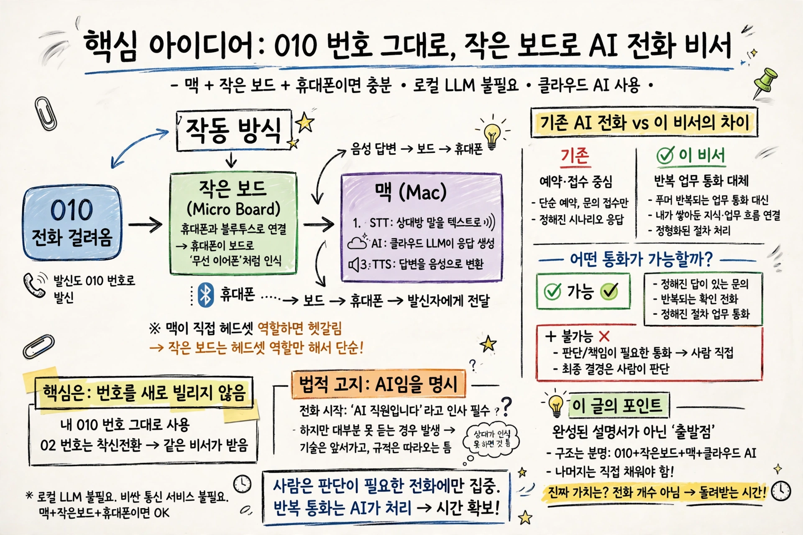
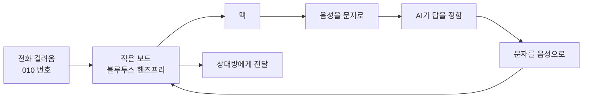
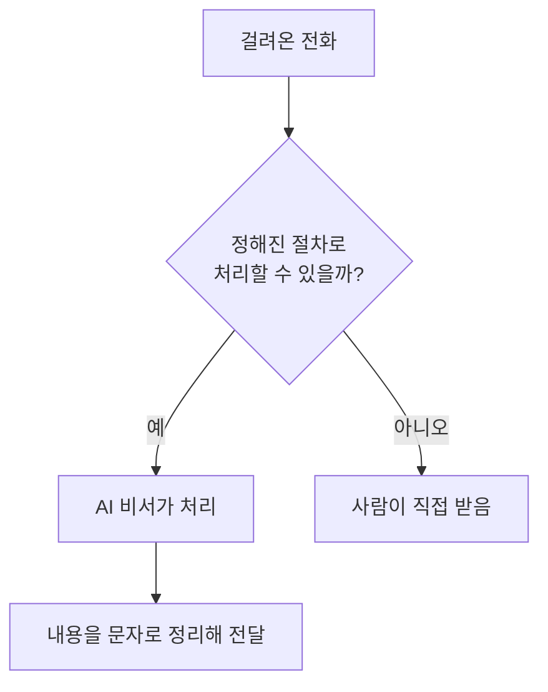

# 전화 비서, 010 번호 그대로 받습니다. 맥과 작은 보드 한 장이면 됩니다

> **Summary**
> 맥과 작은 보드를 블루투스로 연결해 기존 010 번호로 걸려오는 전화를 AI가 받고, 클라우드 모델로 응답하는 전화 비서 구상이다. 예약뿐 아니라 반복적인 업무 통화도 처리하고 내용을 정리해 전달할 수 있지만, 판단과 책임이 필요한 통화는 사람이 맡아야 한다. 구현 세부 사항은 공개되지 않았으며, AI임을 알려야 하는 고지와 상대방이 이를 알아듣지 못할 수 있다는 문제도 제기된다.

---

- 010으로 걸려오는 전화를 AI가 직접 받습니다. 발신도 010 번호로 나갑니다.
- 비싼 통신 서비스도, 로컬 LLM도 필요 없습니다. 맥과 작은 보드 한 장, 그리고 휴대폰이면 됩니다.
- 진짜 차이는 따로 있습니다. 예약·접수가 아니라, 평소 반복하던 넓은 범위의 업무 통화를 대신한다는 점입니다.

일하다가 전화가 울리면, 하던 일을 멈추고 받아야 합니다. 같은 설명을 또 하고, 같은 질문에 또 답하고, 끝나면 메모까지 남겨야 합니다. 하루에 몇 번씩 반복되는 통화, 그 시간을 돌려받을 수 있을까요?

🎥 [동영상 보기](https://www.youtube.com/watch?v=tNh0HN7ybiw)

## 전화 비서는 어떻게 돌아갈까요?

핵심은 전화번호를 새로 빌리지 않는 것입니다. 이미 손에 있는 010 번호, 그 번호가 들어 있는 휴대폰을 그대로 씁니다. 작은 보드가 휴대폰과 블루투스로 연결돼, 휴대폰은 그 보드를 무선 이어폰처럼 봅니다. 통화가 오면 소리는 보드를 거쳐 맥으로 흘러갑니다. 왜 하필 작은 보드일까요? 맥이 직접 휴대폰의 헤드셋 역할을 맡으면, 역할을 헷갈리는 일이 생기기 때문입니다. 보드는 헤드셋 역할만 하니까 길이 단순합니다.

맥에서는 세 가지 일이 이어집니다. 상대방의 말을 문자로 바꾸고, AI가 무슨 말인지 파악해 답을 정하고, 그 답을 다시 음성으로 바꿔 돌려보냅니다. 로컬 LLM이 없어도 됩니다. 클라우드 모델을 쓰면 되니까요. 02 번호는 착신전환으로 연결해, 02로 걸려온 전화도 같은 비서가 받습니다.

## 예약만 받는 비서가 아닙니다

기존 AI 전화 서비스는 예약 받고 접수하는 일이 중심입니다. 그런데 이 비서의 목표는 한 단계 더 나아갑니다. 평소에 직접 쌓아둔 지식과 업무 흐름을 AI에게 연결하는 것입니다. 그러면 AI는 정해진 문장을 읽는 수준을 넘어, 반복되는 업무 통화의 넓은 범위를 대신 처리합니다.

어떤 통화가 대신 가능할까요? 정해진 답이 있는 문의, 반복되는 확인 전화, 정해진 절차대로 진행되는 업무 통화 같은 것들입니다. 물론 모든 통화를 맡길 수는 없습니다. 판단이 필요한 통화, 책임이 걸린 통화는 사람이 받아야 합니다. 어디까지 AI에게 맡길 수 있을까요? 그 선은 직접 정하는 것이 순서입니다!

## AI라고 밝혀야 한다는 단점도 있습니다

인공지능 기본법 때문에 AI임을 밝혀야 합니다. 전화를 받자마자 "AI 직원입니다"라고 인사해야 한다는 뜻입니다. 그런데 소개된 사례에서는 대부분의 상대방이 그 말을 듣지 못했다고 합니다. 인사가 너무 빨리 지나가거나, 상대방이 주의를 기울이지 않기 때문입니다.

이 지점은 생각해 볼 만합니다. 법이 정한 고지는 했지만, 상대방이 알아듣지 못했다면 고지가 된 것일까요? 상대방은 AI와 통화하고 있다는 걸 알아챌까요? 기술이 먼저 나아가고, 규칙이 뒤따라오는 사이에서 생기는 빈틈입니다. AI 전화가 늘어날수록 이 질문은 더 자주 마주치게 될 것입니다!

## 아직 공개되지 않은 것들도 있습니다

이 글의 원본은 짧은 소개 글 한 편입니다. 연결된 저장소나 시연 영상은 없고, 음성을 문자로 바꾸는 방법이나 음성을 만드는 방법이 무엇인지도 밝히지 않았습니다. 댓글에서도 바로 그 부분을 물었습니다. 어떻게 구현했는지, 유료 에이전트에 연결한 것인지 말이죠.

그래서 이 글은 "이렇게 만들었다"는 완성된 설명서가 아니라, "이렇게 만들 수 있다"는 출발점입니다. 구조는 분명합니다. 번호는 이미 가진 것을 쓰고, 소리는 보드를 거쳐 맥으로 보내고, AI가 지식과 흐름을 이용해 답합니다. 나머지는 직접 채워 넣어야 합니다!

여러분의 전화 중 몇 개가 절차로 풀릴까요? 전화는 여전히 사람의 일처럼 보입니다. 하지만 반복되는 통화의 상당 부분은 절차와 지식으로 풀립니다. 그 부분을 기계에게 맡기면, 사람은 판단이 필요한 통화에만 집중할 수 있습니다. 전화 비서의 진짜 가치는 받는 전화의 개수가 아니라, 돌려받는 시간에 있습니다!

