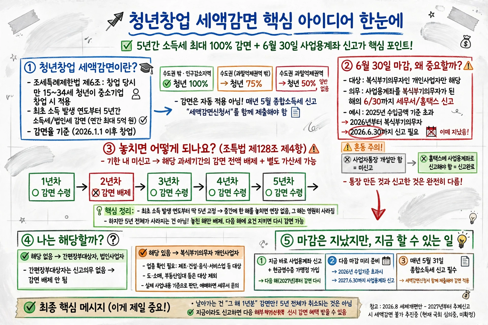
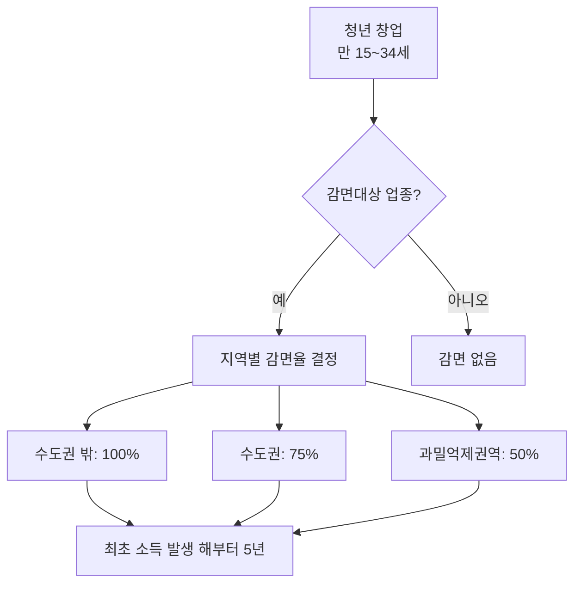
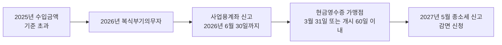
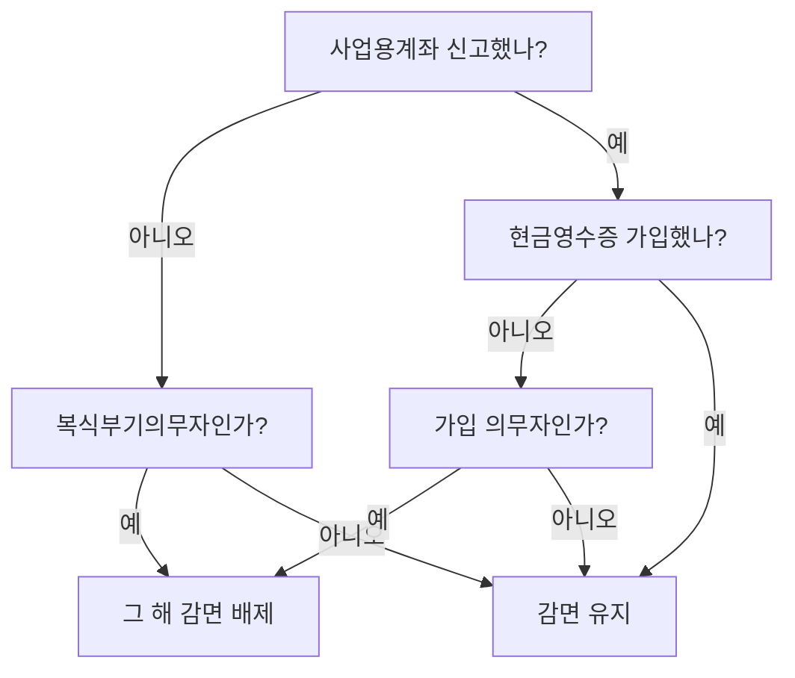

# 청년창업 세액감면, 통장 하나 신고 안 하면 그 해 감면이 통째로 날아갑니다

> **Summary**
> 청년창업 세액감면은 요건을 충족하면 최초 소득 발생 연도부터 5년간 적용되지만, 복식부기의무자가 사업용계좌를 기한 내 신고하지 않거나 가입 의무를 지키지 않으면 해당 연도의 감면을 받지 못합니다. 2026년 6월 30일 마감은 지났으며, 그 해 감면은 되살릴 수 없지만 지금 의무를 이행하면 이후 연도의 감면은 지킬 수 있습니다. 매년 감면 신청과 신고 기한을 챙기고, 업종·대상 여부가 불확실하면 세무서에 확인해야 합니다.

---

- 청년창업 세액감면은 5년간 소득세를 최대 100%까지 깎아주는 제도입니다.
- 그런데 복식부기의무자가 사업용계좌를 6월 30일까지 신고하지 않으면, 그 해 감면이 통째로 배제됩니다.
- 이 글의 마감(2026년 6월 30일)은 이미 지났습니다. 날아간 건 그 해 감면 한 해분이고, 다음 해 감면은 다시 지킬 수 있습니다.

사업자등록을 마치고 첫 매출이 조금씩 늘기 시작했습니다. 어느 날 "사업용계좌 신고 안 하면 세액감면이 날아간다"는 글을 봤는데, 무슨 말인지 감이 안 오셨죠?

🎥 [동영상 보기](https://www.youtube.com/watch?v=e_6UaRcVj1U)

## 청년창업 세액감면, 대체 뭔가요?

청년창업 세액감면은 조세특례제한법 제6조에 있는 제도입니다. 창업 당시 만 15세 이상 34세 이하인 청년이 감면대상 업종으로 중소기업을 창업하면, 처음으로 소득이 생긴 해부터 5년 동안 소득세나 법인세를 깎아줍니다. 군 복무를 했다면 그 기간(최대 6년)을 나이에서 빼고 계산합니다.

감면율은 창업한 지역으로 갈립니다. 2026년 1월 1일 이후 창업 기준입니다.

| 창업 지역 | 청년 창업 | 일반 창업 |
| --- | --- | --- |
| 수도권 밖, 인구감소지역 | 100% | 50% |
| 수도권(과밀억제권역 밖) | 75% | 25% |
| 수도권 과밀억제권역 | 50% | 없음 |

한 해 감면받는 세액은 5억 원까지입니다. 2025년 이전에 창업했다면 예전 표가 계속 적용됩니다. 감면은 자동으로 들어오지 않습니다! 매년 5월 종합소득세 신고 때 세액감면신청서를 함께 내야 합니다.

## 왜 6월 30일이 마감이었을까요?

마감의 정체는 사업용계좌 신고였습니다. 사업용계좌는 복식부기의무자인 개인사업자가 사업 거래에 쓰는 계좌를 세무서에 신고하는 제도입니다. 신고 기한은 복식부기의무자가 된 해의 6월 30일입니다. 2025년 수입금액이 기준을 넘어 2026년부터 복식부기의무자가 된 사업자는 2026년 6월 30일까지 신고해야 했습니다. 6월 29일 저녁에 올라온 글의 "14시간"은 이 마감을 향한 경고였습니다.

복식부기의무자가 되는 기준은 직전 연도 수입금액입니다. 업종마다 다릅니다.

| 업종 | 직전 연도 수입금액 |
| --- | --- |
| 도매·소매업, 농업 등 | 3억 원 이상 |
| 제조업, 음식점업, 정보통신업 등 | 1억 5천만 원 이상 |
| 전문·과학·기술서비스업, 교육서비스업 등 | 7,500만 원 이상 |

여기서 놓치기 쉬운 함정이 있습니다. 은행에서 사업자 통장을 만들어 사업용으로 쓰고 있어도, 홈택스나 세무서에 사업용계좌로 신고하지 않았다면 미신고입니다. 통장을 만든 것과 신고한 것은 다릅니다!

현금영수증가맹점 가입도 같은 맥락입니다. 소비자상대업종으로 직전 과세기간 수입금액이 2,400만 원 이상이면 해당 연도 3월 31일까지 가입해야 하고, 현금영수증 의무발행업종을 새로 시작하면 개시일부터 60일 안에 가입해야 합니다.

## 놓치면 어떻게 되나요?

조세특례제한법 제128조 제4항이 정합니다. 복식부기의무자가 사업용계좌를 기한 안에 신고하지 않거나, 가입 의무가 있는 사업자가 현금영수증가맹점에 가입하지 않으면, 해당 과세기간의 해당 사업장에 대해 감면을 적용하지 않습니다. 가산세가 따로 붙는 것과 별개로, 그 해 감면 자체가 빠집니다.

무서운 점은 감면 기간이 고정이라는 사실입니다. 감면은 최초로 소득이 생긴 해부터 딱 5개 과세연도입니다. 배제된 해만큼 기간이 뒤로 늘어나지 않습니다. 5년 중 한 해를 날리면, 그 해는 영영 돌아오지 않습니다.

다만 한 가지는 분명히 짚어야 합니다. 날아가는 건 그 해 감면 한 해분입니다. 5년 감면 전체가 사라지는 게 아닙니다! 다음 해에 의무를 지키면 다음 해 감면은 다시 받을 수 있습니다. "내년에 울면서 찾아와도 안 돼"라는 말의 정확한 뜻은, 지난 해 감면은 돌이킬 수 없다는 뜻입니다.

## 나도 해당될까요?

먼저 안심할 사람부터 정리하겠습니다. 사업용계좌 신고 의무는 복식부기의무자 개인사업자에게만 있습니다. 간편장부대상자는 의무가 없어서, 신고를 안 했다는 이유만으로 감면이 배제되지 않습니다. 법인도 소득세법상 사업용계좌 신고 대상이 아니라서 이 사유와 관계가 없습니다.

업종도 따져봐야 합니다. 감면은 조세특례제한법이 열거한 업종에만 적용됩니다. 제조·건설·음식업 등이 대상이고, 도·소매나 부동산임대 등은 빠집니다. 원문 댓글에서 많이 물은 질문을 보면, 미용업은 대상이 되지만 카페는 빵 비중이 50%를 넘어야 음식점업으로 보고, 광고대행업이나 소프트웨어는 등록 내용과 실제 사업 형태가 관건이었습니다. 업종 판정은 사업자등록 코드가 아니라 실제 사업 내용으로 하니, 애매하면 관할 세무서에 확인하는 게 안전합니다.

## 마감은 지났는데, 지금 뭘 해야 할까요?

마감은 2026년 6월 30일로 이미 지났습니다. 그런데 할 일은 남아 있습니다. 지금이라도 사업용계좌를 신고하고 현금영수증가맹점에 가입해 두면, 다음 해부터 감면은 다시 받을 수 있습니다. 늦은 신고가 지난 해 감면을 되살리지는 못하지만, 다음 해를 지키는 출발점은 됩니다.

그리고 다음 마감을 미리 챙기세요. 2026년 수입금액이 기준을 넘으면 2027년부터 복식부기의무자가 되고, 사업용계좌 신고 마감은 2027년 6월 30일입니다. 매년 5월 31일 종합소득세 신고 기한도 놓치면 안 됩니다. 기한 후 신고를 하면 그 해 감면도 배제됩니다. 감면 신청 자체를 빠뜨린 해가 있다면, 법정신고기한부터 5년 안에 경정청구로 바로잡을 수 있습니다.

한 가지 더, 2026년 8월 정부가 발표한 세제개편안에는 2027년 귀속 소득부터 추계 신고를 하면 창업중소기업 세액감면을 적용하지 않는 내용이 들어 있습니다. 아직 국회 심의 중이라 확정된 건 아닙니다. 제도가 바뀌는 해에는 신고 방식을 미리 점검하는 게 좋습니다.

국세청은 2026년 6월부터 청년 창업자를 돕는 스타트업 세금든든케어도 운영하고 있습니다. 신고 일정 체크리스트와 세금교실 같은 지원을 묶어둔 서비스입니다. 모르면 놓치고, 알면 챙기는 게 세금 혜택의 본질이 아닐까요?

세금 감면은 신청하는 사람의 것입니다. 마감은 지났지만, 다음 해 감면은 아직 손에 있습니다.

