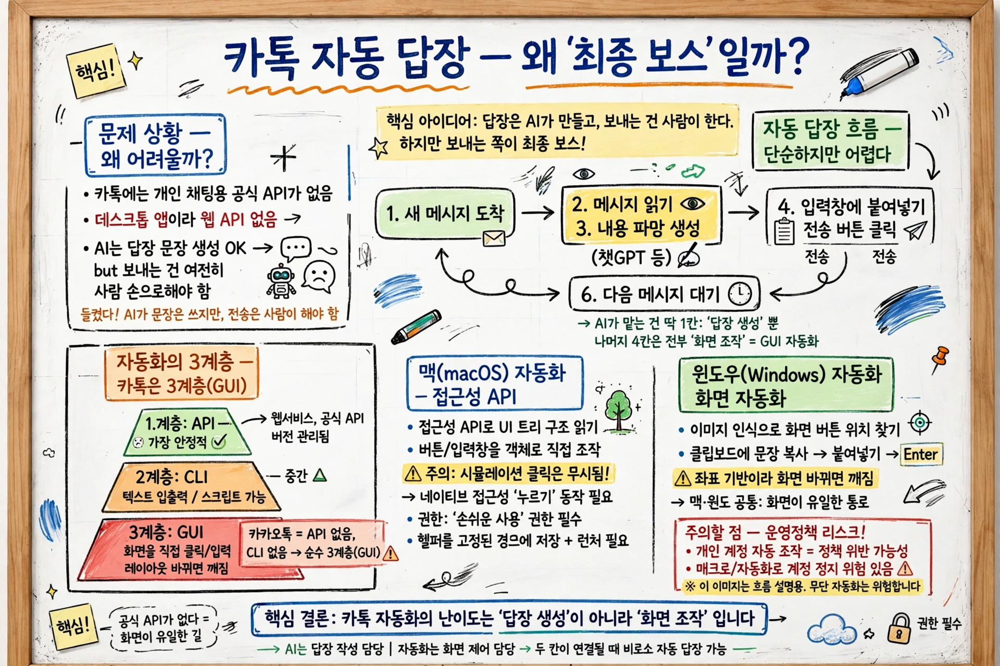
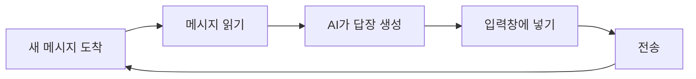
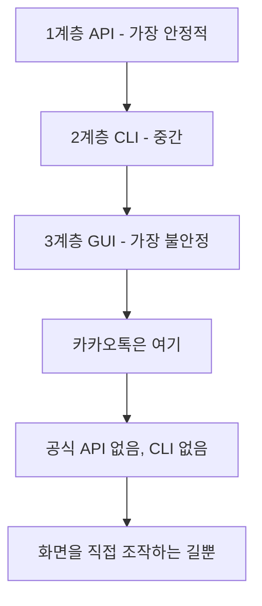
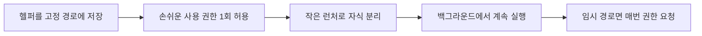

# 카카오톡 자동 답장, 답장 만드는 건 쉬운데 보내는 게 최종 보스입니다

> **Summary**
> 카카오톡 개인 채팅에는 공식 API가 없어 자동 답장은 화면을 직접 조작해야 하며, 맥에서는 접근성 API, 윈도우에서는 화면 자동화 도구를 활용합니다. 답장 생성보다 메시지 읽기와 입력·전송, 권한 관리가 더 어렵고 화면 변경에 취약하며, 개인 계정 자동화는 운영정책 위반이나 계정 제한 위험이 있습니다.

---

- 카톡 답장, 만드는 건 AI가 하고 보내는 건 사람이 합니다. 그런데 보내는 쪽이 최종 보스입니다.
- 카카오톡에는 개인 채팅을 다루는 공식 API가 없습니다. 그래서 자동화는 화면을 직접 조작하는 길로 갑니다.
- 맥에서는 접근성 API로 화면 구조를 읽고, 윈도우에서는 화면 자동화 도구로 같은 일을 합니다.

연인에게 카톡 답장 보내기가 왜 이렇게 어려울까요? 개발은 쉬운데, 카톡 답장은 어렵습니다. 원문 글의 작성자도 마찬가지였습니다. 답장 문장을 만드는 일은 챗GPT에게 맡겼습니다. 그런데 들켰습니다. 문장은 AI가 만들어줬는데, 보내는 일은 여전히 사람이 해야 했던 겁니다!

그래서 나온 질문이 있습니다. 답장까지 AI가 다 해주면 안 될까요? 이 글은 그 질문에서 출발합니다. 카톡 자동 답장의 흐름이 어떻게 돌아가는지, 왜 이 일이 자동화의 최종 보스라고 불리는지 뜯어보겠습니다.

🎥 [동영상 보기](https://www.youtube.com/watch?v=G8r6UIfhWt0)

## 왜 최종 보스일까요?

카카오톡 자동화가 어려운 이유는 하나입니다. 문을 열어주는 공식 통로가 없습니다.

웹 서비스라면 API가 있습니다. 요청을 보내면 답이 옵니다. 그런데 카카오톡은 웹이 아닙니다. 데스크톱 앱입니다. 그리고 개인 채팅을 다루는 공식 봇 API도 부실합니다. 카카오톡 메시지 API는 나와의 채팅과 친구에게 템플릿 메시지를 보내는 정도까지만 됩니다. 대화방을 읽는 API는 목록에 없습니다. 알림톡과 챗봇은 어떨까요? 그것도 개인 계정용이 아닙니다. 회사 카카오톡 채널이 사용자에게 보내거나 답하는 쪽입니다. 질문하는 사람 역할을 대신할 수 없습니다.

결국 남는 길은 하나입니다. 사람이 앱에서 하는 동작을 그대로 흉내 내는 것입니다. "모든 데스크톱 앱을 자동화하는 것"과 똑같은 난이도가 된다는 원문 글의 표현이 그래서 나왔습니다. 답장 문장을 만드는 일은 AI가 잘합니다. 어려운 건 그 문장을 카톡 화면에 넣고 보내는 쪽입니다.

## 자동 답장, 흐름은 단순합니다

자동 답장의 흐름 자체는 단순합니다. 새 메시지가 오면 읽고, AI가 답을 만들고, 입력창에 넣고, 전송합니다. 그리고 다음 메시지를 기다립니다.

이 흐름에서 AI가 맡는 부분은 딱 한 칸입니다. 답장 생성입니다. 나머지는 전부 화면 조작입니다. 메시지를 읽는 일도, 입력창에 넣는 일도, 전송 버튼을 누르는 일도 화면을 다뤄야 합니다. 이 장면이 저는 가장 인상 깊었습니다. AI 자동화라고 하면 모델이 주인공인 줄 알았는데, 카톡 앞에서는 화면을 다루는 손이 주인공이었습니다!

## 자동화의 3계층, 카톡은 3계층입니다

자동화에는 계층이 있습니다. API, CLI, GUI 순서입니다. API가 가장 안정적입니다. 앱 화면이 바뀌어도 API는 버전 관리가 되니까 갑자기 안 되는 일이 거의 없습니다. CLI는 중간입니다. 텍스트 입출력이라 파싱이 가능하고 스크립트로 다루기 좋습니다. GUI는 가장 불안정합니다. 화면을 직접 조작하는 방식이라 레이아웃이 바뀌면 좌표가 틀어집니다.

카카오톡은 어떤 계층일까요? 공식 API 없음, CLI 없음. 순수한 3계층입니다. 그래서 자동화의 출발점이 다릅니다. API 문서를 읽는 게 아니라, 화면을 어떻게 읽고 누를지부터 고민해야 합니다.

## 맥에서는 어떻게 할까요?

맥에서 카톡을 자동화하는 길은 접근성 API입니다. macOS의 접근성 프레임워크는 화면 읽기 프로그램이 앱 화면을 읽고 조작할 수 있게 UI를 트리 구조로 보여줍니다. `AXUIElement`로 앱의 접근성 트리를 읽으면 버튼과 입력창을 객체로 다룰 수 있습니다. 화면에 보이는 것을 눈으로 보고 클릭하는 게 아니라, 화면 뒤의 UI 구조에 직접 접근하는 방식입니다.

그런데 여기서 함정이 하나 있습니다. 카카오톡은 시뮬레이션한 마우스 클릭을 무시합니다. 좌표를 찍어 클릭하는 방식은 통하지 않습니다. 네이티브 `AXPress` 동작으로 눌러야 합니다. 화면을 흉내 내는 것과 화면 구조를 직접 누르는 것은 다릅니다. 카톡은 그 차이를 알아봅니다.

진짜 어려운 건 클릭이 아니라 권한입니다. 접근성 API를 쓰려면 손쉬운 사용 권한이 필요합니다. macOS는 이 권한을 줄 때 앱을 경로로 식별합니다. 그래서 헬퍼 프로그램은 고정된 경로에 저장하고 권한을 한 번만 받는 것이 요령입니다. 임시 위치에 두면 매번 다시 물어봅니다. 백그라운드 실행도 함정이 있습니다. 권한이 부모 프로세스에 묶이기 때문입니다. 그래서 자식 프로세스를 분리해주는 작은 런처가 필요합니다.

이 장면이 저는 가장 인상 깊었습니다. 자동화의 적은 클릭이 아니라 권한이었습니다. 기술보다 운영체제의 보안 규칙이 더 큰 벽이었습니다!

한 가지 더 있습니다. 날것의 스크립트를 그대로 쓰면 안 됩니다. 검증 로직과 폴백으로 감싸야 합니다. 입력창에 넣은 값을 다시 읽어 확인하고, 전송 뒤 입력창이 비었는지도 봅니다. GUI 자동화의 불안정함을 스크립트 안에서 흡수하고, 바깥에서는 깔끔한 인터페이스를 제공하는 것이 요령입니다.

## 윈도우에서는요?

윈도우에서는 어떨까요? 원문 글의 댓글 반응을 보면, 윈도우 쪽이 더 쉽다는 의견이 많았습니다. 화면 자동화 도구가 잘 갖춰져 있기 때문입니다. 대표적으로 `pyautogui` 방식이 있습니다. 화면에서 이미지를 찾아 위치를 잡고, 클립보드에 문장을 복사한 뒤 붙여넣고 엔터를 누릅니다. 원리는 단순합니다. 다만 좌표 기반이라 화면 레이아웃이 바뀌면 깨집니다. GUI 자동화의 숙명입니다.

맥이든 윈도우든 결론은 같습니다. 카톡 자동화는 답장 문장을 만드는 일이 아니라, 화면을 다루는 일입니다. API가 없으니 화면이 유일한 통로입니다. 통로가 화면이면, 화면이 바뀌는 순간 자동화도 함께 바뀝니다.

## 주의할 점은요?

한 가지는 분명히 짚고 넘어가야 합니다. 개인 계정을 자동으로 조작하는 일은 카카오톡 운영정책에 걸릴 수 있습니다. 매크로·자동화 도구 사용은 비정상 이용으로 제한 대상이 될 수 있다고 정책에 명시돼 있습니다. 계정 정지 위험이 있습니다. 이 글은 자동화의 흐름을 설명하는 글이지, 무턱대고 돌리라는 권유가 아닙니다. 위험과 한계, 정책 각도는 따로 다룰 예정입니다.

카톡 자동화의 난이도는 답장 문장이 아니라 화면을 다루는 데서 정해집니다. 답장은 AI가 만들고, 화면은 자동화가 다룹니다. 그 두 칸이 이어질 때 비로소 답장이 혼자 날아갑니다!

