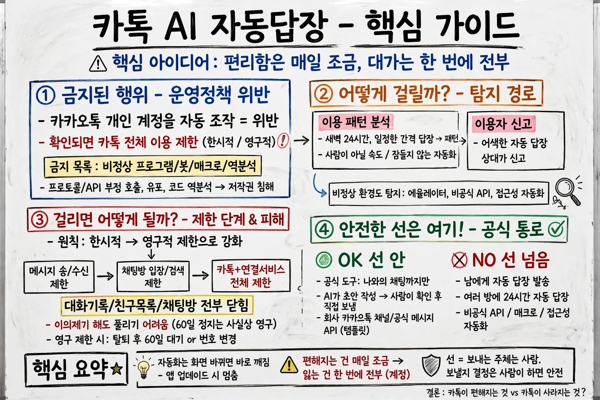
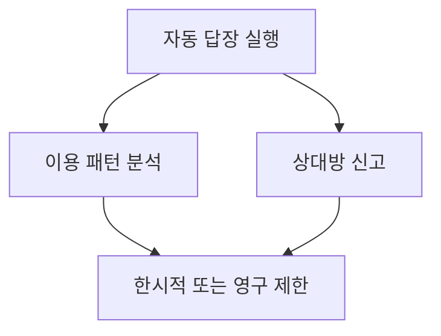
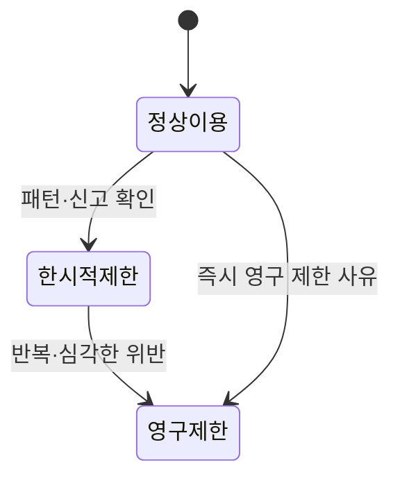
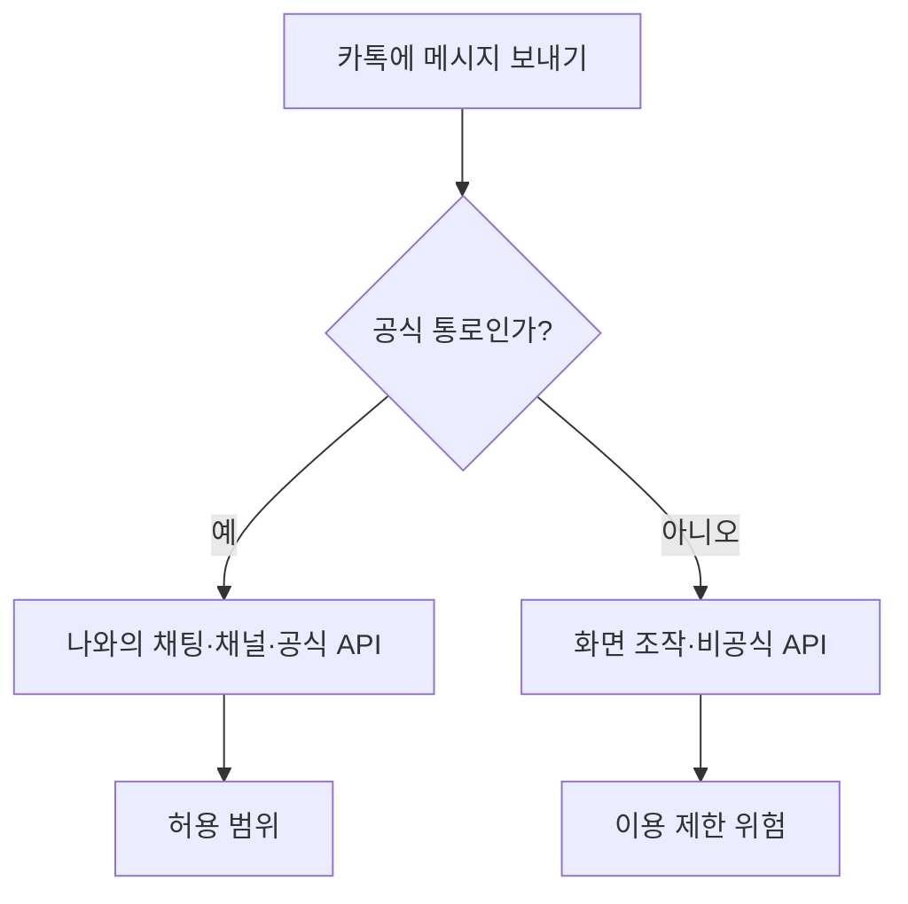

# 카톡 자동 답장, 돌리는 건 쉬운데 걸리면 계정이 통째로 날아갑니다

> **Summary**
> 카카오톡 개인 계정의 자동 답장은 운영정책 위반으로 한시적 또는 영구적 이용 제한을 받을 수 있으며, 패턴 분석이나 상대방 신고로 적발될 수 있습니다. 화면 조작과 비공식 API는 계정 정지와 작동 오류 위험이 있으므로 피하고, 공식 도구를 사용하거나 AI가 작성한 답장을 사람이 직접 확인해 보내는 것이 안전합니다.

---

- 카카오톡 개인 계정을 자동으로 조작하는 일은 운영정책 위반입니다. 확인되면 카톡 전체 이용이 한시적 또는 영구적으로 제한될 수 있습니다.
- 탐지는 생각보다 가깝습니다. 이용 패턴 분석과 상대방의 신고, 그리고 화면이 바뀌면 깨지는 자동화 자체가 약점입니다.
- 안전한 선은 공식 통로입니다. 공식 도구는 '나와의 채팅'까지만 보내고, 남에게 보내는 자동 답장은 그 선을 넘습니다.

카톡 답장을 AI가 대신 보내준다고요? 일주일은 잘 돌아갑니다. 그런데 어느 날 아침, 카톡이 안 열립니다. 화면에 뜬 건 한 줄입니다. 이용이 제한됐습니다. 답장이 편해지는 대신, 몇 년 치 대화가 담긴 계정이 통째로 멈춘 겁니다!

🎥 [동영상 보기](https://www.youtube.com/watch?v=5_OpKrR4I40)

## 정책은 뭐라고 할까요?

카카오톡 안전 정책 페이지는 분명하게 적어두었습니다. 회사가 허용하지 않은 방법으로 서비스를 이용하면 엄중히 대응한다는 겁니다. 금지 목록에는 비정상적인 프로그램으로 프로토콜이나 API를 부정하게 호출하는 행위, 프로토콜을 악용한 봇이나 매크로 프로그램을 만들어 유상 또는 무상으로 타인에게 유포하는 행위가 들어 있습니다.

역분석 얘기도 따로 있습니다. 정당한 권한이나 허락 없이 카카오톡 프로그램 코드를 역분석하고 그 정보를 이용하는 행위는 저작권을 침해하는 행위에 해당하고, 엄격히 금지됩니다. 댓글에서 오간 비공식 API 얘기가 바로 이 지점에 걸립니다.

확인되면 어떻게 될까요? 신고나 제보, 또는 이용 환경과 이용 패턴 분석으로 확인되면, 카톡 전체 서비스 이용을 한시적 또는 영구적으로 제한할 수 있습니다. 서비스 장애를 일으키거나 그럴 우려가 있는 행위는 즉시 영구 제한 대상이고, 심각한 경우 수사기관과의 연계까지 언급돼 있습니다.

## 어떻게 들킬까요?

정책 페이지가 밝힌 탐지 경로는 두 가지입니다. 다른 이용자의 신고, 그리고 이용 환경과 이용 패턴 분석입니다. 사람이 보내는 속도가 아닙니다. 새벽에도, 24시간 내내, 같은 간격으로 답장이 나가면 패턴이 됩니다. 자동화는 잠을 안 잡니다. 그게 흔적입니다.

상대방의 신고도 만만치 않습니다. 이용 제한 안내 페이지가 꼽은 정지 사유 중 하나가 많은 이용자에게 메시지로 신고를 당한 경우입니다. 자동 답장이 어색하면 상대방이 먼저 알아봅니다. 원문 글의 작성자도 답장 문장을 AI에게 맡겼다가 들켰습니다. 기술 탐지보다 사람 탐지가 먼저일 수 있습니다.

비정상적인 환경도 사유가 됩니다. 에뮬레이터 같은 비정상 환경에서 카톡을 쓰면 이용 제한 사유에 오릅니다. 프로토콜을 직접 부르는 비공식 API 방식은 서버 쪽에 흔적이 남습니다. 접근성 API 방식은 화면을 흉내 내서 프로토콜 흔적은 적지만, 패턴은 남습니다. 어느 쪽이든 "안 들킨다"는 보장은 없습니다!

## 걸리면 어떻게 될까요?

운영정책은 제한이 한시적 제한에서 영구적 제한으로 단계적으로 강화되는 것이 원칙이라고 적어두었습니다. 다만 즉시 영구 제한되는 경우도 있다고 덧붙였습니다. 가벼운 경고부터 시작한다는 보장은 없습니다.

제한의 범위가 문제입니다. 메시지 수신과 발송 제한, 채팅방 입장·검색 제한, 카톡과 연결된 다른 서비스 이용 제한까지 걸릴 수 있습니다. 계정 하나가 아니라 카톡 전체가 멈춥니다. 대화 기록, 친구 목록, 채팅방이 한 번에 닫힙니다.

해제가 어렵다는 점이 더 무섭습니다. 이의 제기는 고객센터로 할 수 있습니다. 그런데 커뮤니티 후기를 보면, 문의해도 매크로식 답변만 오고 풀리지 않는 경우가 많습니다. 60일 정지는 사실상 영구 정지라는 얘기가 나옵니다. 영구 제한 뒤에는 탈퇴하고 60일을 기다려 다시 가입하거나, 전화번호를 바꿔야 한다는 후기가 있습니다. 이 장면이 저는 가장 무섭게 느껴졌습니다. 편리함은 매일 조금씩 쌓이는데, 대가는 한 번에 통째로 청구되니까요!

## 어디까지가 선일까요?

공식 통로는 범위가 정해져 있습니다. 카카오가 만든 공식 도구는 '나와의 채팅'으로 보내는 것까지만 됩니다. 단톡방은 안 됩니다. 카카오톡 채널과 공식 메시지 API는 정해진 템플릿을 보내는 용도입니다. 회사 계정으로 고객에게 보내는 쪽이지, 개인 계정을 대신하는 쪽이 아닙니다. 영상에서도 이 선을 분명히 그었습니다. 화면을 직접 조작하는 비공식 방식은 추천하지 않는다고 말입니다.

초안까지만 돕는 건 다릅니다. AI가 답장 문장을 써주고 사람이 확인하고 보내는 건 자동화가 아닙니다. 보내는 주체가 사람이면 선 안에 있습니다. "보낼지는 사람이 정합니다"가 선입니다.

규모도 선입니다. 한 사람에게 가끔 보내는 것과 여러 방에 밤새 보내는 것은 다르게 봅니다. 개인적인 용도라고 해도, 보내는 양과 속도가 기계의 냄새를 풍기면 패턴 분석의 대상이 됩니다.

## 자동화가 깨지는 지점은요?

화면이 바뀌면 깨집니다. GUI 자동화는 화면 레이아웃에 목숨이 걸려 있습니다. 앱 업데이트 한 번에 좌표와 접근성 트리가 바뀌면 자동화도 함께 멈춥니다. 어제 잘 되던 것이 오늘 안 되는 게 GUI 자동화의 숙명입니다.

권한도 자꾸 묻습니다. 맥 접근성 권한은 앱을 경로로 식별합니다. 임시 경로에 두면 매번 다시 물어봅니다. 클릭도 마음대로 안 됩니다. 카톡은 시뮬레이션한 클릭을 무시합니다. 네이티브 동작으로 눌러야 합니다.

비공식 API는 더 위험합니다. 역분석 기반 API는 저작권 침해 소지가 있고, 단속이 강화되는 추세라는 게 원문 댓글의 경고였습니다. PC 카톡의 로컬 DB를 직접 읽는 방식도 마찬가지입니다. 편해 보일수록 선을 더 깊이 넘습니다!

자동 답장의 진짜 비용은 코드가 아닙니다. 계정입니다. 편해지는 건 매일 조금씩이고, 잃는 건 한 번에 전부입니다. 카톡이 편해지는 것과 카톡이 사라지는 것, 어느 쪽이 먼저 올까요?

