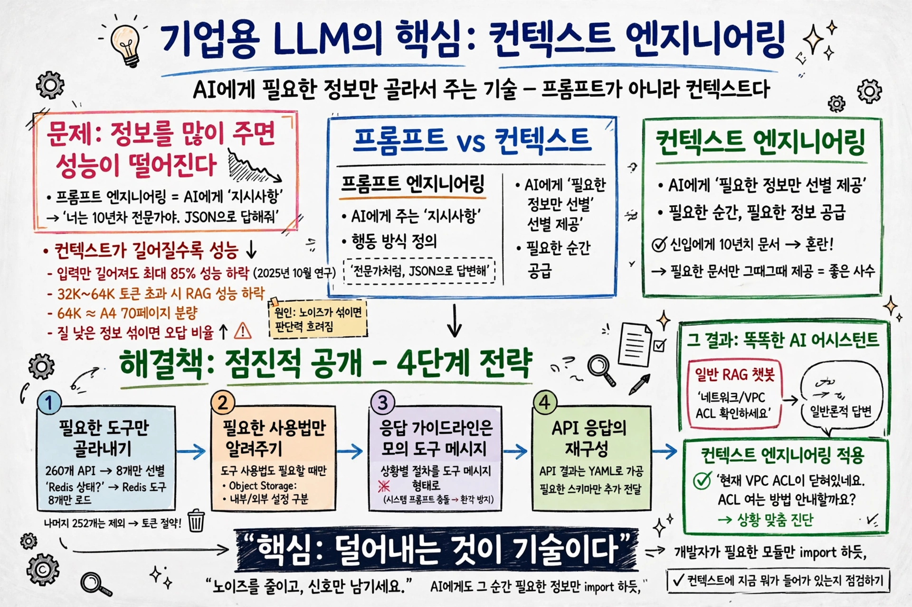
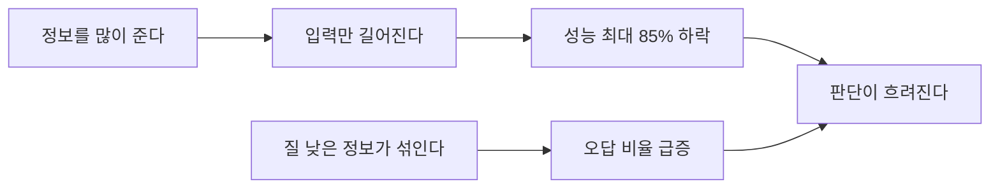
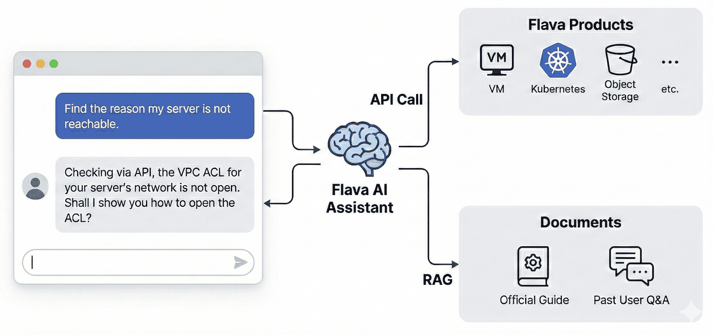
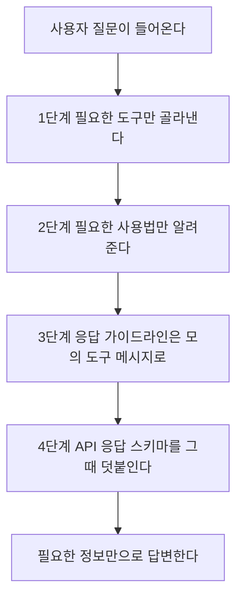
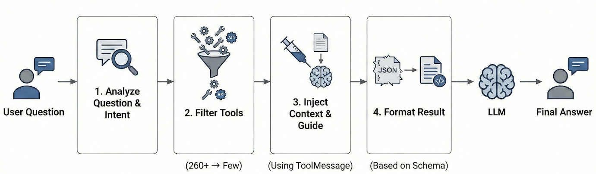
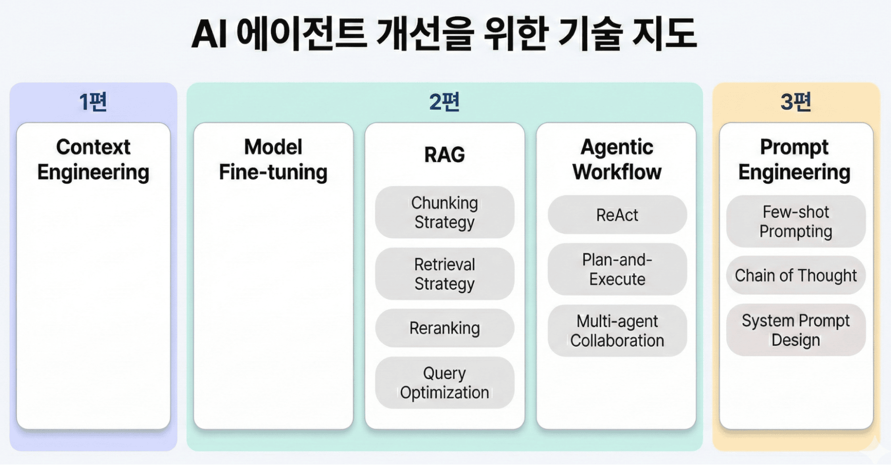

# 컨텍스트 엔지니어링의 핵심은 많이 주는 게 아니라 덜어내는 것이다

> **Summary**
> 컨텍스트 엔지니어링은 정보를 많이 제공하는 대신, 질문과 진행 상황에 따라 필요한 정보만 단계적으로 제공하는 방식이다. 불필요하거나 질 낮은 정보는 LLM의 성능과 판단력을 떨어뜨리므로, 관련 도구와 사용법, 행동 지침, API 응답 스키마를 필요한 순간에 선별해 컨텍스트를 줄이는 것이 대규모 AI 서비스를 더 정확하고 효율적으로 만든다.

---

- 기업용 LLM의 핵심은 프롬프트가 아니라 컨텍스트 엔지니어링입니다. AI에게 필요한 정보만 골라서 주는 기술입니다.
- 정보를 많이 주면 성능이 떨어집니다. 입력만 길어져도 성능이 최대 85%까지 하락한다는 연구 결과가 있습니다.
- 점진적 공개가 답입니다. 260개 도구 중 필요한 것만, 필요한 순간에만 골라서 주는 네 단계 전략입니다.

"너는 10년차 전문가야. 답변은 JSON으로 해줘."

프롬프트를 정교하게 쓰면 AI가 완벽한 답을 줄 거라고 생각하기 쉽습니다. 그런데 기업용 서비스에서는 이야기가 다릅니다. 27개 제품, 260개 API, 수백 페이지의 문서가 걸려 있는데, 프롬프트만 잘 쓴다고 해결될 일이 아닙니다.

🎥 [동영상 보기](https://www.youtube.com/watch?v=uhJJgc-0iTQ)

## 프롬프트와 컨텍스트, 뭐가 다를까요?

프롬프트 엔지니어링은 AI에게 주는 '지시 사항'입니다. "전문가처럼 행동해, JSON으로 답변해" 같은 거죠. 컨텍스트 엔지니어링은 AI에게 '필요한 정보만 선별해서 제공하는 것'입니다.

신입 개발자에게 10년 치 문서를 던져주며 "읽어보고 일하세요"라고 하면 혼란에 빠지겠죠. 필요한 순간에 필요한 문서만 주는 사수가 좋은 사수입니다. AI도 똑같습니다.

컨텍스트 윈도우가 수십만 토큰이라던데, 문서를 다 줘도 될까요?

## 정보를 많이 주면 왜 성능이 떨어질까요?

### 양이 많아지면 성능이 떨어진다

2025년 10월 발표된 논문은 컨텍스트 길이에 따라 LLM 성능이 떨어지는 정도를 측정했습니다. 필요한 핵심 정보는 전부 주면서 의미 없는 공백이나 관련 없는 텍스트를 함께 넣었더니, 입력만 길어졌다는 이유만으로 성능이 **최대 13.9%에서 85%까지** 하락했습니다!

RAG 연구도 같습니다. 컨텍스트가 **32K~64K 토큰**을 넘어가면 RAG 성능이 하락하기 시작합니다. 64K 토큰은 A4 용지 **70페이지**입니다. LLM은 기본적으로 상태가 없어서 모든 대화 내용을 매번 다시 입력해야 하는데, "서버 목록 알려줘"라는 한마디에 수백 개의 JSON 데이터가 반환되니 64K 토큰은 순식간에 찹니다.

### 질 낮은 정보가 섞이면 판단력이 흐려진다

두 번째 문제는 '질'입니다. 정답과 비슷하지만 관계없는 정보를 섞었더니, 컨텍스트가 길어질수록 오답을 내는 비율이 급격히 증가했습니다. 결국 컨텍스트 윈도우가 아무리 커져도 '필요한 것을 골라내는 기술'이 필요합니다.

## 단순 검색기를 넘어, 내 상태를 아는 비서로

기업용 챗봇은 보통 RAG 방식입니다. 사내 문서를 뒤져서 답을 찾아주는 도우미죠.

그런데 이 AI 어시스턴트는 한 발 더 나아갑니다. 공식 가이드나 과거 Q&A는 기본이고, 사용자의 권한으로 실제 API를 호출해서 현재 리소스 상태를 직접 읽어옵니다.

"내 서버에 접속되지 않는 원인을 찾아줘"라고 물으면 답이 이렇게 달라집니다.

- 일반 RAG 챗봇: "서버 접속이 안 되면 네트워크 상태나 VPC ACL을 확인해 보세요" → 일반론적인 가이드
- 이 AI 어시스턴트: "API로 확인해 보니 현재 서버가 속한 네트워크의 VPC ACL이 열려 있지 않네요. ACL을 여는 방법을 알려드릴까요?" → 내 상황에 맞는 진단
사용자가 콘솔을 탐색하지 않아도 AI가 대신 상황을 파악해 주는 거죠. 그런데 이런 '똑똑한' 친구를 만들려니 27개 제품군, 260여 개 API, 수백 페이지의 문서가 필요했습니다.

## 점진적 공개, 네 단계로 덜어내기

그래서 택한 전략이 '점진적 공개'입니다. 처음부터 모든 정보를 주는 대신, 질문이나 진행 상태에 따라 필요한 정보만 골라서 제공하는 방식입니다.

흐름은 네 단계입니다.

### 1단계: 필요한 도구만 골라내기

핵심은 '모든 도구를 한 번에 로드하지 않는다'입니다. 사용자가 "Redis 클러스터 상태 알려줘"라고 물으면, 시스템은 Redis 관련 도구 **8개만** 선별해서 보여줍니다. 나머지 **252개**는 아예 컨텍스트에 올리지도 않습니다. 이렇게 컨텍스트를 획기적으로 절약할 수 있습니다!

### 2단계: 필요한 사용법만 알려주기

도구만 던져주면 끝이 아닙니다. 제품마다 사용법이 다릅니다. Object Storage는 내부용과 외부용 설정이 다른데, 호출할 때만 알려주면 됩니다.

### 3단계: 응답 가이드라인은 '모의 도구 메시지'로

다음으로 주입할 정보는 '상황별 행동 지침'입니다. 특정 상황에서만 지켜야 하는 절차를 '조건'과 '내용'의 쌍으로 구성해, 조건에 맞을 때만 로드합니다.

처음에는 시스템 프롬프트에 내용을 추가했는데, 프롬프트끼리 충돌해 대원칙이 깨졌습니다. 사용자가 "VM 삭제하는 법 알려줘"라고 물었는데, 시스템 프롬프트의 대원칙(검색 결과로만 답변하라)과 가이드라인(UI를 먼저 안내하라)이 함께 들어갔습니다. 그런데 LLM이 가이드라인에 과도하게 집중한 나머지 대원칙을 무시했습니다. 실제 검색도 하지 않고 VM 삭제 방법을 자기 마음대로 상상해서 답변한 거죠. 환각이 발생한 겁니다!

해결책은 **도구 메시지 형태**로 제공하는 것이었습니다. 도구 메시지는 LLM이 도구를 실행한 결과를 저장하는 형식인데, 주입하려는 내용을 마치 도구 실행 결과인 것처럼 인식하도록 한 거죠.

### 4단계: API 응답의 재구성

마지막 단계는 API 실행 직후의 처리입니다. API 호출 결과는 보통 JSON인데, 260개 API의 응답 스키마를 처음부터 다 주입하는 건 엄청난 토큰 낭비입니다. 그래서 실제 API 응답이 돌아온 순간, 해당 데이터를 해석하는 데 필요한 스키마 정보만 덧붙여서 전달합니다. 데이터 형식은 가독성이 높은 **YAML**을 선택했습니다.

## 마치며: 덜어내는 것이 기술이다

컨텍스트 엔지니어링의 핵심을 한 줄로 요약하면 이렇습니다.

> "노이즈를 줄이고, 신호만 남기세요."

LLM 성능이 아무리 좋아져도 불필요한 정보는 판단이 흐려지게 만듭니다. 개발자가 코드를 짤 때 필요한 모듈만 `import` 하듯, AI에게도 그 순간 필요한 정보만 `import` 해 주는 것. 그것이 대규모 AI 서비스를 똑똑하게 만드는 비결입니다!

내 서비스의 컨텍스트에 지금 뭐가 들어가 있는지, 한 번 적어보는 겁니다.

