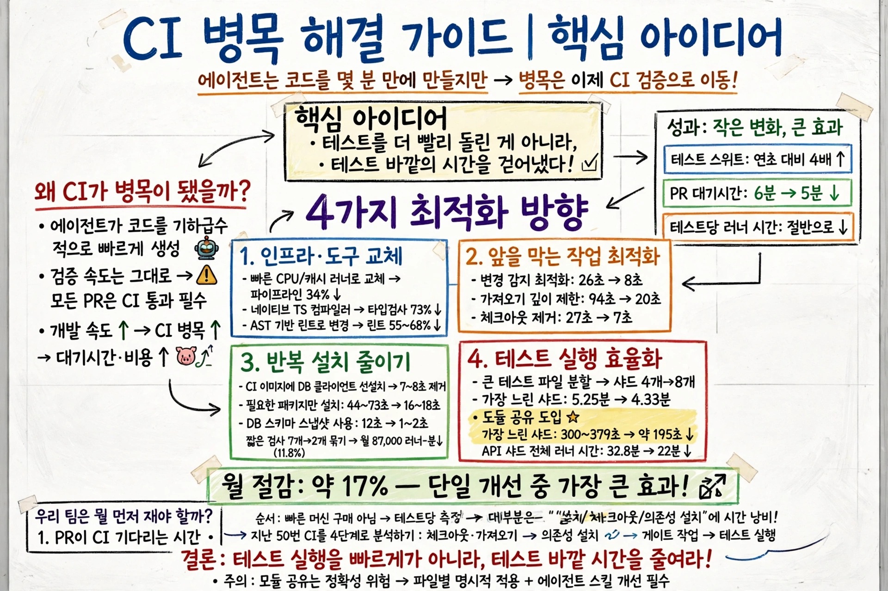
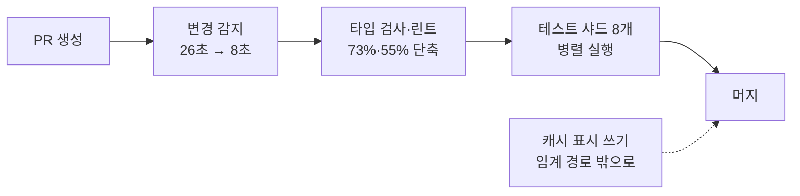
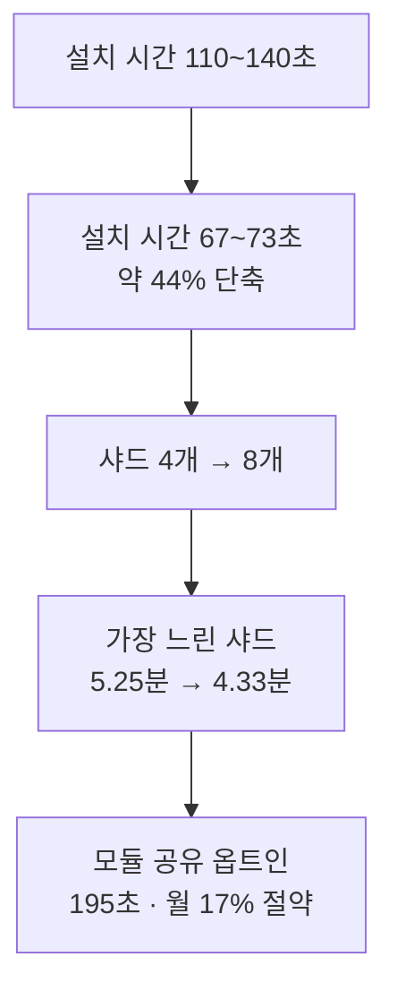

# 코드는 빨라졌는데 머지는 그대로입니다. CI가 새 병목이 됐습니다

> **Summary**
> AI 코딩 에이전트의 확산으로 CI가 새 병목이 됐지만, 테스트 바깥의 시간을 줄이면 대기와 비용을 개선할 수 있습니다. 러너·도구를 교체하고 체크아웃과 설치를 최적화하며 작업을 묶고 테스트 샤딩과 모듈 공유를 개선해, 한 팀은 테스트가 4배 늘어난 상황에서도 PR 대기 시간을 6분 초과에서 5분 조금 넘는 수준으로 줄이고 테스트당 러너 시간을 절반으로 단축했습니다.

---

- 에이전트가 코드를 몇 분 만에 짜내도, 모든 PR은 여전히 CI를 통과해야 합니다. 검증이 새 병목이 됐습니다.
- 한 팀은 테스트가 연초보다 4배로 불었는데도 PR 대기 시간을 6분에서 5분으로 줄이고, 테스트당 러너 시간을 절반으로 잘랐습니다.
- 비결은 테스트를 더 빠르게 돌린 게 아니라, 설치·체크아웃·게이트 같은 테스트 바깥의 시간을 걷어낸 것입니다.

에이전트에게 기능 하나를 맡겼는데, 4분 만에 PR이 올라온 적 있으시죠? 그런데 머지까지는 한참이 걸립니다. 초록색 체크가 뜰 때까지 기다리는 시간이, 코드를 짜는 시간보다 길어졌습니다. 왜 그럴까요?

🎥 [동영상 보기](https://www.youtube.com/watch?v=7b9tov5Uc5s)

## 왜 CI가 병목이 됐을까요?

에이전트는 코드를 기하급수적으로 빨리 만듭니다. 그런데 검증 속도는 그만큼 빨라지지 않았습니다. 모든 PR은 여전히 CI를 통과해야 하니까요. 개발이 가속될수록 CI는 병목이 되고, 인프라 비용은 오르고, 사람과 에이전트는 피드백을 더 오래 기다리게 됩니다.

한 팀의 숫자부터 보겠습니다. 테스트 스위트는 연초보다 거의 4배로 불었고, 지금도 주당 약 2,000개의 테스트가 늘고 있습니다. 테스트 대부분은 이제 에이전트가 씁니다. 손대지 않았다면 지금 스위트는 PR마다 약 11분이 걸렸을 겁니다. 그런데 이 팀은 PR 대기 시간을 6분 초과에서 5분 조금 넘는 수준으로 줄였고, 테스트당 러너 시간은 절반으로 잘랐습니다!

비결은 네 가지 방향이었습니다. 인프라·도구 교체, 앞을 막는 작업 최적화, 반복 설치 줄이기, 테스트 실행 효율화입니다. 하나씩 뜯어보겠습니다.

## 어디서 시간을 걷어냈을까요?

첫 번째는 인프라와 도구입니다. 기본 러너에서 더 빠른 CPU와 저장소, 캐시를 갖춘 외부 러너로 옮기자 같은 파이프라인이 평균 34% 빨라졌고, 타입 검사 작업은 52% 줄었습니다. 네이티브 타입스크립트 컴파일러로 바꾸자 타입 검사 주간 중앙값이 73% 줄었고, 병목이 타입 검사에서 아예 벗어났습니다. 린트도 마찬가지였습니다. 타입 정보에 의존하던 규칙을 추상 구문 트리 기반 정적 분석으로 다시 쓰자 API 린트는 68%, 전체 린트는 55% 줄었습니다!

이 장면이 저는 가장 인상 깊었습니다. 테스트 자체를 건드리지 않고, 테스트를 돌리는 환경을 바꾼 것만으로 이만큼이 줄었다는 게 말이죠.

두 번째는 앞을 막는 작은 작업입니다. 모든 실행은 변경 감지부터 시작합니다. PR이 건드린 경로를 확인하고, 이미 통과한 테스트를 건너뛰는 작업입니다. 이 작업이 끝나야 8개의 API 테스트 샤드가 시작되니, 몇 초 차이도 전체를 흔듭니다. 가져오는 깊이를 제한하자 가장 느린 게이트가 94초에서 20초로 줄었고, 작업 공간이 필요 없는 작업에서 체크아웃을 빼자 27초에서 7초가 됐습니다. 변경 감지 작업의 중앙값은 26초에서 8초로 줄었습니다. 캐시 표시 쓰기를 머지 직전 검사에서 빼낸 것만으로 API PR마다 42초가 줄었습니다.

세 번째는 반복되는 설치입니다. 작업마다 러너를 켜고, 패키지를 설치하고, 의존성을 준비하는 시간은 몇 초짜리 검사에도 몇 분을 붙입니다. API 테스트 샤드는 매번 같은 데이터베이스 클라이언트를 설치하느라 7~8초를 썼습니다. CI 이미지에 미리 넣어두자 그 시간이 사라졌습니다. 전체 저장소를 설치하던 API 테스트는 필요한 패키지만 설치하게 바꾸자 44~73초가 16~18초가 됐습니다. `node_modules` 캐시는 복원이 28초, 재설치가 7.5초라 아예 버렸습니다. 캐시가 항상 답은 아닙니다! 데이터베이스도 마이그레이션 전체를 다시 돌리는 대신 스키마 스냅샷을 불러오자 12초에서 1~2초가 됐습니다. 짧은 검사 7개를 2개 작업으로 묶자 월 약 87,000 러너-분, 전체 CI 사용량의 11.8%가 줄었습니다.

네 번째는 테스트 실행 자체입니다. 테스트 러너는 파일 단위로 일을 나누는데, 유난히 큰 파일 몇 개가 샤드 하나를 붙잡고 전체를 늦췄습니다. 큰 파일을 쪼개고 샤드를 4개에서 8개로 늘리자 가장 느린 샤드가 5.25분에서 4.33분으로 줄었습니다. 가장 큰 한 방은 모듈 공유였습니다. 파일마다 격리하던 방식을, 안전한 파일만 모듈 저장소를 공유하게 바꾸자 가장 느린 샤드가 300~379초에서 약 195초로, API 샤드 전체 러너 시간은 32.8분에서 22분으로 줄었습니다. 월 절감액으로 따지면 약 17%, 단일 개선 중 가장 컸습니다!

## 우리 팀은 뭘 먼저 재야 할까요?

이 팀이 처음부터 잰 건 두 가지였습니다. PR이 CI를 기다리는 시간, 그리고 테스트 하나당 러너 시간입니다. 놀랍게도 둘 다 테스트 실행 자체에서 나온 게 아니었습니다. 대부분은 설치였습니다. 체크아웃, 의존성 설치, 컨테이너 준비, 앞에 선 작은 작업들이었습니다.

그래서 순서가 중요합니다. 빠른 머신부터 사는 게 아닙니다. 지난 50번의 CI 실행을 꺼내 가장 느린 워크플로우를 네 단계로 나눠보세요. 체크아웃·가져오기, 의존성 설치, 게이트 작업, 테스트 실행입니다. 테스트 실행이 아닌 곳에 돈이 숨어 있습니다.

주의할 점도 있습니다. 모듈 공유는 정확성 위험이 가장 큰 최적화였습니다. 파일마다 명시적으로 참여를 표시하고, 공유 상태를 정리하는 코드를 더했고, 타이머를 속이는 파일 몇 개는 격리된 채로 남겨뒀습니다. 에이전트가 이제 테스트 대부분을 쓰니, 생성되는 테스트가 이 규칙을 기본으로 따르도록 에이전트 스킬도 고쳤습니다. 빠르게 만드는 것과 올바르게 만드는 것은 함께 가야 합니다.

에이전트가 코드를 빨리 쓰는 시대, 병목은 사라지지 않고 검증 쪽으로 옮겨갔습니다. 그런데 검증은 손댈 곳이 분명합니다. 테스트를 더 빨리 돌리는 게 아니라, 테스트 바깥의 시간을 걷어내는 것부터 시작하면 됩니다!

