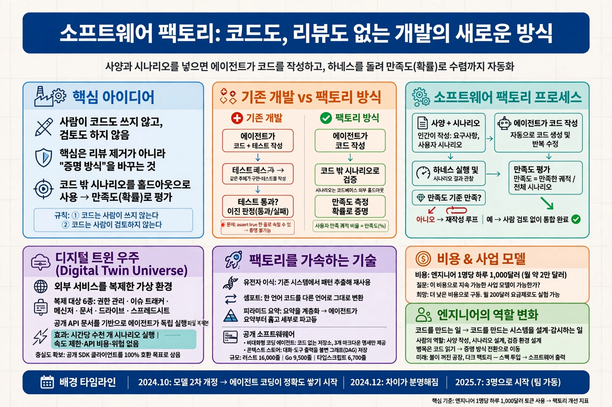
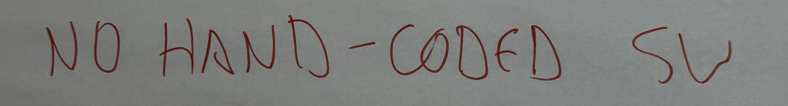
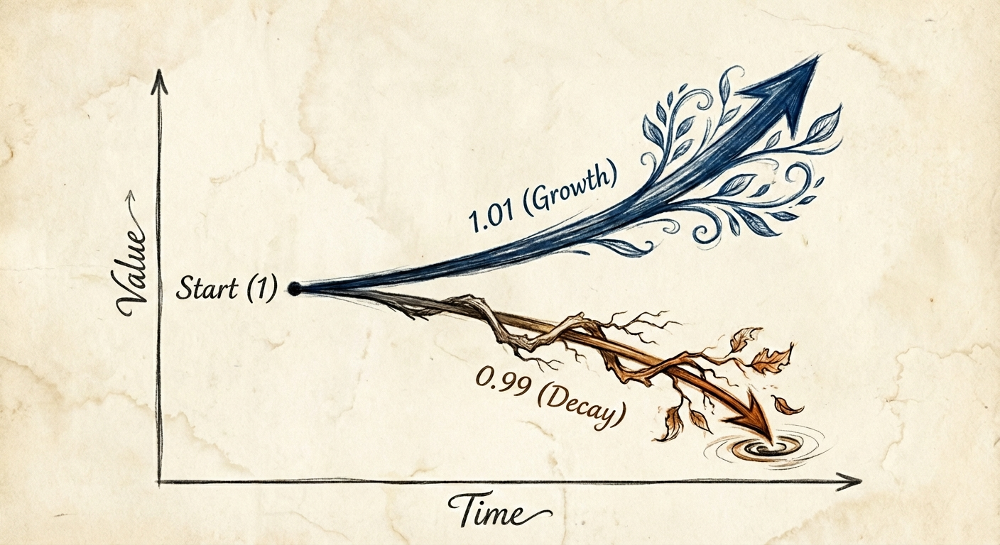
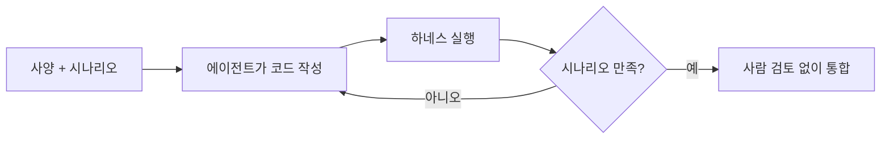
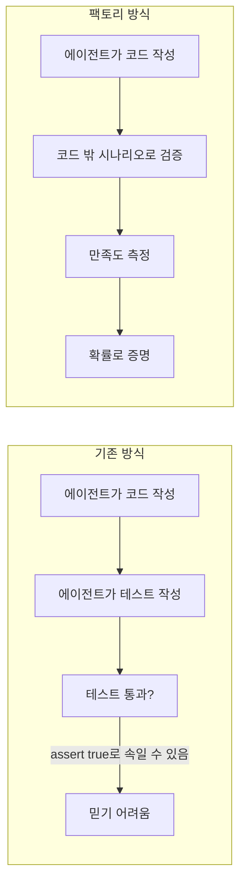
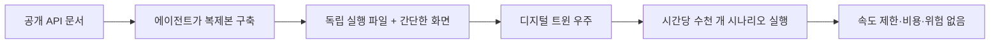

# 코드를 보지 않고 소프트웨어를 만든다고요? 비결은 리뷰가 아니라 증명입니다

> **Summary**
> 소프트웨어 팩토리는 사람이 코드를 쓰지도 검토하지도 않는 개발 방식입니다. 사양과 시나리오를 넣으면 에이전트가 코드를 쓰고 하네스를 돌려 스스로 수렴합니다. 핵심은 리뷰를 없애는 게 아니라 증명을 바꾸는 것입니다. 코드 밖에 둔 시나리오를 홀드아웃으로 쓰고, 통과 여부를 확률(만족도)로 재며, 외부 서비스를 복제한 디지털 트윈 우주에서 시간당 수천 개 시나리오를 돌립니다. 비용은 엔지니어 1명당 하루 1,000달러 수준으로, 이 비용으로도 사업이 되는지는 아직 열려 있는 질문입니다. 엔지니어의 일은 코드를 만드는 일에서 코드를 만드는 시스템을 설계하고 감시하는 일로 이동하고 있습니다.

---

- 소프트웨어 팩토리는 사람이 코드를 쓰지도, 검토하지도 않는 개발 방식입니다. 사양과 시나리오가 들어가면 에이전트가 코드를 쓰고 하네스를 돌려 스스로 수렴합니다.
- 핵심은 리뷰를 없애는 게 아니라 증명을 바꾸는 것입니다. 테스트 대신 코드 밖에 둔 시나리오를 홀드아웃으로 쓰고, 통과 여부를 확률(만족도)로 잽니다.
- 외부 서비스를 복제한 디지털 트윈 우주에서 시간당 수천 개 시나리오를 돌리고, 비용은 엔지니어 1명당 하루 1,000달러 수준입니다. 다만 이 비용이 사업 모델을 바꿔놓는다는 질문이 남습니다.

## 코드 리뷰를 안 한다고요? 처음 들으면 무모해 보이지 않으세요?

풀 리퀘스트를 열었는데, 에이전트가 쓴 코드가 수백 줄 쌓여 있습니다. 한 줄 한 줄 읽다 보면, 어느새 내가 코드를 쓰는 게 아니라 코드 읽는 기계가 되어 있습니다. 에이전트는 쓰는 속도보다 읽는 속도가 느린 사람을 기다려주지 않습니다. 이 장면, 익숙하시죠?

그런데 어떤 팀은 이 병목을 아예 없애버렸습니다. 코드를 읽지 않는 겁니다. 쓰는 것도, 검토하는 것도 사람 손에서 뗐습니다!

🎥 [동영상 보기](https://www.youtube.com/watch?v=eecUhBpTz_g)

## 소프트웨어 팩토리는 뭐가 다른가요?

소프트웨어 팩토리는 비대화형 개발입니다. 사람이 채팅으로 지시하는 게 아닙니다. 사양(spec)과 시나리오를 넣으면, 에이전트가 코드를 쓰고, 하네스를 실행하고, 결과가 수렴할 때까지 스스로 반복합니다. 사람의 검토 없이 통합까지 마칩니다.

규칙은 두 줄로 요약됩니다. 코드는 사람이 써서는 안 됩니다. 코드는 사람이 검토해서도 안 됩니다. 여기에 실무적인 기준이 하나 더 붙습니다. 엔지니어 1명당 하루에 토큰으로 1,000달러를 쓰지 않았다면, 팩토리에는 아직 개선할 여지가 있다는 겁니다!

이 팀은 2025년 7월에 3명으로 시작했습니다. 출발점은 2024년 10월의 변곡점이었습니다. 그때 나온 모델의 두 번째 개정판부터, 긴 호흡의 에이전트 코딩이 오류를 쌓는 대신 정확도를 쌓기 시작했습니다. 2024년 12월이 되자 그 차이는 누구 눈에도 분명해졌습니다. 2025년 7월에는 급진적으로 들렸던 "손으로 코드를 짜지 않는다"는 규칙이, 2026년 1월이 되자 경험 많은 개발자들이 하나둘 따라 하기 시작했습니다. 2025년 11월의 변곡점(새로운 플래그십 모델 두 종의 등장)이 그 흐름에 속도를 더했습니다.

## 코드를 안 보면, 누가 맞다고 증명하나요?

여기가 가장 중요한 질문입니다. 에이전트가 구현도 하고 테스트도 쓰면, 테스트를 속일 수 있지 않을까요? `assert true` 한 줄이면 테스트는 통과합니다. 구현과 테스트를 같은 손이 쓰면, 증명은 증명이 아닙니다!

그래서 이 팀은 테스트를 버리고 시나리오를 썼습니다. 시나리오는 끝에서 끝까지 이어지는 사용자 이야기입니다. 핵심은 저장 위치입니다. 시나리오는 코드베이스 밖에 둡니다. 머신러닝의 홀드아웃(holdout) 집합과 같은 원리입니다. 평가에 쓰는 기준을, 코드를 쓰는 에이전트가 보지 못하게 하는 겁니다. 외부 QA 팀이 따로 붙어서 검증하는 방식과 닮았습니다. 비용은 들지만, 품질 보증에는 가장 확실한 방법입니다.

합격의 기준도 바뀌었습니다. 테스트 스위트가 초록불이냐는 이진 판정을 버리고, 확률로 바꿨습니다. 이 팀은 그 수치를 만족도(satisfaction)라고 부릅니다. 모든 시나리오를 돌며 관찰된 궤적 가운데, 사용자가 만족할 만한 궤적이 얼마나 되는지를 재는 겁니다. 통과 여부를 묻는 게 아니라, 얼마나 만족하는가를 묻는 겁니다!

## 디지털 트윈 우주는 뭐죠?

이 글에서 가장 인상적인 부분은 디지털 트윈 우주입니다. 이 팀이 만들던 소프트웨어는 여러 서비스에 걸친 사용자 권한을 관리하는 것이었습니다. 보안 소프트웨어인데, 사람이 검토하지 않은 코드로 만든다는 겁니다. 보안이 가장 까다로운 분야라는 점을 생각하면, 이 시도는 더 놀랍습니다.

디지털 트윈 우주는 의존하는 외부 서비스의 행동 복제본입니다. 권한 관리, 이슈 트래커, 메신저, 문서, 드라이브, 스프레드시트까지, 여섯 가지 서비스의 API와 엣지 케이스, 관찰 가능한 동작을 그대로 흉내 냅니다. 복제본이 있으니 실제 서비스의 속도 제한에 걸리지 않고, 남용 탐지에 걸리지 않고, API 비용도 쌓이지 않습니다. 시간당 수천 개의 시나리오를 돌릴 수 있습니다. 실제 서비스에서는 위험하거나 불가능한 실패 모드까지 테스트합니다.

복제본은 어떻게 만들었을까요? 에이전트가 만들었습니다. 서비스의 공개 API 문서를 통째로 하네스에 넣고, 그 API를 흉내 내는 독립 실행 파일을 만들게 한 겁니다. 위에 간단한 화면을 얹으면 시뮬레이션이 완성됩니다. 충실도를 높이는 요령도 있습니다. 널리 쓰이는 공개 SDK 클라이언트 라이브러리를 호환성 목표로 삼고, 100% 호환을 지향하는 겁니다. 그렇게 만든 복제본 위에서, 시나리오 테스트는 에이전트가 끊임없이 실행하는 스크립트가 됩니다.

## 팩토리를 돌리는 다른 기술은요?

이 팀은 팩토리를 굴리는 데 쓰는 기법들에 이름도 붙였습니다. 기존 시스템에서 패턴을 뽑아 다른 곳에 재사용하는 유전자 이식, 한 언어의 코드를 다른 언어로 그대로 옮기는 셈포트, 여러 단계의 요약을 쌓아 에이전트가 짧은 요약부터 훑고 필요할 때만 자세한 내용으로 파고들게 하는 피라미드 요약입니다.

공개한 소프트웨어도 독특합니다. 비대화형 코딩 에이전트는 코드가 하나도 없는 저장소로 나왔습니다. 세 개의 마크다운 명세 파일만 들어 있고, 읽은 사람이 자기 코딩 에이전트에 명세를 먹이라고 적혀 있습니다. 다른 하나는 대화 기록과 도구 출력을 불변 그래프(DAG)에 저장하는 콘텍스트 스토어입니다. 러스트 16,000줄, Go 9,500줄, 타입스크립트 6,700줄 규모입니다.

## 하루 1,000달러, 사업이 되나요?

이제 돈 얘기입니다. 하루 1,000달러는 한 달이면 엔지니어 1명당 2만 달러입니다. 이 비용을 얹고도 남는 사업을 만들 수 있을까요? 이 글은 이 질문을 사업 모델 연습 문제라고 부릅니다. 경쟁자가 코딩 에이전트로 몇 시간 만에 최신 기능을 복제할 수 있는 세상에서, 개발 비용이 이렇게 무거우면 사업의 모양 자체가 달라집니다.

그래서 이 글은 이 패턴이 더 적은 비용으로도 돌아가기를 바랍니다. 필자 개인은 월 200달러짜리 요금제로도 에이전트 패턴을 실험할 여지가 충분하다고 말합니다. 다만 24시간 내내 QA 테스터 무리를 돌리는 건 아니라는 단서를 답니다. 이 팀에게서 배울 점은, 수천 달러를 태우지 않더라도 통합니다. 에이전트가 만든 코드가 잘 돌아간다는 것을, 코드를 한 줄 한 줄 읽지 않고도 증명하려면 무엇이 필요한가. 그 질문 자체가 핵심입니다.

## 엔지니어의 일은 어디로 가나요?

이 팀을 직접 본 사람의 인상은 이렇습니다. 소프트웨어 엔지니어는 코드를 만드는 일에서, 코드를 만드는 시스템을 만들고 반쯤 지켜보는 일로 이동하고 있습니다. 불이 꺼진 공장, 다크 팩토리입니다. 스펙이 들어가고 소프트웨어가 나옵니다. 사람이 하는 일은 사양을 쓰고, 시나리오를 정하고, 검증의 환경을 설계하는 쪽으로 옮겨갑니다. 코드를 읽는 속도가 병목이던 시대는, 증명하는 방법을 바꾸는 것으로 넘어가고 있습니다!

