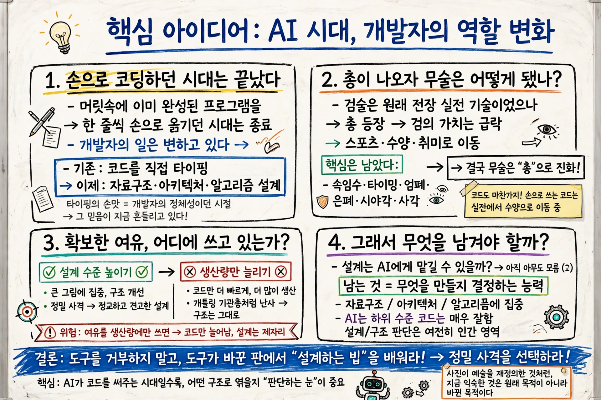
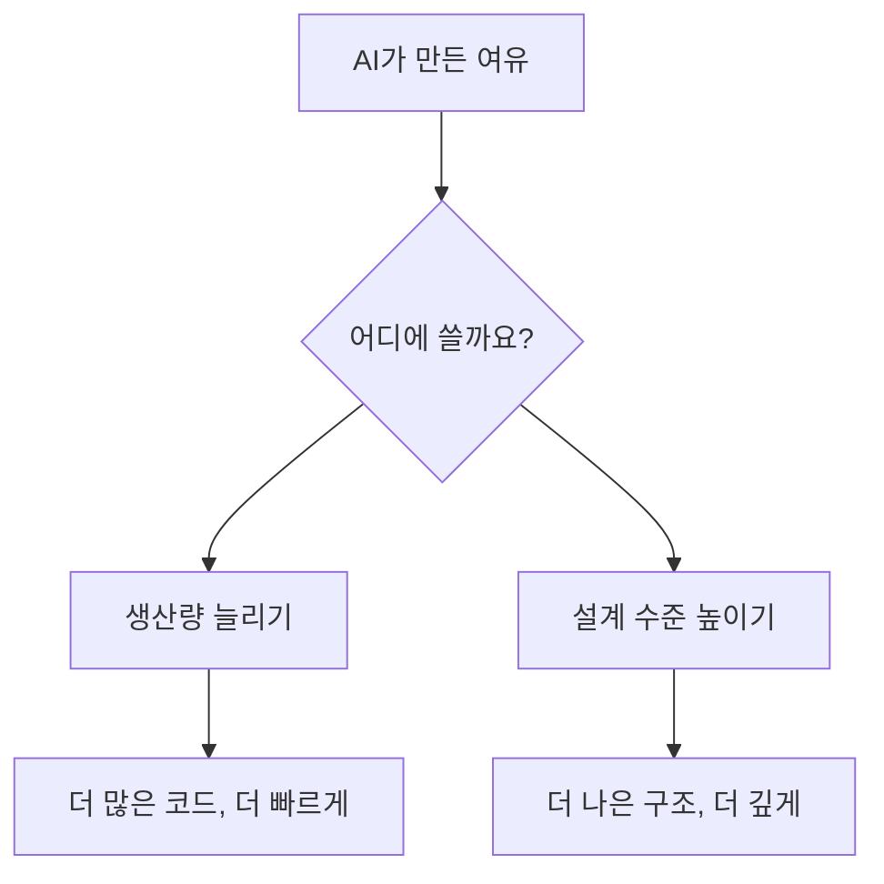

# 코드를 손으로 다 쓰는 시대가 끝나고 있습니다. 현실과 동떨어진 쿵푸 고수가 되지 마세요

> **Summary**
> 총이 등장하자 검술은 실전에서 수양으로 이동했지만, 속임수·타이밍·엄폐 같은 전술의 본질은 총이라는 형태로 계속 발전했습니다. 손으로 코드를 정성스럽게 쓰는 일도 같은 갈림길에 서 있습니다. 머릿속에 이미 완성된 프로그램을 한 줄씩 옮기던 시대에서, 개발자는 자료구조와 아키텍처, 알고리즘을 설계하는 쪽으로 이동하고 있습니다. 순수 바이브 코딩은 단순한 시스템 외에는 지루하지만, AI 보조 코딩은 열정을 되살려 줬습니다. 다만 AI가 만들어준 여유를 생산량을 늘리는 데만 쓰면 코드만 늘고 설계는 그대로입니다. 개틀링 기관총이 아니라 정밀 사격을 골라야 하며, 설계 판단력이 남는 능력입니다.

---

- 머릿속에 이미 완성된 프로그램을, 한 줄씩 손으로 옮기던 시대가 끝나가고 있습니다.
- 이제 개발자의 일은 코드를 직접 쓰는 것이 아니라, 자료구조와 아키텍처, 알고리즘을 설계하는 쪽으로 이동하고 있습니다.
- 다만 그 여유를 생산량을 늘리는 데 쓸지, 설계 수준을 높이는 데 쓸지는 아직 정해지지 않았습니다.

코드를 직접 손으로 쓰지 않으면 진짜 개발자가 아니라고 느낀 적 있으시죠? 한 줄 한 줄 타이핑하는 손맛, 머릿속 설계를 컴파일러가 이해하는 형태로 옮기는 그 고된 과정이 개발자의 정체성이라고 믿었던 시절이 있었습니다. 그런데 그 믿음이 흔들리고 있습니다!

🎥 [동영상 보기](https://www.youtube.com/watch?v=I845O57ZSy4)

## 총이 나오자 무술은 어떻게 됐을까요?

이 글은 검술 고전 번역본의 서문에서 출발했습니다. 검술은 원래 전장에서 살아남기 위한 실전 기술이었습니다. 그런데 총이 등장하자 검의 가치는 급격히 떨어졌고, 검술은 스포츠와 수양, 취미의 영역으로 이동했습니다. 그런데 여기서 끝이 아닙니다. 속임수와 타이밍, 엄폐와 은폐, 시야각과 사각에 대한 이해 같은 전술의 본질은 사라지지 않았습니다. 오히려 계속 발전했고, 결국 무술은 총이라는 형태로 바뀌었습니다!

무술에서 실전 기술을 뜻하는 말과 수양을 뜻하는 말이 따로 있듯이, 코드도 같은 갈림길에 서 있습니다. 손으로 코드를 정성스럽게 쓰는 일은 실전에서 수양으로 이동하고 있습니다. 아직 완전히 그렇지는 않지만, 방향은 분명합니다. 그래서 이 글은 묻습니다. 현실과 동떨어진 쿵푸 고수가 되지 않으려면 어떻게 해야 할까요?

## 머릿속 프로그램이 이미 돌아가고 있다면요?

한 베테랑 프로그래머는 이렇게 말했습니다. 머릿속에서 문제를 풀고 나면, 재미는 거의 끝난다고요. 어셈블리 시대에는 간단한 일도 제대로 구현하려면 한참이 걸렸습니다. 성공적인 경력의 상당 부분을 편집기와 IDE에서 의도를 코드로 옮기는 지루한 작업에 썼습니다. 그런데 이제는 머릿속에 이미 돌아가고 있는 프로그램을, 컴파일러가 이해하는 형태로 옮기는 수고 없이 빠르게 꺼낼 수 있습니다. 그게 좋다고요.

여기서 구분이 중요합니다. 순수 바이브 코딩과 AI 보조 코딩은 다릅니다. 지금 기술로 순수 바이브 코딩은 단순한 시스템 외에는 지루하고 지속하기 어렵습니다. 반대로 AI 보조 코딩은 컴퓨터에 대한 열정을 되살려 줬다고 합니다. 코드를 안 쓰는 게 아니라, 코드를 쓰는 방식이 바뀐 겁니다!

## 그런데 여유를 어디에 쓰고 있나요?

반론도 만만치 않습니다. 더 큰 그림에 집중할 수 있다는 낙관을 믿고 싶지만, 주변에서는 잘 보이지 않는다는 지적이 나왔습니다. AI에 푹 빠진 사람들은 확보한 여력을 설계 수준을 높이는 대신 생산량을 늘리는 데 쓰고 있다는 겁니다. 정밀 사격도 가능해진 시대에 개틀링 기관총만 쏘는 모습처럼 보인다고요. 코드가 더 빨리, 더 많이 만들어지는 대신 구조가 개선되는 변화가 보이는지 묻는 목소리도 있었습니다.

또 다른 걱정도 있습니다. AI 없이 일하며 기초를 익힌 혜택을 이미 누린 개발자들이 있는 반면, 한 세대 전체가 힘들게 기초를 배우는 과정을 건너뛸 수 있다는 우려입니다. 자료구조와 동시성, 네트워크를 밑바닥부터 이해하는 개발자가 충분히 있어 지식이 전승되고 있지만, 그 다음 세대는 어떨까요?

## 설계는 AI에게 맡길 수 있을까요?

여기서 또 다른 질문이 나옵니다. 자료구조 설계와 아키텍처, 알고리즘 능력이 가까운 미래에도 AI보다 뛰어날 것이라고 보는 근거는 무엇일까요? 머지않아 이 세 가지까지 AI가 맡을 가능성은 없을까요? 솔직한 답은 아직 아무도 모른다는 겁니다. 다만 지금 써본 AI는 아키텍처 아래 수준에서는 매우 잘하지만, 설계 자체에는 약하다는 평가가 나왔습니다.

또 하나 짚을 점이 있습니다. 총은 칼을 대체했지만, 코딩 에이전트가 코드 자체를 대체한 것은 아닙니다. 인간과 통계 모델 중 누가 작성하느냐가 달라졌을 뿐, 코드는 여전히 필요합니다. 고급 쿵후 로봇으로 싸우게 됐다는 비유가 더 적절하다는 지적도 있었습니다. 도구가 바뀌었을 뿐, 싸움 자체가 사라진 건 아니라는 뜻입니다.

이 장면이 저는 가장 인상 깊었습니다. 사진이 등장하자 예술가들이 사실적 재현을 넘어서는 방향으로 목적을 재정의했듯이, 무술에서도 비슷한 변화가 일어났다는 대목입니다. 지금 익숙한 것은 원래 목적이 아니라 바뀐 목적이라는 말, 곱씹을수록 묵직합니다.

## 그래서 무엇을 남겨야 할까요?

결론은 단순합니다. 손으로 옮기는 기술이 아니라, 무엇을 만들지 결정하는 능력이 남습니다. 자료구조와 아키텍처, 알고리즘에 집중하는 것, 그게 예전부터 능숙한 프로그래밍의 본질이었습니다. 작은 구성요소를 조합해 시스템을 만들면 자연스럽게 그 수준에 도달합니다. AI가 코드를 써주는 시대일수록, 어떤 구조로 엮을지 판단하는 눈이 더 중요해집니다.

다만 한 가지는 경계해야 합니다. AI가 만들어준 여유를 생산량 늘리는 데만 쓰면, 정작 설계는 그대로인 채 코드만 늘어납니다. 개틀링 기관총이 아니라 정밀 사격을 골라야 합니다. 도구가 바뀌는 시대에, 고수가 되는 길은 도구를 거부하는 게 아니라 도구가 바꿔놓은 판에서 다시 설계하는 법을 배우는 것입니다!

