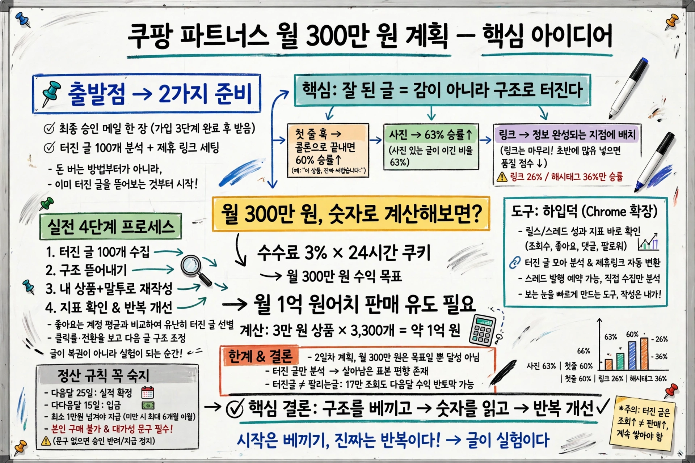
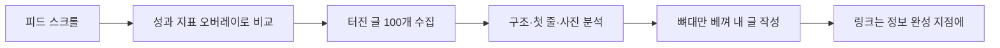
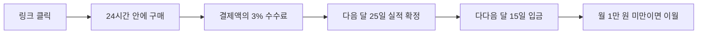
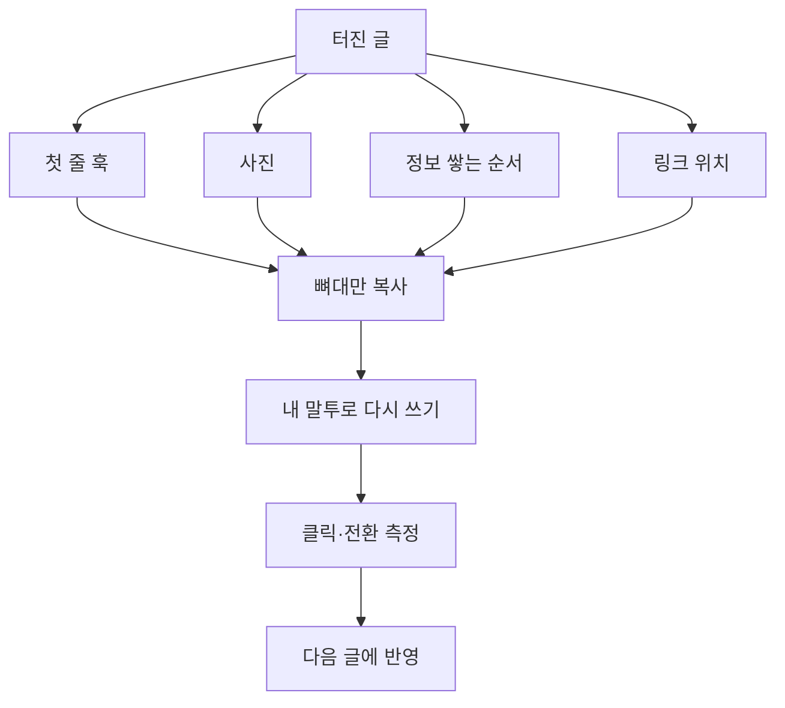

# 쿠파스로 월 300만 원, 터진 글 100개를 뜯어보니 답은 구조 복사에 있었습니다

> **Summary**
> 쿠팡 파트너스로 수익을 내려면 터진 글 100개를 분석해 첫 줄, 사진, 정보 순서, 링크 위치의 구조를 파악하고 이를 자신의 상품과 말투에 맞게 적용해야 합니다. 기본 수수료 3%로 월 300만 원을 벌려면 월 1억 원의 판매를 유도해야 하며, 성과를 꾸준히 측정하고 글의 구조를 개선해야 합니다.

---

- 쿠팡 파트너스로 월 300만 원을 노리는 계획, 출발점은 최종 승인 메일 한 장과 터진 글 100개 분석입니다.
- 잘 된 글은 감이 아니라 구조로 터집니다. 첫 줄 훅, 사진, 정보가 완성되는 지점의 링크, 이 뼈대를 베끼는 게 분석의 목적입니다.
- 수수료 3%에 24시간 쿠키라면, 월 300만 원은 월 1억 원어치 판매를 유도해야 한다는 뜻입니다. 숫자를 먼저 보고 시작해야 합니다.

쿠팡 파트너스 링크를 글에 붙여본 적 있으시죠? 정산 화면을 열면 0원이 찍혀 있습니다. 한 달이 지나도, 두 달이 지나도 숫자는 그대로입니다. 그런데 어떤 글은 올리자마자 주문이 들어옵니다. 뭐가 다를까요?

🎥 [동영상 보기](https://www.youtube.com/watch?v=3XDIbbFNVxQ)

### 이 글의 출발점은 뭘까요?

한 운영자가 월 300만 원 벌기 계획을 세웠습니다. 2일 차에 올린 글은 최종 승인 메일 스크린샷이었습니다. 가입은 세 단계로 진행됩니다. 계정을 만들고, 광고를 시작하고, 누적 판매액 15만 원을 넘기면 채널 심사를 거쳐 최종 승인이 납니다. 최종 승인이 나야 정산과 API 사용이 열립니다. 계획의 첫 과제는 두 가지였습니다. 터진 글 100개를 분석하는 일, 그리고 제휴 링크를 세팅하는 일입니다. 돈을 버는 방법부터 찾는 게 아니라, 이미 터진 글을 뜯어보는 것부터 시작한 겁니다!

### 하입덕은 뭘 해주는 도구일까요?

분석에 쓰인 도구는 하입덕입니다. 릴스와 스레드 콘텐츠를 연구하는 크롬 확장 프로그램입니다. 피드를 스크롤하는 동안 조회수, 좋아요, 댓글, 팔로워 같은 성과 지표를 글 위에 바로 겹쳐 보여줍니다. 글을 하나씩 열어보지 않아도 뭐가 터졌는지 한눈에 비교할 수 있습니다. 마음에 드는 글은 계정에 모아 분석하고, 고른 상품은 제휴 링크로 바꿔줍니다. 스레드 발행 예약까지 됩니다. 대신 대신 게시하지는 않습니다. 수집과 분석은 사용자가 직접 고른 것만 서버로 보냅니다. 도구가 대신 써주는 게 아니라, 보는 눈을 빠르게 만들어주는 도구입니다.

### 터진 글 100개에서 뭘 뜯어냈을까요?

댓글에서 가장 많이 나온 질문은 두 가지였습니다. 반응 좋은 글은 어떻게 가려내느냐, 대본은 내 계정에 어떻게 맞추느냐는 질문입니다. 운영자의 답은 짧았습니다. 대본 구조는 분석한 터진 글에서 그대로 가져왔다는 겁니다. 문장을 베끼는 게 아니라, 구조를 베끼는 겁니다. 여기에 한 가지 경고가 붙었습니다. 초반에 링크를 많이 넣으면 계정 품질 점수가 떨어진다는 겁니다. 링크는 글의 주인공이 아니라, 정보가 완성되는 지점에 두는 마무리입니다.

실제 분석 데이터도 같은 방향을 가리킵니다. 실제 스레드 글 2,572개를 같은 계정 안에서 짝지어 비교한 분석이 있습니다. 사진이 있는 글이 이긴 비율은 63%, 첫 줄이 콜론으로 끝나는 글이 이긴 비율은 60%였습니다. 반대로 링크가 있는 글은 26%, 해시태그가 있는 글은 36%만 이겼습니다. 링크와 해시태그는 터지는 데 도움이 안 된다는 겁니다. 사진과 첫 줄이 승부를 가르고, 링크는 뒤에서 조용히 일합니다!

### 월 300만 원, 숫자로 따져보면?

이제 돈을 계산해볼까요? 쿠팡 파트너스 기본 수수료는 결제액의 3%입니다. 링크를 누른 뒤 24시간 안에 산 물건만 실적으로 잡힙니다. 월 300만 원을 벌려면 월 1억 원어치 판매를 유도해야 합니다. 3만 원짜리 상품이면 3,300개가 넘게 팔려야 합니다. 이게 월 300만 원의 실제 무게입니다.

정산 구조도 알아둬야 합니다. 번 달의 다음 달 25일에 실적이 확정되고, 다다음 달 15일에 입금됩니다. 월 수익이 1만 원을 넘겨야 지급되고, 못 미치면 최대 6개월까지 이월됩니다. 본인이 자기 링크로 사는 건 실적으로 인정되지 않습니다. 그리고 글에는 대가성 문구를 반드시 넣어야 합니다. 이 문구가 없으면 승인 심사에서 반려되거나 지급이 멈출 수 있습니다. 숫자와 규칙을 모르고 시작하면, 터진 글도 정산 화면에서는 0원일 수 있습니다!

### 그래서 뭘 따라 하면 될까요?

순서는 이렇게 정리됩니다. 먼저 잘 된 글을 100개 모읍니다. 좋아요 수만 보지 말고, 그 계정의 평소 반응과 비교해서 유난히 터진 글을 고릅니다. 다음으로 구조를 뜯어냅니다. 첫 줄은 어떻게 끊는지, 사진은 어디에 두는지, 정보는 어떤 순서로 쌓는지, 링크는 어디에 붙는지 봅니다. 그리고 내 상품과 내 말투로 다시 씁니다. 마지막으로 지표를 봅니다. 클릭률과 전환율을 보고, 다음 글의 구조를 고칩니다. 글이 복권이 아니라 실험이 되는 순간입니다.

### 이 분석의 한계는 뭘까요?

정직하게 짚을 점이 있습니다. 이건 한 운영자의 2일 차 계획입니다. 월 300만 원은 목표이지, 달성한 숫자가 아닙니다. 터진 글 100개 분석도 표본입니다. 터진 글만 모으면 살아남은 것만 보게 됩니다. 안 터진 글 1,000개는 분석에 안 들어갑니다. 그리고 터진 글과 팔리는 글은 다릅니다. 조회 17만 회, 댓글 4천 개가 넘은 영상으로 첫 달 50만 원대를 번 사례가 있습니다. 그런데 다음 달은 반토막, 그다음 달은 또 반토막이었습니다. 터진 영상 하나로 번 돈을 실력이라고 착각하면 안 된다는 게 그 운영자의 결론이었습니다. 한 달에 글 몇 편으로 끝나는 일이 아니라, 터지고 나서도 계속 쌓아야 하는 일입니다. 이 글의 결론은 그래서 단순합니다. 터진 글을 베끼는 건 시작일 뿐, 숫자를 읽고 구조를 고치는 반복이 진짜 일입니다!

