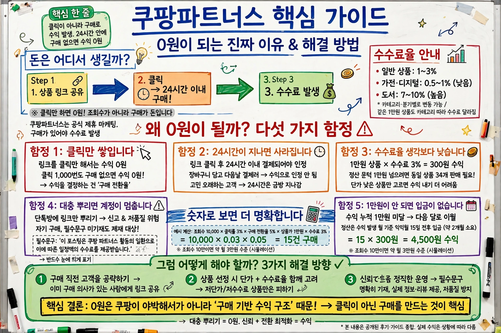
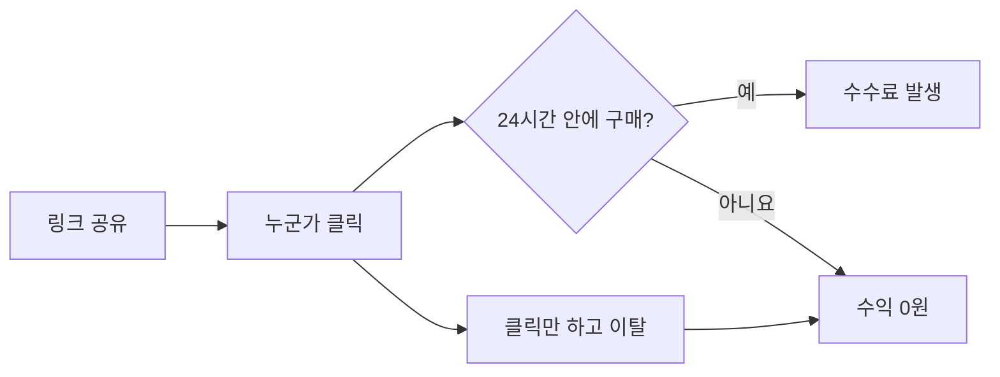
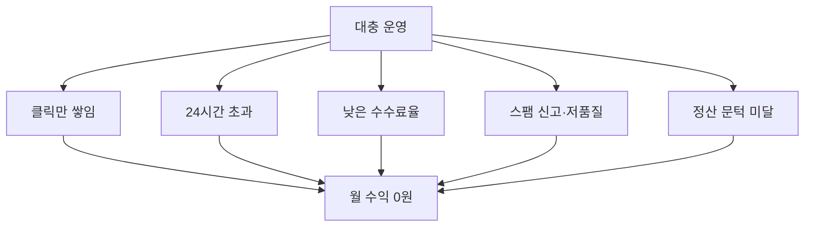
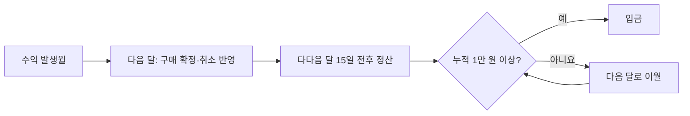

# 쿠팡파트너스 대충 하면 월 수익 0원입니다. 클릭이 아니라 구매가 돈입니다

> **Summary**
> 쿠팡파트너스는 클릭이 아니라 링크 클릭 후 24시간 안에 발생한 구매에 대해 수수료를 지급하므로, 낮은 수수료율과 정산 기준 때문에 링크만 대충 공유하면 수익이 거의 없거나 입금이 늦어질 수 있습니다. 구매 의사가 높은 사람에게 상품 정보를 제공하고, 제휴 문구를 명확히 표시하며 정직하게 운영하는 것이 중요합니다.

---

- 쿠팡파트너스는 클릭이 아니라 구매로 돈을 줍니다. 클릭이 아무리 많아도 24시간 안에 구매가 없으면 수익은 0원입니다.
- 수수료는 상품가의 1~3% 수준이라, 대충 뿌린 링크 몇 개로는 정산 문턱인 1만 원도 넘기기 어렵습니다.
- 링크만 던지는 운영은 신고와 저품질로 이어집니다. 0원이 되는 건 운이 아니라 구조입니다.

월말, 정산 알림을 확인했습니다. 링크는 수십 개 올렸는데, 입금 예정액은 0원입니다. 이상한 일일까요? 아닙니다. 구조를 알면 당연한 결과입니다!

🎥 [동영상 보기](https://www.youtube.com/watch?v=eZUrJcXP7OY)

## 돈은 어디서 생길까요?

쿠팡파트너스는 쿠팡 공식 제휴 마케팅입니다. 상품 링크를 공유하고, 그 링크를 통해 누군가 구매하면 수수료를 받습니다. 핵심은 순서입니다. 클릭하고, 24시간 안에 구매하고, 그제야 수수료가 생깁니다. 클릭만으로는 1원도 생기지 않습니다. 조회수가 아니라 구매가 돈입니다!

수수료율은 카테고리마다 다릅니다. 보통은 상품가의 1~3% 수준이고, 가전·디지털은 0.5~1%로 더 낮고, 도서는 7~10%까지 올라가기도 합니다. 수치는 공개된 가이드들을 정리한 기준이라, 카테고리별·분기별로 바뀔 수 있습니다.

## 왜 0원이 될까요? 다섯 가지 함정

### 함정 1: 클릭만 쌓입니다

링크를 눌렀다고 돈을 주는 게 아닙니다. 구매 전환이 없으면 클릭 1,000번도 0원입니다! 수익을 가르는 건 클릭 수가 아니라 구매 전환율입니다.

### 함정 2: 24시간이 지나면 사라집니다

링크를 누른 뒤 24시간 안에 결제돼야 수익으로 잡힙니다. 장바구니에 담아두고 다음 날 결제하면 인정이 안 됩니다. 고민하는 고객이 많을수록, 24시간은 더 짧아집니다.

### 함정 3: 수수료율이 생각보다 낮습니다

상품 1만 원짜리가 팔려도 수수료 3%면 300원입니다. 정산 문턱인 1만 원을 넘으려면 같은 상품을 34개는 팔아야 합니다! 단가가 낮은 상품만 골랐다면, 계산기는 더 차갑게 돌아갑니다.

### 함정 4: 대충 뿌리면 계정이 멈춥니다

단톡방에 링크만 던지고 나가는 운영, 답변 없이 링크만 남기는 글은 신고를 당해 활동이 정지됩니다. 자기 링크로 자기 물건을 사는 것도 금지입니다. 접속 기록 등으로 잡아내고, 수익금은 들어오지 않습니다. 필수 문구를 숨기거나 작게 처리하는 꼼수도 걸립니다. "이 포스팅은 쿠팡 파트너스 활동의 일환으로 이에 따른 일정액의 수수료를 제공받습니다."라는 문구는 제대로 보이게 써야 합니다.

### 함정 5: 1만 원이 안 되면 입금이 없습니다

수익이 생겨도 누적 1만 원이 넘어야 입금됩니다. 미달이면 다음 달로 이월됩니다. 정산도 수익 발생월 기준 익익월 15일 전후라, 돈이 들어오기까지 두 달이 걸립니다. 0원이 아니라 "아직 0원"인 상태가 길어집니다.

## 숫자로 보면 더 선명합니다

쇼츠 실험 후기 하나를 빌려오면, 조회수 10,000에 클릭률 3%, 구매 전환율 5%, 상품가 1만 원, 수수료 3%를 가정하면 예상 수익은 약 4,500원입니다. 조회수 100,000으로 올려도 월 3만 원 수준이라는 계산이 나옵니다. 이 수치는 한 후기의 시뮬레이션이라 모든 경우에 그대로 적용되지는 않습니다. 방향은 분명합니다. 조회수가 아니라 전환율이 돈을 만듭니다.

실제 후기들을 모아보면, 초보는 월 3만~10만 원, 중급은 월 30만~100만 원 구간이 자주 나옵니다. 2년 넘게 하면서도 "월 1만 원 꾸준히 받기"를 목표로 삼는 후기도 있습니다. 블로그 저품질에 걸려 수익이 0원에 수렴했다는 후기도 있습니다. "월 300만 원"이라는 문구는 안정 궤도에 오른 뒤의 수치로 보는 게 맞습니다. 이 수치들은 공식 통계가 아니라 공개된 후기들을 정리한 것이라, 그대로 믿기보다는 방향으로 읽는 게 맞습니다.

## 그럼 어떻게 해야 할까요?

터진 글 100개를 분석한 이야기는 따로 다룰 예정이라, 여기서는 방향만 짚습니다. 구매 직전의 사람을 데려오는 게 먼저입니다. 이미 살 마음이 있는 사람이 누르는 링크와, 그냥 지나가다 누르는 링크는 값이 다릅니다. 상품을 고를 때는 단가와 수수료율을 함께 봅니다. 그리고 문구는 숨기지 않습니다. 정직한 운영이 오래 가는 운영입니다!

대충 하면 0원이 되는 건, 쿠팡파트너스가 야박해서가 아닙니다. 클릭이 아니라 구매에 돈을 주는 구조라서 그렇습니다.

