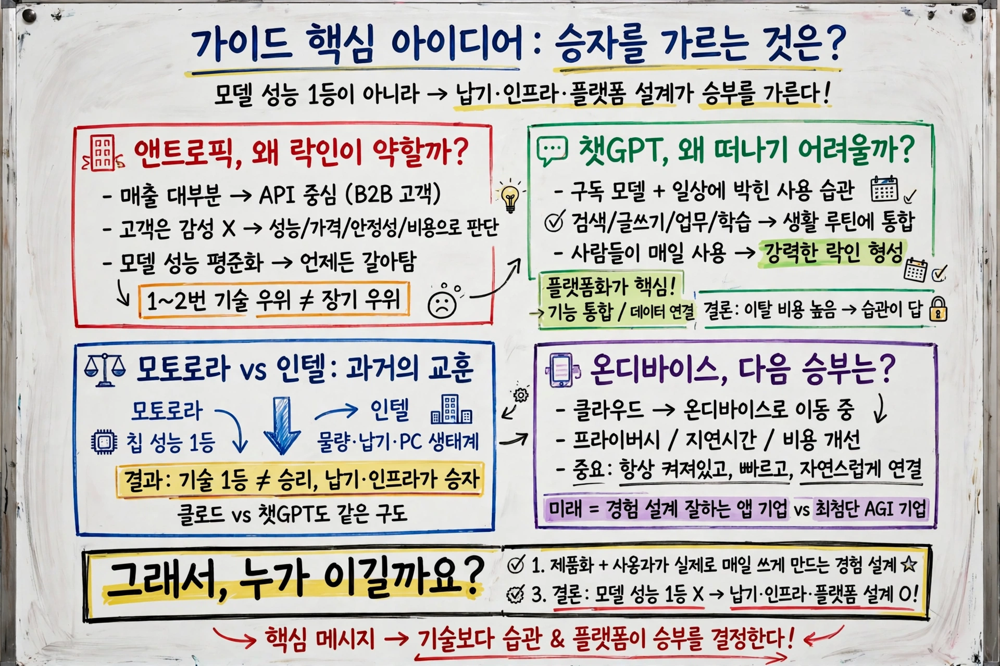
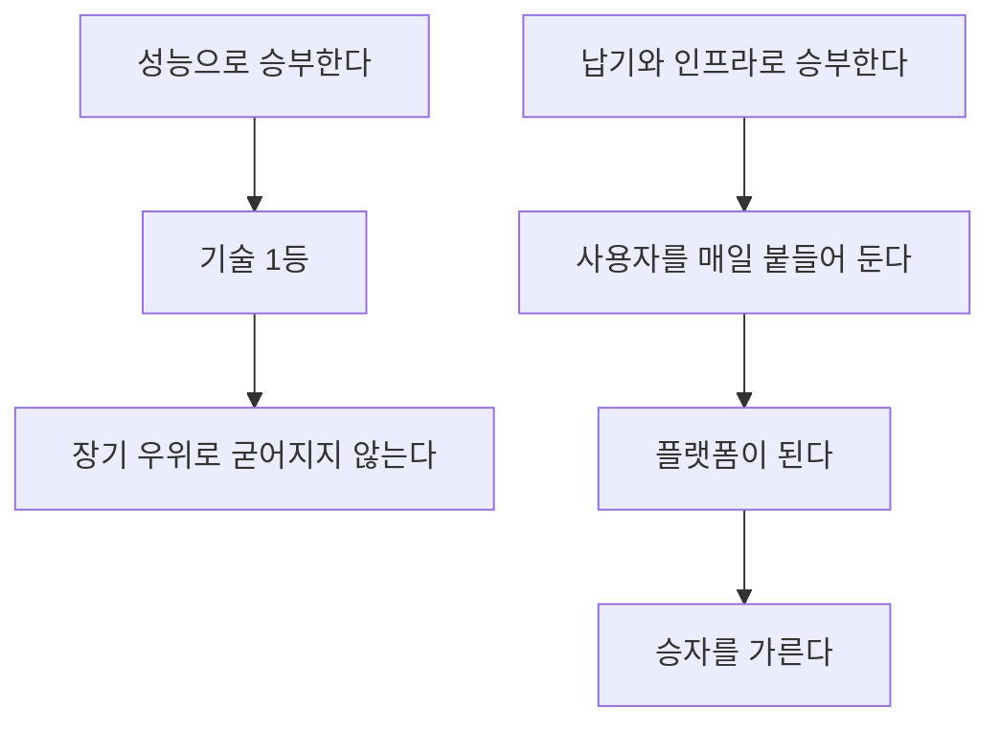
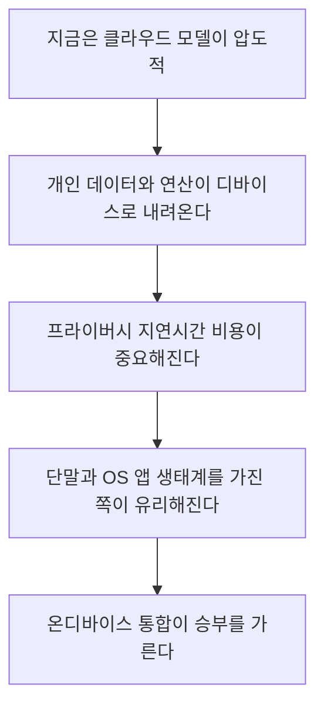

# 클로드 vs 오픈AI, 모토로라와 인텔처럼 결국 납기와 인프라가 승자를 가른다

> **Summary**
> 클로드는 뛰어난 모델 성능에도 API 중심 구조라 고객 락인이 약한 반면, 챗GPT는 구독과 일상적 사용 습관을 바탕으로 플랫폼으로 자리 잡고 있습니다. 모토로라와 인텔의 사례처럼 장기적인 승부는 성능 1등보다 납기와 인프라, 사용자 경험과 생태계 통합에 달려 있으며, 온디바이스 AI 시대에는 단말과 OS를 아우르는 통합 역량이 더욱 중요해질 것입니다.

---

- 앤트로픽은 API 매출 중심이라 고객 락인이 약합니다. 모델 성능이 평준화되는 시장에서는 1~2번의 기술 우위가 장기 우위로 굳어지지 않습니다.
- 챗GPT는 구독 모델과 일상에 박힌 사용 습관으로 강력한 락인을 만들었고, 이미 하나의 플랫폼이 되고 있습니다.
- 결국 승자를 가르는 건 모델 성능 1등이 아니라, 납기와 인프라, 즉 사용자를 매일 붙들어 두는 플랫폼 설계입니다!

클로드가 코딩을 더 잘한다는 얘기를 듣고, 한번 써본 적 있으시죠? 써보면 확실히 잘합니다. 그런데 며칠 지나면 다시 챗GPT를 켜고 있는 자신을 발견합니다. 왜 그럴까요? 성능이 문제가 아닙니다. 이미 일상에 박혀 있는 습관, 그리고 그 습관을 받쳐주는 플랫폼이 답입니다!

🎥 [동영상 보기](https://www.youtube.com/watch?v=SfizG5iXg0Y)

## 앤트로픽, 왜 락인이 약할까요?

앤트로픽의 매출은 대부분 API에서 나옵니다. API는 개발자와 기업 고객을 상대하는 장사입니다. 기업 고객은 감성이나 브랜드 충성도로 공급자를 고르지 않습니다. 성능, 가격, 안정성, 생태계, 유지보수 편의성 같은 지표로 판단합니다. API는 정서적으로 붙들어 둘 이유가 없는 도구입니다. 지금 당장 특정 모델이 괜찮아서 쓰고 있다 하더라도, 다음 분기나 다음 릴리즈에서 더 성능이 좋거나 더 싸거나 더 통합이 잘 된 솔루션이 나오면 언제든 갈아탈 수 있는 구조입니다.

모델 성능이 빠르게 평준화되고, 다양한 공급자가 동시에 경쟁하는 시장에서는 락인이 더더욱 걸리기 어렵습니다. "이 모델이 아니면 안 된다"는 조건을 만들어내기가 어렵고, 결국 기업은 비용 대비 효율로 움직입니다. 성능이 조금 떨어지더라도 가격이 더 매력적이면 이동하고, 성능이 좋아도 공급 안정성이 흔들리면 떠납니다. 1~2번의 기술적 우위가 곧장 장기 우위로 굳어지지 않는 이유입니다. 앤트로픽은 지금 좋은 평가를 받고 있지만, 구조적으로 "계약 지속성"이 흔들릴 위험이 상대적으로 큽니다.

개발자들의 태도가 이걸 잘 보여줍니다. 클로드를 쓰는 개발자들은 성능이 좋아서 쓰는 것이지, 충성도 때문이 아닙니다. 좋은 모델이 나오면 바로 갈아탈 준비를 하고 있습니다. 성능으로 온 고객은 성능으로 떠납니다!

## 챗GPT, 왜 떠나기 어려울까요?

챗GPT의 강점은 크게 두 가지입니다. 첫째, 절대적으로 락인된 소비자가 많습니다. 많은 사람들이 챗GPT를 습관처럼 사용하고, 일상 업무의 루틴에 이미 들어가 있습니다. 검색을 대체하고, 글쓰기와 번역, 업무 정리, 학습, 의사결정 보조까지 생활 속에 박혀 있습니다. 아무리 다른 모델이 더 낫다고 해도, 주변에 그 사실을 아는 사람도 많지 않고, 쓰다 보면 고점은 챗GPT가 높은 경우가 더 많습니다.

둘째, 구독 수익의 비중이 높습니다. 구독 모델은 현금 흐름을 안정화시키고, 제품을 확장할수록 고객의 재방문과 결제 유지 가능성을 올립니다. API 매출이 주는 "단기 효율"과는 다른, 장기적 제품 경제성을 만들기 쉽습니다.

현장의 이야기도 같은 방향을 가리킵니다. 고객을 만나보면 99%가 챗GPT를 쓴다는 이야기가 있습니다. 메신저에 챗GPT가 들어오는 것도 대중화의 큰 흐름입니다. 이미 사람들이 매일 여는 곳에 들어가 있기 때문입니다.

결국 챗GPT는 "하나의 플랫폼"이 되고 있습니다. 플랫폼은 사용 경험, 기능 통합, 데이터 연결, 개인화로 승부가 바뀌는 순간부터 훨씬 강해집니다. 사람들은 더 이상 "누가 더 똑똑한 답을 하냐"로만 제품을 고르지 않습니다. "누가 내 생활과 업무를 더 잘 이어주는가"가 중심이 되고 있습니다!

## 모토로라와 인텔, 그 비유가 말하는 것?

과거 반도체 시장에서는 기술이 뛰어난 칩이 항상 이긴 게 아니었습니다. 모토로라의 칩은 성능이 뛰어났지만, 인텔이 물량과 납기, 그리고 PC 생태계로 시장을 가져갔습니다. 기술 1등이 아니라, 납기와 인프라가 승자를 가른 겁니다.

클로드와 챗GPT도 같은 구도입니다. 클로드는 코딩을 비롯한 성능에서 뛰어나지만, 챗GPT는 이미 사용자의 일상에 들어가 있고, 구독과 플랫폼, 그리고 단말과 서비스 통합이라는 인프라를 갖고 있습니다. 성능으로 승부하는 회사와, 납기와 인프라로 승부하는 회사의 싸움입니다.

## 온디바이스, 다음 승부는 어디서 날까요?

이 경쟁의 큰 흐름은 온디바이스로 이어질 것으로 보입니다. 지금은 클라우드 모델이 압도적이지만, 장기적으로는 개인 데이터와 연산의 일부가 디바이스로 내려오고, 프라이버시나 지연시간, 비용 같은 요소 때문에 온디바이스의 비중이 커질 수밖에 없습니다.

사용자 경험의 관점에서는 "항상 켜져 있고, 빠르고, 자연스럽게 연결되는" 형태가 중요해지고, 그 최종적인 완성은 결국 단말과 OS, 앱 생태계를 가진 쪽이 유리합니다. 그래서 "얼리어답터가 많이 있다"는 점이 절대적인 우위로 이어지지는 않습니다. 시장이 커지고 대중화 단계로 가면, 기술 애호가들의 평가보다 사용자가 체감하는 편의성과 통합성, 그리고 기본 탑재된 경험이 훨씬 강력하게 작동합니다.

미래는 "온디바이스 통합에 있어 경험 설계를 잘하는 애플리케이션 기업"과 "최첨단 AGI 경쟁 기업"의 싸움이 될 것입니다. 그리고 그 싸움에서 중요한 건 단순한 모델 성능 1등이 아니라, 사용자가 매일 쓰게 만드는 플랫폼 설계, 그리고 OS와 디바이스, 서비스 전반을 통합하는 능력입니다.

## 그래서, 누가 이길까요?

올해 하반기 제품 라인업이 어떻게 나오느냐에 따라 윤곽이 잡힐 것입니다. 각 회사가 "AI를 어디까지 제품화했는지", 그리고 "사용자가 실제로 쓰게 만드는 경험을 어떤 방식으로 제공하는지"가 더 명확해지는 타이밍이기 때문입니다. 앤트로픽이 오히려 "거품을 대표하는 기업"이 될 가능성도 있습니다. 여기서 거품이란 기술이 없다는 뜻이 아닙니다. 기술은 분명히 뛰어나고, 평가도 좋습니다. 다만 "시장 지배력으로까지 이어지는 구조적 확실성" 없이, 기대감만으로 과대평가될 위험이 있다는 뜻입니다.

기준은 하나입니다. 모델 성능 1등이 아니라, 납기와 인프라가 승자를 가릅니다. 사용자가 매일 쓰게 만드는 플랫폼 설계, 그게 결국 중요한 겁니다!

