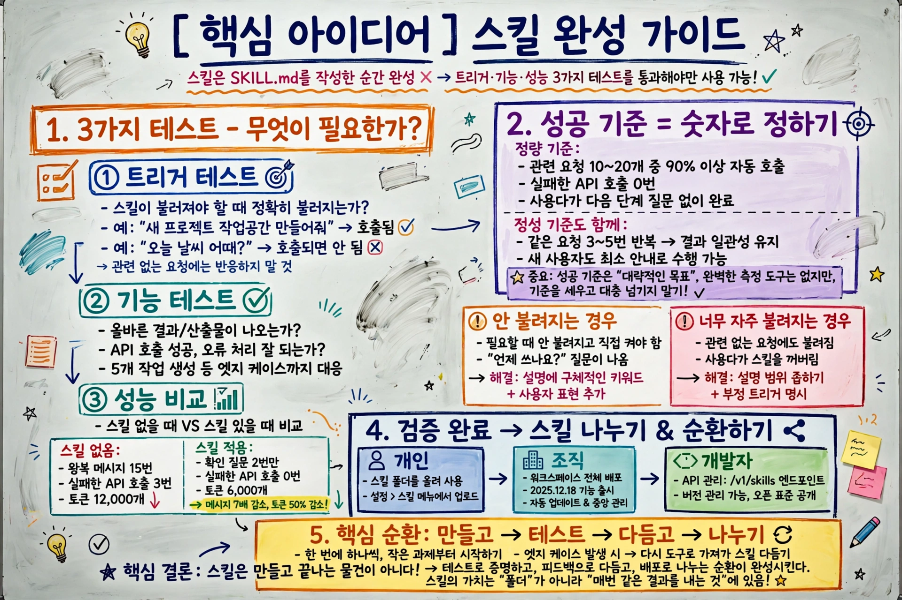
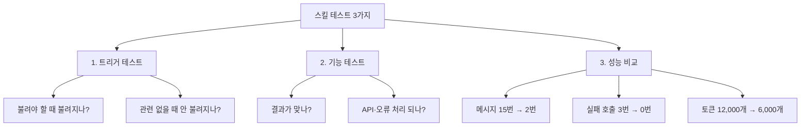
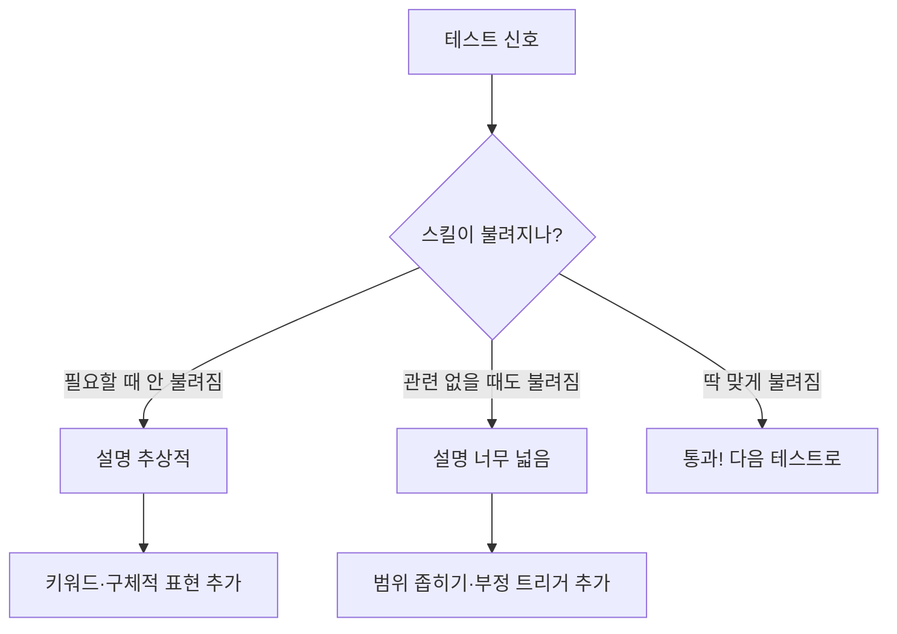
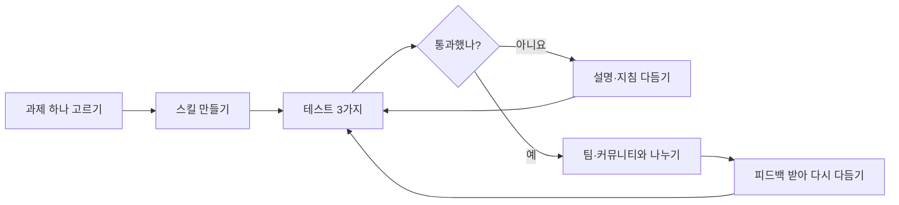

# 클로드 스킬, 만들고 끝이 아니라 테스트 3가지로 증명해야 합니다

> **Summary**
> 클로드 스킬은 만들기만 해서는 충분하지 않으며, 트리거·기능·성능 테스트로 효과를 검증해야 합니다. 관련 요청의 자동 호출률 90%, API 실패 0회 등 성공 기준을 정하고, 결과에 따라 설명과 범위를 다듬은 뒤 팀이나 커뮤니티에 배포합니다.

---

- 스킬은 `SKILL.md`를 쓴 순간 완성되는 게 아니라, 트리거·기능·성능 3가지 테스트를 통과해야 쓸 수 있습니다.
- 성공 기준은 숫자로 정합니다. 관련 요청 10~20개 중 90%에서 불려지고, 실패한 API 호출 0번, 사용자가 다음 단계를 묻지 않는 것입니다.
- 검증이 끝나면 팀이나 커뮤니티와 나눕니다. 개인은 폴더를 올려 쓰고, 조직은 워크스페이스에 배포하고, 개발자는 API로 관리합니다.

## 스킬을 만들었는데, 잘 되는지 모르겠으시죠?

스킬 폴더를 만들고 `SKILL.md`까지 썼습니다. 이제 클로드가 알아서 불러주길 바랍니다. 그런데 정말로 잘 될까요? 설명을 읽고 필요할 때만 불려지는지, 결과는 제대로 나오는지, 확인하지 않으면 모릅니다!

🎥 [동영상 보기](https://www.youtube.com/watch?v=oVthf0fUcFY)

## "작동한다"와 "더 나아졌다"는 다릅니다

가이드가 처음부터 강조하는 말이 있습니다. "작동한다"는 것만으로는 부족하고, "더 나아졌다"를 증명해야 한다는 것입니다. 스킬 없이 하던 일과 비교해서 실제로 나아졌는지, 숫자로 보여줘야 합니다.

그래서 테스트는 세 가지로 나뉩니다. 트리거 테스트, 기능 테스트, 성능 비교입니다. 하나라도 빠지면 스킬이 제대로 되는지 확신할 수 없습니다.

## 테스트 3가지, 뭘 보나요?

**첫째, 트리거 테스트입니다.** 스킬이 불러져야 할 때 불러지는지 확인합니다. 분명한 요청에서는 불려지고, 다르게 표현한 요청에서도 불려지고, 관련 없는 주제에서는 불려지지 않아야 합니다. "새 프로젝트 작업 공간을 만들어줘" 같은 요청에는 반응하고, "오늘 날씨 어때?" 같은 요청에는 반응하지 않아야 합니다!

**둘째, 기능 테스트입니다.** 스킬이 올바른 결과를 내는지 확인합니다. 산출물이 맞는지, API 호출이 성공하는지, 오류 처리가 되는지, 엣지 케이스를 다루는지 봅니다. 예를 들어 프로젝트에 작업 5개를 만드는 스킬이라면, 프로젝트가 만들어지고 5개 작업이 올바른 속성과 함께 연결되고 API 오류가 없어야 합니다.

**셋째, 성능 비교입니다.** 스킬이 없을 때와 있을 때를 나란히 놓고 비교합니다. 가이드에 나온 비교가 있습니다. 스킬 없이 같은 작업을 하면 왕복 메시지 15번, 실패한 호출 3번, 토큰 12,000개가 듭니다. 스킬을 쓰면 확인 질문 2번, 실패한 호출 0번, 토큰 6,000개로 끝납니다. 메시지는 7배 넘게 줄고 토큰은 절반이 됩니다!

## 성공 기준, 숫자로 정합니다

테스트하기 전에 성공 기준부터 정합니다. 가이드가 제시하는 기준은 이렇습니다. 관련 요청 10~20개 중 90%에서 스킬이 자동으로 불려져야 합니다. 워크플로마다 실패한 API 호출은 0번이어야 합니다. 그리고 사용자가 다음 단계를 묻지 않고, 스킬이 알아서 이어가야 합니다.

숫자만으로 다 잴 수는 없습니다. 그래서 정성 기준도 함께 봅니다. 같은 요청을 3~5번 반복해도 결과가 일관되는지, 새 사용자가 처음 써봐도 최소한의 안내로 해내는지를 봅니다. 숫자와 느낌, 둘 다 맞아야 합니다.

이 장면이 저는 가장 인상 깊었습니다. 가이드가 성공 기준을 "대략적인 목표"라고 밝히는 부분입니다. 완벽한 측정 도구가 아직 없다는 걸 인정하면서도, 대충 넘어가지 않고 기준을 세우라고 말합니다.

## 안 불려지면? 너무 자주 불려지면?

테스트하다 보면 두 가지 신호가 나옵니다. 하나는 **안 불려지는 경우**입니다. 스킬이 필요할 때 안 불려지고, 사용자가 직접 켜야 하고, "언제 쓰나요?"라는 질문이 옵니다. 이럴 땐 설명이 너무 추상적인 경우입니다. 설명에 구체적인 키워드와 사용자가 말할 법한 표현을 더 넣습니다.

다른 하나는 **너무 자주 불려지는 경우**입니다. 관련 없는 요청에도 스킬이 불려지고, 사용자가 스킬을 끄고, 목적이 헷갈립니다. 이럴 땐 설명이 너무 넓은 경우입니다. 범위를 좁히고, 쓰지 말아야 할 경우를 명시합니다. 부정 트리거를 넣는 것입니다.

## 만든 스킬, 어떻게 나누나요?

검증이 끝난 스킬은 나누는 게 다음 단계입니다. 개인은 스킬 폴더를 내려받아 압축한 뒤 설정에서 스킬 메뉴로 올리면 됩니다. 클로드 코드에서는 스킬 디렉터리에 폴더를 두는 방법도 있습니다.

조직은 더 편합니다. 관리자가 워크스페이스 전체에 스킬을 배포할 수 있습니다. 2025년 12월 18일에 나온 기능이고, 자동 업데이트와 중앙 관리가 함께 제공됩니다. 팀 전체가 같은 스킬을 같은 방식으로 쓰게 됩니다.

개발자는 API로 관리합니다. 스킬 목록과 관리를 위한 `/v1/skills` 엔드포인트가 있고, 메시지 요청에 스킬을 붙여서 보낼 수 있습니다. 버전 관리도 콘솔에서 합니다. 스킬은 오픈 표준으로도 공개돼 있습니다. 한 곳에서 만든 스킬이 다른 도구에서도 통한다는 뜻입니다.

## 한 번에 하나씩, 작은 과제부터

가이드가 주는 실용적인 조언이 있습니다. 처음부터 넓게 테스트하지 말고, 어려운 과제 하나를 골라서 그것만 될 때까지 다듬으라는 것입니다. 하나의 과제에서 이기는 방법을 찾으면, 그걸 스킬로 뽑아내는 게 빠릅니다.

내장된 스킬 생성 도구가 이 과정을 돕습니다. 자연어로 설명하면 스킬 초안을 만들어주고, 설명이 모호하거나 트리거가 빠진 부분을 짚어주고, 테스트 케이스도 제안합니다. 이 도구를 쓰면 첫 스킬을 만들고 테스트하는 데 15~30분이면 된다고 가이드는 말합니다. 스킬을 쓰다가 엣지 케이스를 만나면, 그 사례를 다시 도구로 가져가서 스킬을 다듬습니다. 만들고, 테스트하고, 다듬고, 나누는 순환이 스킬을 단단하게 만듭니다.

## 스킬은 만들고 끝나는 물건이 아닙니다

스킬은 한 번 만들고 끝나는 물건이 아닙니다. 테스트로 증명하고, 피드백으로 다듬고, 배포로 나누는 순환이 스킬을 완성합니다. 33페이지 가이드의 결론도 결국 같습니다. 스킬의 가치는 폴더가 아니라, 매번 같은 결과를 내는 데 있습니다!

