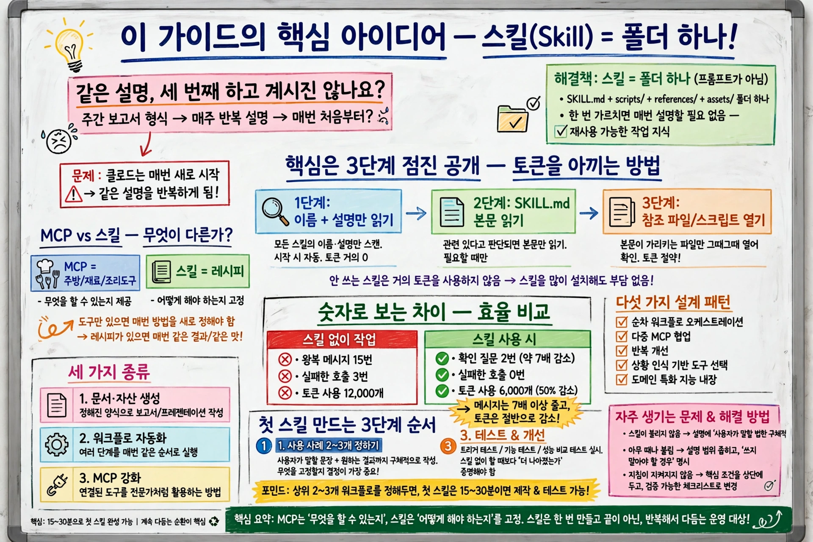
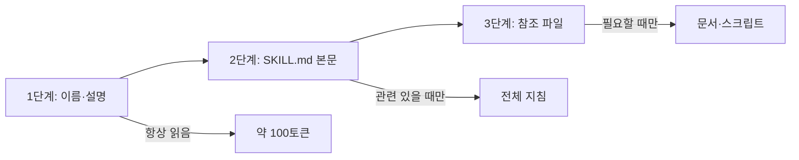
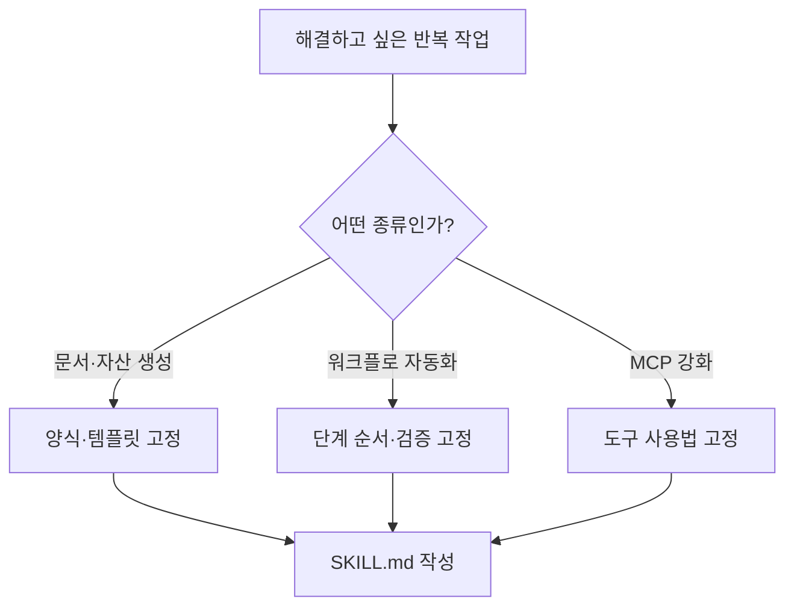
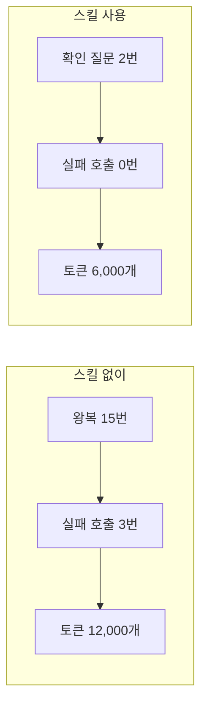

# 클로드 스킬, 매번 설명하지 말고 한 번 가르치면 됩니다

> **Summary**
> 클로드 스킬은 반복 작업의 지식과 절차를 폴더에 담아 재사용하는 방법입니다. 이름과 설명, 본문, 참조 파일을 단계적으로 불러 토큰을 절약하며, 구체적인 사용 사례를 바탕으로 만들고 트리거·기능·성능을 테스트해 반복적으로 개선합니다.

---

- 스킬은 프롬프트가 아니라 폴더 하나에 담은 재사용 가능한 작업 지식입니다. 한 번 가르치면 매번 설명하지 않아도 됩니다.
- 핵심은 3단계 점진 공개입니다. 이름과 설명만 항상 읽고, 본문은 필요할 때만, 참조 파일은 그때그때 열어 토큰을 아낍니다.
- 상위 2~3개 워크플로만 정해져 있으면 첫 스킬은 15~30분이면 만들고 테스트할 수 있습니다.

## 같은 설명, 세 번째 하고 계시진 않으신가요?

주간 보고서 형식을 설명했습니다. 다음 주에 또 설명했습니다. 다다음 주에 또 설명했습니다. 매번 같은 형식을 처음부터 설명하는 일, 겪어보신 적 있으시죠?

문제는 기억력이 아닙니다. 클로드는 매번 새로 시작하니까요. 그래서 같은 설명을 반복하게 됩니다. 그런데 이 반복을 폴더 하나로 끝낼 방법이 있습니다!

🎥 [동영상 보기](https://www.youtube.com/watch?v=kS1MJFZWMq4)

## 스킬, 프롬프트가 아니라 폴더입니다

스킬은 폴더 하나입니다. 안에 `SKILL.md`라는 파일이 들어가고, 필요하면 `scripts/`와 `references/`, `assets/` 폴더가 함께 들어갑니다.

`SKILL.md` 맨 위에는 짧은 정보가 들어갑니다. 이름과 설명, 딱 두 가지가 필수입니다. 이름은 소문자와 하이픈으로 쓰고, 설명에는 스킬이 무엇을 하는지, 언제 써야 하는지, 사용자가 말할 법한 표현까지 적습니다. 설명이 곧 스킬의 얼굴입니다. 설명이 추상적이면 스킬이 아예 불려지지 않습니다.

## 왜 세 단계로 나눠서 읽을까요?

클로드는 스킬을 한 번에 다 읽지 않습니다. 3단계로 나눠서 읽습니다. 1단계에서는 이름과 설명만 읽습니다. 시작할 때 모든 스킬의 이 부분만 스캔합니다. 2단계에서는 관련 있다고 판단되면 `SKILL.md` 본문을 읽습니다. 3단계에서는 본문이 가리키는 참조 파일이나 스크립트를 필요할 때만 엽니다.

이게 점진 공개입니다. 안 쓰는 스킬은 토큰을 거의 안 씁니다. 그래서 스킬을 많이 설치해도 부담이 적습니다. 핵심은 "무엇을 할 수 있는가"가 아니라 "어떻게 해야 하는가를 고정하는 것"입니다!

## MCP와 스킬, 뭐가 다를까요?

MCP와 스킬은 자주 함께 나오는데 역할이 다릅니다. MCP가 "무엇을 할 수 있는지"를 주면, 스킬은 "어떻게 해야 하는지"를 고정합니다. 주방 비유가 잘 맞습니다. MCP는 주방과 재료와 조리 도구이고, 스킬은 레시피입니다. 도구가 있어도 레시피가 없으면 매번 방법을 새로 정해야 합니다. 레시피가 있으면 같은 요리를 매번 같은 맛으로 만듭니다.

## 세 가지 종류, 다섯 가지 패턴이 있습니다

가이드는 스킬을 세 가지로 나눕니다. 문서와 자산 생성, 워크플로 자동화, MCP 강화입니다. 문서 생성은 정해진 양식으로 보고서나 프레젠테이션을 만드는 일입니다. 워크플로 자동화는 여러 단계를 매번 같은 순서로 실행하는 일입니다. MCP 강화는 연결된 도구를 전문가처럼 쓰는 방법을 담는 일입니다.

설계 패턴도 다섯 가지가 나옵니다. 순차 워크플로 오케스트레이션, 다중 MCP 협업, 반복 개선, 상황 인식 기반 도구 선택, 도메인 특화 지능 내장입니다. 어떤 패턴을 고를지는 문제에서 출발합니다. 도구가 아니라 해결하고 싶은 흐름이 먼저입니다.

## 숫자로 보면 차이가 확실합니다

가이드에 나온 비교가 있습니다. 스킬 없이 같은 작업을 하면 왕복 메시지 15번, 실패한 호출 3번, 토큰 12,000개가 듭니다. 스킬을 쓰면 확인 질문 2번, 실패한 호출 0번, 토큰 6,000개로 끝납니다. 메시지는 7배 넘게 줄고 토큰은 절반이 됩니다!

첫 스킬을 만드는 시간도 길지 않습니다. 상위 2~3개 워크플로가 정해져 있으면 15~30분이면 만들고 테스트할 수 있습니다. 내장된 스킬 생성 도구를 쓰면 대화만으로 초안을 만들 수도 있습니다. "스킬을 만들어줘"라고 말하고 자주 하는 작업을 설명하면 됩니다.

## 만드는 순서는 이렇습니다

먼저 2~3개의 구체적인 사용 사례를 정합니다. 사용자가 말할 문장과 원하는 결과까지 포함해서 적습니다. 이 단계가 가장 중요합니다. 무엇을 고정할지 모르면 스킬을 만들 준비가 안 된 상태입니다.

그 다음 폴더를 만듭니다. 이름은 소문자와 하이픈으로 짓습니다. 안에 `SKILL.md`를 만들고 맨 위에 이름과 설명을 적습니다. 본문에는 단계별 지침과 예시, 자주 생기는 오류와 해결 방법을 적습니다. 자세한 문서는 `references/`로 분리합니다.

마지막으로 테스트합니다. 트리거 테스트, 기능 테스트, 성능 비교 테스트, 세 가지를 봅니다. 스킬이 적절한 상황에서만 불려지는지, 의도한 결과가 나오는지, 스킬 없이 할 때보다 나아졌는지를 확인합니다. "작동한다"는 것만으로는 부족합니다. "더 나아졌다"를 증명해야 합니다!

## 자주 생기는 문제, 이렇게 고칩니다

스킬이 불려지지 않으면 설명이 너무 추상적인 경우입니다. 사용자가 말할 법한 구체적인 표현을 설명에 넣습니다. 반대로 아무 때나 불려지면 설명이 너무 넓은 경우입니다. 범위를 좁히고 쓰지 말아야 할 경우를 적습니다.

지침이 잘 안 지켜지면 지침이 너무 길어서 핵심이 묻힌 경우입니다. 중요한 조건은 위에 두고 검증 가능한 조건 목록으로 바꿉니다. 업로드가 실패하면 `SKILL.md` 파일명이나 구분자가 틀린 경우를 먼저 봅니다. 이름에 대문자나 공백이 들어가도 거부됩니다.

스킬은 한 번 만들고 끝나는 물건이 아닙니다. 패턴을 고르고 반복해서 다듬으면서 성숙해지는 운영 대상입니다. 첫 스킬 하나를 만들고, 부딪힌 사례를 다시 스킬에 넣어 다듬는 순환이 핵심입니다!

