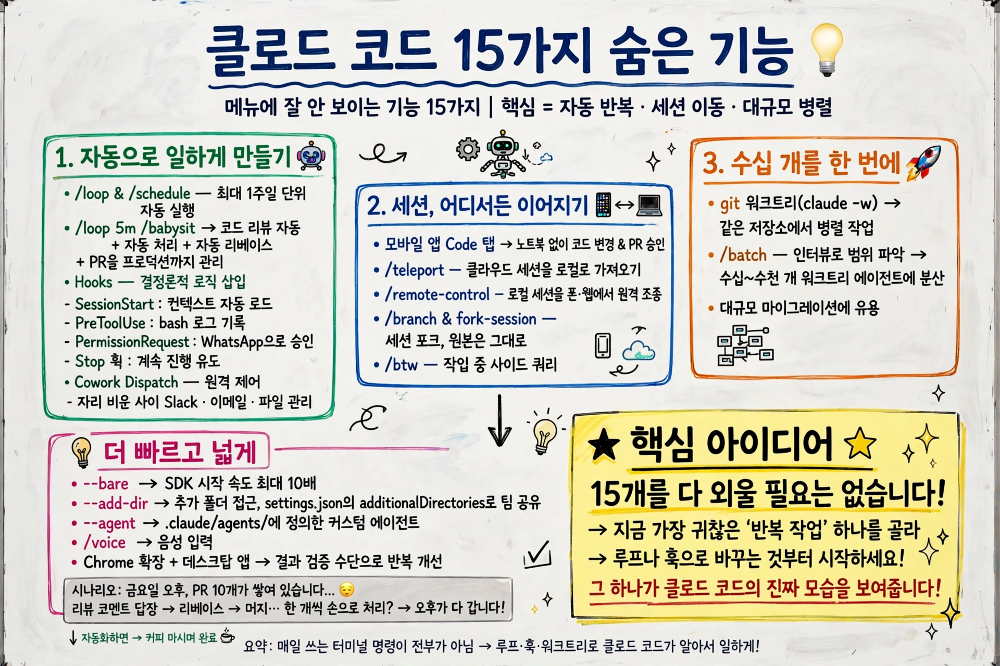
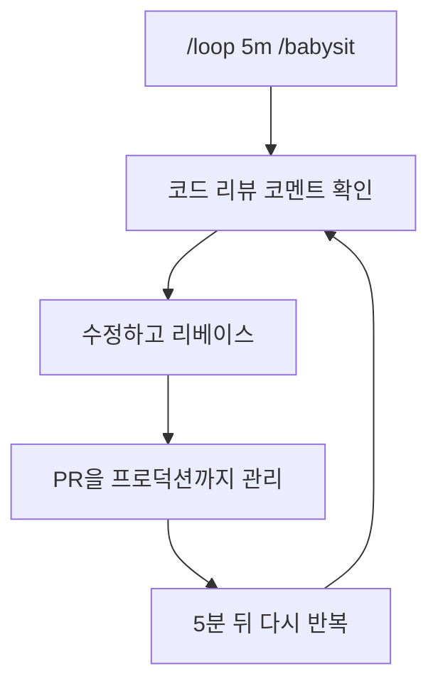
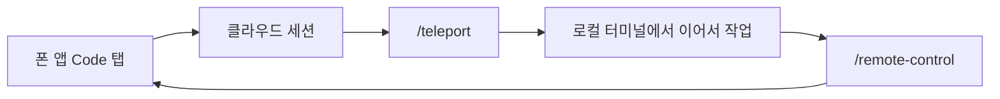
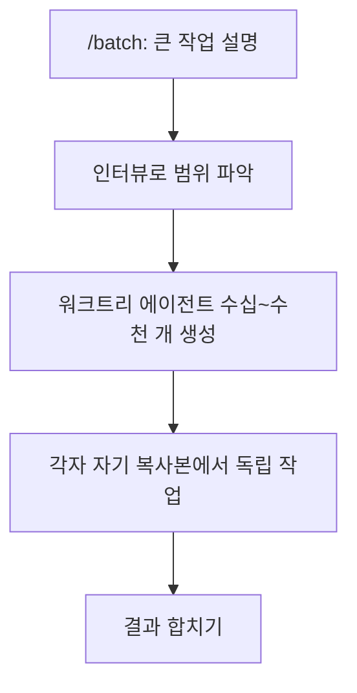

# 클로드 코드, 쓰는 기능이 전부가 아닙니다. 숨은 15가지가 일하는 방식을 바꿉니다

> **Summary**
> 클로드 코드에는 메뉴에 잘 안 보이는 기능이 15가지나 있습니다. 자동 반복, 세션 이동, 대규모 병렬이 핵심입니다. 매일 쓰는 터미널 명령이 전부가 아니고, 루프와 훅, 워크트리를 얹으면 클로드 코드가 알아서 일하는 구조가 됩니다. 15개를 다 외울 필요는 없고, 지금 가장 귀찮은 반복 작업 하나를 루프나 훅으로 바꾸는 것부터 시작하면 됩니다.

---

- 클로드 코드에는 메뉴에 잘 안 보이는 기능이 15가지나 있습니다. 자동 반복, 세션 이동, 대규모 병렬이 핵심입니다.
- 매일 쓰는 터미널 명령이 전부가 아닙니다. 루프와 훅, 워크트리를 얹으면 클로드 코드가 알아서 일하는 구조가 됩니다.
- 15개를 다 외울 필요는 없습니다. 지금 가장 귀찮은 반복 작업 하나를 루프나 훅으로 바꾸는 것부터 시작하면 됩니다.

금요일 오후, PR 열 개가 쌓여 있습니다. 리뷰 코멘트에 답하고, 리베이스하고, 머지하고... 한 개씩 손으로 처리하다 보면 오후가 다 갑니다. 이런 적 있으시죠?

클로드 코드에는 이런 반복을 알아서 처리하는 기능이 숨어 있습니다. 만든 팀이 직접 정리한 15가지, 주제별로 묶어봤습니다.

🎥 [동영상 보기](https://www.youtube.com/watch?v=0kgPSRCQrKE)

## 자동으로 일하게 만들 수 있을까요?

가장 먼저 볼 건 자동화입니다. `/loop`와 `/schedule`은 클로드 코드를 최대 1주일 단위로 자동으로 돌리는 기능입니다. `/loop 5m /babysit`을 걸어두면 코드 리뷰를 자동으로 처리하고, 자동으로 리베이스하고, PR을 프로덕션까지 관리합니다. 30분마다 Slack 피드백 PR을 올리는 루프, 오래된 PR을 닫는 루프도 같은 방식입니다. PR 관리가 알아서 돕니다!

`/schedule`은 클라우드에서 돕니다. 컴퓨터가 꺼져 있어도 스케줄은 계속 실행됩니다. 반복되는 워크플로우를 스킬로 만들고 루프에 걸어두면, 그때부터는 사람이 개입할 일이 줄어듭니다.

`Hooks`는 여기에 결정론적인 로직을 끼워 넣는 장치입니다. `SessionStart`에서 시작할 때 컨텍스트를 동적으로 불러오고, `PreToolUse`에서 모델이 실행하는 모든 bash 명령을 로그로 남기고, `PermissionRequest`를 WhatsApp으로 보내 직접 승인하거나 거부할 수 있습니다. `Stop` 훅은 클로드가 멈출 때마다 계속 진행하도록 유도합니다.

`Cowork Dispatch`는 데스크탑 앱의 보안 원격 제어 기능입니다. 자리를 비운 사이에 Slack과 이메일을 확인하고, 파일을 정리하고, 노트북 작업을 대신 처리합니다. 코딩이 아닌 일도 맡길 수 있다는 점이 포인트입니다.

## 세션, 어디서든 이어집니까?

두 번째 주제는 이동입니다. 클로드 코드에는 iOS·Android 모바일 앱이 있습니다. 앱 왼쪽의 Code 탭에서 노트북을 열지 않고 코드 변경과 PR 승인을 할 수 있습니다. 출근길에 리뷰 하나를 처리하는 일, 이제 폰으로 끝납니다.

`/teleport`는 클라우드에서 돌던 세션을 로컬 머신으로 가져오는 명령입니다. 반대로 `/remote-control`은 로컬에서 실행 중인 세션을 폰이나 웹에서 원격으로 조종합니다. `/config`에서 전체 세션에 원격 제어를 항상 켜둘 수도 있습니다. 세션이 끊기지 않습니다!

실험을 하다가 방향이 틀어졌을 때는 세션을 포크하면 됩니다. 세션 안에서 `/branch`를 실행하거나, CLI에서 `claude --resume <session-id> --fork-session`을 쓰면 됩니다. 원본 세션은 그대로 두고, 분기에서 마음껏 시도해볼 수 있습니다.

작업 중에 갑자기 궁금한 게 생기면 `/btw`를 씁니다. 에이전트가 일하는 동안 사이드 쿼리로 빠른 질문을 던질 수 있습니다. 본작업은 멈추지 않습니다.

## 수십 개를 한 번에 돌릴 수 있을까요?

세 번째 주제는 병렬입니다. 클로드 코드는 git 워크트리를 깊이 지원합니다. `claude -w`로 새 워크트리 세션을 시작하거나, 데스크탑 앱의 워크트리 체크박스를 쓰면 됩니다. 같은 저장소에서 여러 작업을 동시에 돌릴 때 필수입니다.

`/batch`는 여기서 한 걸음 더 나아갑니다. 큰 작업을 설명하면 인터뷰 방식으로 범위를 파악한 뒤, 수십 개에서 수천 개의 워크트리 에이전트에 작업을 나눠줍니다. 각 에이전트는 자기 복사본에서 독립적으로 일합니다. 대규모 코드 마이그레이션처럼 병렬화가 가능한 작업에 특히 유용합니다. 수천 개가 동시에 뜁니다!

## 더 빠르고 넓게 쓸 수 있을까요?

마지막 주제는 속도와 범위입니다. `--bare` 플래그는 SDK 시작 속도를 최대 10배까지 빠르게 만듭니다. `claude -p`나 SDK를 실행하면 기본적으로 로컬 `CLAUDE.md`와 설정, MCP를 자동 탐색하는데, 비대화형으로 쓸 때는 이 탐색이 필요 없는 경우가 많습니다. `--system-prompt`와 `--mcp-config`, `--settings`로 명시적으로 지정하면 됩니다. 향후 버전에서는 기본값으로 바뀔 예정입니다.

`--add-dir`은 클로드가 추가 폴더에 접근하고 작업할 권한을 줍니다. 여러 저장소를 오가며 일할 때 씁니다. 팀 공유 설정 파일인 `settings.json`에 `"additionalDirectories"`를 넣어두면 시작할 때마다 자동으로 불러옵니다.

`--agent`는 커스텀 에이전트입니다. `.claude/agents/` 디렉토리에 에이전트를 정의한 뒤 `claude --agent=<name>`으로 실행하면, 제한된 도구와 커스텀 시스템 프롬프트를 가진 에이전트가 됩니다. 읽기 전용 에이전트나 리뷰 전용 에이전트를 만들 때 씁니다.

`/voice`는 음성 입력입니다. CLI에서 `/voice`를 실행한 뒤 스페이스바를 누른 채 말하면 됩니다. 데스크탑에서는 음성 버튼, iOS에서는 받아쓰기 설정을 씁니다.

그리고 프론트엔드 작업의 핵심 원칙이 하나 있습니다. 클로드에게 결과물을 직접 검증할 수단을 줘야 합니다! 브라우저 없이 웹사이트 개발을 시키면 결과 품질이 낮을 수밖에 없습니다. Chrome 확장을 주면 코드를 쓰고 결과가 좋아질 때까지 반복합니다. 유사 MCP보다 안정적으로 동작한다는 점도 함께 기억해두면 좋습니다. 데스크탑 앱은 웹 서버를 자동으로 실행하고 내장 브라우저에서 테스트하는 기능까지 묶어 제공합니다.

15개를 다 쓸 필요는 없습니다. 가장 귀찮은 반복 하나를 골라 루프로 돌려보세요. 그 하나가 클로드 코드의 진짜 모습을 보여줍니다!

