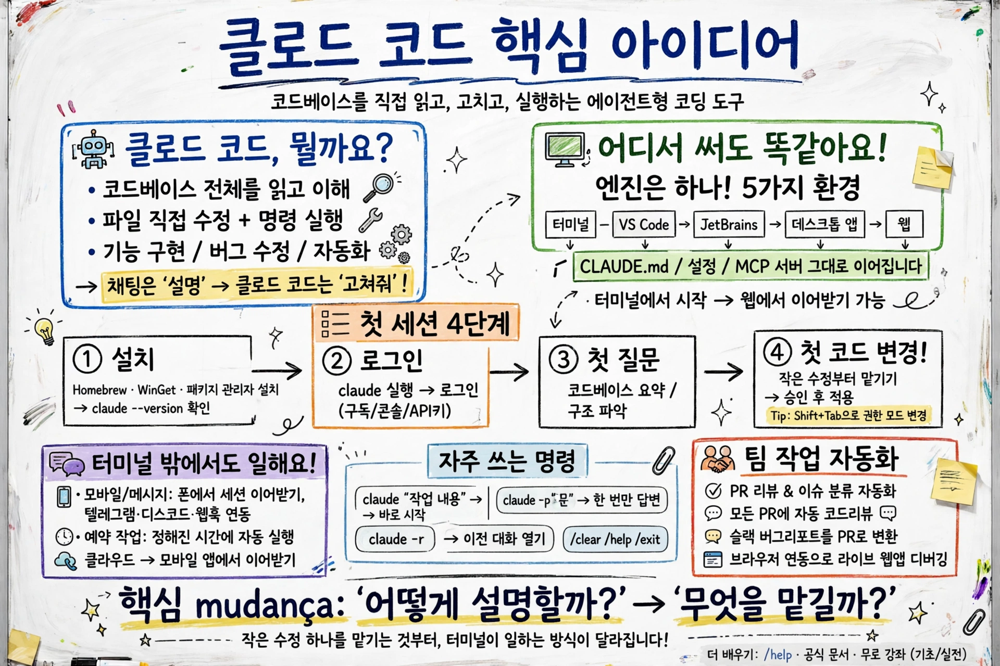
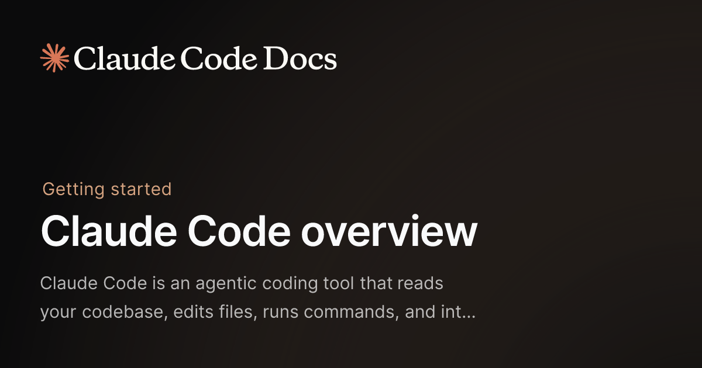
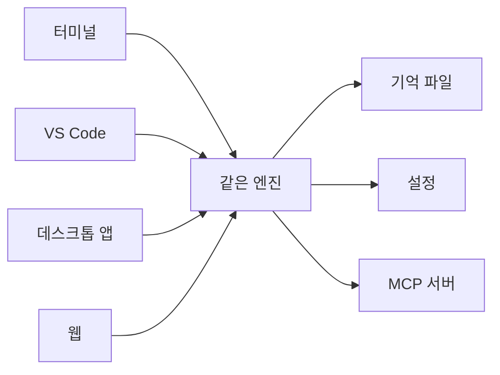
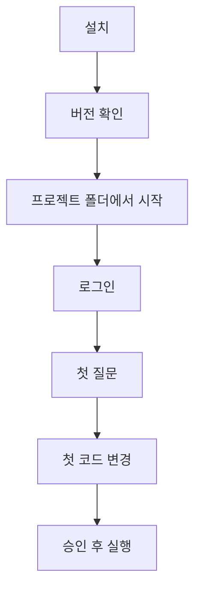
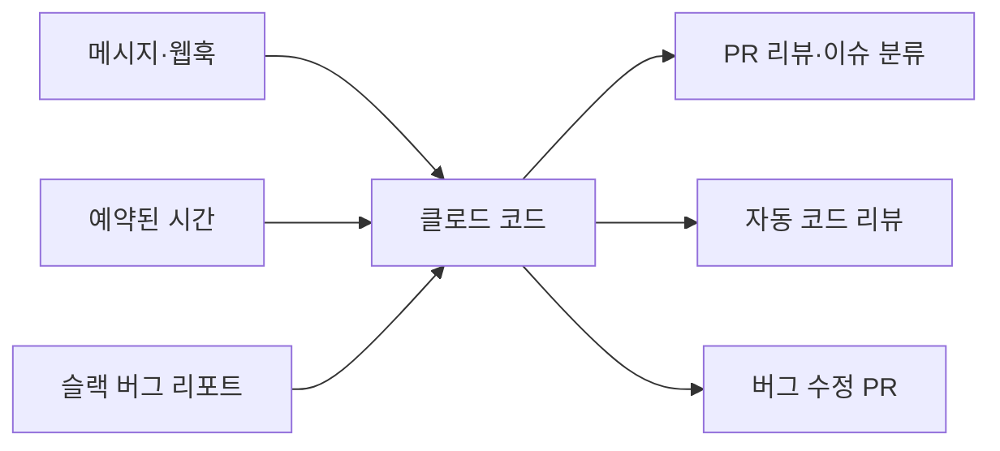

# 클로드 코드, 질문에 답하는 게 아니라 직접 고치고 실행합니다

> **Summary**
> 클로드 코드는 코드베이스를 이해해 여러 파일을 직접 수정하고 명령을 실행하는 AI 코딩 도구입니다. 터미널, 에디터, 데스크톱, 웹 등 어디서나 같은 설정과 기억을 이어 사용할 수 있으며, 설치와 로그인을 마친 뒤 작은 작업부터 맡기고 변경을 승인하며 시작하면 됩니다. 원격 제어, 자동화, 팀 작업 연동과 확장 기능도 제공합니다.

---

- 클로드 코드는 코드베이스 전체를 읽고 파일을 직접 고치고 명령까지 실행하는 에이전트형 코딩 도구입니다.
- 터미널·VS Code·데스크톱·웹, 어느 화면에서든 같은 엔진이 돌아가서 설정과 기억이 그대로 이어집니다.
- 설치 한 줄, 로그인 한 번이면 첫 세션이 열립니다. 작은 수정부터 맡겨보는 게 가장 빠른 시작입니다.

터미널 앞에 앉아 있는데, 고쳐야 할 파일이 열 개쯤 흩어져 있는 장면, 익숙하시죠? 채팅창에 코드를 붙여넣고 설명만 받아 적던 방식, 이제는 조금 답답하게 느껴지시나요? 이 글에서는 코드베이스를 직접 읽고 고치는 도구를 소개합니다.

🎥 [동영상 보기](https://www.youtube.com/watch?v=rZMRY55qfkg)

## 클로드 코드, 도대체 뭘까요?

클로드 코드는 AI 코딩 어시스턴트입니다. 기능을 만들고, 버그를 고치고, 개발 작업을 자동화합니다. 코드베이스 전체를 이해하고 여러 파일과 도구에 걸쳐 일합니다.

채팅 어시스턴트와 무엇이 다를까요? 답만 하고 끝나는 게 아닙니다. 맥락을 모으고, 계획을 세우고, 직접 고치고, 결과를 확인하는 순환이 돌아갑니다. 그래서 "설명해 줘"가 아니라 "고쳐 줘"라고 말할 수 있습니다.

## 어디서 써도 똑같을까요?

터미널, VS Code, JetBrains, 데스크톱 앱, 웹. 다섯 가지 화면이 있지만 엔진은 하나입니다! 그래서 프로젝트에 적어 둔 `CLAUDE.md` 파일과 설정, 연결한 MCP 서버가 어느 화면에서든 그대로 이어집니다. 터미널에서 시작한 작업을 웹에서 이어받는 구조입니다.

화면을 고르는 기준은 취향입니다. 자주 쓰는 곳에서 쓰면 됩니다. 엔진이 같으니 옮겨 다녀도 다시 설명할 필요가 없습니다.

## 첫 세션은 어떻게 시작할까요?

시작은 네 단계입니다.

첫째, 설치입니다. 네이티브 설치가 권장되고, Homebrew·WinGet·패키지 관리자도 쓸 수 있습니다. 설치가 끝나면 `claude --version`을 쳐서 버전이 찍히는지 확인합니다.

둘째, 로그인입니다. 프로젝트 폴더에서 `claude`를 치면 처음 한 번 로그인을 묻습니다. 구독 계정이나 콘솔 계정, 클라우드 제공자 계정으로 들어갑니다. API 키를 환경 변수로 넣어 두면 이 화면을 건너뜁니다.

셋째, 첫 질문입니다. 코드베이스를 요약해 달라고 하거나, 특정 부분이 어떻게 돌아가는지 물어봅니다. 파일 구조를 파악하는 질문부터 시작하면 됩니다.

넷째, 첫 코드 변경입니다! 작은 일부터 맡기고, 바꾸기 전에 보여주는 화면에서 승인하면 됩니다. 권한 모드는 `Shift+Tab`으로 그때그때 바꿉니다.

자주 쓰는 명령은 따로 모아 두면 좋습니다. `claude "작업 내용"`은 시작하면서 바로 일을 시킵니다. `claude -p "질문"`은 한 번만 물어보고 끝냅니다. `claude -c`는 가장 최근 대화를 이어가고, `claude -r`은 이전 대화를 다시 엽니다. 세션 안에서는 `/clear`로 새 대화를 시작하고, `/help`로 명령을 확인하고, `/exit`으로 나갑니다.

## 터미널 밖에서도 일할까요?

터미널 안에만 갇혀 있지 않습니다! 폰에서 이어받을 수도 있고, 메시지에서 일이 들어올 수도 있습니다.

전화기에서 세션을 이어받는 원격 제어, 텔레그램·디스코드·메시지 앱·웹훅에서 일을 밀어 넣는 채널 연결, 정해진 시간에 자동으로 도는 예약 작업이 있습니다. 시작한 일을 클라우드로 넘겨 모바일 앱에서 이어받는 방법도 있습니다.

팀 작업에도 붙습니다. PR 리뷰와 이슈 분류를 자동화하고, 모든 PR에 자동 코드 리뷰를 달고, 슬랙에 들어온 버그 리포트를 PR로 바꿉니다. 라이브 웹앱은 브라우저 연동으로 직접 디버깅합니다. 나만의 에이전트를 만들고 싶으면 전용 SDK로 확장하면 됩니다!

## 어디서 더 배울 수 있을까요?

시작 가이드를 따라 첫 작업을 끝냈다면, 다음은 세 갈래입니다. 프로젝트 기억 파일과 자주 쓰는 워크플로, 그리고 모범 사례를 읽어보는 것입니다. 무료 강좌도 준비돼 있습니다. 기초 강좌와 실전 강좌가 따로 있으니, 순서대로 들으면 됩니다. 막히면 세션 안에서 `/help`를 치거나 문서를 찾아보면 됩니다.

코딩 도구의 질문이 바뀌었습니다. "어떻게 설명할까?"가 아니라 "무엇을 맡길까?"입니다! 작은 수정 하나를 맡기는 것부터, 터미널이 일하는 방식이 달라집니다.

