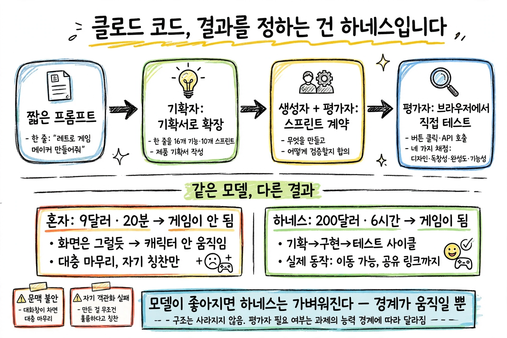
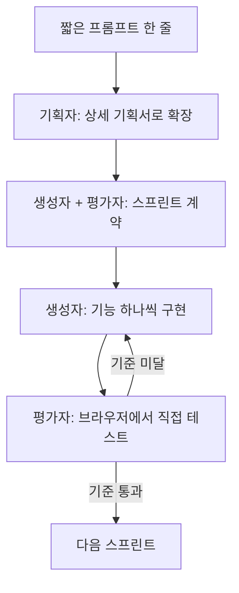
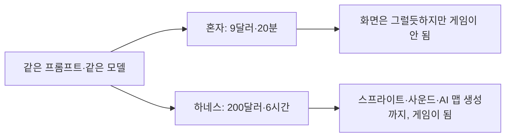
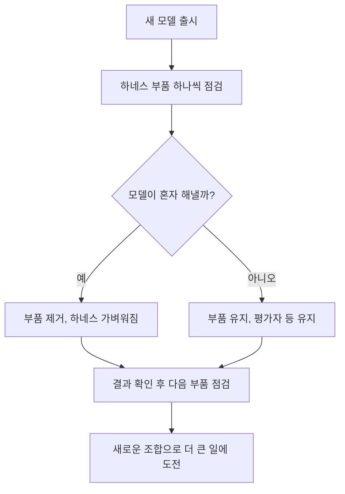

# 클로드 코드, 프롬프트만 치면 안 됩니다. 결과를 정하는 건 하네스 구조입니다

> **Summary**
> 클로드 코드의 성과는 프롬프트보다 작업 구조와 검증 방식에 달려 있습니다. 기획자·생성자·평가자를 나누고 스프린트 목표와 테스트 기준을 합의하면 결과물의 기능성과 완성도를 높일 수 있습니다. 모델이 발전하면 하네스를 단계적으로 가볍게 하되, 모델이 혼자 해결하기 어려운 영역에서는 평가자를 유지해야 합니다.

---

- 클로드 코드의 결과는 프롬프트가 아니라 모델을 감싸는 하네스 구조가 정합니다.
- 만드는 쪽과 채점하는 쪽을 나누면, AI가 자기 작품을 무조건 칭찬하는 함정에서 벗어납니다.
- 모델이 똑똑해질수록 하네스는 가벼워지지만 사라지지는 않습니다. 경계가 움직일 뿐입니다.

클로드 코드를 깔고 "레트로 게임 메이커 만들어줘"라고 한 줄 쳤는데, 20분 만에 나온 앱에서 캐릭터가 키를 눌러도 꼼짝도 않던 적 있으시죠? 화면은 그럴듯했습니다. 그런데 게임이 안 됐습니다.

같은 모델, 같은 프롬프트로 한 번 더 돌렸더니 이번에는 6시간이 걸리고 200달러가 들었습니다. 그런데 게임이 됐습니다! 차이는 모델이 아니었습니다. 모델을 감싸는 구조, 하네스였습니다.

🎥 [동영상 보기](https://www.youtube.com/watch?v=mR-WAvEPRwE)

## 왜 프롬프트만으로는 안 될까요?

긴 작업을 맡기면 에이전트는 두 가지 방식으로 무너집니다.

첫 번째는 문맥 불안입니다. 대화창이 꽉 차 간다고 느끼면, 에이전트는 일을 대충 마무리 지으려고 합니다. 아직 할 일이 남았는데도 스스로 끝을 내버리는 거죠.

두 번째는 자기 객관화 실패입니다. 만든 걸 평가해 달라고 하면, 엉망인 결과물에도 무조건 훌륭하다고 칭찬합니다. 특히 디자인처럼 정답이 없는 영역에서 심합니다.

이 장면이 가장 인상 깊었습니다. 평가를 맡긴 쪽이 칭찬만 하니, 만드는 쪽은 고칠 이유를 모릅니다. 피드백이 없으면 발전도 없습니다.

## 하네스는 무엇일까요?

하네스는 모델을 감싸는 구조입니다. 프롬프트 한 줄이 아니라, 일하는 방식 자체를 설계하는 겁니다.

앤트로픽이 공개한 하네스는 세 명의 에이전트가 한 팀으로 움직입니다. 기획자가 짧은 프롬프트를 상세한 제품 기획서로 넓히고, 생성자가 기능을 하나씩 구현하고, 평가자가 직접 브라우저를 띄워 클릭해 가며 버그를 찾고 채점합니다.

이 세 명이 일하는 방식이 핵심입니다.

코드를 짜기 전에 생성자와 평가자는 이번 스프린트에 무엇을 만들고 어떻게 검증할지 미리 합의합니다. 이걸 스프린트 계약이라고 부릅니다. 기획서가 일부러 큰 그림만 그리기 때문에, 이 합의가 없으면 개발이 기획 의도에서 벗어나기 쉽습니다.

평가자는 화면을 보기만 하지 않습니다. 자동화 도구를 써서 직접 앱을 켜고 버튼을 누르고 API를 두드려 봅니다. 채점 기준은 네 가지입니다. 디자인 품질, 독창성, 완성도, 기능성. 하나라도 기준 아래로 떨어지면 스프린트는 실패하고, 생성자는 구체적인 피드백을 받습니다.

소통은 파일로 합니다. 한 에이전트가 파일을 쓰고, 다른 에이전트가 읽고 답을 파일로 남깁니다. 대화창을 공유하지 않으니, 각자 자기 일에만 집중할 수 있습니다.

## 같은 모델, 다른 결과: 9달러와 200달러의 차이

실험은 단순했습니다. 같은 프롬프트, 같은 모델, 두 가지 방식.

혼자 둔 에이전트는 9달러, 20분 만에 앱을 내놓았습니다. 화면은 그럴듯했습니다. 그런데 캐릭터가 움직이지 않았습니다. 버튼을 눌러도 반응이 없었고, 코드 속 연결이 끊어져 있었습니다.

하네스를 가동하자 200달러, 6시간이 들었습니다. 기획자는 한 줄짜리 프롬프트를 16개 기능, 10개 스프린트짜리 기획서로 넓혔습니다. 스프라이트 애니메이션, 사운드, AI 자동 맵 생성, 게임 공유 링크까지 들어갔습니다. 그리고 게임이 됐습니다.

비용은 20배가 넘었습니다. 그런데 결과가 완전히 달랐습니다. 이게 하네스의 값입니다!

평가자를 잘 만드는 일도 만만치 않았습니다. 처음에는 평가자가 진짜 문제를 찾아놓고도 "크게 문제없다"며 넘어가곤 했습니다. 겉만 훑고 지나가서 미묘한 버그는 놓쳤습니다. 로그를 읽고 판단이 어긋난 부분을 찾아 평가자 프롬프트를 고치는 과정을 여러 번 반복한 뒤에야 평가자가 제대로 채점하기 시작했습니다.

만드는 쪽을 비판적으로 만드는 것보다, 채점하는 쪽을 깐깐하게 만드는 편이 훨씬 쉽습니다. 이게 생성자와 평가자를 나누는 이유입니다!

## 모델이 좋아지면 하네스는 어떻게 될까요?

여기서 질문이 생깁니다. 모델이 똑똑해지면 하네스는 필요 없어지는 걸까요?

실험이 답을 보여줬습니다. 더 똑똑한 모델이 나오자, 하네스는 과감히 가벼워졌습니다. 작업 단위를 잘게 쪼개던 스프린트 구조를 통째로 없앴고, 평가자의 개입 횟수도 줄였습니다.

그런데 평가자 자체는 남았습니다. 모델이 혼자 잘 해내는 범위 안에서는 평가자가 불필요한 짐이 되지만, 그 경계 밖에 있는 일에서는 여전히 실질적인 도움이 됐습니다. 평가자가 필요한지 여부는 고정된 답이 아닙니다. 과제가 지금 모델의 능력 경계 밖에 있는지가 기준입니다!

## DAW 실험이 보여준 것

가벼워진 하네스로 디지털 작곡 프로그램을 만들어 봤습니다. 4시간, 124달러가 들었습니다.

결과는 어땠을까요? 평가자는 여전히 진짜 빈틈을 잡아냈습니다. 클립을 타임라인에서 끌 수 없고, 악기 패널이 없고, 녹음 버튼은 눌리지만 실제로 녹음이 안 되는 껍데기 기능이었습니다. 생성자는 혼자 두면 세부 기능을 껍데기로 남기기 쉽습니다. 평가자가 마지막 1마일을 잡아주는 구조는 여전히 유효했습니다.

그래도 최종 앱은 브라우저에서 멜로디와 믹서가 돌아가는 작곡 프로그램이 됐습니다. 프롬프트만으로 짧은 노래 한 곡을 만드는 데까지 갔습니다. 전문 프로그램 수준은 아니었지만, 핵심 기능은 모두 살아 있었습니다.

## 하네스는 계속 바뀝니다

하네스의 모든 부품은 "모델이 이걸 혼자 못 한다"는 가정을 담고 있습니다. 그 가정은 틀릴 수도 있고, 모델이 좋아지면 금방 낡습니다.

그래서 새 모델이 나오면 하네스를 다시 뜯어봐야 합니다. 더는 필요 없는 부품을 빼고, 새로 가능해진 일을 담을 부품을 더합니다. 한 번에 하나씩 빼면서 결과를 확인하는 게 방법입니다. 한꺼번에 확 줄이면 무엇이 핵심이었는지 알 수 없게 됩니다.

결론은 단순합니다. 클로드 코드를 제대로 쓰는 건 프롬프트를 잘 치는 게 아닙니다. 만드는 쪽과 채점하는 쪽을 나누고, 검증할 수 있는 합의를 앞에 두는 구조를 짜는 일입니다. 모델이 좋아질수록 그 구조는 가벼워지겠지만, 구조 자체가 사라지지는 않습니다. 경계가 움직일 뿐, 다음 조합을 찾는 일은 계속됩니다!

