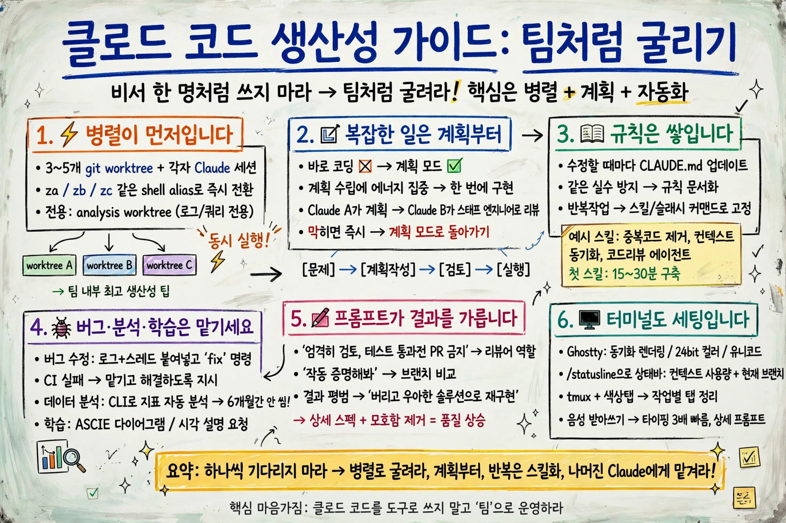
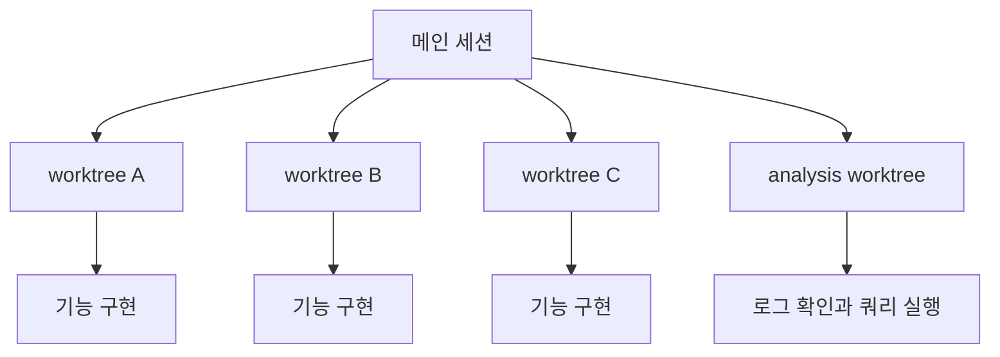

# 클로드 코드, 하나씩 시키면 손해입니다. 병렬로 굴리는 게 답입니다

> **Summary**
> 클로드 코드 창시자가 공개한 실전 사용 팁 10가지를 정리했습니다. 병렬 작업이 최고의 생산성 팁으로, 3~5개 git worktree에 각각 Claude 세션을 띄워 동시에 굴립니다. 복잡한 일은 계획 모드로 시작하고, 반복되는 일은 스킬로 고정하고, 규칙은 CLAUDE.md에 쌓아 실수를 줄입니다. 버그 수정·데이터 분석·학습까지 Claude에게 맡기는 방법도 다룹니다.

---

- 클로드 코드 팀 내부에서 꼽은 최고의 생산성 팁은 병렬 작업입니다. 3~5개 `git worktree`에 각각 Claude 세션을 띄워 동시에 굴립니다.
- 복잡한 일은 계획 모드로 시작하고, 반복되는 일은 스킬로 고정하고, 규칙은 `CLAUDE.md`에 쌓아 실수를 줄입니다.
- 버그 수정·데이터 분석·학습까지 Claude에게 맡기면, 손으로 하던 일이 줄고 프롬프트 수준이 올라갑니다.

클로드 코드를 켜고 한 가지 일을 시킨 뒤, 끝나기를 기다린 적 있으시죠? 끝나면 다음 일을 시키고, 또 기다리고요. 그런데 내부 팀은 이렇게 쓰지 않습니다! 창시자가 공개한 실전 사용 팁 10가지를 정리했습니다. 핵심은 하나입니다. 비서 한 명처럼 쓰지 말고, 팀처럼 굴리는 겁니다.

🎥 [동영상 보기](https://www.youtube.com/watch?v=gv0WHhKelSE)

## 병렬이 먼저입니다, 왜 한 번에 하나씩만 시키세요?

가장 큰 팁은 병렬 작업입니다. 3~5개 `git worktree`를 동시에 실행하고, 각각에 별도 Claude 세션을 띄웁니다. 팀 내부에서 최고의 생산성 향상 팁으로 꼽혔습니다. 일부는 `git checkout` 방식을 쓰지만, 대부분은 worktree를 선호합니다. 이 방식이 널리 쓰이면서 데스크톱 앱에는 네이티브 worktree 지원까지 추가됐습니다.

worktree마다 이름을 붙이고, `za`, `zb`, `zc` 같은 shell alias를 설정하면 한 번의 키 입력으로 전환됩니다. 로그 확인과 쿼리 실행 전용 `analysis` worktree를 따로 운영하는 팀원도 있습니다. 병렬이 답입니다!

## 복잡한 일은 계획부터, 왜 바로 코딩부터 하세요?

복잡한 작업은 항상 계획 모드로 시작합니다. 계획 수립에 에너지를 쏟아, Claude가 한 번에 구현을 끝내도록 유도합니다. 하나의 Claude가 계획을 작성하면, 두 번째 Claude를 띄워 스태프 엔지니어 역할로 검토시키는 방식도 씁니다.

작업이 잘못되는 순간, 즉시 계획 모드로 돌아가 다시 계획합니다. 무리하게 밀어붙이지 않는 게 중요합니다. 검증 단계에서도 명시적으로 계획 모드 진입을 지시하는 게 효과적입니다. 계획에 에너지를 쏟는다는 대목이 저는 가장 와닿았습니다. 보통은 바로 코딩부터 하니까요.

## 규칙은 쌓입니다, 같은 실수 또 하세요?

매번 수정할 때마다 `CLAUDE.md`를 업데이트하도록 지시합니다. 같은 실수를 반복하지 않으라는 겁니다. Claude는 스스로 지켜야 할 규칙을 매우 잘 문서화합니다. 시간이 지나며 계속 다듬다 보면, 실수율이 측정 가능하게 줄어듭니다.

하루에 한 번 이상 반복하는 작업은 스킬이나 슬래시 커맨드로 만듭니다. 세션 종료 시 중복 코드를 찾아 제거하는 커맨드, 일주일치 업무 도구를 하나의 컨텍스트 덤프로 동기화하는 셋업, 데이터 모델 작성과 코드 리뷰를 맡는 에이전트까지, 팀은 반복 작업을 스킬로 고정합니다. 첫 스킬은 15~30분이면 구축하고 테스트할 수 있습니다.

## 버그 수정은 맡기세요, 왜 직접 뒤지세요?

버그 수정은 Claude에게 맡기는 게 빠릅니다. 메신저의 버그 스레드를 붙여넣고 "fix"라고만 입력하면, 컨텍스트 전환 없이 수정이 진행됩니다. "실패한 CI 테스트를 고쳐봐"라고만 지시하고 방법은 맡기는 방식도 씁니다. 로그를 넘겨 분산 시스템 트러블슈팅을 맡겨도 놀라울 정도로 잘 처리합니다.

## 프롬프트 수준이 결과를 가릅니다!

프롬프트를 바꾸면 결과가 바뀝니다. "이 변경사항을 엄격히 검토하고, 테스트를 통과할 때까지 PR을 만들지 마"라고 지시하면 Claude가 리뷰어가 됩니다. "이게 작동한다는 걸 증명해봐"라고 하면, 메인 브랜치와 기능 브랜치 사이의 동작 차이를 직접 비교합니다. 평균적인 결과가 나오면 "지금까지 알게 된 모든 것을 바탕으로, 이걸 버리고 우아한 솔루션으로 다시 구현해"라고 지시합니다.

작업 전달 전, 상세한 스펙을 작성하고 모호함을 제거하는 게 출력 품질을 가르는 핵심입니다.

## 터미널도 세팅입니다

터미널 환경도 생산성의 일부입니다. 팀에서는 `Ghostty` 터미널을 선호합니다. 동기화 렌더링, 24비트 컬러, 유니코드 지원이 장점입니다. `/statusline`으로 상태바를 바꿔 컨텍스트 사용량과 현재 브랜치를 항상 표시합니다. 터미널 탭에 색상과 이름을 붙이고 `tmux`를 쓰면, 작업과 worktree마다 탭 하나로 정리됩니다.

음성 받아쓰기도 권합니다. 타이핑보다 3배 빠르게 말할 수 있고, 프롬프트가 훨씬 상세해집니다.

## 데이터 분석과 학습까지 맡기세요

데이터 분석도 Claude에게 맡깁니다. 명령줄 도구를 써서 즉석에서 지표를 가져오고 분석하도록 요청합니다. 데이터 분석 스킬을 저장소에 넣어두면 팀 전체가 직접 분석 쿼리를 실행합니다. 6개월 동안 SQL을 직접 작성하지 않았다는 말이 저는 가장 충격적이었습니다. 데이터 분석까지 맡긴다는 거니까요!

학습에도 씁니다. 출력 스타일을 바꾸면 Claude가 변경 사항의 이유를 설명해줍니다. 익숙하지 않은 코드는 시각적 프레젠테이션이나 ASCII 다이어그램으로 설명하도록 요청합니다. 이해한 내용을 설명하면 빈틈을 채우는 추가 질문을 하고 결과를 저장하는 간격 반복 학습 스킬도 만들 수 있습니다.

클로드 코드를 쓰는 방식이 곧 생산성입니다. 하나씩 시키던 습관을 버리고, 병렬로 굴리고, 계획부터 세우고, 반복되는 건 스킬로 고정하면 도구가 달라집니다!

