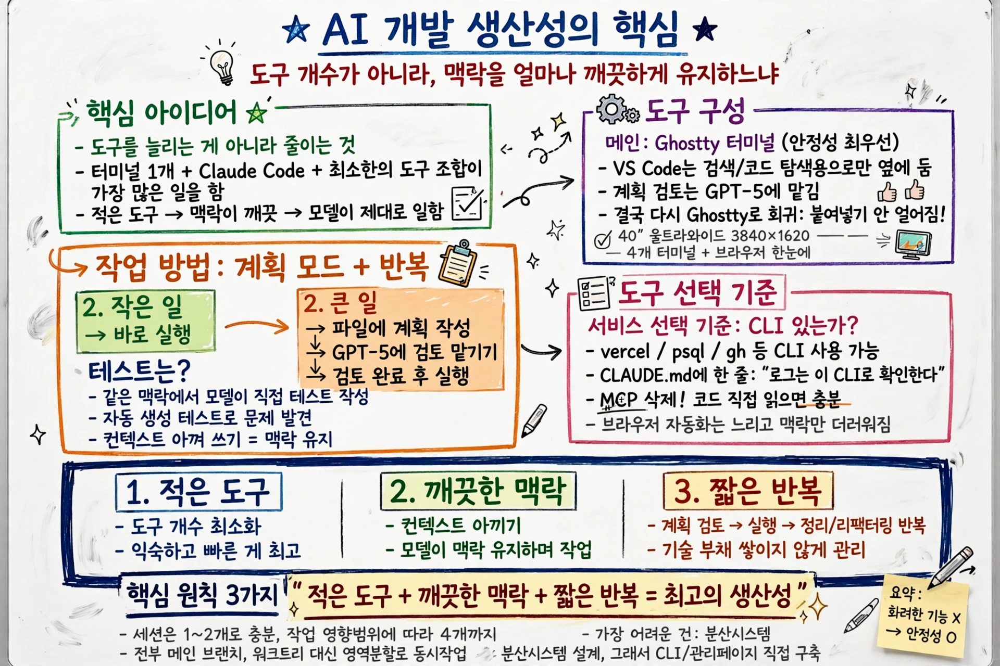
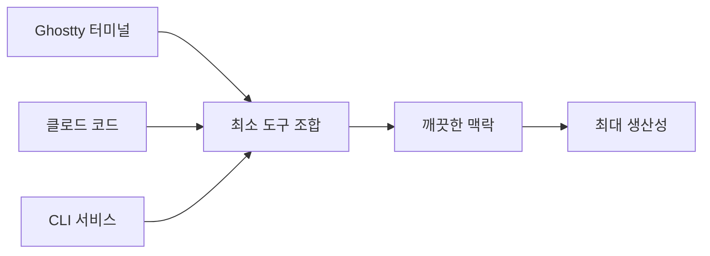
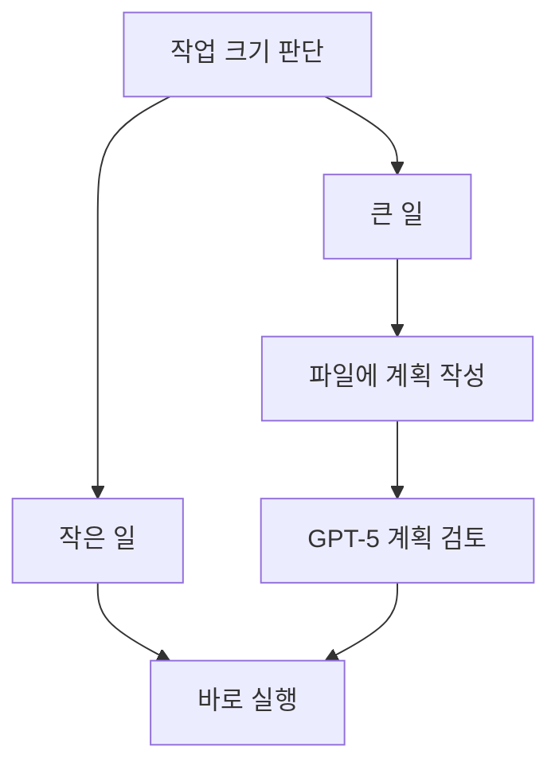

# 클로드 코드 + Ghostty, 적은 도구가 더 많은 일을 해냅니다

> **Summary**
> AI 개발 생산성은 도구를 늘리기보다 Ghostty, 클로드 코드, CLI 중심의 간결한 환경으로 맥락을 깨끗하게 유지하는 데서 나옵니다. 작은 일은 바로 실행하고 큰 일은 계획을 검토받으며, 작업에 맞춰 에이전트 수를 조절하고 같은 맥락에서 테스트를 작성하면 효율적으로 개발할 수 있습니다.

---

- AI 개발 생산성의 비결은 도구를 늘리는 게 아니라 줄이는 데 있습니다. 터미널 하나와 클로드 코드, 최소한의 도구 조합이 가장 많은 일을 해냅니다.
- 작은 일은 바로 실행하고, 큰 일은 파일에 적어 계획 검토를 받은 뒤 실행합니다. 계획 모드와 반복이 핵심입니다.
- 테스트는 같은 맥락에서 모델이 직접 쓰게 하고, 컨텍스트는 아껴 씁니다. 도구가 적을수록 맥락이 깨끗하게 남습니다.

AI 코딩 도구가 하루가 다르게 쏟아지는데, 뭘 골라야 할지 막막했던 적 있으시죠? 새 도구가 나올 때마다 갈아타다 보면, 정작 일하는 시간보다 도구를 만지는 시간이 더 길어지기도 합니다.

🎥 [동영상 보기](https://www.youtube.com/watch?v=gv0WHhKelSE)

## 어떤 조합으로 일할까요?

메인 터미널은 Ghostty입니다. VS Code는 코드를 찾아볼 때 옆에 두고, 계획 검토는 GPT-5에 맡깁니다. 한때 VS Code에 올인해 본 적도 있지만, 결국 다시 Ghostty로 돌아왔습니다. VS Code 터미널은 큰 텍스트를 붙여넣으면 얼어버리는 일이 잦았거든요. Ghostty는 그런 적이 없습니다!

모니터는 40인치 울트라와이드 한 장이면 충분합니다. 3840x1620 해상도에서는 클로드 코드 네 개와 브라우저를 창을 옮기지 않고 한눈에 볼 수 있습니다. 새 터미널도 써봤습니다. 그런데 화면 생김새가 눈에 안 들어오더라고요. 결국 도구는 익숙하고 빠른 게 이깁니다.

이 대목이 저는 가장 와닿았습니다. 도구를 고르는 기준이 화려한 기능이 아니라 '붙여넣을 때 안 얼어버리는가' 같은 사소한 안정성이라니, 참 현실적입니다.

## 도구는 왜 줄이는 게 좋을까요?

마지막 MCP마저 뺐습니다. 코드를 직접 읽으면 될 일을, 굳이 브라우저 자동화로 확인할 필요가 있을까요? 모델이 브라우저를 띄워 확인하곤 했는데, 느리고 맥락만 더럽혔습니다. 코드 읽기만으로 충분한 일을 굳이 무거운 도구로 할 이유가 없습니다!

서비스를 고를 때도 기준은 하나입니다. CLI가 있는가? `vercel`, `psql`, `gh` 같은 명령줄 도구가 있으면 에이전트가 바로 쓸 수 있습니다. 설정 파일(`CLAUDE.md`)에 한 줄만 적으면 됩니다. '로그는 이 CLI로 확인한다', 'DB는 이 명령으로 접속한다' — 그 정도면 충분합니다. 도구가 적을수록 맥락이 깨끗하게 남습니다. 맥락이 깨끗해야 모델이 제대로 일합니다.

## 계획은 어떻게 세울까요?

계획 모드와 반복이 핵심입니다. 작은 일은 바로 실행합니다. 큰 일은 파일에 적어 둡니다. 그리고 GPT-5에 검토를 맡깁니다. 계획 검토만큼은 GPT-5가 더 잘합니다.

프롬프트는 대개 짧게 씁니다. 가끔은 두서없는 생각을 그대로 던져 브레인스토밍을 하기도 합니다. 엉킨 생각을 에이전트가 알아서 정리해 주는 걸 보면, 놀랍습니다!

세션 관리는 상태 표시줄과 세션 ID로 합니다. 계정을 바꾸거나 세션을 다시 시작해야 할 때, 처음 주제를 바로 찾을 수 있어서 편합니다.

## 에이전트는 몇 개가 적당할까요?

평소에는 1~2개로 충분합니다. 정리·테스트·UI 작업일 때는 4개 정도가 딱 맞습니다. 정답은 없습니다. 작업의 영향 범위에 따라 달라집니다!

전부 메인 브랜치에서 작업합니다. 워크트리 설정을 써본 적도 있지만, 오히려 느려지더라고요. 작업 영역을 잘 나누면 여러 일을 동시에 해도 서로 간섭하지 않습니다.

모델이 엉망으로 만들 때도 있습니다. 그런데 정리와 리팩터링도 그만큼 잘합니다. 만들고 정리하는 걸 함께 해야 기술 부채가 쌓이지 않습니다.

## 가장 어려운 부분은 뭘까요?

가장 어려운 건 분산 시스템 설계입니다. 의존성을 고르고, 플랫폼을 정하고, 앞을 내다보는 DB 스키마를 짜는 일 말입니다.

그래서 관리 페이지와 CLI 같은 맞춤 인프라를 직접 많이 만들었습니다. 사람도 쓰고 에이전트도 쓰는 도구입니다. 이 작업이 속도를 엄청나게 올려줬습니다. 예전 방식으로는 엄두도 못 냈을 일입니다.

## 테스트는 어떻게 할까요?

큰 변경에는 항상 테스트를 붙입니다. 자동 생성 테스트가 대단하진 않습니다. 그런데 같은 맥락에서 모델에게 테스트를 쓰게 하면, 문제를 거의 항상 찾아냅니다! 컨텍스트는 소중합니다. 아껴 써야 합니다.

## 다른 도구와 비교하면요?

다른 CLI나 모델은 아직 못 미칩니다. Codex는 검색이 안 됩니다. 검색 엔진에 묻는 게 낫습니다. Cursor와 GPT-5 조합은 너무 느리고, 생각을 공유하지 않아서 조종하기 어렵습니다. GPT-5는 훌륭한 모델이지만, 프롬프트를 아주 정확하게 줘야 하는 에이전트로는 아쉬움이 있습니다.

백그라운드 에이전트로 옮기는 건 아직 모르겠습니다. 모델이 빗나가는 걸 보고 바로 방향을 잡아주는데, 백그라운드에서는 그게 훨씬 어렵습니다.

결국 AI 개발의 생산성은 도구의 개수가 아니라, 맥락을 얼마나 깨끗하게 유지하느냐에서 갈립니다. 적은 도구, 같은 맥락, 짧은 반복 — 이 세 가지가 가장 많은 일을 해냅니다.

