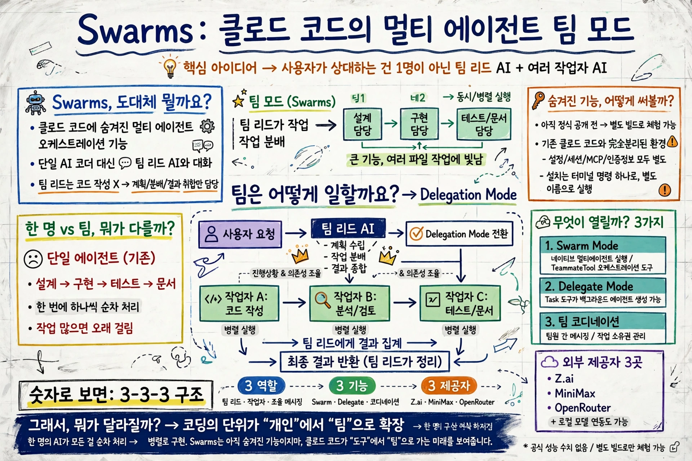
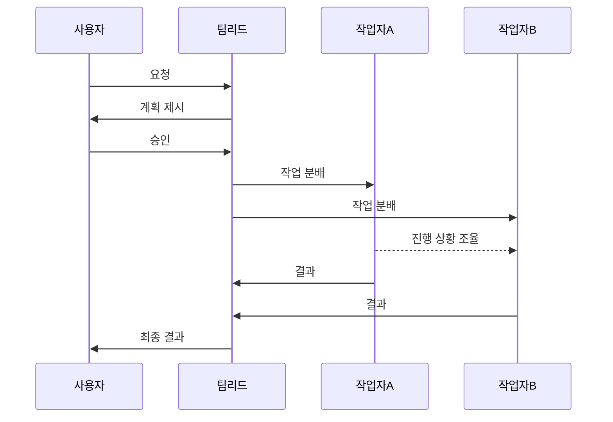
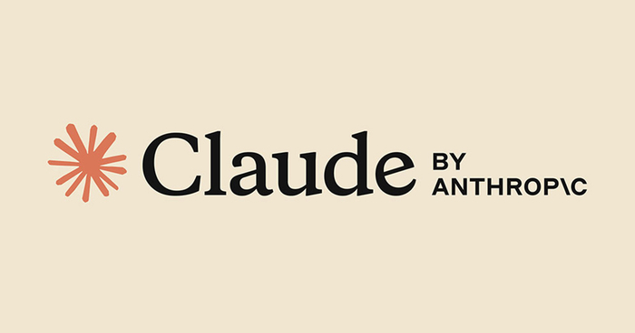
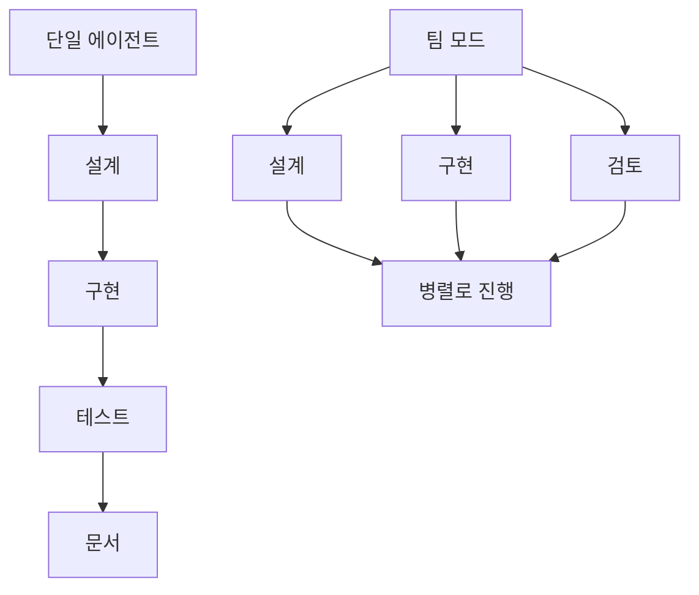

# 클로드 코드 Swarms, 이제 AI가 혼자가 아니라 팀으로 일합니다

> **Summary**
> Swarms는 클로드 코드의 숨겨진 멀티 에이전트 기능으로, 팀 리드 AI가 계획을 세우고 작업자 에이전트들이 구현·검토를 병렬로 수행합니다. 아직 정식 공개 전이며, 별도 빌드에서 체험할 수 있고 큰 기능이나 여러 파일을 다루는 작업에서 효율을 높일 잠재력이 있습니다.

---

- Swarms는 클로드 코드 안에 숨겨진 멀티 에이전트 오케스트레이션 기능입니다. 사용자가 상대하는 건 코더 한 명이 아니라 팀 리드 AI입니다.
- 팀 리드는 코드를 직접 쓰지 않고 계획하고 일을 나누고 결과를 모읍니다. 승인된 계획은 전문화된 작업자 에이전트들이 병렬로 구현합니다.
- 아직 정식 공개 전이라 별도 빌드로 체험할 수 있고, 기존 설치와 완전히 분리된 환경에서 돌아갑니다.

큰 기능 하나를 클로드 코드한테 맡겼는데, 설계하고 구현하고 테스트하고 문서까지 한 에이전트가 차례로 처리하느라 오래 걸린 적 있으시죠? 할 일은 많은데 일하는 손은 하나뿐이니까요. 그런데 클로드 코드 안에, 여러 에이전트가 팀으로 일하는 모드가 숨어 있었습니다. Swarms라는 이름의 멀티 에이전트 팀 모드입니다!

🎥 [동영상 보기](https://www.youtube.com/watch?v=uhJJgc-0iTQ)

## Swarms, 도대체 뭘까요?

Swarms는 클로드 코드에 내장되어 있지만 아직 공개되지 않은 멀티 에이전트 오케스트레이션 기능입니다. 오케스트레이션, 쉽게 말하면 여러 에이전트를 지휘하는 일입니다. 사용자가 더 이상 단일 AI 코더와 대화하지 않고, 팀 리드 역할의 AI와 상호작용합니다. 팀 리드는 직접 코드를 작성하지 않습니다! 계획 수립과 작업 분배, 결과를 종합하는 게 팀 리드의 일입니다. 그러면 실제 구현은 누가 할까요? 전문화된 작업자 에이전트들이 맡습니다.

## 팀은 어떻게 일할까요?

흐름은 이렇습니다. 사용자가 요청하면 팀 리드가 먼저 계획을 세웁니다. 계획이 나오면 사용자가 승인합니다. 승인된 계획 이후부터 Delegation Mode로 전환됩니다. 전문화된 작업자 에이전트들이 여러 개 생성되어 병렬로 작업을 수행합니다! 각 작업자는 코드 작성, 분석, 수정 등 실질적인 구현 작업을 담당합니다. 작업자끼리는 메시지를 주고받으며 진행 상황과 의존성을 조율합니다. 모든 결과는 팀 리드에게 집계되어 최종 응답으로 반환됩니다. 사용자가 받는 건 팀 리드가 정리한 최종 결과 하나입니다.

## 한 명과 팀, 뭐가 다를까요?

단일 에이전트는 모든 일을 순서대로 처리합니다. 설계하고, 구현하고, 테스트하고, 문서까지 한 번에 하나씩요. 팀 모드는 다릅니다. 팀 리드가 일을 나누면 작업자들이 동시에 움직입니다. 설계는 설계대로, 구현은 구현대로, 검토는 검토대로 병렬로 진행됩니다. 일이 많아질수록 팀의 이점이 커집니다. 물론 팀이 만능은 아닙니다. 작은 수정 하나에는 단일 에이전트가 더 빠릅니다. 팀 모드는 큰 기능, 여러 파일에 걸친 작업에서 빛납니다.

AI 에이전트 팀이 역할을 나누는 모습은 이런 식입니다.

## 숨겨진 기능을 어떻게 써볼까요?

아직 정식 공개 전이라, 기능 플래그가 열린 별도 빌드로 체험할 수 있습니다. 별도 빌드는 기존 클로드 코드 설치와 완전히 분리된 환경으로 실행됩니다. 설정, 세션, MCP 서버, 인증 정보까지 따로 씁니다. 기존 설치는 건드리지 않습니다! 설치는 터미널에서 명령 하나로 하고, 별도 이름으로 실행합니다.

## 무엇이 열릴까요?

별도 빌드에서 열리는 건 세 가지입니다. 첫째, Swarm mode입니다. 네이티브 멀티 에이전트 실행을 지원하는 모드로, `TeammateTool`이라는 오케스트레이션 도구가 동작합니다. 둘째, Delegate mode입니다. Task 도구가 백그라운드 에이전트를 생성할 수 있게 됩니다. 셋째, 팀 코디네이션입니다. 팀원 간 메시징과 작업 소유권 관리 기능이 제공됩니다. 모델과 제공자도 넓어집니다. `Z.ai`, MiniMax, OpenRouter를 쓸 수 있고, 로컬 모델 연동도 가능합니다.

## 숫자로 보면 어떨까요?

정식 공개 전이라 공식 성능 수치는 없습니다. 대신 구조를 숫자로 보면 이렇습니다. 팀을 이루는 역할은 세 가지입니다. 계획을 세우는 팀 리드, 구현하는 작업자, 조율하는 메시징입니다. 열리는 기능도 세 가지입니다. Swarm mode, Delegate mode, 팀 코디네이션입니다. 쓸 수 있는 외부 제공자는 세 곳입니다. `Z.ai`, MiniMax, OpenRouter입니다. 숫자로 증명된 건 아니지만, 방향은 분명합니다. 클로드 코드가 단일 도구를 넘어 팀 단위 개발 프로세스로 확장되는 흐름입니다.

## 그래서, 뭐가 달라질까요?

코딩의 단위가 바뀌고 있습니다. 한 명의 AI에게 일을 맡기던 방식에서, 팀 리드 AI가 계획하고 여러 작업자 AI가 병렬로 구현하는 방식으로 말입니다. Swarms는 아직 숨겨진 기능이지만, 클로드 코드가 어디로 가는지 보여줍니다. 코딩 도구가 아니라 팀이 되는 방향으로요!

