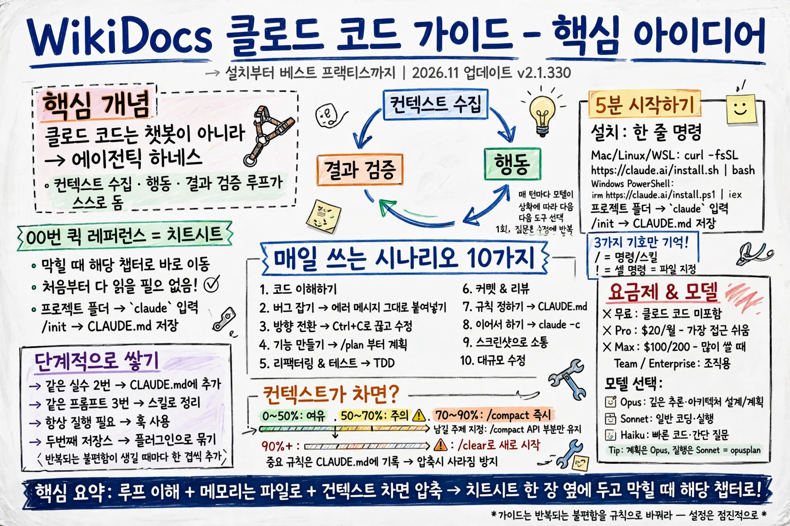
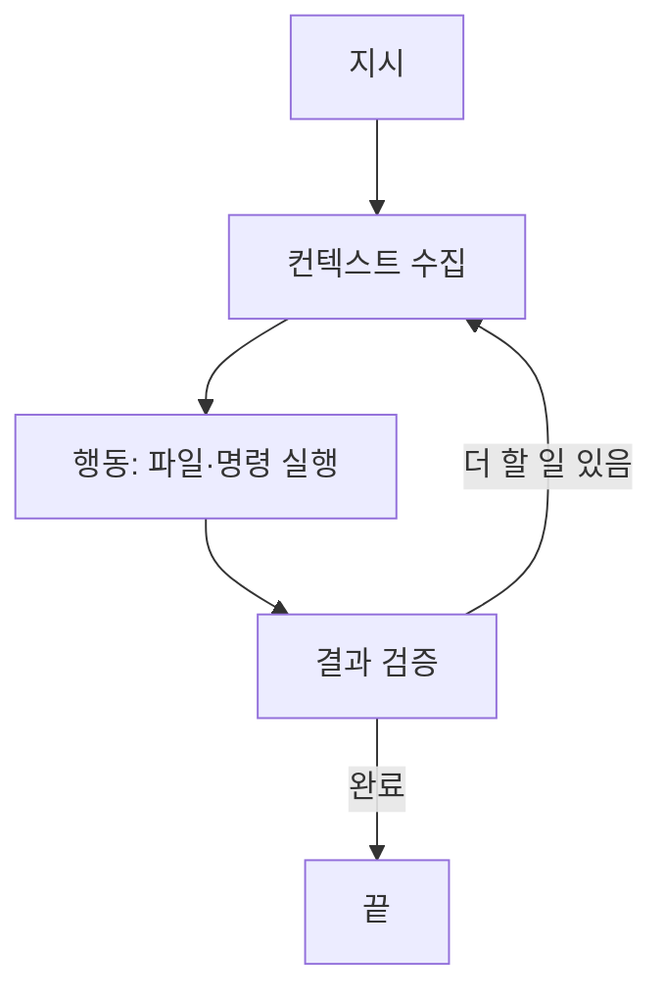
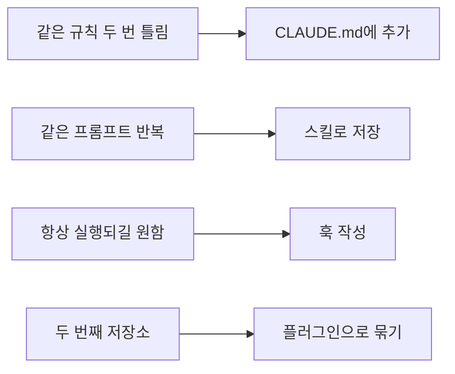

# 클로드 코드 가이드: 두꺼운 설명서가 아니라 필요할 때 펼치는 지도입니다

> **Summary**
> 클로드 코드는 코드베이스를 읽고 수정하며 테스트까지 수행하는 에이전틱 도구로, 컨텍스트 수집·행동·검증의 반복 루프를 이해하면 효과적으로 활용할 수 있습니다. 퀵 레퍼런스와 일상 시나리오를 참고하고, 반복되는 작업은 규칙·스킬·훅으로 정리하며, 컨텍스트 사용량에 따라 압축하거나 새 세션을 시작하세요.

---

- WikiDocs의 클로드 코드 가이드는 설치부터 베스트 프랙티스까지 한 권으로 정리한 한국어 레퍼런스입니다.
- 핵심은 클로드 코드를 챗봇이 아니라 에이전틱 하네스로 보는 것입니다. 컨텍스트 수집·행동·검증 루프가 스스로 돕니다.
- 00번 퀵 레퍼런스를 치트시트로 쓰고, 막힐 때 해당 챕터로 들어가면 됩니다. 처음부터 다 읽을 필요가 없습니다.

## 클로드 코드, 깔았는데 뭘 시켜야 할지 모르겠죠?

클로드 코드를 깔았습니다. 터미널에 `claude`를 쳤더니 커서가 깜빡입니다. 뭘 시켜야 할지 모르겠습니다. 명령어 목록을 외워야 할까요? 이런 적 있으시죠?

그래서 나온 게 이 가이드입니다. 설치부터 베스트 프랙티스까지, 한국어 한 권으로 정리했습니다. 두껍다고 겁낼 필요는 없습니다. 지도가 두꺼운 건, 필요할 때 펼치라고 있는 것이니까요!

🎥 [동영상 보기](https://www.youtube.com/watch?v=AJpK3YTTKZ4)

## 클로드 코드는 챗봇이 아니라 하네스입니다?

가이드가 가장 먼저 바로잡는 게 있습니다. 클로드 코드는 채팅창이 아닙니다. 터미널·IDE·데스크톱 앱·브라우저에서 돌아가는 에이전틱 코딩 도구입니다. 코드베이스를 읽고, 파일을 고치고, 명령어를 실행하고, 테스트까지 돌립니다. 제안만 하는 챗봇과 뭐가 다를까요? 스스로 일한다는 점입니다!

동작 원리는 에이전틱 루프입니다. 컨텍스트 수집, 행동, 결과 검증. 세 단계가 한 바퀴 돌고, 또 돕니다. 순서는 고정되지 않았습니다. 매 턴마다 모델이 상황을 보고 다음 도구를 고릅니다. 단순한 질문은 수집 한 번으로 끝나고, 버그 수정은 세 단계를 여러 번 반복합니다.

도구는 다섯 갈래입니다. 파일 작업, 검색, 실행, 웹, 코드 인텔리전스. 여기에 서브에이전트·MCP·스킬이 붙으면 확장됩니다. 모델이 중심이 아니라, 모델을 둘러싼 층이 일합니다. 가이드에서는 이 층을 에이전틱 하네스라고 부릅니다. 하네스가 도구를 주고, 모델이 보는 맥락을 관리합니다. 이 구분이 저는 가장 인상 깊었습니다. 모델만 바꾸는 게 아니라, 하네스를 어떻게 쓰느냐가 결과를 가른다는 뜻이니까요!

## 5분이면 시작합니다, 어떻게요?

설치는 한 줄입니다. 맥·리눅스·WSL에서는 `curl -fsSL https://claude.ai/install.sh | bash`, 윈도우 파워셸에서는 `irm https://claude.ai/install.ps1 | iex`를 칩니다. 프로젝트 폴더로 들어가 `claude`를 치면 시작합니다.

처음에는 파악부터 합니다. "프로젝트 구조 설명해줘"라고 묻습니다. 그다음 `/init`을 칩니다. 프로젝트 규칙을 `CLAUDE.md`로 저장하는 명령입니다. 이 파일 하나가 모든 세션에 적용됩니다.

기호는 세 개만 기억하면 됩니다. `/`는 명령이나 스킬, `!`는 셸 명령, `@`는 파일 지정입니다. "이 프로젝트 뭐야"처럼 짧게 말해도 알아듣지만, 명확할수록 결과가 좋습니다.

## 매일 쓰는 시나리오, 열 가지면 충분할까요?

가이드 00번 퀵 레퍼런스의 중심은 매일 쓰는 시나리오 열 가지입니다. 코드 이해하기, 버그 잡기, 방향 전환하기, 기능 만들기, 리팩터링과 테스트, 커밋과 리뷰, 규칙 정하기, 이어서 하기, 스크린샷으로 소통하기, 대규모 수정입니다.

버그를 잡을 때는 에러 메시지를 그대로 붙여넣는 게 가장 빠릅니다. "실패한 테스트 고쳐줘. 테스트 코드는 건드리지 마"처럼 경계를 함께 말합니다. 방향이 틀어졌으면 `Ctrl+C`로 끊고 바로잡습니다. 과잉 수정을 막는 한 줄이 있습니다. "요청한 부분만 수정해", "다른 파일 건드리지 마"입니다. 이 한 줄이 결과를 바꾼다고 가이드에서는 강조합니다!

큰 기능은 `/plan`부터 시작합니다. 계획을 확인하고 나서 구현합니다. 테스트를 먼저 짜고 통과할 때까지 구현하는 TDD도 같은 흐름입니다.

## 맥락이 차면 어떻게 할까요?

한 시간만 쓰면 반드시 만나는 문제가 있습니다. 컨텍스트입니다. 책상 위 작업 공간에 비유하면 됩니다. 공간이 제한되어 있어, 가득 차면 오래된 자료를 요약 정리해서 새 공간을 확보합니다.

사용률에 따라 행동이 정해져 있습니다. 0~50%는 여유, 50~70%는 주의, 70~90%는 `/compact` 즉시, 90% 이상은 `/clear`로 새로 시작합니다. 압축할 때는 `/compact API 연동 부분만 유지`처럼 남길 주제를 지정할 수 있습니다.

중요한 규칙은 `CLAUDE.md`에 적어둡니다. 압축 과정에서 초반 지시가 사라질 수 있기 때문입니다. 세션은 `~/.claude/projects/` 아래에 저장되니, `claude -c`로 어제 하던 대화를 이어갈 수 있습니다. 이름을 붙여두면 찾기도 쉽습니다.

## 단계적으로 쌓으면 됩니다, 뭘 먼저 할까요?

모든 기능을 처음부터 설정할 필요는 없습니다. 가이드에서는 트리거를 제시합니다. 같은 실수를 두 번 하면 `CLAUDE.md`에 추가합니다. 같은 프롬프트를 세 번째 붙여넣고 있으면 스킬로 정리합니다. 매번 묻지 않고 항상 실행되길 원하는 동작이 있으면 훅을 씁니다. 두 번째 저장소에서 같은 설정이 필요하면 플러그인으로 묶습니다.

이 방식이 저는 가장 실용적으로 느껴졌습니다. 설정을 한 번에 끝내는 게 아니라, 반복되는 불편함이 생길 때마다 한 겹씩 추가하는 것입니다. 반복되는 실수는 일회성 수정이 아니라, 규칙으로 바꿀 신호입니다.

## 요금제부터 확인하셨나요?

한 가지 먼저 확인할 게 있습니다. 무료 플랜에는 클로드 코드가 포함되지 않습니다. 개인이라면 Pro(월 20달러)가 가장 접근하기 쉬운 시작점입니다. 많이 쓰면 Max(월 100달러 또는 200달러), 팀이면 Team, 대규모 조직이면 Enterprise를 씁니다. API 크레딧 종량제도 있습니다.

모델은 작업 성격에 따라 바꿉니다. 깊은 추론과 아키텍처 설계는 Opus, 일반 코딩은 Sonnet, 빠른 코드 생성과 간단한 질문은 Haiku입니다. 계획은 Opus로 정밀하게, 실행은 Sonnet으로 효율적으로 하는 `opusplan` 별칭도 있습니다.

## 맺음말

가이드는 2026년 11월에도 계속 업데이트되고 있습니다. 00번 퀵 레퍼런스만 봐도 버전 2.1.330까지 반영됐습니다. 도구는 계속 바뀌지만, 쓰는 법의 뼈대는 그대로입니다. 루프를 이해하고, 메모리를 파일로 남기고, 맥락이 차면 압축합니다. 치트시트 한 장을 옆에 두고, 막힐 때 챕터로 들어가면 됩니다!

