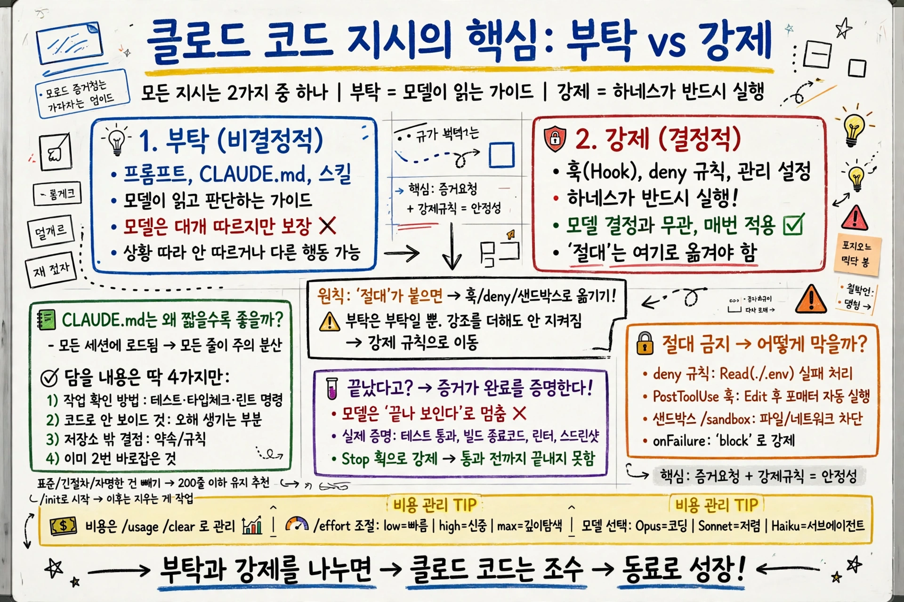
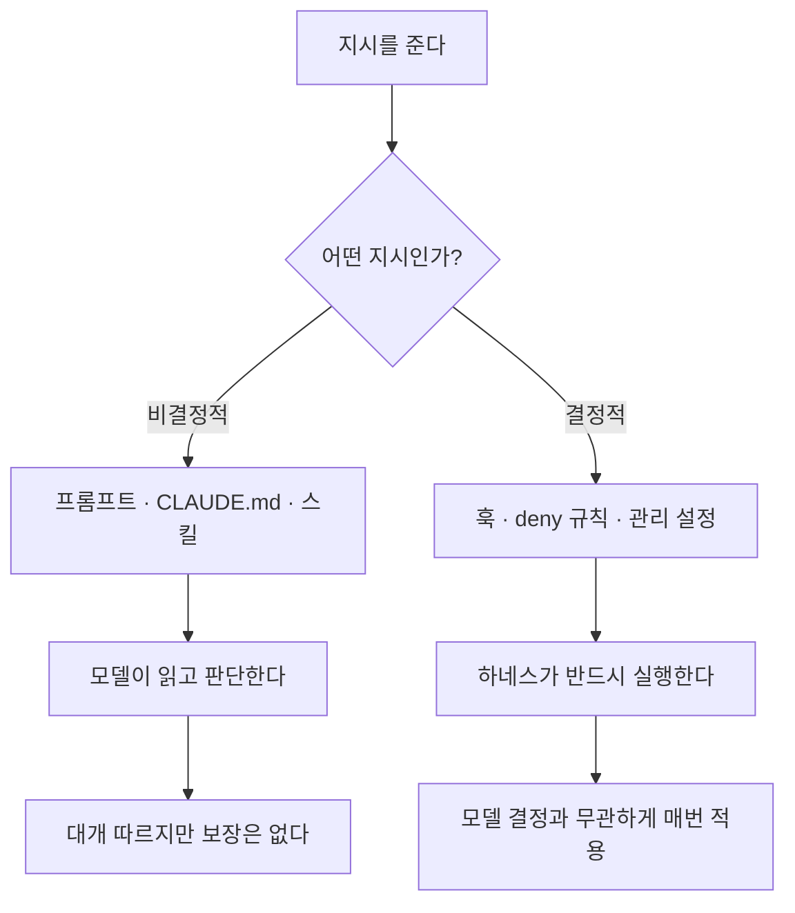
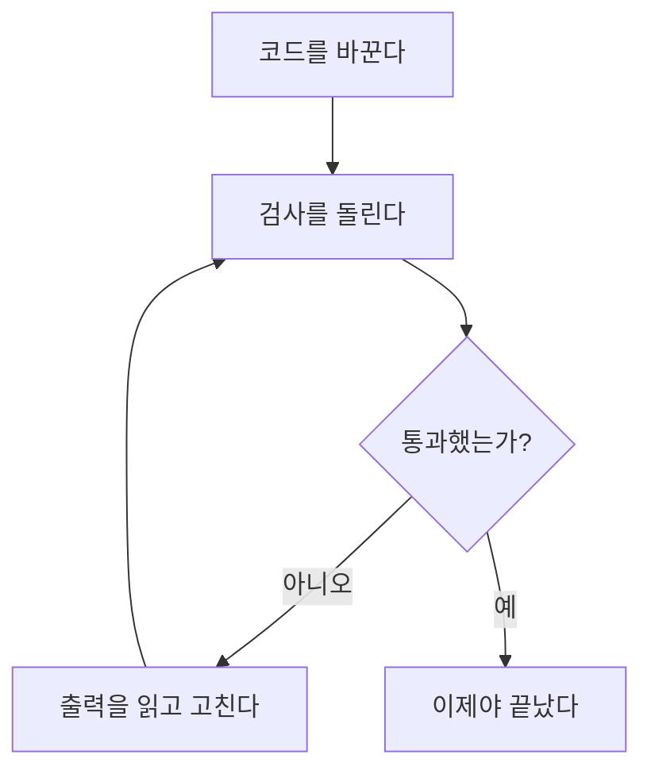

# 클로드 코드 가이드: 부탁은 가끔 놓치고, 훅은 절대 놓치지 않습니다

> **Summary**
> 클로드 코드의 지시는 모델이 판단하는 프롬프트·CLAUDE.md와 하네스가 강제하는 훅·deny 규칙으로 구분해야 합니다. 반드시 지켜야 할 규칙은 훅이나 deny 규칙, 샌드박스로 강제하고, CLAUDE.md는 코드만으로 알기 어려운 내용만 짧게 유지하세요. 완료 여부는 테스트와 검증 결과로 확인하고, /usage, /clear 등으로 비용과 세션을 관리하세요.

---

- 클로드 코드에 주는 지시는 두 종류입니다. 프롬프트와 `CLAUDE.md`는 모델이 읽고 판단하는 부탁이고, 훅과 deny 규칙은 하네스가 반드시 실행하는 강제입니다.
- "절대"가 붙은 규칙은 부탁으로 두지 말고 훅·deny 규칙·샌드박스로 옮기면 됩니다. 끝났다는 말 대신 테스트와 `Stop` 훅이 완료를 증명합니다.
- `CLAUDE.md`는 코드에서 안 보이는 것만 짧게 남기고, 비용은 `/usage`와 `/clear`로 관리하면 됩니다.


이런 적 있으시죠? `CLAUDE.md` 맨 위에 ".env는 절대 읽지 마"라고 써뒀는데, 세션을 보니 비밀 키 파일을 읽고 있더라고요. 그날 깨달았습니다. 부탁은 부탁일 뿐이었습니다!

🎥 [동영상 보기](https://www.youtube.com/watch?v=vlfCjWuv4es)

## 지시는 두 종류입니다, 부탁과 강제?

클로드 코드에 주는 모든 지시는 둘 중 하나입니다. **비결정적** 지시는 내가 쓰고 모델이 읽습니다. 프롬프트, `CLAUDE.md`, 스킬이 여기에 속합니다. 모델은 대개 따르지만 보장은 없습니다. 하지 않기로 하거나 다른 일을 할 수도 있습니다.

**결정적** 지시는 내가 구성하고 하네스가 반드시 실행합니다. 훅, deny 규칙, 관리 설정이 여기에 속합니다. 모델이 무엇을 결정했든 매번 적용됩니다.



대부분은 모델이 결정하게 두는 편이 낫습니다. 실제 코드를 보고 있는 모델이 미리 써 둔 규칙보다 대개 더 나은 판단을 하니까요. 결정적인 방식은 특정 일이 항상 일어나야 하거나 절대 일어나지 않아야 할 때 씁니다.

이 문장이 저는 가장 와닿았습니다. "`CLAUDE.md`의 한 줄에 강조를 계속 덧붙이는데도 Claude가 놓친다면, 그 줄은 훅으로 옮겨야 한다는 신호입니다." 굵은 글씨를 더 붙인다고 해결되는 게 아니었습니다!

## `CLAUDE.md`는 왜 짧을수록 좋을까요?

`CLAUDE.md`는 모든 세션에 로드됩니다. 파일의 모든 줄이 관련 여부와 상관없이 모든 작업에서 모델의 주의를 조금씩 차지합니다. 그래서 이 파일은 코드만으로 알아낼 수 없는 것만 담을 때 가장 잘 동작합니다.

담을 것은 딱 네 가지입니다. 작업 확인 방법(정확한 테스트·타입 체크·린트 명령), 코드가 오해를 부르는 곳, 저장소에 없는 결정, 이미 두 번 바로잡은 것입니다. 반대로 코드 읽으면 아는 것, 표준 규칙, 긴 절차, 자명한 것은 빼는 게 좋습니다.

`/init`으로 시작 버전을 만들고, 이후 작업은 대부분 줄을 지우는 것입니다. 200줄 이하 유지를 권장합니다. `/doctor prompt-audit`은 이전 모델용으로 쓰인 지시나 없는 파일을 가리키는 지시, 서로 모순되는 지시를 표시합니다. 개인 선호는 `CLAUDE.local.md`에 두고 `.gitignore`에 추가하면 됩니다.

코드베이스 일부에서만 중요한 규칙은 `.claude/rules/`에 `paths:` 필터와 함께 두면, 실제로 그 영역에서 작업할 때만 로드됩니다. 팀 절차는 `.claude/skills/<name>/SKILL.md`에 넣는 게 낫습니다. 릴리스처럼 부작용이 있는 워크플로우에는 `disable-model-invocation: true`를 추가하면, 내가 직접 입력할 때만 실행됩니다.

## 끝났다고 하면, 정말 끝난 걸까요?

모델은 작업이 끝나 보이면 멈춥니다. 실제로 끝났는지 알려주는 실행 수단이 없으면 "끝나 보인다"가 유일한 근거입니다. 그러면 사실상 내가 테스트 스위트가 되고, 모든 실수는 내가 우연히 발견할 때까지 남아 있습니다!

검사는 모델이 결과를 읽을 수 있다면 거의 무엇이든 됩니다. 테스트 파일, 빌드의 종료 코드, 린터, 출력을 픽스처와 비교하는 스크립트까지요. 저장소에 이미 있다면, `CLAUDE.md`에서 가장 유용한 한 줄은 그것을 실행하는 명령입니다.



검사 강도는 네 단계로 고를 수 있습니다. 프롬프트로 부탁하는 방법, `/goal`로 별도 모델이 매 턴 뒤 조건 충족 여부를 확인하는 방법, `Stop` 훅으로 타입 체크가 통과할 때까지 턴을 끝내지 못하게 하는 방법, 그리고 추론을 보지 않은 새 서브에이전트가 diff를 리뷰하는 `/code-review`입니다.

어떤 방식이든 증거를 요청하세요. 실행한 명령과 그 출력, 또는 스크린샷입니다. "테스트 모두 통과"라는 말만으로는 알 수 있는 게 거의 없습니다!

## 절대 일어나면 안 되는 일은 어떻게 막을까요?

`.env`는 절대 읽지 마, 편집 후에는 항상 포매터 실행, `migrations` 폴더는 건드리지 마. 모델은 거의 매번 따릅니다. "거의"로는 부족한 몇 가지만 `CLAUDE.md`에서 빼서 하네스가 직접 적용하는 설정으로 옮기세요. 그때부터 결과는 모델이 무엇을 기억하거나 결정하는지에 좌우되지 않습니다.

deny 규칙은 auto와 `bypassPermissions`를 포함한 모든 권한 모드에서 유지됩니다. `Read(./.env)`, `Read(./.env.local)`, `Read(./secrets/**)`처럼 적으면, `cat .env`로 읽으려 해도 실패합니다. 단, 파일을 여는 스크립트는 잡지 못합니다. 파일시스템이나 네트워크 접근을 OS 수준에서 제한하려면 `/sandbox`로 샌드박스를 켜면 됩니다.

훅도 같은 역할을 합니다. 포매터 규칙을 `PostToolUse` 훅으로 만들면 모든 `Edit`·`Write` 뒤에 실행됩니다. `migrations/` 아래 경로는 종료 코드 2로 끝나는 `PreToolUse` 훅이 됩니다. 단, `prompt`·`agent` 훅은 다른 모델에게 판단을 맡기므로 결정적이지 않습니다. 진짜 강제가 필요하면 `command`나 `http` 훅을 쓰고, 훅 자체가 멈췄을 때도 동작을 막아야 한다면 `onFailure: "block"`을 추가하세요.

Auto 모드 분류기도 있습니다. `curl | bash`, 프로덕션 배포, 다른 사람 작업 위의 force push 같은 동작을 실행 전에 검사해 막습니다. 하지만 분류기는 판단이라 틀릴 수 있습니다. "절대"인 규칙은 deny 규칙이나 훅에 두세요. 강제 규칙은 적게 유지하는 게 좋습니다.

## 비용은 어디서 새나요?

`/effort`로 생각의 깊이를 조절하면 됩니다. 놓치기 쉬운 경우가 정답을 좌우할 때는 `/effort high`, 빠르게 주고받으며 매 결과를 어차피 리뷰할 때는 `/effort low`, 나 없이 끝까지 파고들어야 하는 어려운 문제는 `max`입니다. 다음 메시지 하나만 필요할 때는 그 프롬프트에 `ultrathink`를 붙이면 됩니다. 모델은 기본값인 Opus 5.5가 대부분의 코딩을 잘 처리하고, 일상 작업에서는 Sonnet이 더 저렴합니다. 단순한 일을 하는 서브에이전트에는 Haiku가 잘 맞습니다.

서브에이전트 비용은 주로 토큰입니다. 모든 서브에이전트는 자체 요청을 보내고, 메인 대화와 같은 사용량에서 차감됩니다. 단순한 일이라면 서브에이전트 정의에 `model: haiku`를 설정하고, 짧은 요약만 돌려받도록 요청하세요.

## 세션 관리, 처음 1분이 전부입니다?

어떤 설정도 처음 1분을 지켜보다가 모델이 빗나갈 때 개입하는 것을 대체하지 못합니다.

```mermaid
flowchart TD
    A[처음 1분을 지켜본다] --> B{빗나갔는가?}
    B -->|아니오| C[계속 진행한다]
    B -->|예| D[Esc로 멈춘다]
    D --> E[두 번 바로잡았는가?]
    E -->|아니오| F[방향을 바꿔 다시 시도한다]
    E -->|예| G[/clear 후 새 프롬프트 하나로 다시 시작한다]
```

`Esc`는 동작 도중 모델을 멈추고 그 시점까지의 결과는 유지합니다. `/rewind`는 코드, 대화, 또는 둘 다를 이전 프롬프트 시점으로 되돌립니다. 컨텍스트에 남기지 않을 빠른 질문은 `/btw`를 쓰면 됩니다. 답변이 오버레이로 표시되고 대화 히스토리에 들어가지 않으니까요. 여러 날에 걸친 작업은 `/rename`으로 이름을 붙여 두고 `claude --resume`으로 다시 이어가면 됩니다.

부탁할 것과 강제할 것을 나누는 순간, 클로드 코드는 조수에서 동료가 됩니다. 말로만 부탁하던 규칙 중 "절대"가 붙은 것 하나를 골라 훅이나 deny 규칙으로 옮겨보세요!

