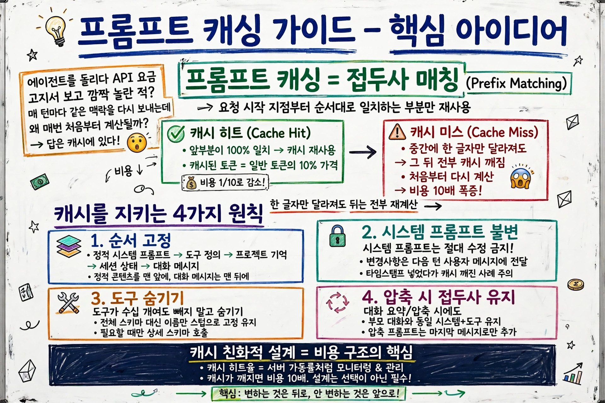
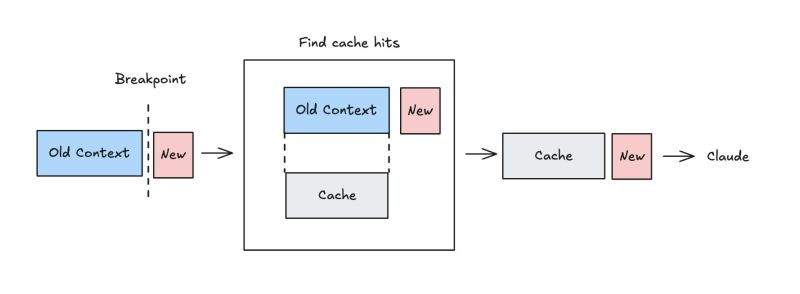
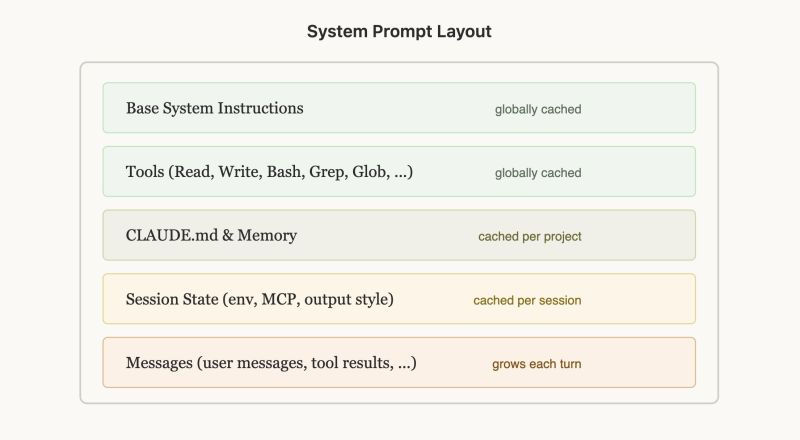
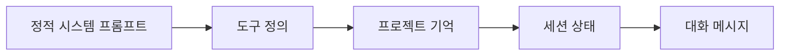
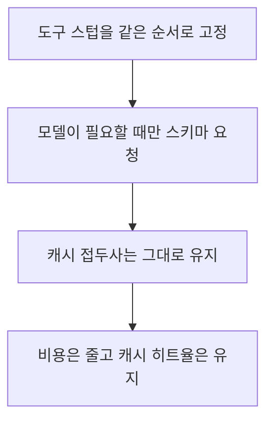
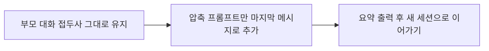

# 클로드 코드 비용 90% 줄이는 비결, 캐시를 깨뜨리지 않는 설계에 있습니다

> **Summary**
> 프롬프트 캐싱은 앞부분부터 정확히 일치하는 내용만 재사용하므로, 정적 프롬프트와 도구 순서를 고정하고 변경 사항은 뒤쪽 메시지로 전달해야 합니다. 도구는 제거하지 말고 가벼운 스텁으로 숨기며, 대화를 압축할 때도 기존 접두사를 유지하면 캐시 적중률을 높이고 비용을 줄일 수 있습니다.

---

- 프롬프트 캐싱은 앞부분이 그대로 일치할 때만 재사용됩니다. 중간에 한 글자만 달라져도 그 뒤는 전부 다시 계산합니다.
- 캐시된 토큰은 일반 입력 토큰의 10% 가격입니다. 캐시를 지키는 설계가 곧 비용 구조를 결정합니다.
- 순서 고정, 시스템 프롬프트 불변, 도구 숨기기, 압축 시 접두사 유지. 네 가지 원칙만 지키면 됩니다.

에이전트를 돌리다 API 요금 고지서를 보고 깜짝 놀란 적 있으시죠? 매 턴마다 같은 맥락을 다시 보내는데, 왜 매번 처음부터 계산하는 걸까요? 답은 캐시에 있습니다. 캐시가 살아 있으면 같은 맥락을 10분의 1 가격에 재사용합니다. 캐시가 깨지면 처음부터 다시 계산합니다!

🎥 [동영상 보기](https://www.youtube.com/watch?v=ys6YQ2yfBpM)

## 캐시는 앞에서부터 일치하는 부분만 재사용합니다?

프롬프트 캐싱은 접두사 매칭입니다. 요청 시작 지점부터 순서대로 일치하는 부분만 재사용합니다. 중간에 한 글자만 달라져도 그 뒤는 전부 캐시가 깨집니다. 그래서 프롬프트를 쌓는 순서가 전부입니다!

정적 콘텐츠를 맨 앞에, 대화 메시지를 맨 뒤에 두는 구조가 정답입니다. 시스템 프롬프트에 타임스탬프를 넣었다가 캐시가 깨진 사례도 보고됐습니다. 도구 정의 순서를 비결정적으로 섞어도 캐시 미스가 납니다. 변하는 것은 뒤로, 안 변하는 것은 앞으로. 이게 첫 번째 원칙입니다.

## 시스템 프롬프트, 고치지 말고 메시지로 넘기세요?

시간이 바뀌거나 파일이 수정됐다고 시스템 프롬프트를 직접 고치면 캐시가 통째로 날아갑니다. 대신 다음 턴의 사용자 메시지에 `system-reminder` 태그로 변경 사항을 전달합니다. 시스템 프롬프트는 그대로 두고, 바뀐 것만 메시지로 알리는 방식입니다.

계획 모드도 같은 원리입니다. 도구를 교체하는 대신 `EnterPlanMode`라는 도구 호출로 구현합니다. 모델이 어려운 문제를 감지하면 스스로 계획 모드에 들어갈 수도 있습니다. 도구 정의는 한 번 넣으면 세션 끝까지 절대 빼지 않습니다. 모델 전환도 캐시를 깨뜨리므로, 다른 모델이 필요하면 서브에이전트 방식으로 처리합니다. 바꾸는 게 아니라, 덧붙이는 겁니다!

## 도구가 수십 개면 빼지 말고 숨기면 됩니다?

연결된 도구가 수십 개면 전부 포함시키기엔 비용이 부담됩니다. 그렇다고 중간에 빼면 캐시가 깨집니다. 답은 숨기기입니다. 도구 전체 스키마 대신 이름만 담은 가벼운 스텁을 항상 같은 순서로 넣어둡니다. 스텁에는 도구 이름과 `defer_loading` 표시만 들어 있습니다.

모델이 필요할 때 `ToolSearch` 도구로 해당 스키마를 그때그때 불러오는 구조입니다. 캐시 접두사는 항상 동일하게 유지됩니다. 이 패턴은 API에서도 도구 검색 기능으로 직접 쓸 수 있습니다. 빼는 게 아니라, 필요할 때 꺼내 쓰는 겁니다!

## 압축할 때도 캐시가 깨질 수 있습니다?

맥락이 가득 차면 대화를 요약해서 새 세션으로 이어가야 합니다. 여기서 함정이 있습니다. 요약용 API 호출을 다른 시스템 프롬프트로 보내면 기존 캐시와 전혀 매칭되지 않습니다. 10만 토큰짜리 대화 전체를 캐시 없이 다시 처리하게 됩니다.

부모 대화와 동일한 시스템 프롬프트, 동일한 도구 정의를 유지한 채 압축 프롬프트만 마지막 사용자 메시지로 추가합니다. 부모 대화의 접두사를 그대로 재사용해 캐시 히트를 확보하는 방식입니다. 압축 메시지와 요약 출력을 위한 여유 버퍼도 미리 확보합니다. 이 패턴은 현재 API에 압축 기능으로 내장됐고, 자동 캐싱을 쓰면 `cache_control`을 요청 본문에 한 번만 설정하면 됩니다.

## 캐시 히트율, 가동률처럼 봐야 하지 않을까요?

캐시를 지키는 설계가 곧 에이전트 비용 구조를 결정합니다. 캐시 히트율을 서버 가동률처럼 모니터링하고, 수치가 떨어지면 장애로 선언한다는 팀도 있습니다. 캐시가 깨지는 순간 비용이 10배로 뛰는 경우도 있습니다. 에이전트를 만든다면 캐시 친화적 설계는 선택이 아닙니다. 지속 가능한 아키텍처의 출발점입니다!

