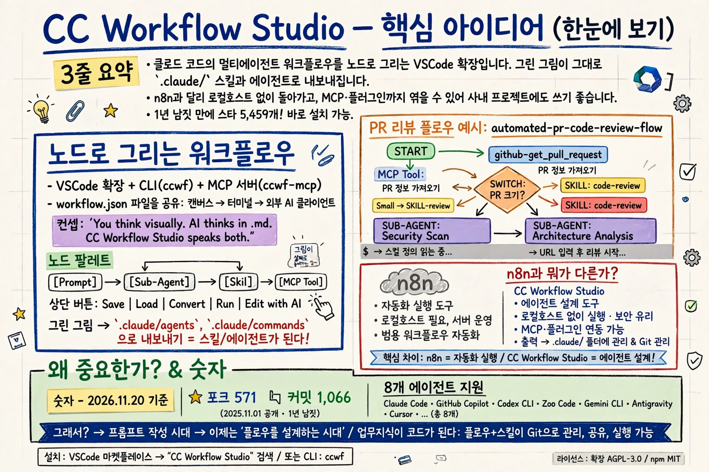
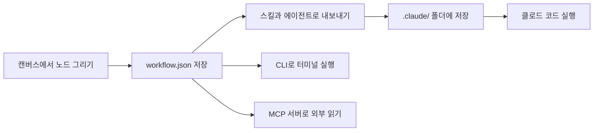
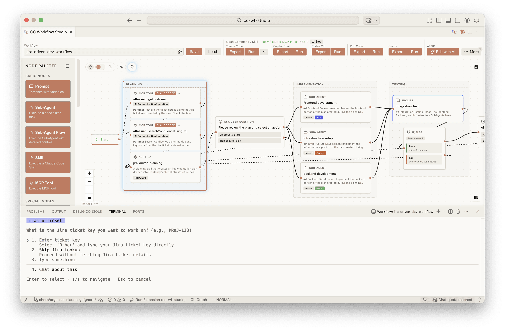
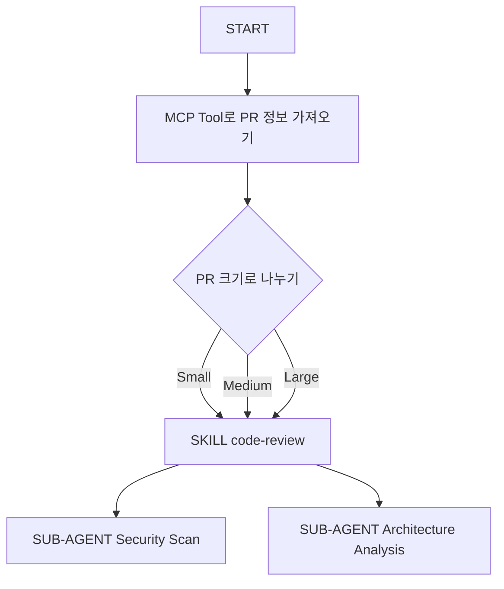
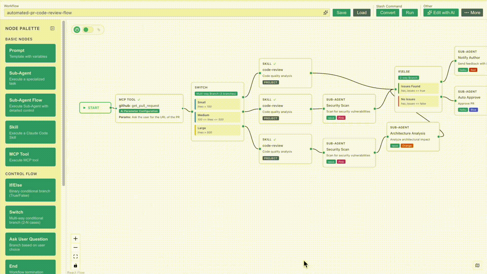

# CC Workflow Studio: 클로드 코드 워크플로우, 노드로 그린 그림이 그대로 스킬이 된다

> **Summary**
> CC Workflow Studio는 VSCode에서 멀티에이전트 워크플로우를 시각적으로 설계하고, 이를 Claude Code의 스킬과 에이전트 파일로 내보내 실행하는 도구입니다. n8n처럼 일반 자동화를 실행하기보다 에이전트의 작업 흐름을 설계하는 데 초점을 두며, CLI와 MCP를 지원해 다양한 도구와 프로젝트에 연동할 수 있습니다. 워크플로우를 코드처럼 버전 관리하고 팀과 공유해 업무 지식과 절차를 실행 가능한 자산으로 만들 수 있습니다.

---

**3줄 요약**

- 클로드 코드의 멀티에이전트 워크플로우를 노드로 그리는 VSCode 확장입니다. 그린 그림이 그대로 `.claude/` 스킬과 에이전트로 나갑니다.
- n8n과 달리 로컬 호스트 없이 돌아가고, MCP·플러그인까지 엮을 수 있어 사내 프로젝트에도 쓰기 좋습니다.
- 저장소는 1년 남짓 만에 스타 5,459개를 모았고, VSCode 마켓플레이스에서 검색해 바로 설치할 수 있습니다.

"처음 보는 사람들은 n8n과 뭐가 다른지 전혀 모르겠네라고 생각할 것 같다." 워크플로우 도구는 이미 많은데, 이건 뭐가 다를까요? 2025년 12월 31일에 올라온 글을 끝까지 읽고 나니, 질문이 달라졌습니다. 이건 자동화 도구가 아니라, 클로드 코드가 일하는 방식을 그림으로 그리는 도구였습니다. CC Workflow Studio, n8n이랑 뭐가 다를까요? 한번 뜯어보겠습니다!

## 노드로 그리는 워크플로우

CC Workflow Studio는 VSCode 확장입니다. 그런데 확장이 전부가 아닙니다. 같은 `workflow.json` 파일을 CLI(`ccwf`)와 MCP 서버(`ccwf-mcp`)가 함께 다룹니다. 캔버스에서 그린 워크플로우를 터미널에서 실행하고, 외부 AI 클라이언트가 MCP로 읽고 고칠 수도 있습니다.

공식 문구는 이렇습니다. "You think visually. AI thinks in `.md`. CC Workflow Studio speaks both." 사람이 그림으로, AI가 마크다운으로 생각한다면 이 도구는 둘 사이의 통역사입니다. 캔버스에 그린 노드는 클로드 코드가 이해하는 `.claude/agents`, `.claude/commands` 형태의 스킬과 에이전트로 내보내집니다. 그린 그림이 그대로 스킬이 됩니다!

노드 팔레트엔 Prompt, Sub-Agent, Sub-Agent Flow, Skill, MCP Tool이 있고, 상단엔 Save, Load, Convert, Run, Edit with AI 버튼이 있습니다. 드래그 앤 드롭으로 놓고 선을 잇는 방식입니다.

## 예시로 보는 PR 리뷰 플로우

공유된 스크린샷 속 워크플로우 이름은 `automated-pr-code-review-flow`입니다.

START에서 시작해 MCP Tool `github-get_pull_request`로 PR 정보를 가져옵니다. 그다음 SWITCH 노드가 PR 크기를 Small, Medium, Large로 나눕니다. 각 갈래마다 SKILL `code-review`가 붙고, 마지막엔 SUB-AGENT `Security Scan`과 `Architecture Analysis`가 달립니다.

하단 터미널엔 실행 장면이 그대로 보입니다. `/automated-pr-code-review-flow`를 치면 스킬 정의를 읽고 "PR URL을 알려주세요"라고 묻습니다. URL을 답하면 리뷰가 시작됩니다.

이 장면이 저는 가장 인상 깊었습니다. 워크플로우가 단순한 그림이 아니라 실제로 돌아가는 절차라는 게, 터미널 로그 한 장면으로 증명되니까요!

## n8n과 뭐가 다른가?

이 질문은 댓글에서도 나왔습니다. 한 댓글은 이렇게 정리했습니다. 로컬 호스트 없이 사내 프로젝트를 운용할 수 있고, MCP와 Plugins를 쓸 수 있어 더 확장된 작업 흐름이 된다는 것입니다. "보안 측면에서 꽤 좋은 도구"라는 반응도 있었습니다.

근본적인 차이는 목적에 있습니다. n8n이 자동화를 실행하는 도구라면, CC Workflow Studio는 에이전트를 설계하는 도구입니다. 워크플로우 자체가 스킬과 에이전트 정의로 나가고, 그 정의가 `.claude/` 폴더에 파일로 남습니다. 버전 관리가 되고, 팀원과 공유되고, 나중엔 조직의 자산이 됩니다!

지원하는 에이전트도 넓습니다. Claude Code, GitHub Copilot, Codex CLI, Zoo Code, Gemini CLI, Antigravity, Cursor까지 8개입니다.

## 숫자 — 1년 남짓 만에 스타 5,459개

저장소는 2025년 11월 1일에 만들어졌고, 2026년 11월 20일 기준 스타 **5,459개**, 포크 **571개**, 커밋 **1,066개**입니다. 1년 남짓 만에 모은 숫자입니다! "에이전트 워크플로우를 그림으로 그리고 싶다"는 수요가 그만큼 컸다는 뜻입니다.

설치는 간단합니다. VSCode 마켓플레이스에서 CC Workflow Studio를 검색해 설치하면 되고, 터미널만 쓰는 분이라면 CLI로도 쓸 수 있습니다.

라이선스는 확장이 AGPL-3.0, npm 라이브러리는 MIT입니다.

## 그래서, 이게 왜 중요할까요?

프롬프트를 잘 쓰는 사람의 시대에서, 플로우를 설계하는 사람의 시대로 넘어가는 지점입니다. 한 줄 프롬프트의 솜씨가 아니라 Sub-Agent, Skill, MCP, 조건 분기를 어떻게 조합하느냐가 경쟁력입니다.

더 크게 보면, 업무 지식 자체가 코드가 되는 흐름입니다. "이 일은 어떻게 처리해야 하는가"를 담은 플로우와 스킬이 Git으로 관리되고 공유됩니다. 매뉴얼이 실행 가능한 파일이 되는 것입니다.

PR 리뷰처럼 반복되는 일 하나를 골라 플로우를 그려보고 `.claude/commands`로 내보내 실행해보세요. 그림이 실제로 돌아가는지 확인하는 게 가장 빠른 평가입니다!

