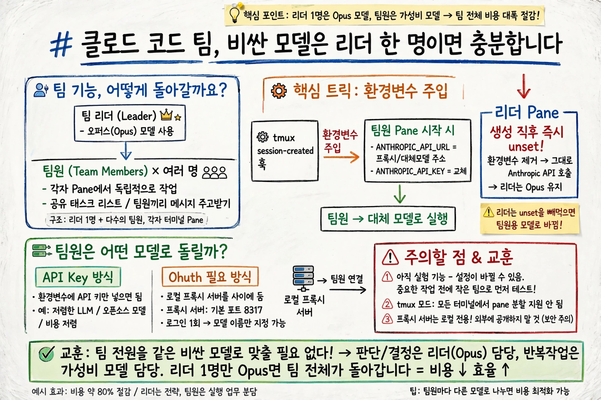
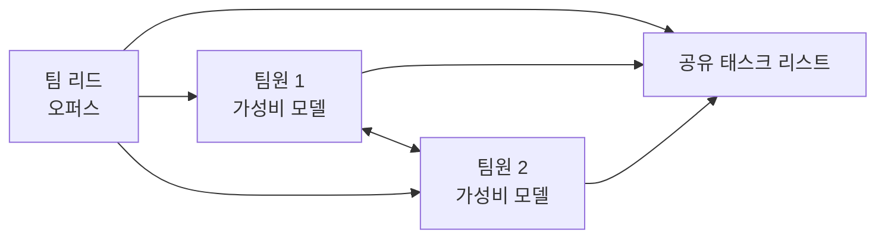
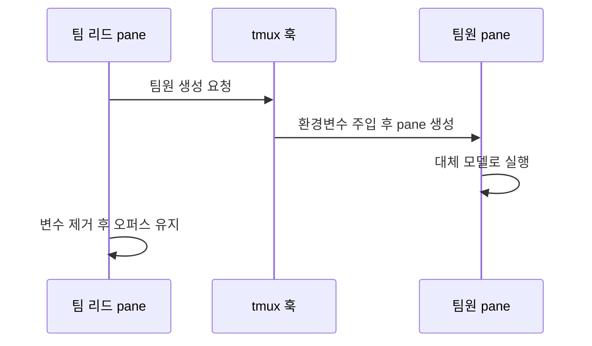
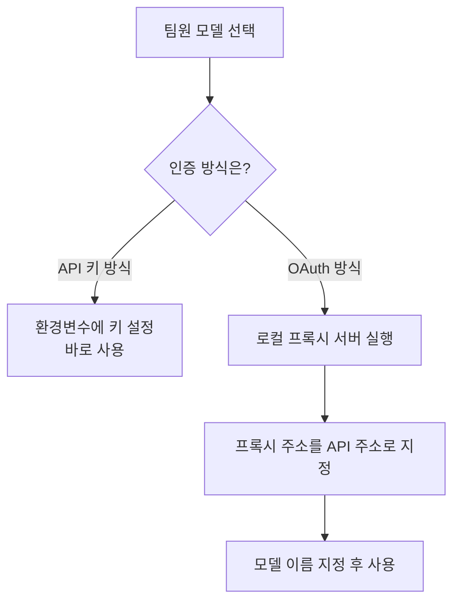

# 클로드 코드 팀, 비싼 모델은 리더 한 명이면 충분합니다

> **Summary**
> 클로드 코드 팀 기능은 리더 한 명과 여러 팀원이 각자 pane에서 일하는 구조다. tmux session-created 훅에 환경변수를 주입하면 팀원만 대체 모델로 실행할 수 있고, 리더는 오퍼스를 그대로 쓴다. API 키 방식 모델은 키만 넣으면 되고, OAuth 방식 모델은 로컬 프록시 서버를 사이에 둔다.

---

# 클로드 코드 팀, 비싼 모델은 리더 한 명이면 충분합니다

- 클로드 코드 팀 기능은 리더 한 명과 여러 팀원이 각자 pane에서 일하는 구조입니다.
- tmux의 session-created 훅에 환경변수를 주입하면, 팀원만 다른 모델로 실행할 수 있습니다.
- 리더는 오퍼스로 두고 팀원은 가성비 모델로 돌리면, 팀 전체 비용을 크게 아낄 수 있습니다.

🎥 [동영상 보기](https://www.youtube.com/watch?v=S-sYlFiGFv8)

터미널에 클로드 코드 세션을 여러 개 띄워 놓고, 각각 다른 일을 시켜 본 적 있으시죠? 그런데 팀원 전원이 가장 비싼 모델로 돌아가면 요금이 눈에 띄게 불어납니다! 리더만 비싼 모델로 두고, 팀원은 역할에 맞는 모델로 나누면 어떨까요?

## 팀 기능, 어떻게 돌아갈까요?

클로드 코드의 팀 기능은 여러 클로드 코드 인스턴스가 하나의 팀으로 일하는 방식입니다. 팀 리드가 팀을 만들고 팀원을 생성하면, 팀원마다 자기만의 컨텍스트를 갖고 독립적으로 일합니다. 공유 태스크 리스트를 모두가 보고, 팀원끼리 직접 메시지도 주고받습니다.

이 기능은 아직 실험 단계라 기본값이 꺼져 있습니다. 환경변수를 켜거나 설정 파일에서 팀원 모드를 지정해야 쓸 수 있습니다. tmux 모드로 바꾸면 팀원마다 터미널 pane이 하나씩 생겨서, 누가 뭘 하고 있는지 눈으로 바로 확인할 수 있습니다.

## 핵심 트릭은 환경변수 주입입니다

팀원을 만드는 명령은 tmux로 새 pane을 띄우는 구조입니다. 이 점을 이용하면, 팀원마다 다른 모델을 끼워 넣을 수 있습니다! tmux의 session-created 훅에 스크립트를 등록해 두는 겁니다. 훅이 실행되면 대체 모델의 환경변수(`ANTHROPIC_BASE_URL`, `ANTHROPIC_AUTH_TOKEN` 등)를 세션에 주입합니다.

팀원이 새로 생기면 세션 레벨 환경변수를 그대로 상속받습니다. 그래서 팀원은 주입된 주소로 연결돼 대체 모델로 실행됩니다. 리더 pane은 실행 직후 `unset`으로 해당 변수를 지웁니다. 리더는 원래대로 Anthropic API를 직접 호출하니까 오퍼스를 그대로 씁니다.

순서가 전부입니다. 리더가 변수를 지우는 걸 빼먹으면 리더까지 대체 모델로 바뀌어 버립니다. 생성 직후 바로 지우는 한 줄이 이 구조의 핵심입니다!

## 팀원은 어떤 모델로 돌릴까요?

모델마다 연결 방법이 다릅니다. API 키만 있으면 되는 모델은 환경변수에 키만 넣어주면 바로 쓸 수 있습니다. 그런데 OAuth 로그인이 필요한 모델은 이야기가 달라집니다. 키를 직접 만들 수 없으니까요!

이럴 땐 로컬 프록시 서버를 사이에 둡니다. 프록시 서버가 OAuth 로그인을 대신 처리하고, 클로드 코드 쪽에는 프록시 주소를 API 주소로 알려주는 방식입니다. 프록시 서버는 기본적으로 8317번 포트에서 돌고, 로그인 명령 한 번이면 인증이 끝납니다. 그 뒤에는 평소처럼 모델 이름만 지정하면 됩니다.

## 주의할 점은 뭘까요?

첫째, 아직 실험 기능입니다. 설정이 바뀌거나 동작이 달라질 수 있으니, 중요한 작업 전에 먼저 작은 팀으로 시험해 보는 게 안전합니다. 둘째, tmux 모드는 모든 터미널에서 되는 게 아닙니다. 일부 통합 터미널에서는 pane 분할이 안 될 수 있습니다. 셋째, 프록시 서버는 내 컴퓨터에서 도는 로컬 서버입니다. 외부에 공개하지 않고, 로컬에서만 쓰는 게 원칙입니다.

이 구조가 주는 교훈은 단순합니다. 팀을 짤 때 전원을 같은 모델로 맞출 필요가 없습니다. 판단이 필요한 자리는 비싼 모델이 맡고, 반복 작업은 가성비 모델이 맡으면 됩니다. 리더 한 명만 오퍼스면, 팀 전체가 돌아갑니다!

