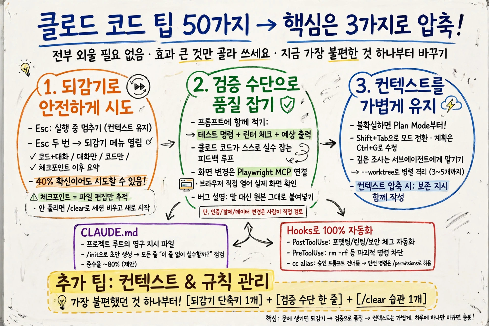
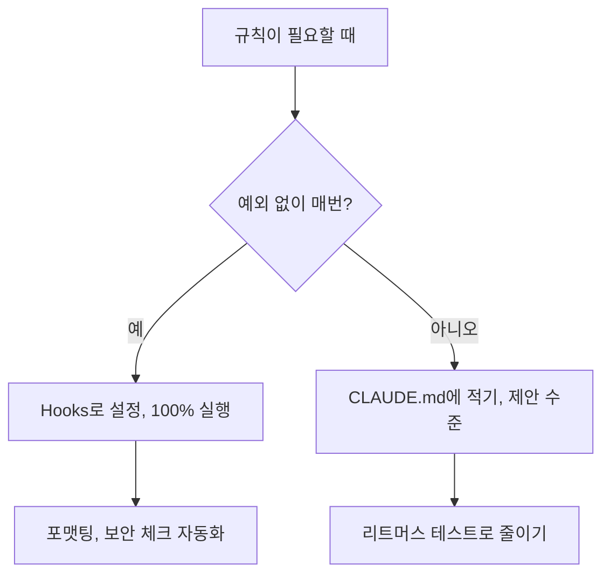

# 클로드 코드 팁 50가지, 전부 외울 필요 없습니다. 가장 불편한 것 하나부터 바꾸면 됩니다

> **Summary**
> 클로드 코드 팁 50가지를 다 외울 필요는 없습니다. 되감기로 안전하게 시도하고, 검증 수단으로 품질을 잡고, 컨텍스트를 가볍게 유지하는 세 가지가 핵심입니다. 50개 전부 말고 지금 가장 불편한 것 하나부터 바꾸는 게 목록을 쓰는 방법입니다.

---

- 클로드 코드 팁 50가지를 다 외울 필요는 없습니다. 효과가 큰 건 몇 가지로 압축됩니다.
- 핵심은 세 가지입니다. 되감기로 안전하게 시도하고, 검증 수단으로 품질을 잡고, 컨텍스트를 가볍게 유지하는 것입니다.
- 50개 전부 말고, 지금 가장 불편한 것 하나부터 바꾸면 됩니다.


클로드 코드를 매일 쓰는데, 어딘가 답답한 적 있으시죠? 같은 설명을 반복하고, 승인 버튼을 수백 번 누르고, 긴 세션 끝에 엉뚱한 방향으로 간 걸 뒤늦게 알아차리고요. 1년간 매일 쓰면서 모은 50가지 팁 모음이 있습니다. 전부 외울 필요는 없습니다. 효과가 큰 것만 골라 쓰면 됩니다!

🎥 [동영상 보기](https://www.youtube.com/watch?v=HVtSwhguZ7I)

### 되감기가 되면, 40% 확신으로도 시도할 수 있지 않을까요?

`Esc` 키는 클로드 코드를 중간에 멈추되 컨텍스트를 잃지 않습니다. 방향을 바로 틀 수 있습니다. `Esc`를 두 번 누르면 되감기 메뉴가 열립니다. 코드와 대화, 대화만, 코드만, 체크포인트 이후 요약 — 네 가지 중 골라 복원하면 됩니다.

이게 왜 중요할까요? 되감기가 있으면 40% 확신인 접근법도 시도해볼 수 있습니다. 실패하면 되감기로 되돌리면 되니까요. 단, 체크포인트는 파일 편집만 추적합니다. 명령으로 바꾼 데이터베이스 같은 건 되돌리지 못합니다.

같은 문제에 두 번 고쳐도 안 풀리면, 세션을 비우고 새로 시작하는 게 낫습니다. 실패한 접근법으로 가득 찬 컨텍스트가 다음 시도를 방해하니까요. 관련 없는 작업으로 넘어갈 때도 `/clear`부터 누르는 게 좋습니다. 깨끗한 세션의 날카로운 프롬프트가 지저분한 3시간 세션보다 낫습니다!

이 장면이 저는 가장 인상 깊었습니다. 되감기가 있다는 걸 알면, 시도 자체가 가벼워집니다.

```mermaid
flowchart TD
    A[계획 세우기] --> B[실행하기]
    B --> C{검증 통과?}
    C -->|통과| D[다음 단계로]
    C -->|실패| E[Esc 두 번으로 되감기]
    E --> B
    C -->|두 번 실패| F[/clear 후 새로 시작]
    F --> A
```

### 품질은 어떻게 2~3배가 될까요?

프롬프트에 테스트 명령과 린터 체크, 예상 출력을 함께 적어주면 됩니다. 클로드 코드가 스스로 실수를 잡는 피드백 루프가 생깁니다. 이 하나만으로 품질이 2~3배 좋아진다는 게, 팁 모음의 결론입니다!

화면 변경은 유닛 테스트만으로 부족합니다. Playwright MCP 서버를 연결하면 클로드 코드가 브라우저를 직접 열고, 페이지를 눌러보며, 화면이 예상대로 나오는지 확인합니다.

버그를 설명할 때는 말로 풀지 말고 원본을 그대로 붙여넣는 게 좋습니다. 에러 로그, CI 출력, 스레드 그대로요. 사람의 해석은 디테일을 잃는 추상화를 더할 뿐입니다. 터미널 출력은 파이프로 바로 넘길 수도 있습니다.

```bash
cat error.log | claude "explain this error and suggest a fix"
```

단, 인증 흐름과 결제 로직, 데이터를 바꾸는 작업은 예외입니다. 아무리 좋아 보여도 사람이 직접 검토해야 합니다. 잘못된 인증 범위나 결제 웹훅 하나가 사용자와 비용, 신뢰를 한 번에 잃게 만듭니다.

### 계획에 몇 분 쓰면, 20분을 아낄 수 있을까요?

접근 방법이 불확실하면 Plan Mode부터 켜는 게 좋습니다. 다중 파일 변경이나 낯선 코드, 아키텍처 결정에 특히 잘 맞습니다. 몇 분 투자로, 클로드 코드가 20분간 잘못된 문제를 푸는 일을 막을 수 있습니다. `Shift+Tab`으로 일반 모드와 자동 승인, 계획 모드를 오갈 수 있습니다.

계획이 나오면 `Ctrl+G`로 에디터에서 직접 고칠 수도 있습니다. 코드를 한 줄도 쓰기 전에 제약 조건을 더하고, 단계를 빼는 식으로요.

스펙이 불완전하면 인터뷰부터 시키는 것도 방법입니다. 만들고 싶은 걸 간략히 설명하고, 기술 구현과 엣지 케이스, 트레이드오프를 물어보게 한 뒤 `SPEC.md`에 완전한 스펙을 적게 합니다. 스펙이 완성되면 새 세션에서 깨끗한 컨텍스트로 구현을 시작합니다.


### 컨텍스트가 무거워지면 어떻게 하나요?

깊은 조사는 컨텍스트 윈도우의 절반을 먹을 수 있습니다. 그럴 땐 서브에이전트에게 맡기면 됩니다. 별도 인스턴스가 독립된 컨텍스트에서 파일을 읽고, 간결한 요약만 메인 세션에 보고합니다. 빠른 파일 검색용 Explore와 읽기 전용 분석용 Plan이 내장 타입입니다.

병렬 작업은 `--worktree`로 격리합니다. 격리된 작업 복사본과 새 브랜치를 만들고, 3~5개까지 띄워 각각 독립 세션을 돌릴 수 있습니다. 같은 파일을 건드리면 덮어쓰기가 생기니, 리서치와 리뷰부터 병렬로 시작하는 게 좋습니다.

컨텍스트가 압축될 때는 보존 지시를 함께 적습니다. `/compact focus on the API changes and the list of modified files`처럼요. `CLAUDE.md`에 "컴팩션 시 수정 파일 전체 목록과 현재 테스트 상태를 보존하라"고 적어두면 매번 챙기지 않아도 됩니다.

### 규칙은 어디에 적어야 할까요?

`CLAUDE.md`는 프로젝트 루트의 영구 지시 파일입니다. `/init`으로 초안을 만들 수 있는데, 출력이 비대해지기 쉬우니 존재 이유를 설명할 수 없는 줄은 지우는 게 좋습니다. 모든 줄에 "이 줄 없이 실수할까?"라고 물어보는 겁니다. 이미 올바르게 하는 지시는 노이즈일 뿐입니다.

단, `CLAUDE.md`는 제안입니다. 준수율이 80% 정도라고 합니다. 예외 없이 매번 지켜야 하는 건 Hooks로 거는 게 맞습니다. Hooks는 100% 실행되니까요! 포맷팅이나 린팅, 보안 체크처럼 반드시 실행돼야 하는 건 PostToolUse Hook으로 자동화하고, `rm -rf` 같은 파괴적 명령은 PreToolUse Hook으로 아예 차단합니다.

권한 설정도 마찬가지입니다. `cc` alias는 모든 승인 프롬프트를 건너뜁니다. 이름 그대로 위협적인 플래그입니다. 코드베이스에 무엇을 할 수 있는지 완전히 이해한 뒤에만 쓰는 게 좋습니다. 안전한 명령은 `/permissions`로 허용목록에 등록하는 편이 낫습니다. 목록에 없는 명령에는 여전히 프롬프트가 뜹니다.



### 50개 중 오늘 하나만 고른다면?

50개를 한 번에 적용할 필요는 없습니다. 가장 불편했던 것 하나만 골라보세요. 되감기 단축키 하나, 검증 수단 한 줄, `/clear` 습관 하나면 됩니다. 하나가 자리를 잡으면 다음이 보입니다. 클로드 코드와 일하는 방식은, 그렇게 조금씩 바뀌는 겁니다!

