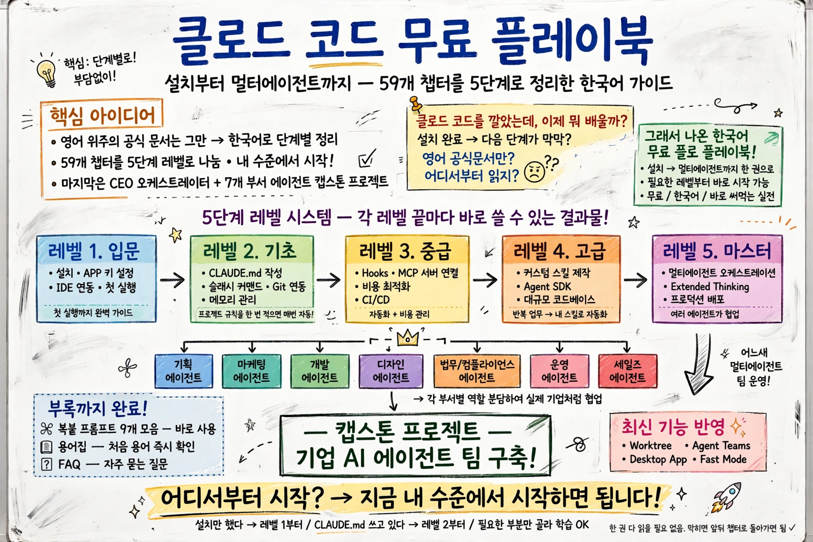
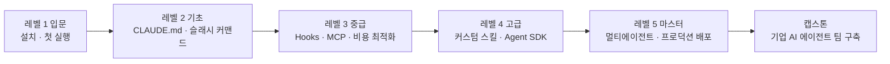
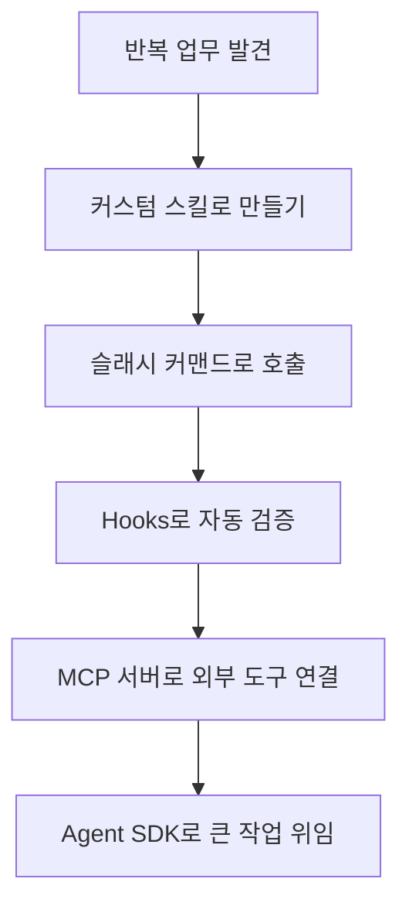
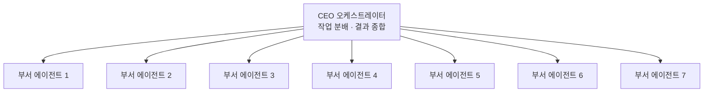

# 클로드 코드 플레이북: 59챕터 무료 한국어 가이드, 설치부터 멀티에이전트까지 레벨대로 밟으면 됩니다

> **Summary**
> 클로드 코드 플레이북은 영어 위주의 공식 문서를 대신해 설치부터 멀티에이전트까지 59개 챕터를 한국어로 단계별로 정리한 무료 가이드입니다. 5단계 레벨 시스템이라 지금 내 수준에서 시작할 수 있고, 각 레벨이 끝날 때마다 바로 쓸 수 있는 결과가 남습니다. 마지막 캡스톤에서는 CEO 오케스트레이터와 7개 부서 에이전트로 기업 AI 팀을 직접 지어보며, 부록의 복붙 프롬프트 9개와 용어집, FAQ까지 챙길 수 있습니다.

---

- 클로드 코드 공식 문서는 영어 위주라, 설치부터 멀티에이전트까지 한국어로 단계별로 정리한 무료 플레이북이 나왔습니다.
- 59개 챕터를 5단계 레벨로 나눴습니다. 입문부터 마스터까지, 지금 내 수준에서 시작하면 됩니다.
- 마지막에는 CEO 오케스트레이터와 7개 부서 에이전트로 기업 AI 팀을 짓는 캡스톤 프로젝트까지 이어집니다.

## 클로드 코드, 깔았는데 뭘 배워야 할지 모르겠죠?

클로드 코드를 설치했습니다. 터미널에서 첫 명령은 돌아갑니다. 그런데 다음이 안 보입니다. 뭘 더 배워야 할까요? 영어로 된 공식 문서를 뒤지자니, 어디서부터 읽어야 할지 감이 안 잡힙니다. 이런 적 있으시죠?

그래서 나온 게 이 플레이북입니다. 설치부터 멀티에이전트까지, 59개 챕터를 한국어로 단계별로 정리했습니다. 무료입니다. 책 한 권을 처음부터 끝까지 읽을 필요가 없습니다. 내 레벨에서 시작하면 됩니다!

🎥 [동영상 보기](https://www.youtube.com/watch?v=ZRb7D6R64hM)

## 왜 5단계 레벨 시스템일까요?

가이드가 두꺼우면 읽기가 부담스럽습니다. 그래서 이 플레이북은 레벨로 나눴습니다. 레벨 1 입문, 레벨 2 기초, 레벨 3 중급, 레벨 4 고급, 레벨 5 마스터. 여기에 캡스톤 프로젝트 하나가 붙습니다. 각 레벨이 끝날 때마다 쓸 수 있는 게 늘어납니다. 어디서 멈춰도 손에 남는 게 있다는 뜻입니다.

## 레벨 1~2: 설치하고, 내 프로젝트를 이해시키는 법?

레벨 1은 입문입니다. 설치, API 키 설정, IDE 연동, 첫 실행까지 다룹니다. 설치만 하고 끝나는 게 아닙니다. 첫 실행에서 뭘 시켜봐야 하는지까지 알려줍니다.

레벨 2는 기초입니다. 핵심은 `CLAUDE.md`입니다. 프로젝트 규칙을 적어두면, 클로드 코드가 매번 같은 기준으로 일합니다. 슬래시 커맨드와 Git 연동, 메모리 관리까지 이어집니다. 이 장면이 저는 가장 인상 깊었습니다. 규칙을 한 번 적어두면, 매번 설명하지 않아도 된다는 점이요!

## 레벨 3~4: 도구를 넘어 내 손에 맞게 만드는 법?

레벨 3은 중급입니다. Hooks, MCP 서버, 비용 최적화, CI/CD를 다룹니다. Hooks는 특정 순간에 자동으로 개입하는 장치입니다. MCP 서버를 연결하면 외부 도구까지 손이 닿습니다. 비용 최적화도 이 레벨에서 잡습니다. 많이 쓸수록 요금이 신경 쓰이기 시작하니까요.

레벨 4는 고급입니다. 커스텀 스킬과 Agent SDK, 대규모 코드베이스 다루기가 나옵니다. 남이 만든 스킬을 쓰는 단계를 지나, 내 업무에 맞는 스킬을 직접 만드는 단계입니다. 내 반복 업무 하나를 스킬로 바꾸면, 그 다음부터는 말 한 마디로 끝납니다!

## 레벨 5와 캡스톤: 혼자가 아니라 팀으로?

레벨 5는 마스터입니다. 멀티에이전트 오케스트레이션, Extended Thinking, 프로덕션 배포를 다룹니다. 에이전트 하나가 아니라 여러 에이전트가 역할을 나눠 일하는 단계입니다.

캡스톤은 실제 기업 AI 에이전트 팀 구축 프로젝트입니다. CEO 오케스트레이터가 중심에 서고, 7개 부서 에이전트가 각자 일을 맡습니다. 혼자 쓰는 도구에서 팀이 쓰는 시스템으로 넘어가는 연습입니다. 이쯤 되면 클로드 코드는 코딩 도구가 아니라 일하는 방식이 됩니다!

## 부록까지 챙겼을까요?

부록도 있습니다. 복붙 프롬프트 9개 모음, 용어집, FAQ입니다. 프롬프트 모음은 당장 써먹을 수 있는 문장들입니다. 용어집은 처음 보는 단어를 그 자리에서 확인할 때 좋습니다.

최신 기능도 반영했습니다. Worktree, Agent Teams, Desktop App, Fast Mode까지 들어갔습니다. 가이드가 한 번 만들고 끝나는 자료가 아니라, 기능이 바뀔 때마다 따라가는 자료라는 뜻입니다.

## 어디서부터 시작하면 될까요?

정답은 하나입니다. 지금 내 수준에서 시작하면 됩니다. 설치만 했다면 레벨 1부터, `CLAUDE.md`를 쓰고 있다면 레벨 2부터 읽으면 됩니다. 59개 챕터를 순서대로 다 읽을 필요는 없습니다. 필요한 레벨만 골라 읽고, 막히면 앞뒤 챕터로 돌아가면 됩니다.

영어 문서 앞에서 멈췄던 분이라면, 이 플레이북이 좋은 출발점이 될 겁니다. 무료이고, 한국어로 돼 있고, 단계가 나뉘어 있으니까요. 레벨을 하나씩 올리다 보면, 어느새 멀티에이전트 팀을 굴리고 있는 나를 발견하게 될 겁니다!

