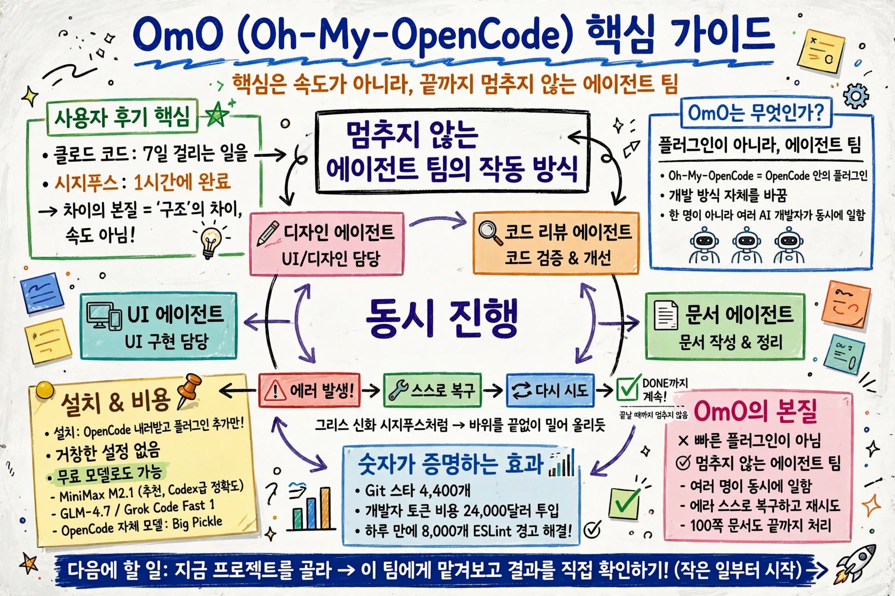
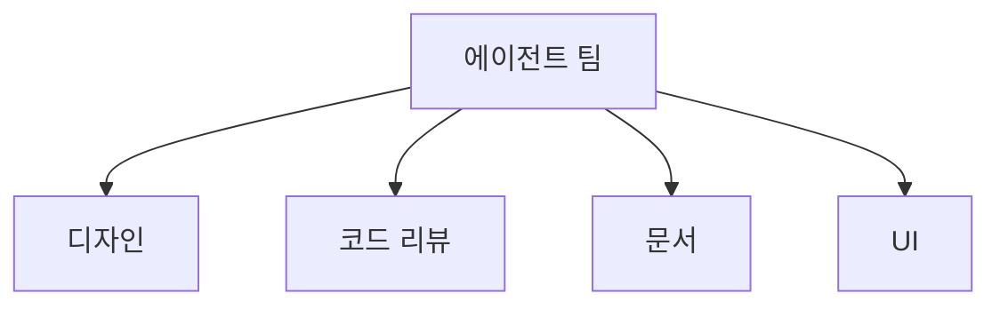
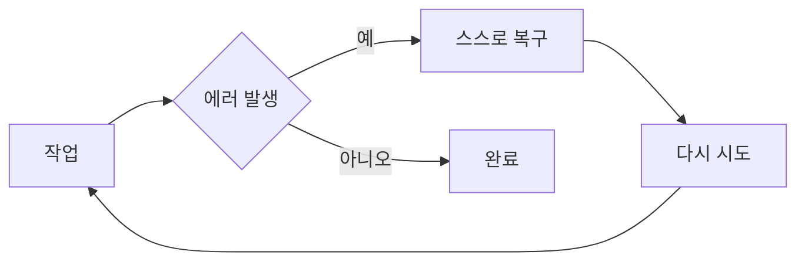

# Oh My OpenCode: 클로드 코드가 7일 걸리는 일, 시지푸스는 1시간에 끝냅니다

> **Summary**
> Oh My OpenCode는 여러 AI 에이전트가 디자인, 코딩, 리뷰, 문서 작업을 동시에 수행하고 오류가 나면 스스로 복구하며 완료까지 반복하는 OpenCode 플러그인입니다. 무료 모델로도 사용할 수 있으며, 반복적이고 복잡한 작업을 효율적으로 처리하는 것이 핵심입니다.

---

- 클로드 코드가 7일 걸리는 일을 시지푸스는 1시간에 끝낸다는 사용자 후기가 나왔습니다. 핵심은 속도가 아니라, 끝까지 멈추지 않는 에이전트 팀입니다.
- 디자인·코드 리뷰·문서·UI를 여러 에이전트가 동시에 맡고, 에러가 나면 스스로 복구하고 다시 시도합니다.
- 설치는 OpenCode를 내려받아 플러그인을 추가하는 게 전부이고, 무료 모델로도 쓸 수 있습니다.

## 혼자 코딩하는데, 옆에 팀이 생겼습니다?

혼자 코딩하다 보면, 설계하고 구현하고 문서 쓰고 리뷰까지 혼자 다 해야 할 때가 있죠. 손은 두 개인데 할 일은 네다섯 개입니다. 그런데 OpenCode 안에 여러 명의 AI 개발자를 동시에 굴리는 구조가 있다면 어떨까요? "클로드 코드가 3개월짜리 일을 7일에 해준다면, 시지푸스는 1시간에 해준다." 과장처럼 들리죠? 그런데 이건 과장이 아니라 구조의 차이였습니다!

🎥 [동영상 보기](https://www.youtube.com/watch?v=uuV1DcvObsg)

## 플러그인이 아니라, 에이전트 팀입니다

Oh-My-OpenCode, 줄여서 OmO는 OpenCode 안에서 돌아가는 플러그인입니다. 그런데 "조금 편해지는 플러그인"이 아닙니다. 개발 방식 자체를 바꾸는 도구입니다. 핵심은 하나입니다. 에이전트 한 명이 아니라, 여러 명의 AI 개발자가 동시에 일합니다!

디자인은 디자인대로, 코드 리뷰는 코드 리뷰대로, 문서와 UI는 각자 맡은 일을 합니다. 혼자 코딩하는데 옆에 팀이 생긴 기분, 그게 이 도구의 첫인상입니다. 그런데 팀이 생겼다고 끝이 아닙니다. 이 팀은 멈추지 않습니다.

## 멈추지 않는 게 진짜 차이입니다

에이전트 도구를 쓰다 보면 제일 답답한 순간이 있습니다. 중간에 멈추는 순간입니다. 에러 하나에 손을 놓고, "어떻게 할까요?" 하고 되묻는 순간이죠. 시지푸스는 다릅니다. 끝날 때까지 갑니다. 에러가 나면 스스로 복구하고, 안 되면 다시 시도합니다. DONE이 될 때까지요!

이름도 그래서 시지푸스입니다. 쉬지 않고 일하라는 뜻을 담았다고 합니다. 그리스 신화의 시지푸스가 바위를 끝없이 밀어 올리듯, 이 에이전트는 멈추지 않고 일을 밀어붙입니다. 이름 하나에도 설계 철학이 들어 있습니다.

일이 끝나면 보고서도 씁니다. 뭘 했는지 정리해서 보여주고, 코드 리뷰로 검증한 뒤, 부족하면 다시 고쳐서 더 나은 코드를 만듭니다. 설계부터 구현, 검증까지 한 번에 이어지는 구조입니다. 그래서 단순한 작업보다 복잡한 프로젝트에서 더 빛납니다. 100쪽이 넘는 문서도 처리한다고 합니다. 문서가 길어질수록 사람이 놓치는 게 많아지는데, 에이전트는 끝까지 읽고 일합니다.

## 숫자가 말해주는 것들

숫자를 보겠습니다. Git 스타 4,400개. 개발자가 토큰 비용으로만 24,000달러를 쏟아부으며 만들었다고 합니다. 스타 수도, 들어간 비용도 "조금 만져본 플러그인"의 규모가 아닙니다.

사용자 후기도 있습니다. 단 하루 만에 8,000개의 ESLint 경고를 해결한 후기입니다. 8,000개입니다! 사람이 하나하나 잡았다면 며칠이 걸렸을까요? 물론 모든 작업이 이렇게 되는 건 아닙니다. 그래도 숫자가 가리키는 방향은 분명합니다. 반복 작업, 지루한 작업일수록 에이전트가 잘합니다.

## 무료 모델로도 쓸 수 있습니다?

비용이 걱정되시죠? 좋은 소식이 있습니다. 무료 모델로도 쓸 수 있습니다. MiniMax M2.1이 가장 추천되고, 정확도는 Codex와 비슷하다고 합니다. GLM-4.7, Grok Code Fast 1도 있고, OpenCode 자체 모델인 Big Pickle도 있습니다. 유료 모델이 없어도 시작할 수 있다는 뜻입니다.

설치도 간단합니다. OpenCode 홈페이지에서 내려받은 뒤 플러그인을 추가하면 됩니다. 거창한 설정은 없습니다. 클로드 코드를 쓰고 있다면, 한번 써볼 만합니다.

## 정리하면

OmO의 본질은 "빠른 플러그인"이 아닙니다. 멈추지 않는 에이전트 팀입니다. 여러 명이 동시에 일하고, 에러를 스스로 복구하고, 끝까지 갑니다. 그 결과가 7일짜리 일을 1시간으로 줄인 후기입니다.

작은 일 하나부터 맡겨보면, 이 팀이 뭔지 바로 알 수 있습니다.

